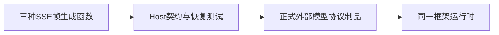

# 目标测试支持边界

测试支持只生成确定性的协议帧，不拥有Agent、服务端模型替身、ACP/stdio/PTY宿主、环境覆写或进程生命周期。真实推理验收走用户指定连接，不能将夹具中的固定usage当作真实用量。

| 保留契约 | 验证 |
|---|---|
| chat_completion_script_exact | 空白/Unicode/空文本逐字保留，模型标识、usage帧与DONE顺序 |
| chat_completion_events_exact | Axum编码与脚本帧一致，不丢终止标记或文本字节 |
| chat_completions_reasoning_then_tool_call_events | 推理帧、调用ID/名称/原始参数和工具结束顺序 |

只保留这些被目标Host使用的协议行为，不保留旧产品驱动API或兼容导出。依赖目标为普通/构建内部包仅自身；Host含开发依赖的闭包不得再出现nofy-acp-lib。执行器真正使用的tty-utils进程组终止/隔离不属于旧测试宿主，不因名称而删除。CLEAN4d先在原实现运行契约，再删除旧模块并对同一契约、Host完整默认回归及闭包验证；不将测试包收敛当成唯一预设或全源码树清理完成。
