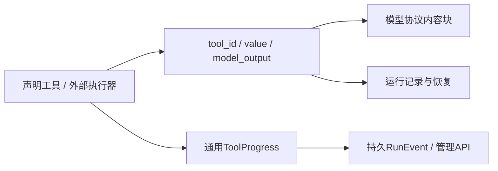

# 中立工具契约边界

目标是声明式Agent框架的工具执行契约，不是旧Computer Hub、Shell或UI卡片的兼容API。业务通知、内置子Agent提示词和产品任务DTO不属于内核公共类型；工具能力与提示词由外部系统声明、代码制品和预设提供。

| 决策 | 契约 | 边界 |
|---|---|---|
| 类型擦除输出 | 只有tool_id、value、model_output | value保留任意业务JSON；model_output为Text/Image/Resource块，默认从结果提取，可由类型化工具明确提供 |
| 客户端展示 | 管理API读取运行事件与工具值 | 不由内核拼接厂商ChatCompletion、UI卡片或计划/LSP/Bash业务通知 |
| 业务事件 | 通用ToolProgress及运行事件 | 业务语义由外部模块定义，不增加内核通知枚举或第二套无界通知总线 |
| 模型内容 | 通用内容块/MCP结果提取 | 不识别旧ToolRunResult字段组合，不隐藏业务JSON兄弟字段；旧类型专用extractor删除 |
| 子Agent | 统一框架的声明与装载路径 | tool-types不含旧任务工具输入/输出、默认Explore/Plan/General提示词或模板渲染feature |
| 工具身份 | ToolId / ToolCallId / IdError | 工具定义与单次调用分离；不包含Hub连接、用户、握手或注册标识 |
| 能力元数据 | ToolCapabilities / StreamingSpec / ToolScope | 不承担权限授予、主从路由或沙箱隔离；未知字段拒绝，生命周期由框架Hook模块负责 |
| 错误 | ToolError(kind, detail, details) | 直接使用现有规范序列化，source仅供进程内调试；无ToolErrorWire投影、伪造unknown工具ID或业务RenderLimited分类 |

类型擦除输出的根Schema为object，required为`tool_id`、`value`、`model_output`，additionalProperties为false。tool_id使用现有ToolId验证，value不限制业务形状，model_output沿用现有ContentBlock格式。旧开发期UI字段不得静默忽略或转为兼容字段；不支持的根字段反序列化失败。现有框架工厂始终生成上述三字段，移除的可选字段此前为None且不写入记录；仍须以实际旧检查点恢复证明，而不是仅推断兼容。

三套外部模型协议在同一tool_parts执行此契约：只有恰好包含tool_id/value/model_output且类型匹配的三字段对象才是执行信封；普通业务对象中的value键不触发解包。显式模型内容块优先，不允许prompt_text等业务字段覆盖；原始MCP结果的structuredContent与内容块共同送达模型。字段名称本身不产生旧产品语义。真实补验已发现并复现原共享程序的覆盖缺陷，修复前请求只剩banner；修复后的三协议请求用例和真实私有结果往返均保留完整值，失败证据保留。

CLEAN4b删除通知模块、旧渲染输出/提取器/产品特判及task/lenient任务类型，并修正外部三协议工具内容。CLEAN4c继续删除Hub会话、连接、握手、JSON-RPC帧、注册、通知、输出及错误线协议，保留工具身份与通用能力。tool-protocol不再依赖tool-types或任何其他内部包；tool-runtime直接拥有错误，不增设传输别名或重导出。

ToolCapabilities的根Schema仅含streaming、supports_cancel、max_concurrency、is_read_only、behavior_version、max_frame_bytes、timeout_ms、tool_scope，均可省略；布尔默认false，其他默认None。StreamingSpec必须含subkind，可含max_delta_bytes；两者additionalProperties均为false。ToolId保持单名或namespace:name、ASCII字母数字下划线连字符的既有规则，ToolCallId保持非空字符串并提供UUID v7生成。ToolError保留14种通用错误及既有Serde格式；details不注入、覆盖或展开code，Some(JSON null)仍按原Option<Value>语义解码为None。生命周期钩子由框架自身HookBus负责，不保留旧Hub钩子枚举。

本阶段不改变新框架已支持的声明、检查点、generation或回滚格式。旧项目调用方随源码清理淘汰，不修补旧入口。旧源码树、完整预设、资源及进程级隔离仍未完成，不能将这些公共契约收敛当作全目标交付。
