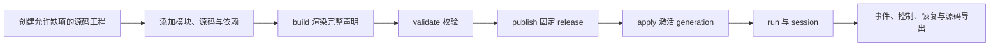

# Agent 开发手册

本轮全部缺口的实现与真实模型证据见[缺口验收记录](../verification/kernel-gaps-2026-11-05.md)。通过 MCP 创建 Agent 从[装配指南](assembly.md)开始。

版本：`nofy.kernel/v1`，契约 `0.6`。本阶段实现 Rust CLI、入站 MCP、共用客户端、允许缺项的源码工程、Session 模块化和模块仓库。集中验收结果以[CLI/MCP 实现记录](../verification/agent-development-cli-mcp.md)和[Session 实现记录](../verification/session-modularization.md)为准；当前发布不包含前端。

| 入口 | 内容 |
|---|---|
| [MCP 装配指南](assembly.md) | 无须框架源码的创建、公开参数、接线、运行与排错 |
| [交互进程与网络](process-sessions.md) | PTY、终端回执、stdio MCP 和受控代理 |
| [权限](permissions.md) | 规则、命令分析、审批记忆与撤销 |
| [会话分支](session-branches.md) | fork/rewind 和历史效果边界 |
| [子任务与通信](agent-collaboration.md) | 并发子 Agent、持久消息与恢复 |
| [问询与升级](human-and-escalation.md) | Human 回答、受控较宽执行编排 |
| [输入队列](input-queues.md) | steering/follow-up 与消费模式 |
| [模型策略](model-resilience.md) | hosted tools、图片回退、重试与续写 |
| [清理](cleanup.md) | 声明删除、字段移除、版本撤下及缓存回收 |
| [CLI](cli.md) | 连接配置、工程/模块编辑、构建发布、运行、会话、退出码 |
| [模块](modules.md) | 类型、插槽、依赖、源码绑定、完整 Rhai 工具 |
| [模块仓库](repositories.md) | 来源登记、不可变版本、声明组合、共享源码与离线导出 |
| [Session](sessions.md) | 规则/源码策略、20 项操作、接纳、生命周期与恢复 |
| [MCP](mcp.md) | stdio、Streamable HTTP、Codex 配置、工具与归档资源 |
| [协议](protocol.md) | 结果信封、精确版本、并发更新、权限、幂等和部分完成 |
| [操作目录](operations.json) | 98 项操作，其中 96 项开放为 MCP 工具 |
| [契约 Schema](contracts.schema.json) | CLI/MCP 共用输入输出；原生 DTO 仍由内核校验 |
| [HTTP 索引](http-api-index.json) | 从当前源码提取的方法、路径和行号；不代表运行实例已经升级 |
| [文件说明](文件说明.md) | 文件职责及证据范围 |

## 安装与连接

```sh
cargo build --locked -p nofy-cli -p nofy-agent-host
./target/debug/nofy --help
./target/debug/nofy describe \
  --endpoint http://127.0.0.1:7331 \
  --token-file "$NOFY_ACCESS_TOKEN_FILE"
```

`NOFY_ACCESS_TOKEN_FILE` 指向实际私有令牌文件，Unix 权限为 0600。也可用 `--token-env NOFY_ACCESS_TOKEN`。客户端和服务端访问令牌与模型 API key 分开配置。

启动独立内核时，`access.json` 只保存令牌环境引用和作用域，例如：

```json
[{"token_env":"NOFY_KERNEL_ACCESS","scopes":["read","edit","publish","resources","execute"]}]
```

```sh
./target/debug/nofy-agent-host \
  --state-dir "$NOFY_STATE_DIR" \
  --access-file "$NOFY_ACCESS_FILE" \
  --preset-dir "$PWD/presets" \
  --module-dir "foundation=$PWD/modules/agent-foundation" \
  --listen 127.0.0.1:7331
```

状态路径和访问配置须使用实际绝对路径；内核访问令牌至少 32 个非空白字节。连接已有实例时不重复占用其地址或状态目录。源码模板由显式 `--preset-dir` 登记；当前登记 `coding@0.1.0` 基线源码模板。pi 的参考提交和复现验收仍独立进行，不能把 coding 改名后宣称 pi 已完成。

## 开发路径



源码事实位于 `preset.json` 与显式文件集合；本地副本由 CLI 明确读写，托管工程由内核保存。CLI 与 MCP 共用相同编辑引擎，发布和运行走现有内核路径。空 Agent 没有虚构的默认模型或运行环境。

源码工程的 revision 检查只用于避免同时编辑覆盖，属于本地实现，不依赖商业 CAS 产品或外部认证服务。源码归档仅收集声明文件、外部模块源码和普通依赖清单；用户安装外部依赖。打包不执行项目脚本、不检查工具版本、不打包 Python/GCC/库，也不设置包体配额。

早期 [0.1 手册设计检查](../verification/agent-development-handbook.md)与[0.2 Session 设计检查](../verification/session-modularization-design.md)保留其原始范围，不作为新版二进制互通证据。

- [命令、交互终端与 stdio MCP](process-sessions.md)
- [Session 分支与历史回退](session-branches.md)

- [权限规则与审批记忆](permissions.md)
