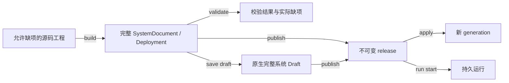

# 开发协议与数据字典

版本：`nofy.kernel/v1`，契约 `0.6`。CLI、MCP、源码工程与 Session 控制接同一内核。构建和实例能力见[总入口](README.md)，实际检查见[实现记录](../verification/agent-development-cli-mcp.md)。

## 数据对象与生命周期

| 对象 | 身份 | 说明 |
|---|---|---|
| 源码工程 | project_id + source_revision | 保存声明模板、源码、依赖说明和参数，允许尚不完整 |
| 本地工作副本 | source_digest | 同一格式的本地文件集合；写入前核对原像，不悄悄推送远端 |
| 模块 | 系统图内 ModuleRef + 实际配置/工厂身份 | 版本和依赖随声明冻结；跨系统不能仅凭同名认定相同 |
| 原生 Draft | name + revision | 当前 SystemDocument 的编辑记录；不直接承载字段缺失的 Agent |
| 发布 | release | 完整声明、依赖及程序快照的不可变身份 |
| 激活 | system + generation | 指向某个 release 的当前激活事实 |
| 运行 | run_id + thread_id | 原 ManagedRunRequest 与持久执行记录 |
| 会话 | session_id + session_revision | 原运行绑定、顺序与续轮事实；session_revision 是元数据版本，区别于原运行 live revision |
| 会话策略 | policy_revision + 冻结模块闭包 | Agent.session_policy 选择规则/源码，内核验证建议后提交 |
| 管理命令 | command_id | 原请求与回执；相同 ID 不允许不同内容 |
| 观察位置 | cursor | 内核返回的精确游标，不能自行推算 |

已有原生 AgentDefinition 强制要求 model 和 prompt，见 [compile.rs](../../crates/common/nofy-agent-runtime/src/compile.rs)。源码工程必须通过模板/未绑定引用保存真实缺项；不得为了允许 create 而给内核编造默认模型，也不得弱化可发布声明的校验。

## 源码工程 HTTP 能力

源码工程由内核控制面统一管理。CLI 与 MCP 通过相同 project ID、revision 和文件集合编辑；前端暂停。已注册入口：

| 方法与路径 | 内容 |
|---|---|
| POST /api/v1/projects | 创建空工程或版本化模板 |
| GET /api/v1/projects | 分页列举源码工程 |
| GET /api/v1/projects/{id} | 原 revision、源码及缺项 |
| POST /api/v1/projects/{id}/edits | CAS 提交注册的 Agent/模块编辑操作 |
| POST /api/v1/projects/{id}/build | 纯渲染，输出完整部署或缺项 |
| POST /api/v1/projects/{id}/preview | 只读比较候选声明和当前激活版本 |
| GET /api/v1/projects/{id}/source | 导出源码与普通依赖说明 |
| GET /api/v1/presets / {id} | 模板目录与指定版本源码 |
| POST /api/v1/projects/{id}/archive | 登记托管源码归档 |
| POST /api/v1/source-archives | 登记明确源码集合的归档 |
| GET /api/v1/source-archives/{digest} | 仅登记归档的流式下载 |
| GET /api/v1/source-archives/{digest}/chunks | 显式 offset/total/eof 的 base64 分块 |

这些路径由 Host 注册并列入源码路由索引。源码编辑只执行内置的纯数据变换；不会执行上传源码、项目提供的构建脚本或依赖安装命令。真正工具执行仍归原 Loader/Worker/权限/预算路径。

本地离线编辑使用共用项目组件。转换为内核工程时明确上传并带预期 revision；导出是显式操作。不同目标不自动覆盖对方；二者共享声明格式，不维护另一套隐藏 Agent 配置。

## 输入格式

### Session 模块化契约

完整方案见[架构](../architecture/session-modularization.md)与[操作手册](sessions.md)。SessionPolicy 是原生种类；Agent 声明 v2 提供可选 session_policy 引用，v1 声明不能携带该 v2 策略字段。存储复用运行库资源，命名/接纳/路由/归档建议由规则或纯程序表达。

`SessionStart` 创建时 expected_session_revision=null；`SessionCreate` 只含 session_id/root_run_id 并映射现有首根接纳请求。`SessionTurn` 新增 expected_session_revision，request_json 仍保存原 SessionTurnCommand；其原命令和原源/绑定版本不变。`SessionTurns` 的 after 为十进制 sequence，不复用按 id 列会话的 after。

`SessionState`、`SessionCommandReceipt` 及专用 Result 定义了模块化视图，原生响应与客户端共用这些字段。命令回执按原 ID 查询，prepared/applied/rejected 与运行结果区分。route/plan 不写入运行、版本或队列；close/reopen/archive/unarchive/reconfigure 在明确静止边界按 CAS 提交。reconfigure 保留预算/历史身份，后继种子冻结所选策略；详细前提见专册。

会话 HTTP 路径均记为 native_routes；GET /api/v1/sessions/capabilities 报告 session-policy ABI、声明版本、20 项操作和输入/输出 Schema。客户端调用会话操作时核对协议，不使用旧线格式后备。

受支持旧状态使用明确版本解码和显式迁移回执；保留原不可变提交/预算证据，进入同一内部执行模型。更换策略是新版本提交，存储位置变化是原 runtime-history 迁移；不通过删除会话元数据撤销预算使用。

### 通用输入

完整输入 Schema 见 [contracts.schema.json](contracts.schema.json)。

| 名称 | 定义 |
|---|---|
| Target | 托管 project_id 或明确传入的源码文件集合；写入携带原 revision/digest |
| SourceFiles | 归档内相对文件名到字节描述的映射，encoding=utf8/base64，记录 executable 意图 |
| ModuleAdd | agent、target、slot，以及模块引用、原生模块 JSON 或 factory/config/dependencies 的一种 |
| NativeJson | 严格 UTF-8 JSON 文本；用于完整部署、原生审批/命令/会话等已有 DTO，保留大整数 |
| Plan | 已发布的 system/release；源码预览使用独立 preview，不隐式发布 |
| Apply | command_id、system、release、expected_generation |
| Events | run_id、原 cursor、limit、有限 wait |

JSON 文本和文件正文均为数据，不递归解释成模板命令、shell 命令或凭据引用。模板解释精确 `$file`、`$json`、`$parameter`、`$module`、`$when`，以及 pure prepare 的 lookup/merge/select/if/concat 等受限数据表达式；`$literal` 和用户配置明确保持字面数据；原生部署按原 Schema 处理。

文件集合拒绝绝对路径、父级逃逸、重复名称与特殊文件描述。源码包保留原字节和执行意图，默认不检查业务源码语法、依赖安装位置、工具版本或包体大小。运行时/传输层的显式资源边界与源码包体配额不同；大源码需要流式制品传输，不能静默截断。

## 公共结果信封

| 字段 | 类型与语义 |
|---|---|
| protocol | 固定 `nofy.kernel/v1` |
| operation | 操作目录中的唯一 ID |
| status | ok / accepted / unconfirmed / error |
| data | 经该操作 Schema 映射的业务结果；可为对象、数组、标量或 null |
| error | null 或 code/message/details；不携带秘密值 |
| refs | 原 project/source revision、command/run/thread/release/generation 等无损身份 |
| next_cursor | 原分页游标的无损字符串或 null |

所有字段都出现在信封中，缺省值使用 null 或空 refs。MCP structuredContent 放整个对象；CLI 默认 stdout 输出同一对象。纯编辑也返回实际修改内容/文件集合，不只返回“成功”文字。

status 描述这一次协议操作，data 中保留实际执行状态。accepted 表示已接纳；运行中、审批停驻、预算停驻、失败与外部效果由原业务状态表达。对工具返回的 ok/isError/退出码仍按其契约检查。

## 精度、版本与并发

控制元数据 generation、revision、sequence、cursor 等在适配层按 Schema 转为精确字符串，必要时无损转换到原 API 数值。操作目录的具体字段映射必须显式，不能扫描业务 JSON 中同名字段后改写。声明、设置和用户数据以原 JSON 文本/制品传输，避免 JS 浮点数破坏整数。

源码编辑带 expected source revision；原生草稿带 expected_revision；激活带 expected_generation。首次创建以 null 表示预期不存在，字符串 `"0"` 表示数值零，不等价于不存在。

CLI 可先读版本再提交，但只能做一次带原版本的 CAS，不遇冲突后自动覆盖。MCP 明确传递原版本。源码/声明冲突与传输失败分别报告。

## 幂等与部分完成

| 操作 | 重试依据 |
|---|---|
| 查询、Schema、校验、纯构建 | 无业务派发，可按原输入重新查询/计算 |
| 源码写入/原生 Draft | 原 revision + 相同输入；不以自动取新 revision 代替冲突处理 |
| 发布 | 保留返回的 release，查询实际目录；不假定任意发布请求都有 command_id 幂等 |
| apply / 管理动作 | 原 command_id + 完整原请求，查询原回执 |
| run start | 原 run_id + 完整原请求；不同请求不能复用 ID |
| 原生 cancel | 原 cancel command_id 与原运行，不替换成新运行 |
| 审批/恢复 | 精确原请求或票据，以及真实外部证据 |

MCP JSON-RPC id 不是业务幂等键。发送写请求前 CLI/Server 固定并保留业务 ID；未确认结果返回 unconfirmed 与可查询标识，不用新 ID 自动重发。

`agent apply` 等组合入口不拥有跨多个 HTTP 请求的原子性。返回已完成阶段、已产生 release/command_id 和未完成部分；发布成功而激活冲突时，已发布版本仍真实存在。源码回滚、generation 回滚和外部效果补偿是不同动作。

## 错误与权限

保留现有原生错误码：unauthorized、forbidden、not_found、conflict、busy、unavailable、runtime_conflict、invalid。客户端补充 local_input、local_io、unsupported_operation、unsupported_protocol、result_unconfirmed 等适配器错误，并标明来源，不把本地报错伪装成内核响应。

权限沿用 read/edit/publish/resources/execute；具体组合由内核判定。原生完整声明保存、发布或激活含 Resource 时可能要求额外 resources 权限；源码编辑只保存数据，不装载或执行资源。工具的安全注解不授予这些权限。CLI 的密钥注入从 stdin/指定私有文件读取，公开结果只含引用及 metadata；普通 MCP 开发工具不接触密钥正文。

模型 API 令牌用于模型连接，内核访问令牌用于调用控制面，两者职责独立。客户端配置和源码工程仅保存引用；HTTP MCP 桥接转交请求方身份，不使用固定管理员身份替所有请求执行。

## 原生 DTO 对照

| 操作 | 当前依据 |
|---|---|
| 发布、草稿、计划与激活 | [Host API](../../crates/common/nofy-agent-host/src/api.rs)、[control.rs](../../crates/common/nofy-agent-runtime/src/control.rs) |
| 原生系统与发布锁 | [system.rs](../../crates/common/nofy-agent-runtime/src/system.rs) |
| 模块与工厂 | [registry.rs](../../crates/common/nofy-agent-runtime/src/registry.rs) |
| Agent 必填字段与插槽 | [compile.rs](../../crates/common/nofy-agent-runtime/src/compile.rs) |
| 运行和管理动作 | [managed.rs](../../crates/common/nofy-agent-runtime/src/supervisor/jobs/managed.rs)、[运行 API](../../crates/common/nofy-agent-host/src/api/runs.rs) |
| 会话 | [会话 API](../../crates/common/nofy-agent-host/src/api/sessions.rs) |
| 凭据 | [凭据 API](../../crates/common/nofy-agent-host/src/api/credentials.rs) |

NativeJson 入参只负责无损传输；解析后仍按原生 DTO 和权限进行校验，不代表允许任意字段。工厂的实际配置与派生依赖由 schema 操作返回；NativeJson 内部 DTO 的出处见上表及各操作手册，不将任意 JSON 字段当成已获支持。

原生 DTO 对应请求选中的 endpoint/view。run.inspect 默认传 view=status，原生响应标识为 nofy.run-status/v1，并显式标记输出预览的 bytes/truncated；view=full 才返回原完整运行视图。HTTP GET /api/v1/runs/{id} 未指定 view 时返回完整视图，?view=status 返回状态视图。状态查询在数据库投影状态和受限文本，不反复反序列化实现快照。agent.apply 默认仅保留 publication 身份/读取指令；完整发布 DTO 按 include_publication:true 显式读取。

## 实施与验收要求

完整功能块交付实现、接线、说明和案例后集中验证：

1. 空工程逐步加模块、检查缺项、完整构建、发布、运行和源码导出；普通模块变化不重启内核或重编译 Rust。
2. CLI/MCP/HTTP 观察同一托管源码 revision、release、generation 和运行回执。
3. 三种模块添加方式得到等价接线；不把 Resource 误挂成 Tool，不悄悄删除使用者。
4. CAS、超过 JS 安全整数的控制值、重复命令、写请求失联和已成功效果都保持原语义。
5. stdio stdout 纯协议；HTTP 与 stdio 使用同一操作引擎，权限不因桥接增强。
6. JSON/Schema/工具目录与实际服务一致；CLI help 和 MCP tools/list 从同一契约产生或逐项校验。
7. 真实 Codex MCP 客户端完成一次完整开发闭环，不能用自制协议服务代替客户端互通验收。
8. pi 另按固定提交和完整差异矩阵验证；本接口手册完成不代表 pi 预设完成。
9. SessionPolicy 装载、命令幂等、首根原子创建、直接 Run/NextTurn 的统一策略检查及轮次间切换按[专门方案](../architecture/session-modularization.md)验收；会话/策略/source/binding 各自版本不混用。

手册内部链接、JSON/TOML 示例、Schema 引用和操作映射在一次文档检查中集中验证；不运行与本次文档变化无关的整个 Rust 工作区。

源码工程写入使用本地文件锁、原 revision 检查和原子替换；CAS 指比较后更新，不是第三方产品。该机制不自动合并不同编辑，也不因冲突重发或覆盖。控制数字按原生 u64 范围转换，超过 JavaScript 安全整数仍用精确字符串；NativeJson 保留原始 DTO 文本，普通业务 JSON 不按同名字段递归改写。

run.inspect 的 refs.live_revision 在尚无 live 更新记录时明确为 "0"，对应原生更新契约的初始版本；data.native_json 中原 live=null 表示保持原样。budget.list 和 runtime_sources 使用内核返回的 next 原值；artifact/image 页以原 digest 继续。runtimes 返回原生完整清单，不能传分页参数。

## 源码模板表达式

project.json 是工程头，format=nofy.project/v1，declaration 指向唯一声明；settings、settings_schema、prepare 分别指定参数、默认值 Schema 和纯数据推导文件。source-files.json 显式列举归档文件，包含它自身；不扫描工作目录中的依赖或其他未声明文件。

prepare.json 的 parameters 对象将参数名映射到以下表达式；`$parameter` 读取推导后的值并检测循环，`$setting` 只读原参数。参数 Schema 的 default/properties 用于默认值收集，工厂和部署的最终校验仍由内核执行。

| 表达式 | 形状和结果 |
|---|---|
| $literal | `{ "$literal": VALUE }`，整个 VALUE 保持字面数据 |
| $file | `{ "$file": "relative/file" }`，构建时读取 UTF-8 正文 |
| $json | `{ "$json": {"path":"relative/file.json","pointer":"/field"} }`，读取 JSON 值；结果不再递归解释 |
| $setting | `{ "$setting": "/pointer" }`，读取原设置 |
| $parameter | `{ "$parameter": "/derived/path" }`，读取设置或推导参数 |
| $module | `{ "$module": "source-id" }`，解析模块引用；自动版本随配置及依赖内容变化 |
| $when | 列表项 `{ "$when": {"parameter":"/enabled","value":VALUE} }`，布尔参数决定是否包含 |
| $lookup | `{ "$lookup": {"value":EXPR,"key":EXPR} }`，按字符串键取对象成员 |
| $merge | `{ "$merge": [EXPR,EXPR] }`，从左至右深合并对象 |
| $values | `{ "$values": EXPR }`，对象成员值转数组 |
| $concat | `{ "$concat": [EXPR,EXPR] }`，连接数组 |
| $coalesce | `{ "$coalesce": [EXPR,EXPR] }`，取第一个存在且非 null 的值 |
| $if | `{ "$if": {"condition":EXPR,"then":EXPR,"else":EXPR} }`，按布尔值选择分支 |
| $select | `{ "$select": {"items":EXPR,"field":"/field","equals":VALUE,"value":"/result"} }`，筛选数组并提取值；可用 not_equals，或省略 field/比较而只提取 |
| $configure | `{ "$configure": {"base":EXPR,"set":{"/pointer":VALUE},"source_bindings":{"/source":"relative/file"}} }`，对基础配置应用字面覆盖和明确文件绑定 |

set/config/config_json 是用户数据，不递归解释模板关键字。只在声明模板表达式位置解释这些节点。CLI 编辑生成 configure/literal 节点并维护源码清单，不调用 prepare.py、build.py 或任何项目脚本。

打包与构建分开：包收齐模板引用的文件并保留原字节，不检查模块脚本、模块 JSON 或运行参数文件是否可执行/可解析。工程头和源码清单用于定位与收集文件；真正的 `$file` UTF-8、`$json` 解析与工厂配置检查在构建/校验时进行。读取未编辑的只读模板不创建锁侧文件。

模块仓库操作及 `agent.module.use/unuse` 见[模块仓库手册](repositories.md)。声明保存固定版本引用，导出收齐源码；运行依赖由用户提供。

审批与恢复的原生 JSON 示例：先用 run.approvals 读取完整 request，再向 run.decide 的 decision_json 序列化 `{ "request": <原请求对象>, "allow": true, "scope": "once" }`。恢复使用 run.control 的 action_json：`{ "run_id": "原根运行", "command_id": "唯一命令", "command": { "kind": "resume" } }`，kind 位于 command 内。用 action.inspect(command_id) 查询命令结果。schema(operation=run.control) 另给 Human 请求的完整字段与示例，不需要读取 Rust DTO。
