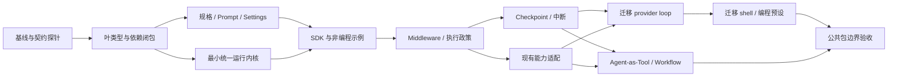

# 可组合 Agent 框架实施蓝图

> 2026-10-28 状态纠正：本蓝图保留前轮设计与阶段记录。公共 SDK 和兼容适配已实现，但不代表 Hook、完整记忆、配置装配和嵌套执行等全能力已闭环。后续施工以[全能力模块化闭环计划](2026-10-28-agent-modularity-closure.md)为准；不得据前轮阶段通过宣称整体完成。

- 状态：公共模块、具名阶段与原预设阶段验收通过；2026-10-27 调研基线 `65ed83b8`。
- 分支：`research/modular-agent-framework`。
- 目标：应用通过组件组合构建不同用途 Agent；Nofy 编程能力成为可选预设。
- 非目标：本轮不做 TUI/前端、不迁移到 Python、不实现完整通用图引擎或动态库插件系统。
- 先读：[调研与契约](../../architecture/2026-10-27-composable-agent-framework-research.md)、根 `AGENTS.md`、根 `.ai_project.md`。
- Owner：Agent 框架维护者。Read When：实施任一工作单元前。
- Update Trigger：工作单元完成、依赖/接口/回滚边界改变。Validation：任务验收证据与源码同步。

## 1. 原则与集成门槛

按阶段集中做 GitNexus upstream impact、构建和回归验证；同一分析覆盖的变更集合不逐函数重复检查，扩大公共契约或依赖范围时补充分析。HIGH/CRITICAL 先报告再编辑。图有 Rust 漏边，必须补源码调用方。提交前运行 detect_changes。工作单元是依赖顺序，不自动授权合并、开 PR 或平行代理。

用户最终验收：模块化完成，原始 Agent 预设以原有入口和配置直接运行，行为保持兼容。非编程示例仅是中途验收，不代替原始预设完整验证。允许把关联工作单元组成较大阶段后集中验证。

第 3 节保留最初工作单元的设计范围；实际实现、合并的模块与后续扩展见本节和使用指南。根 Cargo.toml 是生成文件，新包通过已有 member 的 path dependency 自动登记。

允许每阶段迁移多个相关行为切片，旧入口留 shim。架构回滚通过切回旧 adapter/执行入口完成，不能重置无关用户改动。涉及真实副作用的两条执行路径禁止双跑比对；只使用 mock/model transcript 做差分。

## 2. 依赖图

## 3. 工作单元

### P0：冻结契约与可重放行为基线

- Depends on：无。
- Files：本调研、`README.md`、`scripts/`、根 `Cargo.toml` 只读核查；`nofy-shell/src/session/acp_session_impl/{turn,tool_calls,sampler_turn,spawn}.rs`；`nofy-shell/src/agent/{provider_host,pack_join}.rs`。
- Change：记录交互/provider 两条路径的能力差异；定义 Run/Thread/Step/ToolCall/Child ID、取消、预算、事件顺序、middleware 与 checkpoint 的契约测试。查明 workspace members 的生成入口，或明确包内过渡位置。
- Verify：用 scripted model 固定“模型→两工具→模型结束”“取消”“审批暂停”“结构化输出”“超限/重试”轨迹；区分两宿主原本不同的策略，不强行归一；先捕捉旧行为再改。
- Gate：新增包登记方案明确；provider item round-trip 与 LocalSet bridge 各有最小可编译探针。
- Risk / rollback：只有基线与探针，不切生产路径。
- Cold start：已有两个循环，目标是共用机制、允许宿主选不同策略；不要删掉 provider 的目标 judge。

### P1：消除中立类型层对具体工具实现的反向依赖

- Depends on：P0 的类型所有权决定；与复杂宿主探针可分阶段完成。
- Files：`nofy-tools/src/types/definition.rs`、`nofy-sampling-types/src/{types,conversation}.rs` 及两者 Cargo；已有 `crates/common/nofy-tool-types/src/{lib,types}.rs`；新增中立模块位置在 P0 决定。
- Change：将 ToolDefinition/FunctionTool 的 canonical owner 移到中立叶层，旧路径 re-export 保持 Rust 类型身份和 serde wire 形状。核查 ToolType 同名定义，不能引入第三套 schema。划分中立 model envelope 与 provider opaque payload，保留旧 ConversationItem adapter。
- Verify：旧路径/新路径类型赋值可编译；历史 JSON round-trip 不变；`cargo check --locked -p nofy-sampling-types -p nofy-sampler -p nofy-tools`；离线依赖可用时添加 `--offline`。用 cargo metadata/tree 的 normal 依赖闭包证明 sampler 不再通过 sampling-types 拉入 nofy-tools。
- Gate：去掉反向依赖；不会丢失 reasoning、hosted-tool、工具结果图片与调用 ID。
- Risk / rollback：类型高扇出；先 re-export 再迁移导入，可按叶类型切片回退。
- Cold start：目前反向边的明确触发点是 sampling-types/types.rs:392，注释称纯数据不能代替依赖核验。

### P2：规格、提示词与设置成为可组合输入

- Depends on：P1。
- Files：`nofy-agent/src/{config,builder,agent}.rs`、`nofy-agent/src/prompt/{context,user_message}.rs`、`nofy-tools/src/types/template_renderer.rs`；`nofy-config/src/loader.rs`；`nofy-shell/src/agent/config.rs` 与 `nofy-shell/src/config/reloader.rs`；新的 spec/prompt/settings 模块 planned。
- Change：AgentSpec 存引用与配置；CompiledAgent 存工厂；RunBindings 存每次运行能力。Prompt 使用只读工具/参数快照。通用 settings resolver 接受调用者提供的值，Nofy 的磁盘/env/campaign 输入留 adapter；定义 next-turn delta 和调用时 credential resolver。
- Verify：无 cwd、无 terminal、无 home 也能编译配方/渲染 prompt；工具别名与 schema 同版本；旧 prompt byte snapshot、primary/subagent、Full/Extend、压缩/fork 前缀契约保持；两个 Run 更新配置不互相改变。
- Gate：旧 AgentBuilder 仍可构建 Nofy；新规格不引用 ToolBridge、LocalFs、ACP。
- Risk / rollback：Builder / config 是 CRITICAL 迁移面，保留原门面，禁止整文件重写。
- Cold start：项目规则首次注入与系统提示词不同；不能重排成一个大字符串。

### P3：最小统一运行内核

- Depends on：P1；不依赖 shell 完整迁移。
- Files：planned core/runtime 模块；现有 `nofy-tool-runtime/src/{tool,dispatch,context}.rs` 复用；现有 sampler/chat-state 以 adapter 接入，不复制实现。
- Change：一个状态机实现 model→tool batch→model；输入 model、tool dispatcher、state writer、policy、clock/cancel 等窄能力。先支持 max-steps、统一总重试预算、最终准入和结构化 RunOutcome；不带 Todo/Goal/Plan/AGENTS.md 默认行为。
- Verify：无网络 scripted model、自定义 typed lookup 工具验证 0/1/多次工具调用、未知工具、无效参数、工具业务失败、流取消、模型失败、预算耗尽。不同工具结果必须按调用 ID 归并，不能按完成顺序错配。
- Gate：内核不 import shell/workspace/具体工具/ACP；invoke 与 stream 共用该执行路径；不用 live future 表达可恢复状态。
- Risk / rollback：新路径暂不接用户会话，旧执行路径不动。
- Cold start：先保留本地异步执行能力，不把 ?Send→Send 全量重写混在此阶段。

### P4：公共 SDK 和第一个非编程 Agent

- Depends on：P2、P3。
- Files：planned `nofy-agent-sdk` 或 P0 确定的过渡模块；planned `examples/business_lookup.rs`、`examples/research_agent.rs`；实例级组件 registry 与外部 SDK consumer fixture。
- Change：提供 Builder、compile、start、invoke/stream；工具能用已有 Tool trait 从应用代码注册；每个组件注册表独立。先用业务 lookup Agent 证明没有文件系统默认值，再用 research 配方换工具和 context source。
- Verify：两个租户并发、多工具集、多模型、多个 registry 均不串状态；缺组件/重名/schema 冲突在 compile 失败且无外部副作用；示例仅依赖公共 SDK 与明确选择的 adapter，无路径穿透调用 shell 私有模块。
- Gate：最小示例 normal dependency 闭包没有 nofy-tools、workspace、shell、daemon、pager、ACP、sandbox；添加第三个业务工具仅修改示例/工具 crate。
- Risk / rollback：API 仍 experimental；先约束使用体验，再扩大 SDK 面积。
- Cold start：这是“拼乐高”的首要验收。只有把 Nofy 跑起来但仍不能独立构建业务 Agent，不能算完成。

### P5：Middleware、工具管线与策略组合

- Depends on：P4。
- Files：planned runtime middleware/policy；`nofy-shell/src/session/acp_session_impl/{tool_calls,tool_dispatch,hook_dispatch}.rs`、`nofy-agent-lifecycle/src/{local,send}/`；现有 permissions adapter。
- Change：阶段贡献者、模型 wrapper、工具 wrapper 明确区分；固定准入和 schema 检查保护最终执行；policy 返回受限决策。统一 retry budget 所有权。外部编辑对账/业务提醒改为 batch-boundary 扩展贡献，Nofy 专属判断留预设。
- Verify：middleware 进入/退出顺序、短路、抛错；参数改写后重新准入；拒绝后所有后续调用正确结算；工具 retry 不可自动重复非幂等操作；同文件写顺序、ExitPlanMode tail barrier、pre/post/failure hook 不重复触发。
- Gate：SDK 使用者无需 SessionActor 即可安装中间件；不能经 public next handler 绕开执行政策。
- Risk / rollback：权限/取消/并行语义高风险；保留 legacy executor adapter，在 mock 轨迹上差分。
- Cold start：现有 lifecycle 是可复用事件契约，不是可直接复制的完整 middleware 调度器。

### P6：可恢复 State、Checkpoint 与人工中断

- Depends on：P5。
- Files：planned RunState/RunCheckpoint/Checkpointer；`nofy-chat-state/src/persistence.rs`；`nofy-shell/src/session/{persistence,runtime_journal}.rs`；`nofy-session-journal`；旧格式 adapter。
- Change：定义状态 revision、提交确认、checkpoint 恢复点、pending interrupt 和工具 intent/result 账本；Long-term memory 单独端口。RunContext 和 credential 不入 checkpoint。先单 writer，冲突显式返回。
- Verify：mock 注入崩溃：准入前、intent 已持久化、工具副作用已发生但结果未记账、结果已记账；恢复不得无条件重放 uncertain 写操作。审批换进程恢复、旧 schema 兼容、预算连续、历史与账本一致性、store 写失败均有测试。
- Gate：Paused 可在新进程携带 resume token 继续；没有原 oneshot/Arc 也能恢复；不声称外部副作用 exactly-once。
- Risk / rollback：新增 checkpoint 使用版本化独立存储；旧会话先走旧适配路径，禁止静默覆盖。
- Cold start：chat history、runtime journal、文件 rewind checkpoint、Rhai journal 是四类对象，各自保留语义。

### P7：现有能力作为可选组件接入

- Depends on：P5；持久化 memory 接入与 P6 对齐。
- Files：`nofy-tools/src/{registry/types,bridge}.rs`、`nofy-agent/src/{config,builder}.rs`、`nofy-mcp`、`nofy-memory`、Hub SDK、`nofy-packcore`、`nofy-orchestra/src/compile.rs`；planned coding preset / adapters。
- Change：无业务默认值的 ToolCatalog，旧 registry 包装为 coding tool pack；MCP 动态 catalog adapter；memory/context adapters；pack manifest 编译到公共 AgentSpec。保留既有 host-plane 强约束，能力声明不能提升宿主授权。
- Verify：两个 Agent 独立注册同名工具、单个 Agent 重名失败；MCP 刷新只在安全点换 catalog；in-flight 调用使用准入时 revision；逐字段验证 pack 的 model_route/tool_policy/mcp/subagents/services 为支持、显式保留给 host 或明确不支持，禁止静默丢字段。
- Gate：工具包按选择装载，默认 SDK 无全局注册/磁盘发现；连接、后台任务可确定关闭。
- Risk / rollback：先保留全局入口兼容，旧 host 的行为保持；应用新路径仅用 instance registry。
- Cold start：pack_join 当前只接 audience/persona/skills，不是完整 manifest executor。

### P8：先迁移 daemon provider 的第二套循环

- Depends on：P6、P7。
- Files：`nofy-shell/src/agent/{provider_host,pack_join}.rs`、`nofy-shell/tests/provider_loop_e2e.rs`。
- Change：run_provider_task 调用统一 Runtime；目标 judge 和 24-turn 默认作为 provider policy 保留。模型、工具、预算与事件经 adapter 提供，删除重复推进逻辑。
- Verify：原 provider 轨迹与新路径在 mock 下对照；至少一个实际 dispatch 经过模型→工具→模型→judge；失败/取消/恢复状态对 daemon 正确报告。现有 E2E 先核查其模型/服务前提再运行，不能把缺凭据 skip 当通过。
- Gate：provider 不再自己维护模型—工具 for loop；同一 Run API 可用于非编程示例和 provider。
- Risk / rollback：独立入口单点切换；保留旧执行器仅作为短期回滚路径，有移除条件。
- Cold start：不使用该路径的低图风险去推断其权限等同交互路径，adapter 必须显式提供执行政策。

### P9：迁移 shell 会话，形成 Nofy 编程预设

- Depends on：P8。
- Files：`nofy-shell/src/session/acp_session_impl/{turn,run_loop,sampler_turn,spawn,prompt_build}.rs`、session state/queue/compaction；`nofy-agent` 兼容 facade。禁止修改 pager/TUI。
- Change：SessionActor 只负责会话命令、队列、挂接、宿主通知和 Run 生命周期；身份/技能/项目规则/Goal/Todo/Plan 通过编程预设组合；主循环唯一来源是 Runtime。
- Verify：现有 `cancel_running_task_tests`、`parallel_dispatch_tests`、`prompt_queue_actor_tests`、`inline_auto_compact_flow_tests`、`idle_resume_tests`、`prompt_context_persistence_tests`、`reactive_managed_reauth_e2e_tests` 及 fork/rewind 集成测试。逐组运行 `cargo test --locked -p nofy-shell --lib <filter>`，再按实际环境跑集成测试。
- Gate：模型流排空先于工具事件、turn 终态仅一次、取消后无新副作用；恢复/fork/prefix、usage、预算与权限语义保持。仅源码分包不算过关。
- Risk / rollback：最高风险单元，按 prepare/model/tool/finish 分段接入并保留兼容入口；不在同一阶段重做线程/actor/持久化格式。
- Cold start：SessionActor 有大量共享状态，不要把它整体改名后搬入 core；新 runtime 端口必须窄。

### P10：Agent-as-Tool 与现有 Workflow 共用运行边界

- Depends on：P6、P7；不要求 UI 或 shell 完整迁移。
- Files：`nofy-workflow/src/{host,engine,journal}.rs`、`nofy-orchestra/src/{compile,dag,caps}.rs`、现有 shell workflow host；planned agent-as-tool / runnable adapter。
- Change：提供 Agent node/Tool adapter；先实现代码层 sequence/route/parallel 的最小组合，Rhai SpawnAgent 调统一 Runtime；沿用 workflow journal，不另起一套工作流恢复日志。
- Verify：父取消传播、子预算 reservation 释放/恢复、child ID 去重、capability 收窄、并行结果顺序；重放已有节点结果不再发 child；Rhai 的暂停、divergence、journal 写失败语义保持。执行现有 workflow 63 个单元测试并增加上述 adapter 合同测试。
- Gate：同一 Agent 能独立运行、作为 Tool、作为 Workflow step；更换组合不改 runtime。
- Risk / rollback：先使用已有工作流层；通用图 DSL、任意状态 reducer 和外部分布式调度另立后续决策。
- Cold start：workflow owns 步骤调度日志，Agent owns 步骤内部状态，两层 ID/恢复关系需明确。

### P11：公共包边界和最终验收

- Depends on：P9、P10。
- Files：公共 crate manifests、examples、兼容文档、root docs index；按 P0 查明的生成流程更新 workspace 注册。
- Change：检查默认 features、业务依赖、API 稳定面；移除已迁移重复 loop；标记旧 facade 生命周期和移除条件。
- Verify：最小独立消费 fixture 只依赖 SDK + mock/custom tool；research 与 coding 预设分别构建；依赖闭包检查禁止宿主/业务实现回流到 core。两个 Agent 并发隔离，三个 Agent 配方与一个组合工作流全部通过。
- Gate：新用途无需改内核；公共 API 不泄露 SessionActor、ACP、ToolBridge、环境变量或全局 registry。
- Risk / rollback：保留有明确版本与迁移文档的 facade；不根据“新代码行数”判断可删除旧路径。
- Cold start：包布局服务公共使用体验；crate 数量不是验收指标。

## 4. 验证分层与停点

1. P0/P1：模型/工具类型与旧序列化兼容。
2. P3/P4：零外部服务的最小消费者；这是第一个产品外通用性证明。
3. P5/P6：失败、取消、审批、崩溃与副作用确定性。
4. P7/P8：现有能力与较窄宿主入口集成。
5. P9/P10/P11：旧行为回归与同一组件跨 Agent/Workflow 复用。

75 个组件测试是调研基线。实施验证采用公共 runtime 契约、默认依赖闭包、shell 定向回归和真实 CLI 对照；最新命令和边界见[使用指南](../../architecture/composable-agent-runtime.md)。

## 5. 首个实施范围与未决门槛

实施已越过首个探针：公共 runtime、SDK、业务示例、策略/恢复/组合、Sampler 和原预设适配已落地。契约、SDK 和 runtime 合并为一个公共 crate 的独立模块。

必须在依赖任务开始前落定：workspace 新包注册方式、provider opaque payload 无损表示、checkpoint 提交/冲突策略、?Send 宿主桥接。其余命名和包数量可由 implementation evidence 调整，不需要为了风格选择阻塞第一步。

## 6. 演进记录

- 2026-10-27：建立研究分支，完成固定源码/官方文档对照和 75 个定向基线测试。
- 2026-10-27：建立 P0–P11 依赖蓝图；该时点只完成调研与计划，后续实施映射见第 7 节。

## 7. 实施映射与范围调整（2026-10-27）

| 蓝图范围 | 已落地 | 明确保留的扩展 |
|---|---|---|
| P0/P1 | 修改前可执行基线、CLI 对照脚本、中立 schema、Opaque 消息、LocalBoxFuture driver；默认依赖闭包检查 | 对照基线不是从基线提交重新构建 |
| P2/P3/P4 | 公共 AgentSpec/Components/Builder、Settings/Prompt、Model/ToolCatalog、RunContext/RunState、同一 invoke/stream 执行路径、业务示例 | 设置文件/env 的产品优先级继续由原 loader 处理 |
| P5/P6 | middleware 后最终 schema/policy、Allow/Deny/Pause、CAS、intent/result、防盲目重放、取消和模型调用预算 | 无跨进程总预算；持久化存储通过 Checkpointer 扩展 |
| P7/P8 | SamplerModel、Nofy coding ToolCatalog、StaticPrompt、provider 公共 Agent + 原目标 judge | 已补充 MCP 快照刷新和完整 pack 公共编译器 |
| P9 | 原会话入口委托 coding_preset，固定装配 7 个具名阶段，通过公共 Pipeline / drive 推进；原权限/压缩/工具并行/认证语义保留 | 编程规则分为独立阶段；原预设固定装配，应用可用公共 Pipeline 装配自己的宿主 |
| P10 | Agent-as-Tool、sequence/route/parallel、可选 Rhai adapter | Rhai adapter 按请求串行；工作区/每调用覆盖需应用 adapter；不承诺跨层 exactly-once |
| P11 | 可运行公共示例、边界脚本、兼容脚本、使用文档、项目索引 | 公共 API experimental；没有直接删除旧 facade |

这张表替代“所有 P0–P11 均 pending”的旧进度。它不表示第 3 节每一项扩展门槛均已实现；原设计中的公共 pack/MCP 编译与来源绑定已补齐。当前交付重点是可独立装配不同用途 Agent，同时原始预设继续使用原入口。

- 2026-10-27 继续实施：提取 7 阶段 coding preset 与具名 CodingTurn 状态；增加公共 Pipeline 替换/重启/短路契约和 SettingsSource 分层载入。原 CLI 差分通过，provider E2E 已修复并检查最终 settled_ok，而不只检查队列为空。

- 完整施工收口：公共 CodingHost 和 stationarity/length/todo 策略成为 canonical owner；ToolSource 冻结每轮版本并校验恢复；真实 MCP、pack 全字段绑定、隔离服务和子代理已实现。仓库外工程通过公共 API 运行三种 Agent，并验证委派、并行与依赖边界。
