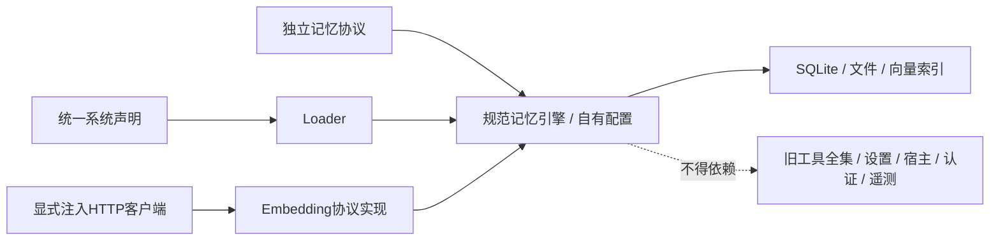
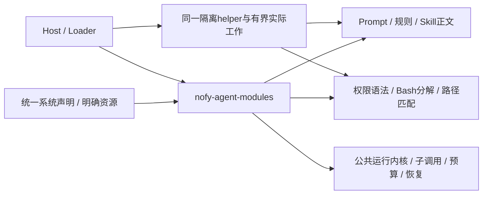
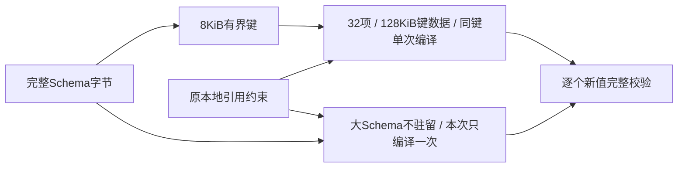

# Agent 全能力模块化闭环计划

L9 MCP Streamable HTTP工具块完成本机协议及默认Host验收：声明工厂、JSON/SSE、会话/目录、凭据、取消、审批/预算/实际退出恢复沿统一路径，11项新行为通过，相关集中矩阵135 pass（含一个辅助入口）。首次测试编译E0382及修正保留。未改Runtime/旧执行器或新增依赖，不宣称完整MCP；stdio/多实现互通、多状态角色迁移和版本化参考Agent预设继续。契约../../architecture/mcp-http-tools.md，验收../../verification/mcp-http-tools.md。

L8 列出的跨库业务矩阵通过，五个新场景沿原 Runtime/Worker 验证原 session/预算、审批/邮箱/取消及未知工具/Hook/根和子模型。集中行为 6 过/3 失败定位模型排空误停止；仅修 models.rs，补验全部受影响迁移 9 项与真实关停/取消 2 项通过，原通过范围不重跑。契约与完整失败记录见 docs/architecture/runtime-history-continuity.md 和 docs/verification/runtime-history-continuity.md/.json。其它状态角色、完整跨实例状态包、参考预设和发布仍开放，整体 active。

L7 传输及控制面范围通过，完整功能块收齐后统一验证并集中修复。最终相关覆盖 718，首轮失败及定向补验见 docs/verification/runtime-history-transfer.md/.json；没有重复整轮 Runtime/Host。当前实现同实例 Runtime SQLite、固定身份、原位恢复、源库退役与外部 bucket 保护；其他状态角色、综合业务迁移矩阵、参考预设和发布仍开放，整体 active。

L5 当前：声明式语义记忆、可恢复 ContextSource 准备计划和原计划模型失败重试已落地。外部 embedding 协议经统一 Model/预算/日志装载，操作 ID 绑定持久作用域，缓存按完整 Model 依赖身份隔离。最终相关1012项通过：Runtime424、Memory328、Host260；Memory原有性能1项未运行。首波1004通过/6失败，修复与受影响补验完整保留，未重跑全工作区。默认 Runtime、严格文档、依赖边界和格式通过；默认 Host 实际验证无关键词命中、缓存、忘记、预算继续、取消后同线程新提交、模型切换/回滚、两预算模式硬退出原票据对账及已知失败精确重试。真实 embedding 上游0请求，不将回环向量算作训练模型验收。契约 docs/architecture/semantic-memory.md，验收 docs/verification/semantic-memory.md/.json，证据 /tmp/nofy-semantic-memory.cef9gux_，恢复 /home/none/nofy-build-retired.jdnpc7/semantic-memory.d270s9o3。跨后端历史迁移、其余有状态职责、多套参考预设和发布仍开放，整体 active。以下为阶段历史。

L4 当前：新的外部常驻控制台通过同一 Host 的 --console-dir 装载，声明/模块源码、版本激活与回滚、运行/会话、审批、原事件流、恢复票据、资源与原预算账本沿统一 API 工作。最终相关270项通过：Host253、Runtime15、JavaScript2；首轮两个失败集中修复，仅补跑受影响范围。默认 Runtime 编译、严格文档、框架边界与格式通过。浏览器实际完成模块及源码编辑、generation 1→2→3、精确审批后一次工具效果与稳定会话续轮；本机模型协议3次、真实上游0次，不重计既有26次真实请求。原真实模型两运行和四账本在无模型凭据的独立状态副本逐字段一致。

系统页移动视口无横向溢出、axe 0违规；复杂运行页0违规但颜色对比1类未判定。测试环境缺中文字体，中文字形排版尚需复核。临时浏览器/服务关闭，缓存执行位恢复。全树detect(all)10793文件/2903符号/196流程/CRITICAL为累计范围，非本块新增；无stale、无新依赖、无commit/push。契约docs/architecture/resident-console.md，验收docs/verification/resident-console.md/.json，证据/tmp/nofy-console.il8cpqrp，恢复/home/none/nofy-build-retired.jdnpc7/console.c3c7ixs6。完整状态迁移、Memory职责与embedding、多套锁定参考版本预设及最终发布继续，整体active。以下为阶段历史。

L3c3：受管记忆捕获与写入绑定更新已通过560项相关验证；7既有/1新增生产Rust，Runtime核心未改。普通/学习资源共用关闭控制，原Hook作用域、预算及模型回执支撑关闭/重开、运行中切换/回滚、exit69对账和整理中断恢复。666源码/31制品冻结匹配，原失败与定向补验完整保留。契约/验收见docs/architecture/managed-memory-capture.md、docs/verification/managed-memory-capture.md/.json。跨后端内容迁移、其余状态能力、Memory职责、新控制台、多套参考预设与发布仍开放；整体active。

## L3c2 当前：默认外部工具源与上下文程序

默认Host现可通过声明装载tool_source.http及context.programmed。外部工具目录/Schema和业务调用绑定版本及连接；上下文程序经原隔离Executor产生计划和更新，模型压缩经原作用域日志、预算、票据与回执，不假造用量或修改当前回合。常规源码/配置更新通过live/v5同一装载和执行路径，无新Rust业务主循环。

用户指定按完整功能块集中测试，已写入AGENTS。相关255项最终通过；初轮253通过/2失败，集中修两份测试夹具后仅补验2项通过。无影响的映像、进程树及其它包沿L3c1证据保留，不重跑或重计。失败/补验边界及实际硬退出证据见[验收](../../verification/external-source-context-adapters.md)，契约见[外部适配器](../../architecture/external-source-context-adapters.md)。

下一优先Memory自动捕获/写入绑定与其它状态迁移，再推进控制台、多套逐版本参考预设和最终发布；总体active。源码包+普通依赖清单、用户自行安装依赖及无包体配额不变。下文为阶段历史。

## L3c1 当前：运行中来源与上下文策略选择

原管理/停驻/CAS/Loader/Worker接入context_sources、context_policies及tool_sources。安全停驻后替换有效句柄；上下文计划、准备请求和成功效果先在原版本处理，不清空原进度。工具来源显式更新只退休旧视图，下一次Worker先接纳新快照。上下文策略身份覆盖传递依赖并保留原完成记录；选择沿后续Prompt更新和会话种子继承。

18包105测试入口1622功能、5文档示例通过；1项既有Memory性能未运行。653源/声明、110预构建制品冻结一致，完整会话60692正常exit0。默认Host三条真实发布/API/Worker及回环HTTP流程覆盖同进程替换、接纳exit73后恢复移除、提交exit72后恢复回滚，旧工具及Hook各一次。详见[契约](../../architecture/live-source-transitions.md)和[验收](../../verification/live-source-transitions.md)。

默认Host的动态ToolSource与通用ContextPolicy外部装载工厂仍未交付，SDK工厂用例不替代平台交付；Memory自动捕获/写入迁移、其他有状态能力、新控制台、逐套参考版本行为预设及发布仍开放。下一施工优先将这两类能力通过外部模块接到默认装载路径，再推进写入迁移与控制台。源码包+普通清单、依赖用户自备及无包体配额保持。下文均为各阶段历史。

## L3b9 当前：有界组合身份与原子组预算

显式HashedV2在所有能力追加后保持84字节身份；新子组79字节摘要绑定composition/input，严格核对原请求并继续原reservation。既有自身格式、原claim/receipt/账本/地址保持。编程预设用V2，运行装载解释版本，源码归档不做依赖探测或包体限制。

原失败Agent＋Hook在默认/V1/V2、150000字节prompt及真实exit75后恢复通过；原深层混合声明保留，V1/V2均验证16层运行与12层重试/取消。18包105入口1613测试、5文档示例、Python53项通过，647源/109预构建制品冻结一致；Memory既有release性能1项未运行。详见[设计](../../architecture/bounded-composition-identity.md)和[验收](../../verification/bounded-composition-identity.md)。

下一阶段先处理ContextSource/ContextPolicy及动态ToolSource更新的应用边界与原pending状态，再完善Memory、控制台和参考预设。全目标active；新格式不被未支持它的旧内核隐式读取，不新增旧产品适配层。以下为阶段历史。

## L3b6 阶段历史：子运行、收尾Hook及原始恢复身份

允许complete但仍有pending work的持久BudgetExceeded停驻，仅改同资源预算并保留原状态；子Agent/原生Skill从原子检查点和父预留继续。Hook意图记录原恢复身份，包含原账本scope与物理存储摘要，额度/租约变更不改身份；缺原证明或错后端不会重发。原生控制器既有静态契约精确核对，不新增旧宿主或兼容工厂。7份生产源码、3既有与5新增测试文件，无新依赖/表/主循环。

最终18包105入口1590功能、5文档示例通过；Memory1项既有release性能忽略。Host236（HTTP148项603.554秒、树11项204.649秒）、Runtime397、Executors19；636源/109制品整套匹配。无默认/SQLite-only构建、SDK、严格文档、Cargo边界和格式通过。初版全量因原恢复依据审查主动中止并保留；有效反向复现HTTP2次，加原证明后1次，四条硬退出及正常调额仍成立。详见[组合恢复验收](../../verification/budget-composition-resumption.md)及JSON。

下一步验证暂停期间新增输入与收尾Hook的先后顺序/事件身份、未知Hook管理恢复入口，再推进Context/动态ToolSource/Memory；不能以本轮原输入恢复外推全部状态完成。其余资源迁移、权限状态、记忆职责、控制台/预算视图、逐版本参考预设、CI/发布、性能及未知清理错误仍开放，整体active。源码普通依赖清单由用户安装处理，不恢复环境或包体门槛。以下保留阶段历史范围。

## L3b5 当前：预算暂停后保留待派发工作并原位继续

原Park在业务未完成、持久BudgetExceeded与检查点完整一致、job waiting及原根租约内确认budget_suspended；此回执只允许budget_limits，除治理根配置外编译定义和RunState保持。原预算迁移事务、Loader及Worker继续使用原run/thread/输入和操作身份，成功效果不重做；期限后的已claim未知工具仍待原对账。生产范围4份Runtime源码，测试两注册及两新resumption.rs，无Host生产变更、依赖、表或主循环。

完整18包105入口1580功能、5文档示例通过，Memory1项既有release性能忽略；Host228（HTTP140项602.116秒、树11项201.293秒），Runtime396。631源/声明和109制品整套摘要全匹配，SDK、严格文档、实际Cargo边界及格式通过。默认Host两条同进程和接纳/提交后两条硬退出流程保持效果一次；首轮夹具关闭Host后的503和最终TTY子汇总收集器错误均保留，修正未改生产断言，不重复计数或重跑整套。见[验收](../../verification/budget-resumption.md)及对应JSON。

下一步验证子控制器与终止工作等预算组合边界，再推进Context/动态ToolSource/Memory。资源替换/账本拆合、其他权限状态、记忆职责、新控制台/预算视图、多套逐版本参考Agent预设、CI/发布、Memory性能及未知清理错误继续开放，整体active。源码/普通依赖清单由用户安装处理，无新增打包门槛。下文为阶段历史。

## L3b4 阶段记录：停驻后的同资源额度迁移

budget_limits显式选择治理额度/重试，live/v4记录Profile到原ledger及历史别名；源目标同资源/物理后端、ref/工厂/依赖与宿主上限保持。私有计划异步解析，在原根租约/CAS/savepoint中同步改原账本、版本和回执，无新表/依赖/执行循环。旧/中间子Profile、下一轮和后续Prompt变更继续原账本，不重开户；额度/预留/回执保留，期限锚原创建时间，已claim可结算/成功可重放，未claim按新约束重检，完整性阻断不清除。

最终18包105入口1575功能及5文档示例通过，Memory1项release性能未运行；Host226/Runtime393，HTTP138项649.953秒、树11项214.848秒。新10项及默认Host同进程/两个硬退出、SDK、严格文档、Cargo边界和fmt通过，629源/109制品冻结一致。首轮测试事件方法误选的编译失败保留，未改业务断言。见docs/verification/live-budget-transitions.md/.json，私有恢复/home/none/nofy-build-retired.jdnpc7/live-budget.wpzjse88。

下一优先是额度耗尽后仍有未派发工作时的迁移/继续边界，本阶段不能替代该要求；预算资源替换/账本拆合、完整权限、Context/动态ToolSource/Memory、记忆职责、控制台/预算用量视图、多参考预设及CI/发布继续。源码/普通依赖清单、外部依赖用户安装边界不变，整体active，无新真实模型验收或提交推送。下文为历史阶段。

## L3b3 当前：普通Policy显式更新完成，继续预算账本及其余状态转换

原update_modules增加policy_set，以live/v3累积选择并随会话种子恢复；普通根工具策略可替换/删除/回滚，强制PolicyFloor及传递共享保护依赖、原执行身份、消息/审批、成功效果和预算保留。只有Runtime五份生产源变化，不新增宿主或依赖。编辑前CRITICAL分析已报告；Host首轮因持久引用扫描漏识别v3拒绝提交，补充HIGH分析后只扩受支持协议识别，原遍历及未知拒绝保留。失败22.676秒与修复后同条件37.316秒均保存。

最终105入口编译通过；相关52入口Host224+Runtime383共607功能、5文档示例通过，无失败/忽略；HTTP136项647.496秒、真实树11项212.346秒。仓库外SDK、严格文档、实际Cargo边界与fmt通过，625源/109制品前后匹配。实际同进程及接纳后/提交后两硬退出、SQL原子失败、精确回放、强制权限、显式回滚及跨根后Prompt更新均有证据。见docs/verification/live-policy-transitions.md/.json；恢复/home/none/nofy-build-retired.jdnpc7/live-policy.sjivotmk。

下一阶段实现预算账本迁移，须保留原逻辑身份、used/reserved/操作回执及原绝对期限，不能直接换新Profile获得空额度。完整权限其他状态边界、Context/动态ToolSource/Memory、记忆职责、新控制台、多套锁定参考版本行为预设及CI/发布仍开放。普通源码包和用户自备依赖边界不变，无新外部模型、依赖安装、提交或推送，总目标active。以下各节为各自阶段事实。

## CLEAN5d 当前：并发回执根因修复，恢复完整状态更新施工

Host及ControlPlane仅将私有只读启动ModuleRegistry改为Arc共享，避免请求状态/控制任务Clone深复制工厂JSON Schema；可变声明覆盖仍独立。接口/快照、数据库、权限、预算、隔离和原15秒期限不变。实际影响按HIGH在编辑前报告，图谱LOW/0遗漏字段/派生Clone边，不能单独作为风险结论。

原制品8路8失败复现两次，SQL/helper计时及外部PC采样逐步定位；全部临时生产计时代码原字节恢复。最终同期限8路8通过19.050秒；完整18包105入口冻结矩阵1555功能通过、1既有Memory release性能忽略，另5文档示例通过，HTTP134项603.071秒、真实树11项203.442秒。严格文档、实际Cargo边界、仓库外SDK及fmt通过，623源/109制品前后不变。完整事实与诊断失败保留于docs/verification/host-registry-sharing.md/.json及/tmp/nofy-action-receipt.AGwTbJ，私有恢复/home/none/nofy-build-retired.jdnpc7/clean5d.1yzj1opd。

下一优先完整运行中权限/预算/上下文/ToolSource/Memory转换，继而记忆职责、新控制台、逐个锁定版本的多套行为预设及CI/发布；未知清理错误等原缺口不关闭。无新真实模型调用、依赖安装/包体配额或提交推送。总目标active；下文CLEAN5c的开放超时为历史，已由本阶段修复。

## CLEAN5c 当前：归属已实现，分组回归覆盖，并发超时继续定位

18包全部common、40条本地边；Memory/Token/PackCore归属，旧Rhai Workflow与Orchestra移出归档，只采用私有DAG，不保留旧脚本路径、兼容feature或内置file-steward。Workflow文档/快照格式保留；两项SDK行为由同一声明图验证。锁521→516无新增/升级；恢复副本/home/none/nofy-build-retired.jdnpc7/clean5c.Ya3dAO，110条移动记录逐项一致，暂存区未动。

105入口1555功能+5文档示例按未变范围分组覆盖，Memory1项release性能未运行。首轮SDK输入调用错误已改default；首轮全Cargo的HTTP133过1回执超时，原二进制/原15秒期限隔离56.662秒通过，根因未确认，不能宣称高负载已修复。进程树首轮10过1失败为提前保存execution completed而queue仍running的记录；只收紧测试完成判定，原40秒不变，11项完整重跑239.074秒通过。最后86入口及文档示例均通过，623源/109制品冻结匹配；修树仅1测试源/二进制变化，其余622/108不变。

全feature/target check、严格文档、105入口编译/格式、真实Cargo全feature/build/dev边界及仓库外SDK通过。Python53和实际无外部工具源码包通过；依赖自备及无包体配额不变，无新增外部提供方请求。实现收尾文档前detect(all)10766文件/2546符号/184流程/CRITICAL为累计脏树，已报告；准确恢复/调用/冻结范围补证，overview旧统计不用作事实。完整证据docs/verification/framework-capability-ownership.md/.json及/tmp/nofy-clean5c-ownership.xyDbvE。

下一优先排查HTTP并发回执时序，再推进依赖其稳定性的实现；完整状态转换、记忆领域职责审核、新控制台、逐个锁定参考Agent版本/能力矩阵/行为复现、CI/发布及此前故障证据均不关闭。整体active，不commit/push；下文为历史阶段。

## CLEAN5b 当前：旧产品源码物理移出（阶段范围通过）

2026-11-03，按先清单/依赖→私有归档/比对→同盘移动→实际运行验收推进。HIGH在编辑前报告；旧Builder同名误选/impact漏项用准确context、Cargo43本地边和源码入口补证，不因旧图误连保留宿主。97项包含69旧codegen包、8旧common包及旧UI/服务/构建/研究/CI/工具/脚本，共10425文件、427889399字节，11491记录前后字节及元数据一致，暂存区未动。恢复目录/home/none/nofy-build-retired.jdnpc7为0700，tar/tree/快照/diff齐全，归档SHA ed88fd1337c368b0db303893f5191811d3fa234cc9cefb7b93f8f4cb9db2feac；不直接删除数据或重置工作树。

旧源码不在树中时，完整all-features/all-targets check33.83秒、独立仓库外SDK、107测试入口no-run51.15秒、实际Cargo边界均通过。原session4016正常终结exit0：6项HTTP239.03秒、2项真实进程树193.88秒、Python53项2.396秒通过，无失败/忽略；只按专项覆盖不重记全量。637保留源和根构建配置原字节，编译后107测试制品/3CLI在专项后冻结匹配。源码包26文件/203602字节/49332归档字节、SHA0304b0f0a6620175dd5a2275989c8bd50f6f64d01fda244cbcd20a52949a51a6与此前全字节相同，依赖用户自备及无包体门槛不变。无新增外部提供方请求。

测试退出后CLI force/skip-agents-md索引12.1秒完成，699文件/14130节点/37116边/636社区/300流程，无embeddings/技能/wiki。overview旧统计缓存未当真，实际图旧Agent/Shell/UI文件0、旧Builder方法已不存在。自定义规则保留，AGENTS仅更新统计；旧SDK兼容门控和Memory原产品接线明确为历史。详细清单/证据docs/verification/retired-source-tree.json及.md，证据根/tmp/nofy-clean5b-retire.SGBmHh。

最终新索引detect(all)10717文件/3035符号/238流程/CRITICAL为累计脏树及移出，已报告；实际保留源/制品摘要与97项恢复清单独立补证，不沿用旧UI流程数字或将累计范围当本轮新增执行源。下一阶段收敛剩余五个公共候选，先做能力/归属矩阵：PackCore编译期builtin_packs/file-steward及SDK workflow::run的非Loader路径不能仅改名/挪目录留下。完整运行中状态迁移、新控制台、多套版本化参考行为预设、CI/发布及原故障证据仍继续；不删除所需能力来缩小目标。整体active、未commit/push。下文为此前历史阶段记录。

## CLEAN5a 当前：框架工作区与中立源码归属（阶段范围通过）

2026-11-03，根工作区显式20包、默认Host，去除旧产品共享依赖和未使用patch；原依赖版本/flags不变，锁离线裁剪1331→521，无新增身份。TTYUtils/SQLiteJournal/TestSupport从codegen物理迁到common，无转发壳；Executors旧沙箱Guard及feature/依赖删除，不修旧Agent来维持兼容。施工前HIGH/CRITICAL已报告，原稿/未提交diff归档/tmp/nofy-clean5-leaves.vy7rmv，入口及精确边界见docs/architecture/framework-source-tree.md。

首轮全工作区1398项通过，含Host222（HTTP757.46秒、树236.57秒）、Runtime375，随后exit101停在原提交已失真的Orchestra固定LOC门槛3980>3693。按用户新机制撤出Orchestra和PackCore两份LOC测试，归档可恢复，不抬阈值/拆文件凑数，业务测试保留。原全工作区图剩余20个冻结测试入口补验327通过，形成20包1725单元/集成通过；额外九包Cargo矩阵不重复计数。文档示例最终5通过，Memory一项release性能基准未运行。53预设测试及无依赖工具环境的实际原字节源码归档通过。

严格全工作区文档、all-features/all-targets check/no-run、全fmt/diff和Cargo边界通过；20包43条本地path边均在工作区。初始639源/5构建/109原测试二进制首轮后匹配，撤出LOC及补Tool文档后其余636源/5构建/109原二进制仍匹配；之后仅更新说明/控制文档。原始失败及恢复证据完整保留，详见docs/verification/framework-source-tree.md，不能宣传为原命令一次全绿。

尚有69旧codegen包、8旧common包及旧UI/服务/构建/发布待按清单归档物理移出；五个公共候选及SDK Workflow/Pack/Orchestra归属与可管理装载未完成。完整运行中状态迁移、新控制台、多套版本化预设与先前故障证据仍开放，整体active。无新外部模型请求、依赖安装或包体治理，未commit/push。下文为此前约束及历史阶段事实。

## 2026-11-03 依赖边界简化：源码交付、依赖自备

本节优先于历史M3d3及依赖适配器计划。用户明确外部依赖自行安装处理，只要求源码打包正确，不设置包体限制。默认打包改为按source-files.json归档声明、模块及普通requirements.txt，不要求settings、模型连接、依赖锁、解释器/工具链版本或环境文件摘要，不开发自动语言依赖安装器。刚新增的Python/uv适配器草稿及其契约已可恢复归档后撤出工程，不清理其他用户修改。

实现边界为：源码清单与引用齐全 → 原字节确定性归档 → 不覆盖发布 → 实际解包回打包核对。既有原生部署只有同时显式给settings/dependency-lock才调用，仍遵守执行环境授权；源码tar.gz不能直接冒充Deployment或完整环境可用。保留路径安全、generation、预算/效果恢复、运行更新及控制台等整体要求。自动依赖重建及GCC闭包不再作为源码交付前置验收；若以后验收GCC行为，必须在用户准备的实际环境中验证，不复活强制安装器计划。证据见docs/verification/source-package.md。

## M3d4当前收尾：用户自备环境执行（阶段范围通过）

源码归档不再绑依赖重建后，新增通用resource.process_local，显式程序/参数/env/只读路径及独立执行授权；单进程与整树复用原Loader、审批、预算、生命周期和状态路径，不安装/复制依赖，不加Python/GCC内核分支。默认源码打包不变；本地部署只需settings.environment，可选command_environment，锁定环境才显式dependency-lock。两种选择不能混用。用户依赖内容变化不自动生成generation，回滚声明不等于回滚外部安装。

实际源码/运行边界见local-environment-contract.md及verification/local-environment.md。用户模块32→独立更新33、真实venv无PYTHONPATH的site-packages与sys.prefix、Guest内GCC链接/执行、精确审批、依赖只读/noexec、私有状态拒绝、double-fork/setsid取消、缺依赖时实际CLI恢复11份完整记录与成功去重均通过。没有新真实模型请求，Tool诊断根不是Agent模型闭环。中立InstalledProgram追加保留调用位置，旧load不变；原生依赖仍由用户自备，不能把新接口变回强制环境闭包。

原/usr非递归绑定EINVAL经独立user/mount namespace复现，改为仅本地目录递归绑定并递归添加限制，原映像/工作区及seccomp不变；前段registry和floor夹具错误全部保留。最终专项98.26秒。完整Host先72/5/118通过，树10过1失败：venv探针没消费JSON stdin，错误为failed to write process input。仅补探针完整JSON读取/断言及精确11份恢复，生产代码不变；随后完整并发树11过225.56秒。Host206按范围分组通过，不冒充一次全量无失败。Executors15、Python53与包内53、严格文档/格式/真实依赖边界通过，普通内部16/含build-dev17。

555源/声明与16保护/实际二进制冻结核对，修正后仅一份测试及其二进制预期变化，最终fixed摘要全部匹配；源包26文件203396字节、归档49244字节，逐字节解包与回打包相同。证据/tmp/nofy-local-runtime.1eKTRv；detect(all)299/3270/13/HIGH为原累计脏树，新入口另以源码/实际执行补证，无stale告警，不重复索引，无遗留验收进程、未commit/push。完整运行中转换、模型协议进程隔离、CLEAN5干净源码、新控制台及多预设仍继续，目标active。

## 2026-11-03 最终产品校准：统一底座与多套行为预设

本节更新此前“最终仅一套编程预设”的数量边界，不撤销2026-11-01对干净源码、同一执行路径和取消旧产品兼容的要求。用户明确：先完成底层框架基线，再逐个复现热门开源Agent能力，以复现过程查缺补漏底层架构，最终上线多套开源Agent的声明式行为预设。Codex、OpenCode、pi为已举例候选，实际参考版本、能力清单和顺序在逐套开始时核定。

执行链路为底层基线 → 参考版本/能力矩阵 → 声明与外部模块组合 → 通用缺口补齐 → 行为对照与既有预设回归 → 版本化预设发布 → 下一参考对象。每套预设仍走系统声明、依赖锁、Loader和统一内核，不包裹第三方CLI/主循环，不按产品名增加内核分支。声明负责连接可执行实现，不能用相似Prompt/工具别名或仅复制Schema冒充完整行为复现。

每套交付应有可移植声明、模块/制品及依赖锁、显式环境/权限/预算和凭据前提、参考版本及能力差异矩阵、实际行为验收报告。对话/工具轨迹、上下文与调度、审批/取消/流式和重启恢复均按对应能力验收；缺失/部分实现继续开放，不能仅标为未支持或缩小范围后宣称完成。框架的有状态更新、历史迁移、控制台、干净源码树和既有版本连续性仍属总目标。

现有presets/coding保留为首个基线样本，“唯一声明”仅指该预设单一事实源，不再限制最终预设数量。当前底层尚未完成：下一施工仍先收束M3c3组合命令预检、终端/工具链及通用阶段/上下文/状态缺口，不因本次产品方向明确而同时开工三套产品。本轮只同步AGENTS、项目上下文与目标/验收规范，无执行代码或部署声明变更，无新增构建/模型请求。AGENTS目标规范的预期变化发生于M3c3冻结验收之后，旧冻结清单保留，不重写已有证据。

## 2026-11-01 目标纠偏：旧源码只作参考

本节优先于本计划全部历史兼容条款。用户要求最终交付干净的声明式 Agent 框架与一套声明式编程预设，不是新框架包裹旧 Agent。借鉴 NixOS 的系统声明、依赖闭包、版本构建与激活/回滚，不预设必须采用 Nix 语言或 NixOS 平台。

- 目标路径只有一条：系统声明 → 校验/依赖锁定 → Loader → 统一运行内核；编程 Agent 是该路径中的一套预设，不拥有独立执行体系。
- 旧 Nofy 仅提供能力与行为参考；不维护旧入口、配置、Rust API、旧会话格式，不以真实旧二进制兼容作为完成门槛，不为保留未交付接口新增一组组兼容工厂。
- 可以保留已实现且符合新边界的中立执行、持久事实、权限/预算、Loader和模块协议；不得仅凭旧代码能跑、已抽包或经过旧回归就认定应保留。保留能力需脱离旧宿主和工具全集的隐式依赖。
- 原始源码、旧展示层/宿主、重复执行路径、临时过渡适配与多余示例不进入最终工程源码树或交付闭包；只从构建排除旧项目不算完成。实际移除前必须列出明确范围及依赖证据，保护当前未提交工作；本次目标纠偏不执行删除。
- 新框架自身的版本化、幂等应用、会话连续性、预算/效果保存和回滚继续验收；旧产品兼容与新框架系统版本恢复必须明确区分。

现状未达到目标：原编程预设仍由Shell/SessionActor适配公共Pipeline，部分声明工厂依赖旧产品实现；B2源文件增量尚未集中构建/验收。下一步须先做目标依赖闭包与保留/提取/移除清单，随后切断旧产品依赖、统一运行和声明预设，最后按新框架端到端验收。暂停状态不因本次文档纠偏自动解除。

### CLEAN1：记忆领域边界脱离旧产品（施工中）

用户已恢复总目标。纠偏文档属于实际进展；本阶段由C → A → X推进源码边界，不继续旧二进制/旧入口兼容验收。



| 边界 | 决定 |
| --- | --- |
| 协议 | MemoryService与请求/回执归属独立nofy-memory-types，不在旧nofy-tools中保留兼容导出；已用调用点改为直接依赖领域协议 |
| 配置 | 索引、搜索、衰减、MMR与敏感类别由记忆领域拥有；移除已弃用recency_decay兼容参数，显式temporal_decay为唯一时间衰减来源 |
| 环境 | 存储根必须显式提供；不得发现HOME、旧设置或产品端点。模型HTTP客户端由调用方注入，不使用产品登录重试/默认代理/产品专用头 |
| 依赖 | 移除Memory对nofy-tools、nofy-config-types、nofy-http、nofy-auth、nofy-telemetry、nofy-env与nofy-version的依赖；规范状态与证明算法可保留，但必须独立构建 |
| 验证 | 保存实际Cargo普通依赖闭包前后差异，验证无上述旧产品节点；对新领域配置/模型接入、真实记忆和持久恢复集中测试，不以旧Agent继续可用证明成功 |
| 宿主资源 | 收敛为单一resource.memory：持久撤销与逐操作接纳为同一资源边界；删除resource.memory_durable/resource.memory_managed重复工厂及旧生产者fixture，不再保留开发期旧摘要作为门槛 |

接口为独立MemoryService协议、自有config类型、显式MemoryStorage::new(cwd, root)以及注入HTTP客户端的ApiEmbeddingProvider。框架模块、预设、MCP/学习/向量管理及完整有状态更新仍属全目标，不因本阶段缩减。后续CLEAN2切断Host对旧Agent/Workspace的Prompt/Skill/权限依赖，CLEAN3清理模型与编程能力装配，CLEAN4统一声明预设和运行更新，CLEAN5按明确清单清理旧工程源码树并对独立目标工程验收。

#### CLEAN1 实施与验收证据

已迁出原工具包的MemoryService协议：新nofy-memory-types独立领域包，原文件删除，无旧路径兼容导出；27个调用文件改为直接依赖协议，旧产品调用点仅做导入归属调整，没有开展旧Agent业务兼容。记忆引擎自有config与明确存储根/HTTP客户端，移除七项旧产品依赖。实际Cargo普通依赖基线保存于/tmp/nofy-clean1-memory-before.txt：75行含(*)重复，按crate名称去重为47（含本包）；不能把75当不同crate数量。边界脚本最终default闭包3、agent-runtime闭包9，后者含中立工具ABI的nofy-tools-api，不含工具全集/旧Agent/Workspace/产品配置、认证、HTTP或遥测。最终日志boundaries-final.log，脚本名称verify-framework-boundaries.py。

宿主删除resource.memory_durable/resource.memory_managed两种工厂，统一resource.memory，提供已发布system/release/module及workflow program/parents明确选择的inspect/apply。后端始终持久撤销、逐实际工作共享使用租约；管理关闭需独占租约，忙时不接纳、不删除状态或猜已关闭。nofy.memory-control/v1持久策略/CAS/64回执窗口，nofy.memory-store/v1明确存储协议；旧工厂/profile、旧生产者fixture、旧摘要断言与重复示例移除，不再为未交付开发版本保留兼容层。关闭后缓存安装的调用仍须重新接纳；重放旧命令只返回旧事实，不改当前已重开的策略。

本轮保留真实失败：第一次全量Memory在并发撤销出现database is locked，专项压力复现；进一步在peer保持BEGIN IMMEDIATE写事务时重开已接纳账本，确定性失败。原因是durable_store每次按create=true重新初始化，CREATE IF NOT EXISTS形成读快照后再INSERT升级写者，与peer冲突；不是简单增大timeout。修复为只在显式安装初始化、初始化使用IMMEDIATE事务、普通重开不建表；另测已接纳表缺失不得静默重建。确定性两项通过，实际并发撤销连续40次通过；初次失败、诊断前后和压力日志均保留于/tmp/nofy-clean1-*。

集中验证最终结果：

- Memory启用agent-runtime完整322通过/1既有忽略，默认308通过/1既有忽略，无warning/error；日志memory-closed.log、memory-default.log。含领域配置、真实本机HTTP向量协议/尺寸/索引/错误、原规范存储/硬退出恢复和新账本锁回归。实际SDK任务持接纳guard到终态、调用方abort不释放、缓存调用重新接纳的新测试在同次完整运行通过。独立协议包构建/测试通过（无独立测试项，不冒称覆盖数量）。
- Host构建通过；资源单元6项通过，包含真实子进程持共享租约、忙时关闭不接纳、硬退出释放、状态损坏失败关闭、有界历史和幂等回放；日志host-memory-unit.log。完整HTTP目标先no-run，确认无活跃构建后冻结发行/HTTP二进制再运行相关组，最终5项通过/98未选/无忽略，79.59秒，日志host-memory-http-final.log。
- Host首轮相关组4通过/1失败（host-memory-http.log）：断言仍要求进程内撤销的泛化错误，而新持久资源返回明确Conflict文本。按新领域错误契约修正，不放宽业务校验；末轮5项全部通过，并追加真实CLI硬退出后关闭策略与同命令回执保留、重开再撤销的证明。新测试模块路径曾编译报E0583，按现有path模块语义修正后重建；未掩盖失败，也没有在存活Host测试期间重建或修改Rust。
- 相关源码全量摘要runtime-source-final.sha256、当前发行/HTTP二进制host-binaries-final.sha256前后匹配，source-check.log与binary-check.log无失败；git diff --check通过。路径前缀均为/tmp/nofy-clean1-。未运行或冒称整个Host旧矩阵、旧Shell/Agent兼容，未commit/push。

本阶段只证明记忆领域依赖切断和新宿主单一资源边界，不证明整个目标工程干净。Host仍从旧Agent/Workspace获取规则/Skill/权限；记忆模块内的旧迁移备份/路径启发式、完整外部学习/embedding资源和预算、MCP、统一声明式编程预设、全能力有状态更新、控制台与最终源码树清理继续。总目标保持active；下一阶段从CLEAN2切断上述宿主依赖，不恢复旧兼容验收方向。

#### CLEAN2 源码归属边界清单（阶段实施见下节）

| 当前来源 | 目标处置 |
| --- | --- |
| nofy-agent/runtime/prompt.rs | 版本化Prompt文档、结构校验与渲染可归属中立声明模块；不连带AgentBuilder或ToolBridge |
| nofy-agent/runtime/sources.rs | FrozenRules的明确正文/来源独立归属；旧HOME、厂商目录与插件发现入口不作为运行依赖 |
| nofy-agent/runtime/skills及旧tools的SkillInfo/SkillManager/替换辅助 | 分离真正的Skill定义、激活、参数、执行和预算能力；不以依赖整个旧工具包来复用几项辅助函数，不为旧字段形状添加兼容导出 |
| nofy-workspace/permission/runtime/skill_scope | 仅保留新框架需要的规则编译、范围匹配与受限执行；从旧workspace/配置/工具别名全集中拆离，权限不退化成仅精确工具名 |
| Host native/prompts/scopes的旧包导入 | 统一指向新的明确模块边界，移除Host Cargo的nofy-agent与nofy-workspace；验收实际闭包不存在间接回流 |
| 原AgentBuilder、ToolBridge、SessionActor、旧CLI/UI | 不接入新框架；待目标依赖清单归零后按明确源码树范围移除，不保留并排产品或窄适配层 |

该清单只明确已核实的引用边界，不等于CLEAN2实现或删除授权清单已经齐备；开始编辑时须集中补充upstream影响分析和新模块接口契约。新模块包名、最终文件树与完整声明式编程预设在该阶段锁定，不把现有SDK或记忆验证系统当最终预设。

CLEAN1收尾范围审计：本地离线索引129.1秒，157721节点/414905关系/7907社区/300流程；26个大文件与缺Swift解析器的1项既有跳过保留，未下载依赖，AGENTS.md目标纠偏未被生成器覆盖。MCP已定位独立协议的MemoryService。detect(all)为整个累计工作树228文件/2998映射变更/218映射路径/7流程/HIGH，无越界路径；该结果不是CLEAN1新增量，也不作为旧App流程兼容门槛。风险已在实施前按HIGH/CRITICAL报告，实际边界以Cargo闭包、源码与相关真实测试共同证明。

收尾rustfmt检查仅发现7个记忆源/测试文件的导入/模块排序，已统一格式；再次完整Memory322/默认308通过，Host相关目标重建与复验后另附最终冻结结果。格式检查日志fmt-check-final.log为空，diff检查通过；索引后仅发生上述排序和验收文档变化，没有新的业务逻辑扩展。

CLEAN1最终冻结：153个Host/记忆/独立协议Rust源与测试在runtime-source-final.sha256，发行宿主及HTTP实际二进制在host-binaries-final.sha256；格式归一化后相关HTTP组再次5项全部通过（98未选、79.95秒，host-memory-http-closed.log），没有构建重叠。最终源码/二进制逐项复核见source-check-final.log、binary-check-final.log，全部一致；Memory322/默认308与边界脚本保持通过。CLEAN1范围完成，整个新框架目标继续active，下一为CLEAN2宿主依赖切断与真正的统一声明预设，不再追加旧兼容路径。

### CLEAN2 实施契约：中立声明模块（施工中）

上一目标回合为progress。新增nofy-agent-modules，归属Prompt文档、明确规则正文、Skill定义/激活/有界替换/执行，以及独立权限表达式与作用域；不依赖旧Agent、Tools、Workspace、设置、认证、CLI或UI。旧实现仅供算法与行为研究，采用的纯模块移出原位置，不为旧调用路径做兼容导出。



| 边界 | 接口与决定 |
| --- | --- |
| Prompt/规则 | PromptDocument及PromptPreview；FrozenRules只接收声明正文/来源，不读HOME/厂商设置或自动发现 |
| Skill定义 | FrozenSkills + 自有SkillInfo/SkillPackage；明确正文、来源、启用/用户与模型调用、条件路径、参数、模型/effort/工具限制和执行依赖；不依赖旧SkillManager或ToolOutput类型 |
| Skill替换/列表 | 参数与通用SKILL_DIR/SESSION_ID/PACKAGE_ROOT/PACKAGE_DATA，有界原子替换；不继承厂商别名或静默截断正文。列表按明确字节上限与成功调用路径激活，不把启发式token估计当硬上界 |
| 权限 | 保留路径/Bash/MCP/自定义工具、嵌套工具及父权限收窄能力；解析与匹配独立，不引入旧权限Actor/UI/自动分类器。Host仍在隔离helper内匹配，不回退主进程 |
| 装配 | Host改用新模块并删除nofy-agent/nofy-workspace依赖，tool.skills_scoped表达显式作用域能力；新声明与测试不保留tool.skills_nofy兼容别名 |
| 验证 | 独立模块构建、领域回归及实际Cargo闭包；完整相关Prompt/Skill/权限HTTP、子预算/审批/恢复和原helper取消/退出边界。不要求旧Shell/Agent编译或行为兼容 |

风险：图谱对DocumentPrompt/SkillsFactory/规则编译器多为0/LOW，源码显示模型上下文、子执行与权限准入均受影响，实施前人工HIGH、权限CRITICAL已报告。完整平台、统一编程预设及最终旧工程清理继续，不以新增模块包代替全目标。

### CLEAN2s：Schema编译与集中验证稳定性（实施契约）

默认并发诊断已经复现：人工Hook回执为hook_controller_timeout（默认5秒），两个工具效果已完成、模型0次；不是Null状态丢失。模块更新的resume仍未结算时，原运行维持paused、更新与unpark回执保留。后一项不能仅据时间推断根因。源码另确认validate_json_value每次先validator_for检查Schema、再jsonschema::validate重复编译；先消除此确定的热路径重复，再用原始默认并发、期限及业务断言验证，不以放宽超时宣称修复。



| 决定 | 不变量 |
| --- | --- |
| 内部schema模块复用已编译Validator | validate_json_schema/validate_json_value及ToolCatalog接口与JSON Schema语义不变；永不缓存值、校验结果或凭据 |
| 完整序列化字节作键 | Schema改变必重新编译，不能按模块名/引用冒充相同Schema；保持原外部引用拒绝及错误类别 |
| 有界LRU与每键OnceLock | 键与条目有上界，编译/匹配不占全局缓存锁；已被调用持有的Arc不因淘汰失效；128KiB仅为键字节，不冒称编译对象硬内存上界 |
| 超大键/缓存不可用回退 | 不拒绝原本有效的大Schema；走原编译器但每次值校验只编译一次，不降级成跳过校验 |
| 验证 | 实际Hook Schema 512对合法/非法值基准、同键并发编译计数、大小/淘汰/Schema变化/外部引用回归，以及原期限下Host默认并发完整HTTP |

影响分析validate_json_value/validate_json_schema/tools::validate_schema均CRITICAL（覆盖20模块，直接调用34/8/4）。覆盖配置装载、工具/权限、Prompt、图及人工响应；已在编辑前报告。此阶段不改默认5秒Hook、管理15秒等待或生产状态/提交协议，不新增旧产品兼容层。同一驻留编译slot只初始化一次，LRU淘汰后可重新编译，不承诺进程生命周期只编译一次。

本阶段全量Host单元另暴露Memory的父进程File-only租约会被无关fork继承延长：并发无业务使用时，66次顺序管理操作偶发Busy。两个确定性fork测试在修复前均失败（父操作/管理已结束，子进程仅持继承描述符），证明并非Schema语义变化。MemoryControl新增不可克隆MemoryLease，在真实操作/管理终结时显式解锁OFD；已独立接纳的其他进程/并发操作仍持各自锁。只改Memory acquire/state/change的租约，不改执行器cache跨fork/exec持有规则或关闭状态/回执协议。图谱MemoryControl为0/LOW漏报，已按实际准入风险CRITICAL在编辑前报告；验证两个fork回归、实际跨进程使用阻止关闭、SDK调用方丢弃后实际工作仍持锁，以及完整Host。

复测澄清：Schema复用不是两个HTTP期限失败的修复，优化后默认并发仍复现两项。诊断确认human_hook为合法controller-timeout暂停；parking/modules在测试15秒截止时原根/子控制器仍running、人工节点waiting、live revision=1、unpark已released、无error，不能据此叫执行失败或数据损失。两项测试此前把默认短Hook预算/普通动作测试期限错误当作多阶段工作流无条件完成保证。保持内核5秒默认、普通action_result 15秒及全部最终输出/效果/预算断言；仅两项长流程的系统声明显式配置30秒Hook预算，调用方显式45秒端到端等待。新增20毫秒unfinished实际HTTP反例必须触发失败，防止参数化期限变成忽略期限。没有无限重试、自动重新派发或扩大旧兼容。

后续默认并发还捕获Host重开commit fence busy；提交shared/exclusive及目录事务三个确定性fork反例修复前失败，实际执行工作继承反例通过。扩展CommitFence/LoaderAdmission/StoreLock分析，图谱0/2/1漏报按提交关键路径CRITICAL处理；CommitLease、MemoryLease与StoreLock按创建PID终结，用统一unlock_local处理正常结束，不能让fork子进程的Drop解除活父进程栅栏。增加子进程Drop反例；初版Memory显式解锁在该反例失败，PID归属补齐后通过，未将不完整实现记为验收。执行器cache工作File仍按实际进程树持有。49项Host单元（含所有Loader/维护/取消/退出）与编译no-run通过无警告；当前冻结完整Host默认并发验收，不同时运行索引或改Rust。

### CLEAN2s 最终阶段证据（通过，不是全平台完成）

- 内核sqlite,pack,workflow,control-file完整367项、声明模块82项、Memory agent-runtime完整322项通过（Memory另1既有忽略）；Host默认并发49单元+5凭据+104完整HTTP=158项通过，无警告、无新忽略；合计929项。HTTP239.36秒，采用默认线程数，不是用4线程结果替代。多阶段正例显式预算已如上记录，没有把Schema加速冒充期限问题修复。
- 强制“人工工作流已提交效果、Hook确认阻塞至超时”新回归通过：超时前模型0次，显式恢复后模型1次、效果仍1次，再次恢复不增。20毫秒unfinished HTTP反例按预期失败。Fork父操作/父事务终结、子进程Drop、独立进程真实占用、执行器实际工作继承及调用方取消/实际进程退出边界全部通过。
- 原Schema逐值校验基准512对真实Hook合法/非法值176.756ms，新实现65.337ms；该单次测量只支持此固定探针，不推导整个平台倍率。编译对象按完整Schema键复用，不保存业务值/决策；4项缓存一致性/并发/淘汰/大小/引用测试通过。首次测试编译因sum类型推断失败，已明确usize后修正，不记为行为测试通过。
- 最终冻结363份Rust源码/测试，依赖Cargo.lock/三份manifest与实际CLI/HTTP二进制SHA256前后复核相同；没有遗留实际Host进程。fmt和git diff --check通过；根Cargo.toml与.cargo/config.toml未改。未提交、未推送，总目标保持active。
- 日志：/tmp/nofy-clean2s-runtime-full.log、modules.log、memory.log、host-final-closed.log、workflow-hooks.log、deadline-negative.log、fences-after.log；探针schema-before.log/schema-after.log；失败证据default-diagnostics.log、host-default-after.log、host-default-closed.log、host-final-default.log、memory-fork-before.log、commit-fork-before.log、memory-child-drop-before-actual.log均保留（均带nofy-clean2s-前缀）。初次child-drop命令因--exact短名选择0例，不作证据，随后实际选择1例并确认失败。
- 指纹：/tmp/nofy-clean2s-source-final-closed.sha256与/tmp/nofy-clean2s-artifacts-final-closed.sha256。阶段依赖边界脚本再次通过：memory默认3/运行9，agent-modules 7，Host23；没有因此说Host整体已干净。
- 本地GitNexus最终重建131.0秒，158283节点/415614边/7907簇/300流程（/tmp/nofy-clean2s-gitnexus.log）。MCP overview仍缓存157721统计，不能用缓存概览否认新索引，也不反复重建无变化的源码。detect(all)累计232文件/2991符号/218映射路径/8流程/HIGH，覆盖整个既有未提交工作树；不是CLEAN2s独占改动或新旧展示层迁移授权。新增未跟踪源按明确源码/manifest/测试/指纹核验，不以图谱零引用或同名流程替代实际Rust边界。

接续CLEAN3：先锁定采样连接的中立协议与装载边界，切断旧认证/默认产品头/版本和环境发现；读取证据表明SamplerResourceFactory仍通过SamplerConfig默认字段承载产品origin/client信息，agent_model/auth.rs引入旧登录恢复，shared_http自动读取NOFY_EXTRA_CA_BUNDLE。不得仅加product-auth feature或并排保留旧模型实现来“兼容”；保留需要的流式/取消/工具与计量能力，常规连接/能力变更应由声明/外部制品装载。编排/打包/薄工具协议等归属和最终旧源码/展示层/临时兼容分支清理仍须按明确清单继续。新控制台、完整外部资源和唯一编程预设尚未交付。

### CLEAN3a 通用模型协议装载与凭据归属（通过，CLEAN3未完成）

- 架构契约见 `docs/architecture/model-program-runtime.md`。新 `nofy-agent-models` 提供 resource.model_protocol / resource.model_connection / model.programmed：系统文档持有外部纯JSON/Rhai协议；固定原点/目录前缀、TLS/代理显式声明，禁止重定向、隐式代理和脚本选择认证头。CredentialProvider/EnvironmentCredentials从旧采样源码迁到Runtime，旧位置删除且无兼容导出；Host凭据、Loader来源、CLI和两条采样/模型调用都使用此唯一接口，不新增旧Agent主循环。
- 一个活跃调用保留一个有界协议工作线程，不开启全工作区Rhai sync feature。SSE逐字节解析有整帧/总字节/帧数限额，规范推理、工具增量、opaque与最终结果通过同一ModelStream；明确finished后才允许一次Completed。程序显式next才可继续请求，最多1..8次，累加token并按端点真实上限预留；脚本伪造调用次数会被内核覆盖。取消/丢弃流后等待真实HTTP与协议工作退出再放接纳。
- 新模块4单元+8真实本地HTTP/SSE集成=12项通过；覆盖轮换、编译/声明无IO、完整工具参数、未知opaque拒绝、重定向/路径逃逸、截断、帧数/字节/操作量、空/非法凭据与超时。首轮路径反例发现根目录base下`../escape`仍会落在已接纳根内，现明确拒绝点路径段并重验；不是允许跨原点后忽略失败。协议装载不是只做SDK示例：实际Host导入系统文档、运行、修改协议源码、再装载新版本并重跑旧锁定版本全部通过，无内核重启；仅证明新运行版本装载，不宣称会话内完整热更新。
- Runtime sqlite,pack,workflow,control-file全367项（45套）、声明模块82、Memory agent-runtime全322项（另1既有忽略）通过。最终Host默认并发49单元+5凭据+105 HTTP=159项全部通过，HTTP249.35秒，无新忽略/警告；合计942项。没有以少线程或放宽deadline替代默认验收。严格rustdoc、fmt、diff空白和真实Cargo依赖边界检查通过：Memory3/9、modules7、models7；Host临时24，仍含旧采样/auth尾部，不宣称已清干净。
- 失败保留：首次与全库索引/其他回归并行的Host HTTP102通过/3失败，304.37秒，均在15秒测试等待到期（人工Hook、来源传输开始、cwd声明流程），同期索引Napi异常退出；只观察到负载条件相关，不能据此说修复了内核状态丢失或压力稳定性。冻结同一源码/二进制、不改超时/断言，独立HTTP105项250.56秒通过；第二轮单元48/1暴露actual_work_lease反例的并行fork交叉继承。该例独立20次通过；源码证实其它fork有权保留该实际工作File，不能用显式unlock破坏生产语义。仅把此反例移到独立exec测试进程，并增加另一个继承者活着仍必须Busy的断言；49单元及最终全量均通过，生产锁未改。
- 最终冻结427份Rust/Rhai实现与测试、根Cargo/锁/.cargo配置和相关manifest、实际CLI/HTTP二进制，SHA前后相同；无遗留实际Host进程，无提交/推送。日志均为 `/tmp/nofy-clean3a-` 前缀：models-closed.log、runtime.log、modules-memory.log、host-final.log、boundaries-final.log、rustdoc.log、fmt.log；失败证据models.log、host-full.log、host-isolated-load.log、lease-dedicated-before.log保留。指纹source-final.sha256、artifacts-final.sha256。
- 索引最终独立重建130.3秒成功：158521节点/416282边/7935簇/300流程；MCP overview仍缓存157721统计，未重复重建。detect(all)累计236文件/3039符号/8流程/HIGH，是整个既有dirty worktree；图中旧展示层同名调用不代表本段修改或迁移授权，新增未跟踪实现以源、Cargo、测试和指纹补证。GitNexus凭据同名分析HIGH，人工按认证关键边界CRITICAL报告后才编辑；租约测试补充影响为0/LOW。
- 边界：当前只执行受信任管理代码，字节/Rhai操作/线程数限额不等于进程总内存与故障隔离，该C8尾项未完成。CLEAN3b必须迁入完整Chat Completions、Responses、Messages能力及错误/结构化恢复，替换Host旧声明、切断Sampler/auth/version等闭包，不能保留并行旧模型实现收尾。完整外部资源、唯一编程Agent预设、新控制台与旧源码树清理仍未交付，总目标active。

### CLEAN3b-1 外部三协议与制品装载（集中验证，CLEAN3继续）

- 三个正式协议位于`presets/coding/modules/models`，共同纯函数、独立协议、严格参数Schema和manifest同属外部制品。支持实际JSON/SSE、工具增量与原生历史、图片、推理/签名/加密内容、结构化输出及有界修复，保留原始根Schema的本地引用。拒绝未声明次数、非法选择/缺失usage、混合终结器与业务工具等错误；普通调用只预留一次，显式修复才允许额外请求。HTTP错误由受限纯阶段分类，HTTP状态仍由内核覆盖，Retry-After支持秒数与HTTP日期；无隐式网络/认证重试。
- ArtifactBundle从Executors迁入Runtime并更新Host各Loader/持久引用/GC/进程接入，原位置无重导出，没有另建协议代码仓库。source采用inline或artifact选择器，artifact入口有序、相对、有界，参数Schema来自同一制品；旧开发期裸字符串不做适配，工厂修订为artifact-json-protocol-v2。GitNexus ArtifactBundle upstream为HIGH19，编辑前已报告，并以精确源码/Cargo补充Rust图谱缺口；模型/凭据/预算路径按CRITICAL边界审计。没有扩大到旧TUI/Desktop。
- Rhai的默认u64序列化会提升FLOAT，已用修复前失败用例证明；改为JSON专用递归桥，以原生u64 Dynamic保留大整数，不使用字符串/哨兵字段。原生序列化、json_parse/stringify、三个协议工具参数及opaque均验证u64::MAX/i64::MIN/2^53+1。另修复预取消/排队取消关闭流却让complete误报missing_completion；修复前真实失败、修复后真实HTTP及许可再接纳均有证据。未改Rhai全局sync feature，字节/操作限制仍不是OS总内存或进程故障隔离，C8未完成。
- 集中通过：Models7+15+9=31，Runtime368，Executors14，Modules82，Memory322（1既有忽略），严格模型rustdoc。实际Host专项2项通过14.03秒，使用同一生产manifest与artifact、真实HTTP，验证三协议可由同一常驻Host工作而不在该声明中使用旧采样工厂；这不是全Host闭包已清除，也不是现有会话完整热更新。日志为`/tmp/nofy-clean3b-{models-closed,runtime,executors,modules-memory,host-programs-2,rustdoc-closed}.log`。最初Host专项误把Rust测试插入Rhai原始字符串，实际只选1项且失败，修正后才选2项通过；不能把首轮写为成功。
- 默认完整Host首轮49单元+5凭据通过，HTTP105过1失败256.66秒，`business_event_workflow_human_response_keeps_original_owned_source_and_payload`在完成输出处读到None，未保存实际暂停类型。仅在该测试加入有界状态/回执诊断，未改内核、期限或断言语义；独立1项15.01秒、正确栈配置的四进程对照各1项16.17～16.78秒通过。随后完整默认并发49+5+106=160项通过，HTTP253.28秒，无警告；冻结源/manifest/CLI/HTTP摘要一致，无残留Host进程。首轮日志`/tmp/nofy-clean3b-host-final.log`和补诊断全量`/tmp/nofy-clean3b-host-diagnostic-full.log`均保留，稳定性原因仍未知，未复现不等于修复。额外直接调用测试二进制时漏带项目RUST_MIN_STACK，四个探针因栈溢出中止；这些不是有效压力证据，按项目16777216配置重测才得到四次通过。
- 追加事件/模块装载并发交叉复核，实际选择28项、76.80秒全部通过，日志`/tmp/nofy-clean3b-event-cohort.log`。原人工事件仍未复现，不关闭根因记录。最终格式检查通过，源与二进制摘要再次一致。没有改声明期限或生产默认，也没有提交。
- 边界脚本实测Models7/Modules7/Memory3或9/Host24；Host仍注册并依赖旧Sampler。CLEAN3b-2继续迁移Host声明、切断旧采样/auth/version闭包；不得加旧工厂别名或保留并行旧模型实现收尾。`presets/coding`现阶段仅为协议模块，不是完整Agent预设。CLI索引独占刷新132.1秒成功，158587节点/416537关系/300流程；MCP缓存显示旧计数，不据此反复重建。detect(all)234文件/3009符号/8流程/HIGH属于整个原有脏工作树，不能当成本阶段独有变更，尚未提交。下一阶段预分析的registry同名误命中旧Pager（CRITICAL188），精确Host context无入边、旧两工厂impact为LOW0，是Rust图谱缺口而非无调用；尚未据此改动任何下一阶段代码，切断前须补精确源码/Cargo调用与新声明影响清单。

### CLEAN3b-2 Host旧采样依赖切断（阶段通过）

- 删除Host的`nofy-sampler`依赖及`resource.sampler`、`model.connected`两项工厂注册；六份模型声明改为通用连接/协议/模型与同一外部制品。未知旧工厂直接拒绝，未建立别名、字段转换或第二套执行器。普通内部闭包24→17，normal/build/dev合计20；`nofy-tools-api`、其构建依赖`nofy-proto-build`及测试支持尾部仍待清理，不能宣称源码树干净。
- 四项专项最终通过10.46秒。首次专项3过1失败，原因是新连接契约要求规范目录URL，声明`/v1`改为显式`/v1/`；未增加自动兼容。首次完整Host HTTP97过11失败，其中10处组合漏复制protocol/artifact依赖、1处裸SDK恢复注册表缺ArtifactFactory；修正四处声明组合与测试装配，未改Loader安装语义。交叉33项通过73.73秒；最终默认完整49单元+5凭据+108HTTP=162项通过，HTTP229.64秒，无警告。日志`/tmp/nofy-clean3b2-{programs-2,repaired-cohort,host-full-2}.log`，初次失败日志保留。
- fmt、diff检查、dev check、no-run、依赖边界均通过。533份源/声明及manifest/实际CLI/HTTP二进制摘要在`/tmp/nofy-clean3b2-{source-2,artifacts-2}.sha256`，完整测试真实终止后全部匹配，无残留Host。索引独占刷新130.8秒成功，158611节点/416558关系/7928社区/300流程；MCP计数缓存不同，不因缓存重复重建。CLEAN3b-1人工事件偶发失败本轮未复现，但根因仍未知。未commit/push，不关闭总体目标。

### 真实模型补验（2026-11-01，CLEAN3b-2冻结版本）

- 用户指定外部连接、凭据和模型路由后实施；此前31项模型/162项Host均为受控响应，不算真实推理。隐藏输入将凭据传给实际Host子进程的环境CredentialProvider，仅声明逻辑引用；未写入仓库/系统声明。用户指定HTTP，已告知认证明文传输风险。没有访问其他服务或采用旧产品登录/默认配置。
- 真实CLI经统一管理API validate/import/apply装载同一外部Chat Completions制品。3个运行、4次物理模型请求：非流式返回本次随机标记；流式自行选择Rhai工具，实际计算17×2并返回仅工具知道的随机proof，再次请求正确消费结果；实际停止并重新启动Host，完成运行记录摘要不变，显式Session新轮次正确记住proof/34且未再次调用工具。共8个model_delta、1次成功工具效果，提供方usage累计输入832/输出480。没有修改内核或重新构建二进制。
- 请求路由为`gemini-3.8-flash-high`，四次提供方元数据均为`gemini-3.8-flash-n`；原样保留差异，未证明别名等价、high思考参数或代理后的上游身份。256k上下文容量未测试；Responses/Messages、真实模型审批/取消/运行中更新以及完整编程预设未在本轮覆盖，不能将本轮作为全平台验收。
- 临时证据位于`/tmp/nofy-live-e2e.I3Pq2u`，`result.json`最终通过，`live-*-{record,events}.json`保留真实记录及用量。最初观察器把ToolResult封装直接比较业务JSON，第二次续测递归遇到无config的工厂描述符，均属验收脚本错误；第二次在CLI刚宣告端口后立即SIGINT，进程退出-2，后续以实际API就绪作为边界。修正观察器后续接原持久状态、检查冻结工具源码，并完成重启/会话断言，未重复前三次模型调用或将失败日志改为成功。临时脚本不是新产品Agent预设。
- 前后533份源/声明及所有冻结二进制均通过原摘要检查，记录在该临时目录的`source-{freeze,after}.log`、`artifacts-{freeze,after}.log`。最终Host正常退出，无存活子进程。CLEAN4已预分析WorkspaceBindMetadata/WorkspaceViewerContext：图谱LOW2/LOW0，仅映射自测，精确源码另见旧tools/workspace共10个调用文件；目标框架无引用。尚未删除侧带或依赖，实施前仍须报告公共API删除影响，不因图谱LOW视为无风险。

### CLEAN4 工具工作区侧带/gRPC依赖切断（阶段通过）

- upstream集中分析WorkspaceBindMetadata/WorkspaceViewerContext为LOW2/LOW0，仅映射其自测。精确源码补齐旧tools/workspace共10个调用文件，新Host/Runtime/Models/Modules/Executors/Memory/Workflow/Orchestra/Packcore均无引用；公共Rust契约删除按人工HIGH在编辑前报告。删除两种类型、宽容ok_or_default及6项旧线协议兼容测试和重导出，没有搬到另一个兼容包，也没有修补旧工程调用方；原实现可从Git基线追溯，旧项目整体删除仍须清单。
- ToolRuntime不再依赖nofy-tools-api；其构建依赖nofy-proto-build也退出目标闭包。真实Cargo普通内部包数为ToolRuntime3、Modules6、Models6、Memory默认3/agent-runtime8、Host16；Host含normal/build/dev为18。两种旧线协议包仍属于待删旧workspace，未伪称已从全源码树删除。边界脚本对工具根包严格限定三个内部包，并为四个目标根检查普通/构建边，禁止两者重入。
- dev check含Host测试装配通过100秒，no-run65秒，ToolRuntime137通过/1既有rustdoc忽略，完整默认Host49+5+108=162通过，HTTP229.42秒，无警告。fmt初次仅发现移除尾段后的空行，修正后检查通过，diff检查通过。日志`/tmp/nofy-clean4-{check,build,tool-runtime,host-full,fmt-final,boundaries}.log`。删除的6项旧兼容测试不计作框架测试覆盖，没有缩减新框架行为断言。
- 本阶段冻结含18个normal/build/dev内部包及预设的551份源/声明，比此前只选普通包的533份口径更广；12份保护文件/实际二进制含根Cargo、锁、AGENTS、栈配置、边界脚本、CLI和六个测试可执行文件。清单`/tmp/nofy-clean4-{source,artifacts}.sha256`，完整回归及随后真实模型补验后均全部匹配，`*-closed.log`保留。测试真实结束后才运行后续真实CLI；没有在运行中修改Rust/manifest或重建二进制，没有残留Host进程。
- 新CLEAN4实际CLI打开此前私有测试状态：上一阶段live-memory完整运行记录逐字段相同，显式Session再续一轮，模型记住此前工具私有proof与34，没有重发工具。一次真实请求通过5.35秒，提供方输入566/输出129；累计4个运行、5次请求，输入1398/输出609、11个model_delta、1次工具效果。证据`/tmp/nofy-live-e2e.I3Pq2u/clean4-result.json`及`live-clean4-{record,events}.json`，不覆盖旧失败观察器记录。五次均请求gemini-3.8-flash-high/返回gemini-3.8-flash-n，别名等价性未确认，已向用户异步询问；256k未测。
- 本轮不改变模型协议、Agent控制流或历史状态格式，跨本次二进制恢复不等于任意有状态热更新。notification/render仍有编程业务枚举，测试支持还带旧ACP/PTY；静态coding策略、完整外部资源/唯一编程预设、旧源码树、C8与新控制台继续，目标active。全工作树detect(all)248文件/3071符号/8流程/HIGH是原有累计脏变更，不是本阶段独有范围；最终索引和范围审计另附，未commit/push。

CLEAN4收尾：首次CLI按未变HEAD误判Already up to date，随后以`--force --skip-agents-md`本地离线刷新132.3秒成功，158599节点/416527关系/7931社区/300流程；未下载依赖，未与完整Host或真实模型运行并发。26个大文件及1个无Swift解析器的既有跳过保留。MCP概览仍缓存158587，但精确context确认两个已删类型均Symbol not found；不以缓存计数反复重建。最终detect(all)仍248文件/3071符号/8流程/HIGH，与本阶段刷新前累计流程一致，流程为旧Agent slash及旧UI，不归因于本次侧带删除。源码/保护文件/二进制最终摘要复核通过，未提交。

模型身份补充：用户已回复“不确定，先保留差异记录”。继续使用原请求路由，不自动换成提供方返回名；high/返回n的等价性及上游身份保持未知，不将真实接口基础链路通过写成该模型规格已核验。

### CLEAN4b 中立工具输出与内置业务删除（阶段通过）

- 本阶段上游：TypedToolOutput为HIGH（2直接调用/4模块），extract_content_blocks为CRITICAL（22直接调用/18模块）；编辑前报告。ToolOutput同名误命中Desktop，ToolNotification误选impl，使用精确Trait/Enum/Struct context及源码补证。BuiltinSubagent/TaskOutput等图谱LOW不能当成无调用；精确搜索98个相关文件，主要为待淘汰旧Agent/Shell/Tools/Workspace/Hub，目标框架只需中立定义与输出，未回填旧调用方。架构契约在docs/architecture/tool-runtime-contract.md先行明确。
- 真实删除tool-runtime notification.rs及notification_serde测试、tool-types task.rs及serde_lenient.rs四个原文件，可从Git基线追溯。移除三套内置子Agent提示词/任务DTO/模板feature、UI输出帧/专用extractor/任务结果trait适配，无移包、别名或兼容导出。ToolOutput只提取模型内容，TypedToolOutput只有tool_id/value/model_output；根未知字段拒绝，业务value内任意字段不限制。补三字段回环与拒绝静默丢字段测试，保留通用流/内容块/取消/搜索。旧业务通知的19项专用测试随契约删除，不算框架功能覆盖减少或新增通过项。
- 初轮ToolRuntime121通过/1既有rustdoc忽略、ToolTypes58通过；全特性Runtime368、Models31、Modules82、Executors15通过。dev check含Host测试装配33.43秒、no-run47.80秒；初次完整默认Host49+5+108=162通过，HTTP232.79秒。这不是后续外部协议修复后的最终验收。
- 真实补验首先证明旧CLEAN4完整记录逐字段不变、会话新轮次记住旧工具结果且无重发（10.81秒，1次请求）。新业务工具实际计算且事件/模型内容块包含完整三字段结果，但两次请求后的模型称私有结果未返回（27.46秒），验收失败，未放宽断言或归咎模型。证据`/tmp/nofy-live-e2e.I3Pq2u/clean4b-result.json`及live-clean4b-payload记录保留。
- 根因是外部common.rhai的tool_parts在已读model_output后仍强行用payload.prompt_text覆盖文本，三协议均调用该函数；另会对任意业务value键解包且遗漏原始MCP structuredContent。Rhai函数未被图谱识别，按源码三调用与公共协议CRITICAL补充范围，未以not found视为无风险。先加真实本地HTTP请求检查，修复前0过1失败（0.22秒），捕获Chat请求只剩ordinary banner；修复后32项Models通过，新增一个入口覆盖三协议×四种形状、共12次受控HTTP请求。日志`/tmp/nofy-clean4b-profile-repro-before.log`与`/tmp/nofy-clean4b-models-fixed.log`。
- 删除业务特判、严格识别恰好三字段的类型化信封，普通业务value键保留兄弟数据，MCP structuredContent与块共同送达。六份Host模型声明快照仅同步common.rhai同源字节；未扩展到旧采样工厂或厂商Rust实现。A/B源差异恰为该Rhai、六份JSON和新增profiles测试，生产Rust没有再变，原Runtime/Modules/Executors/ToolRuntime/ToolTypes证据可复用；模型与Host按更新制品重验。
- 修复后使用同一实际CLI二进制（A/B摘要相同）启动Host，纯管理入口发布protocol/artifact/model/tool显式新版本；同一Host PID内应用新release并完成新工具往返，8.92秒/2次真实请求，最终正确返回工具私有proof及34。不是重写旧结果、自动重发旧效果或完整有状态热更新。新验证脚本最初漏更新tool_pack引用版本，validate返回422且零模型请求；保存在clean4b-fixed-observer-error.json，修正测试装配后clean4b-fixed-result.json通过，旧业务失败记录不覆盖。
- 最新完整默认Host再次49+5+108=162全过，HTTP248.52秒，无警告，`/tmp/nofy-clean4b-host-full-2.log`；fmt/diff/依赖边界通过。547份源/声明和12份保护文件/实际二进制冻结B在`/tmp/nofy-clean4b-{source-2,artifacts-2}.sha256`，A冻结与初次日志也保留。完整Host真实结束后才刷新索引，不在运行中改Rust/manifest、重建或杀掉测试。
- 累计真实7运行/10次物理模型请求，提供方输入2895/输出3031，包含初次业务验收失败，不能写“十次全过”。请求high/返回n仍未知，用户已选择保留；256k、其他协议真实推理、审批/取消的真实模型组合仍未覆盖。当前依赖边界仍ToolRuntime3、Modules/Models6、Memory3或8、Host16（normal/build/dev18）；tool-protocol旧Hub线协议、测试支持、静态coding策略、完整资源/唯一预设、旧源码树、C8与新控制台继续，目标active，未commit/push。CLEAN3b-1偶发None根因记录继续保留。

CLEAN4b收尾：本地离线索引以force/skip-agents-md刷新130.0秒成功，158236节点/416036关系/7912社区/300流程，26大文件及1无Swift解析器的既有跳过保留，未与Host/真实模型测试并发。MCP概览继续缓存158587，精确UID context确认ToolNotification、ToolChatCompletionResponse、BuiltinSubagent原定义均不存在。最终detect(all)258文件/3156符号/12流程/HIGH属于整个累计脏工作树；8个流程标题与前轮一致，另4个均终止于render.rs中cfg(test)且函数局部的Plain。context误将旧Sampler client::new/旧工具通知handle::new连到该私有测试类型；源码作用域证明这些边不能是实际Rust调用，不把它们当新框架模型流程。精确影响分析、实际构建/回归及源摘要继续作为证据，不以图谱HIGH/LOW替代真实边界。源冻结B及12份保护文件/二进制最终复核一致，无遗留Host；未commit/push。

### CLEAN2 实施证据与集中验收（历史，后由CLEAN2s补验收）

- Host的Cargo普通依赖已移除nofy-agent、nofy-workspace；Prompt/规则/Skill/权限属于nofy-agent-modules。新包普通内部闭包7个：自身、agent-runtime、interjection-core、tool-protocol、tool-runtime、tool-types和薄tools-api；脚本对白名单之外的内部包直接失败。Host普通闭包23个，五类旧主干依赖已无，但旧认证/采样等尾部仍在，不能称全闭包干净。
- 四个采用的Prompt/Skill源文件已从旧Agent位置移出，无旧路径重导出；SkillManager、旧ToolOutput解码、厂商替换别名、启发式token列表预算和命令高亮/UI排版不进入新模块。明确SkillPackage与有界通用metadata属于新声明，不引入旧插件管理器。
- 新Skill默认及SDK直接调用均有界；参数64KiB，默认输入/输出各1MiB、工作64MiB，列表真实字节上限及省略计数。条件路径使用globset自动机，模式/路径比较最多200万次，超限显式失败；不用克隆全部正文来生成列表。调用标记、父权限、原根预算、暂停/恢复、拒绝/截断及取消仍由同一运行时执行。Factory使用新的declared-skills修订，不让改变后的声明语义冒充旧修订。
- 独立模块61单元+5 Prompt+16真实子Agent/SQLite跨进程测试，共82通过，无忽略；严格RUSTDOCFLAGS=-Dwarnings文档构建通过。新包首次测试因遗漏通用metadata使15项子执行用例失败，补入有界独立字段后全部通过；首次严格文档发现公开文档指向私有符号，已修正并重验。失败日志保留。
- Host编译/no-run通过无警告；40单元、5凭据通过；最终4线程完整HTTP 103/103、528.65秒通过，合计148项。首轮默认并发HTTP 101通过/2失败、268秒：human_hook恢复读到Null而非完成输出；parking/modules的resume动作15秒内未结算。两项在同一冻结源码/二进制上独立复测分别20.51秒/49.67秒亦通过；没有改Rust、断言或超时。功能/边界集中验证已通过，默认并发非稳定问题保留待因果定位，不能称已修复或简单归因CPU；涉及该稳定性边界的新实施仍须先完成诊断。
- 冻结121个Host/独立模块Rust源与测试SHA256，CLI及HTTP二进制SHA256已前后复核；未为复测改Rust、manifest或超时。记录：/tmp/nofy-clean2-runtime-source-frozen.sha256、host-binaries-frozen.sha256；/tmp/nofy-clean2-modules-closed.log、modules-doc-closed.log、boundaries-closed.log、host-full.log、human-hook-reproduce.log、parking-modules-reproduce.log、host-http-bounded.log。
- 本地GitNexus重建241.9秒，158189节点/415626边/7889簇/300流程。MCP资源仍报告前一索引统计157721，工具结果按缓存/缺失Rust边界处理；不重复重建同一源码冒充解决缓存问题。detect(all)为整个未提交工作树累计228文件/2924符号/7映射流程/HIGH，不是本阶段独占统计，也不能替代未跟踪新包与实际Cargo闭包验证。

集中验收后SHA256复核：121份Rust源/测试与CLI、HTTP二进制均未变；没有遗留实际Host进程。后续先完成非稳定用例的证据定位，再切断采样/认证闭包、完成外部资源与唯一声明式编程预设；最终旧源码、展示层、开发期兼容路径及多余示例须按明确清单移除。当前仅以progress记账，总目标保持active，不提交、不推送。

---

- 状态：施工中，C0–C8d4 的已记账阶段通过；2026-10-29 按用户要求校准为控制台驱动的常驻、可装载与运行中可更新内核。优先 L1/L2 控制面/加载，再补执行更新与 C8 尾项。
- Owner：Agent 内核与宿主适配维护者。
- Read When：实施模块注册、Hook、记忆、模型、工具、权限、流程编排或其管理接口前。
- Update Trigger：公共契约、阶段状态、依赖、验收证据或迁移边界改变。
- Validation：各阶段真实执行证据与最终验收矩阵；禁止用计划文字替代实现。
- 工作分支：沿用 `research/modular-agent-framework`，保留已有暂存与未提交变更，不重置用户工作。
- 前置资料：[当前 SDK 指南](../../architecture/composable-agent-runtime.md)、[前轮蓝图](2026-10-27-composable-agent-framework.md)、根 AGENTS.md、根 .ai_project.md。

## 目标与完成定义

最终产品是由控制台管理的常驻 Agent 平台。用户能在内核运行期间注册和更改能力、源码/制品、提示词、工具、Hook、记忆、模型及运行策略，组合自主 Agent 或 workflow，装载发布并在明确执行边界更新现有会话；常规能力变化无须修改内核 Rust 源码、重新编译应用或重启内核。编程 Agent 是同一平台的一套版本化声明预设，旧源码仅作行为参考，不保留独立旧宿主、入口或配置兼容路径。详细契约与新的施工优先级见[常驻内核与控制台规范](../../architecture/live-agent-console.md)。

本轮必须闭合 Hook 及审计的 13 类缺口：注册/工厂、Tool 实现绑定、Prompt/规则/Skill、模型与输出、记忆、上下文压缩、权限与环境、runtime 配方、workflow、子 Agent 控制、持久化恢复、流式观察、设置资源与治理。会话输入/插话作为跨层契约一并验收。

最终完成必须同时满足：

1. 仅修改可序列化配置即可创建新 Agent；新增 HTTP、进程/脚本、MCP 和 workflow Tool 不必修改内核或重编译应用。新增原生 Rust 插件仍需宿主安装/构建，不能把 Rust trait 对象当成可上传代码。
2. Hook、模型、Prompt、Tool、上下文、记忆、策略、执行环境、运行配方、状态后端、事件订阅和工作流均有明确的注册/绑定方式；支持范围可以枚举，未支持选项必须显式报错。
3. Agent 可以作为 workflow 节点，已发布 workflow 可以作为 Agent Tool；权限、暂停、取消、预算、恢复在嵌套边界不丢失。
4. 记忆、权限、压缩、Skill、Hook 等实际能力经新框架的明确模块边界装入 Agent，与旧产品宿主解耦；旧实现可供研究，不以模拟接口或对旧产品全集的依赖证明完成。
5. 独立进程重启后可继续线程和流程；审批、事件游标、配置版本和工具身份保持一致；不盲目重放不确定的外部副作用。
6. 同一声明式编程预设具备对话、工具、权限、取消、流式、继续会话、压缩、Hook、记忆、子 Agent和结构化输出的实际证据；目标构建及依赖闭包不含旧宿主/旧主循环或双轨兼容路径。
7. 同一个常驻内核进程中，控制台现场创建/修改/加载能力并执行；代码型模块通过受支持解释器或进程/服务协议接入。不能以 Rust 工厂注册代码充当用户的必经配置入口。
8. 运行中的变更有版本化更新指令、应用边界与恢复轨迹；保留会话、配额和成功效果。只有下一次启动或新建运行才读取新配置，不等于完整热更新。
9. 一份可移植系统声明可以共享、导入和应用整套 Agent，锁定代码/依赖/资源协议；控制台、文件与 API 使用同一事实源，支持差异、幂等应用和回滚。跨机器预检、凭据注入和自动装载不得变成手工修改/重编译宿主。
10. 配置迁移与运行数据迁移分别验收；后者通过显式状态后端或迁移包保留会话、记忆、检查点、预算及未完成工作，并防止源/目标双派发。

最终产品包含新控制台，当前先做控制面与内核，其页面为后续独立里程碑。非目标：原 TUI/Web/桌面展示层重构；Python 迁移；跨机器分布式调度；任意语言动态库加载；跨外部服务分布式 exactly-once。单机服务重启、嵌套总预算、执行审计属于本轮范围。非目标不能用来缩掉上列验收。

## 开工前审计基线（C0 前，当前进展见阶段账本）

- `Components` 是 Rust 实例容器，`AgentSpec` 是引用集合；缺配置到实例的统一 Factory 层。
- `agent.rs` 有 before_model/before_tool/observe Middleware，但没有完整 Hook 事件与既有 Hook 执行器接入。
- `memory.rs` 只有 search/append 与内存示例；尚未连接自研完整 MemoryService。
- CodingHost/七阶段与纯策略已公共化，但压缩、授权、流式、输入和资源生命周期仍由原 SessionActor 适配实现。
- Agent-as-Tool 将非 Completed 结果变成工具错误；sequence 和 Rhai adapter 也没有保留完整中断语义。
- `Model` 仅有 complete；SamplerModel 收集完响应才返回，通用事件可丢，工具取 terminal。
- 通用 Checkpointer 只有内存实现；现有 session/workflow journal 不是它的自动持久化后端。
- 仓库已有 nofy-hooks、nofy-agent-lifecycle、nofy-memory、nofy-orchestra DAG、nofy-workflow Rhai、nofy-subagent-resolution 等，必须优先复用而非重造。
- 前轮测试仅证明其覆盖场景；289 项通过和旧 CLI 四种对照不能证明本轮全部能力完成。

## 架构决定

### 配置、实例和运行分层

`ModuleDefinition -> ModuleRegistry/Factory -> CompiledPlan -> RunSupervisor -> Agent/Workflow`。

- 定义层存 kind/type/id/version、配置、config/input/output schema、依赖引用、能力要求与适用事件/端口。
- Factory 负责校验与绑定已有实现。纯 validate/compile 不启动进程、不执行网络请求；连接探测/预热为显式操作，不能假装编译无副作用。
- 单次执行快照固定组件版本、schema、策略、binding 身份和配方；草稿编辑不直接篡改它。发布激活与运行中更新由 Loader/CompositionTransition 显式驱动，在安全边界绑定新版本并保留历史；旧 v1/v2 恢复语义不变。动态 MCP 采用每轮不可变快照，保留现有安全校验。
- RunSupervisor 统一管理运行树、输入邮箱、审批、预算、取消、事件和恢复；内部复用同一 Agent 驱动与现有调度器。
- 公共 runtime 维持小依赖闭包。HTTP、进程、SQLite、原宿主能力置于显式选择的适配层，不强制进入默认依赖。
- AgentSpec 保留兼容解码；新增定义采用版本化 envelope 和显式迁移，未知字段/选项产生定位明确的错误，不能静默忽略。

### 两种连线

- 装配关系：模型、Prompt、工具、策略、记忆等绑定到 Agent/runtime 的命名插槽。
- 执行关系：workflow 节点通过结构化端口传数据和控制；Prompt 或配置块不因画了一条线就自动成为执行节点。
- 通用节点契约包含输入/输出 schema、绑定表达式、错误/超时规则、控制结果。Agent 和 workflow 都可实现该契约；Tool 直接作为节点时仍走最终准入。
- runtime 阶段顺序只允许通过已注册 recipe/stage 工厂配置；权限、schema、身份与副作用记账为不可绕过的执行边界。

### Hook 方法与结果

HookDefinition 描述事件、匹配、顺序、Handler 引用、超时、失败策略与版本。Handler 复用 native/HTTP/受控进程或脚本/workflow 执行器。结果按事件限制 Continue/Deny/Pause/Patch，变更参数后重新校验和准入；事实发生后的事件不能修改已完成事实。自定义事件必须由声明该事件的模块实际 emit。嵌套 Hook/workflow 有调用链标记、深度和预算，防止递归触发。

## 阶段依赖与执行纪律

原依赖主链为 C0–C10；2026-10-29 调整：C8d4 后优先进入 L1 配置/制品/资源仓库与 L2 常驻宿主/装载（对齐 C9），再推进 L3 执行更新及剩余 C8，最后 L4 控制台和 L5/C10。管理控制面不再等待所有 C8 尾项才开工。每类能力接通定义、装载、执行、修改与恢复后才算该类闭环。

阶段内部可以连续修改，不逐函数验证。阶段开始对入口集中做 upstream impact，报告真实调用方/流程与风险；Rust 图漏边以源码补齐。新增公共契约或扩大范围要补分析。HIGH/CRITICAL 在编辑前报告并采用兼容适配，不重复请求已授权范围的批准。阶段结束集中构建、契约和相关宿主回归，失败修复后才进入依赖阶段。无新证据不重复跑通过项。

计划已进入实施；各阶段 impact 必须在实际开工时按当时源码执行，不能把历史图结果作为未来批准证明。提交前运行 detect_changes，禁止重置/覆盖既有 68 文件施工成果。生成的根 Cargo.toml 不直接修改。

## C0：建立可核对的行为基线与覆盖账本

- 依赖：无。
- 文件：`scripts/verify-agent-preset-compat.py`、`scripts/verify-agent-independent-consumer.py`、`fixtures/agent-runtime-consumer/`、本计划；新增基线/能力矩阵资料位置待记录在本计划旁。
- 行为：记录现有工作树与暂存树身份；保留当前可执行基线及来源。尝试在独立目录从已知提交重建旧二进制；若失败，明确旧二进制来源限制，不能伪称提交级差分。扩展脚本覆盖审批、拒绝、取消、Hook、记忆、压缩、子 Agent、结构化输出。建立“已有/待适配/待新增/已验收”逐项账本。
- 验收：基线脚本能在隔离 HOME、模拟模型和测试服务下重放；无真实用户副作用；每个场景有预期轨迹和比较项。
- 风险/回滚：仅探针；不改变实际生产路径。
- 续做提示：前轮基线不是从 65ed83b8 重建，不得丢掉该限制。

## C1：定义注册、Factory 和不可变编译快照

- 依赖：C0。
- 文件：现有 runtime `agent.rs/settings.rs/context.rs/pack.rs/lib.rs`；拟新增 `registry.rs/definition.rs/compile.rs` 及相应契约测试。
- 行为：版本化 ModuleDefinition/ModuleRef/ModuleDescriptor/Factory；各 kind 有配置 schema 与输入输出 schema；注册 native 工厂及配置数据。新增显式装配 profile，覆盖 middleware/Hook、checkpointer、context binding、recipe、治理策略，保持 AgentSpec 兼容门面。编译递归解析引用、拒绝重名/循环、检查能力和 schema、返回配置字段级诊断。版本身份覆盖原先遗漏的 middleware、Prompt 实现、策略及绑定，不只比较工具 schema。草稿、发布版本和运行快照分离。
- 验收：只提交 JSON 定义可编译业务 Agent；修改已发布模块不改变旧运行；同名不同版本不得混用 checkpoint；未知配置、引用循环、缺凭据绑定均有明确错误且无 I/O。
- 风险/回滚：Builder 高扇出，保留旧 builder；新编译器先走显式入口。
- 续做提示：Factory 不能只是返回 trait 对象的另一层包装，必须实际消费序列化配置。

## C2：持久化 RunSupervisor、审批与组合控制闭环

- 依赖：C1。
- 文件：runtime `state.rs/agent.rs/composition.rs/context.rs/workflow.rs`；既有 `nofy-sqlite-journal`、`nofy-session-journal` 和 `nofy-orchestra` 的适配入口；拟新增可选持久化适配、supervisor/interrupt 模块及进程恢复测试。
- 行为：提供实际磁盘 CAS Checkpointer、运行索引和版本快照持久化；评估复用现有 SQLite 层而不挪用旧会话格式。规范 Run/Thread/Node/Child/Call/Interrupt ID、树关系与状态。组合调用携带 Completed/Paused/Cancelled/Failed/BudgetExceeded，停止把子暂停转成普通错误；恢复同一 child 而非重复创建。审批决定绑定运行、调用、参数与组件快照，恢复时重新准入；提供审批队列与显式对账。CAS 不足以防并发执行的部分以 run lease/fence 收敛。
- 验收：父 Agent 调子 Agent 请求审批，服务重启后批准，实际工具只执行一次；workflow 同样通过。两个 worker 竞争同一运行不产生双派发；intent 已存/result 未存时标记 uncertain，显式对账而非自动重放；旧版本缺失安全失败。
- 风险/回滚：存储与副作用 CRITICAL；独立新命名空间、明确 schema migration，不覆盖原存储。回退入口前处理未完成运行，不双跑副作用。
- 续做提示：远端服务无法确认是否成功的场景不能宣传 exactly-once。

## C3：完整事件、模型输出与数据契约

- 依赖：C2。
- 文件：runtime `model.rs/agent.rs/state.rs/tools.rs`，`nofy-sampler/src/agent_model.rs`、既有 sampling-types；拟新增事件适配和协议测试。
- 行为：在保留 complete 兼容入口下提供真正模型流；消费工具 progress/terminal，不能仅 call_terminal。定义序列化事件 envelope：event ID/cursor、run/node/parent/call、类型、顺序、时间与版本；覆盖 token、reasoning 可见性、工具进度、审批、错误、取消和结束。终态/控制事件可靠，token 传输、持久化与背压策略明确，断线通过游标和状态快照恢复。模型能力声明与配置 schema；完整映射声明支持的参数，结构化输出 schema/校验/修复预算，保留原生 opaque 数据；引入 typed 多模态输入/附件引用，不能随意跨 provider 重解释。输出可作为结构化节点端口数据。
- 验收：首 token 在模型完成前送达，工具进度在 terminal 前出现；重连无控制事件丢失；取消与失败有唯一终态；参数不静默丢弃，unsupported 可定位；结构化结果和图片往返通过真实适配及模拟 provider 协议测试。
- 风险/回滚：保留旧 CLI 流式入口，先适配而非重写全部 provider。
- 续做提示：不要把可丢观察 channel 改名就当成可靠事件流。

## C4：可配置执行器、Tool 与资源/权限边界

- 依赖：C1–C3。
- 文件：runtime `tools.rs/policy.rs/context.rs/settings.rs`，现有 `nofy-tool-runtime`、`nofy-mcp/src/runtime.rs`、`nofy-agent/src/runtime.rs`；nofy-sandbox/config/auth 及原 tool_dispatch 对应适配；拟新增可选 executor/resource adapters。
- 行为：统一 executable definition 与 HTTP、进程/脚本、native、MCP、workflow 引用工厂。脚本先明确支持的已安装解释器与资源约束，缺运行环境明确报错；不默认执行任意宿主命令。配置输入映射、输出 schema、timeout、错误映射、幂等声明；凭据只存引用。资源工厂管理模型连接、MCP admission、凭据解析、cwd/fs/终端/工作区生命周期。接入原权限审批与 sandbox；子能力显式收窄，拒绝模型或配置自行授予权限。Tool-as-node 同样经过参数校验、策略、Hook、账本与取消。MCP 重连版本改变后的未完成审批采用显式重新绑定/重新审批规则。
- 验收：仅用配置注册 HTTP、脚本/命令、MCP Tool 并让模型调用；无效参数、权限拒绝、取消/超时、凭据失效、连接重建和图片输出均有轨迹；不能由 workflow 绕过 Agent 工具准入。
- 风险/回滚：权限与文件执行高风险；复用原引擎，默认最小能力，不隐式继承用户 HOME/cwd。
- 续做提示：Tool schema 与具体可执行绑定必须是同一版本；原 ToolBridge adapter 当前不转发完整 per-call context，需核对取消/权限上下文。

## C5：Hook 与生命周期扩展统一接入

- 依赖：C2–C4。
- 文件：现有 `nofy-hooks`、`nofy-agent-lifecycle/src/{local,send}`、shell `hooks_plugins.rs/turn_end_hooks.rs` 与原 Hook fire sites；runtime `agent.rs/pipeline.rs`；拟新增公共 hook definitions 与 adapters。
- 行为：复用原 dispatcher、HTTP/command runner、matcher、信任和 managed-policy 约束；注册 Handler 与生命周期贡献者。覆盖 session/turn/user input/model/tool/permission/subagent/compact/workflow/node 事件。公开可扩展事件声明与 emitter；每个事件明确允许的决策、payload、超时、排序、冲突合并及 fail-open/closed 默认，保持原事件既有语义。连接原 LocalSet 和 Send 两类宿主，不强制重写 actor。支持配置自定义 HTTP、脚本、native 方法及受控子 workflow；限制递归与预算。legacy fire site 与新 adapter 明确唯一触发责任。
- 验收：pre/post/failure、拒绝、暂停、Patch 后重验、超时、取消、session stop 和节点失败均通过；原路径与公共路径事件一次且顺序正确；自定义事件只有对应模块 emit 才触发。
- 风险/回滚：审批/Hook 双触发高风险；按事件族切换唯一适配入口，禁止两套 handler 同时处理同一事件。
- 续做提示：Middleware 不是完整 Hook；已有 lifecycle registry 必须纳入复用评估。

## C6：Prompt/Skill、自研记忆和上下文压缩

- 依赖：C3–C5。
- 文件：runtime `prompt.rs/memory.rs/pack.rs`；现有 `nofy-agent/src/prompt/`、`plugins/`、`nofy-memory/src/service.rs`、工具 MemoryService 契约；shell `session_setup.rs`、coding_preset `context.rs/maintenance.rs` 与 compaction 实现；拟新增适配与注册工厂。
- 行为：Prompt 定义含变量 schema、片段顺序、工具视图、渲染预览和版本。规则/项目指令/Skill 保留来源、优先级与动态注入语义，不能全部压成静态文本；插件安装包与运行时模块身份建立映射。自研记忆通过 MemoryService 适配开放完整 search/remember/revise/forget/undo/snapshot/capture/consolidate，检索与生命周期写入分开；保留 Personal/Project、所有权、忘记优先、脱敏及子 Agent 限制，不能强塞进简单 search/append。上下文选择、token 计量、裁剪、压缩与摘要为注册策略，复用原算法并接 Hook/记忆刷新；保证模型消息和工具结果配对、缓存前缀稳定。
- 验收：配置更换 Prompt/Skill 后新运行生效，旧运行快照不漂移；无 cwd 的业务 Agent 正常；新 Agent 使用真实自研存储完成记住/检索/修改/遗忘/重启；压缩后继续工具对话且不会复活已遗忘内容；子 Agent 不隐式获得个人记忆。
- 风险/回滚：原记忆和压缩使用既有契约与独立 adapter；不得迁移或复制另一套 canonical 数据。
- 续做提示：自研记忆不是 InMemoryStore 的升级示例；capture 需要原有持久回执门槛。

## C7：运行配方、治理策略与会话输入

- 依赖：C2–C6。
- 文件：runtime `driver.rs/pipeline.rs/coding/agent.rs/settings.rs`，shell `interjection.rs/sampler_turn.rs` 与七阶段 adapter，`nofy-subagent-resolution`、`nofy-orchestra/caps`；拟新增 recipe/limits/input policy 模块。
- 行为：注册标准自主 Agent、编程配方和自定义命名 stage 工厂；配方配置决定合法阶段、策略、结束条件，不能绕过最终校验与准入。抽取重复动作、Todo/Goal、length salvage 等可选策略并接到实际执行，而不只是导出类型。统一 parent-child-workflow 预算账本：steps、tokens、deadline、工具/子调用数、并发及递归深度；恢复不重置，预留/结算可审计。明确模型重试、退避、回退和幂等 Tool 重试的所有权；原认证恢复适配复用。输入 mailbox 支持多轮、排队、插话、取消与恢复时机，定义租约和边界顺序。
- 验收：只改 recipe 配置就能构造不同结束/上下文策略；自定义 stage 真正执行；原编程配方相容。子 Agent 不能放大总预算/权限；重启不清空治理账本；取消退避/资源加载有界；运行中提交输入不会串轮或重复注入。
- 风险/回滚：维护原预设合法顺序与既有重试语义，不一次性替换整个 SessionActor。
- 续做提示：不能把单 Agent max_steps 当成跨组合预算；拒绝不安全的阶段重排。
- C6 接续项：FrozenSkills 暂时明确拒绝 model/effort/allowed_tools 执行覆盖；由本阶段的作用域配方实现，不能改成忽略字段。压缩 Model 调用也要纳入统一重试与预算账本，失败摘要尝试不能丢失成本。

阶段拆分（各自集中分析与验证，依赖通过后继续）：

1. C7a：共享预算存储与纯状态转换。原子预留、真实结算、未知 intent、回执重放、绝对 deadline、并发/深度与租约 fence；此步不宣称执行循环已经强制执行预算。
2. C7b：预算工厂/宿主 floor 接实际模型、工具、子运行、压缩与重试边界；持久请求身份和结果缓存避免恢复重扣/重发。token 限额必须有可信上界；不能拿 bytes/4 估算冒充硬上界。SamplerConfig.context_window 目前只是信息字段，必须确认提供方/请求约束与结构化修复、原生重试的所有权。
3. C7c：命名 recipe/stage 与重复动作、Todo/Goal、length salvage 策略接实际运行，完成 Skill 的作用域模型/effort/工具限制覆盖。
4. C7d：复用 nofy-interjection-core 的 FIFO/格式和原认证恢复门槛，落持久 mailbox、安全注入边界、排队/取消/重启与旧宿主窄适配。

## C8：统一 WorkflowSpec 与双向嵌套

- 依赖：C1–C7。
- 文件：runtime `workflow.rs/composition.rs`，现有 `nofy-workflow`、`nofy-orchestra/src/{dag,orchestra,replay,barrier}.rs`；拟新增 workflow spec/compiler/node adapters 和配置 fixture。
- 行为：定义版本化图/节点/端口/边/变量绑定、分支、join、有限循环、错误路径、重试、暂停、取消与输出。编译到复用的调度器/既有 Rhai 执行设施；C0/C1 先探针决定两者职责，禁止靠无源码映射的字符串拼接生成脚本。注册 Tool、Agent、Prompt 渲染、transform、condition、parallel/join、human、subworkflow 节点。Agent 作为完整可中断节点，已发布 workflow 作为 Tool；运行树与数据均有 checkpoint，外部副作用沿用 intent/reconciliation。补齐或明确映射原 adapter 拒绝的 per-call 选项、资源操作与日志事件，不能静默丢弃。
- 验收：纯配置完成“输入→检索 Tool→并行 Agent→join→结构化输出”，以及“Agent→workflow Tool→子 Agent→审批”；断点重启只继续未完成节点，已完成副作用不重复，错误/取消按图规则收敛，循环受预算限制。
- 风险/回滚：图/schema/compiler 先单独入口；旧 Rhai 与原 DAG 协议保留兼容入口，不偷偷迁移现有 journal。
- 续做提示：仓库并非没有图引擎；缺的是模块级图契约与公共 runtime 接线。

## C9：可供前端消费的配置管理与运行接口

- 依赖：C1–C8d4 已有契约；余下 C8 能力按完成情况接入，不阻塞控制面先行。
- 文件：拟新增独立可选管理宿主与 API schema（包名/目录在 C1 登记）；消费公共 compiler、registry 与 supervisor，不改现有展示层。
- 行为：提供模块类型/配置 schema/能力枚举；定义 CRUD、草稿校验、Prompt 预览、显式连接测试、Tool 单测、发布版本和依赖影响查询；Agent/workflow 编译预览；运行启动、输入、取消、审批、恢复、显式对账、状态/运行树/事件游标。配置仓库持久化并支持版本冲突检测；凭据只返回引用和状态。模块卸载/删除不破坏活跃或历史快照，提供 in-use 诊断。HTTP+SSE 作为首个可测试适配，服务接口本身不依赖 UI 框架。绑定与访问边界由宿主显式提供，不能开放无授权的进程执行入口。
- 验收：独立无界面客户端完全经接口新建 Prompt/Tool/Hook/Agent/workflow，校验、发布、运行、等待审批、重连及重启恢复；失败定位到模块字段/节点/调用；无 Rust 代码改动，无密钥明文泄漏。API 的能力清单必须与可运行实现一致。
- 风险/回滚：管理宿主默认不接管原 CLI；只允许显式绑定的注册类型和能力。
- 续做提示：本阶段先做控制面/装载和执行接口，最终控制台页面在 L4 交付；不得只有 CRUD、只供 SDK 编译或只有新运行生效而无执行更新契约。

## C10：全矩阵验收、迁移收口与准确交付

- 依赖：C0–C9 全部门槛通过。
- 文件：现有契约/宿主测试、仓库外 fixture、兼容脚本、边界脚本、模块管理 E2E；本计划、SDK 指南、.ai_project.md。
- 行为：为每个缺口记录实现路径、公共配置、真实适配、正向/失败/重启证据及限制。清除已替代的重复机制，保留必要旧入口 shim；如果仍有 Unsupported，检查其是否落在明确非目标内，否则不能验收完成。旧预设保存配置/协议兼容，模块身份迁移有文档与测试。
- 验收：执行下列矩阵；记录真实命令、退出码和证据目录。每个审计项都必须有完成证据或用户明确批准的范围变更，不能自行降级为非目标。
- 风险/回滚：不删除仍被原入口使用的旧能力；最终 detect_changes 区分计划范围和既有用户修改，不夹带展示层。
- 续做提示：已存在的 289 项测试是基线的一部分，不是最终本轮充分条件。

## 最终验收矩阵

| 场景 | 必须观察到的结果 |
|---|---|
| 无代码装配 | 使用公共配置创建业务、研究、编程三种 Agent；更换模型/Prompt/Tool/策略无需改 runtime |
| 自定义执行 | HTTP、脚本/进程、MCP、native、workflow Tool 各有真实执行；配置与运行 schema 一致 |
| Hook | 内置/自定义事件、HTTP/脚本/原生/workflow Handler，Continue/Deny/Pause/Patch、失败/超时、递归保护 |
| 记忆与上下文 | 自研持久记忆完整操作，Personal/Project 隔离，忘记后重启/压缩不复活；Skill 与规则来源正确 |
| 模型协议 | token/工具进度实时到达、参数可核验、结构化输出、支持的多模态和 opaque 数据保真 |
| 权限与环境 | 准入、审批、sandbox、cwd、资源生命周期、子能力收窄；所有执行路径均不可绕过 |
| 双向组合 | Agent 调 workflow、workflow 调 Agent/Tool、分支并行/join/循环，控制结果不变成普通错误 |
| 进程恢复 | 审批前/后、intent 后/result 前、模型阶段、join 阶段杀进程并恢复；无盲目重放与并发双派发 |
| 配置版本 | 编辑/发布/删除模块对旧运行有确定行为；相同 ID 的不同实现版本不能蒙混恢复 |
| 总治理 | 父子总预算、超时、并发、深度、重试、取消、输入排队在重启后语义一致 |
| 管理接口 | 外部客户端从注册到发布运行、审批和重连全链路，无展示代码依赖 |
| 原始预设 | 原入口原配置，对话/工具/权限/拒绝/取消/流式/恢复/Hook/记忆/压缩/子 Agent/结构化输出回归 |
| 依赖边界 | 最小 SDK 不拉 shell/工具全集/展示层；显式启用适配才引入对应依赖 |

可复用的现有命令：

```bash
cargo test --locked --offline -p nofy-agent-runtime --all-features
cargo test --locked --offline -p nofy-sampler --features agent-runtime --lib agent_model::tests
cargo test --locked --offline -p nofy-mcp --features agent-runtime --lib runtime::tests
cargo test --locked --offline -p nofy-memory
cargo test --locked --offline -p nofy-hooks
cargo test --locked --offline -p nofy-agent-lifecycle -p nofy-workflow -p nofy-orchestra --lib
cargo build --locked --offline -p nofy-pager-bin --bin nofy
python3 scripts/check-agent-runtime-boundaries.py
python3 scripts/verify-agent-independent-consumer.py --output /tmp/nofy-closure-independent
python3 scripts/verify-agent-preset-compat.py --binary target/debug/nofy --output /tmp/nofy-closure-preset
```

以上命令存在不代表本轮已经执行。新增进程恢复、配置执行、管理 API E2E 的命令必须随对应阶段实现登记；原 shell/daemon 定向回归按实际变更选择，不默认全 workspace 构建。C10 使用 C0 保留的基线执行明确差分。

## 必须在依赖阶段前收敛的技术未知项

1. C0/C1：验证现有 DAG 和 Rhai 各自的控制/数据/重放能力，再确定统一 WorkflowSpec 的降低路径；保留明确架构决定，不并行维护第三个循环。
2. C2：检查已有 SQLite 抽象对 CAS、租约和事务事件写入的支持；先做崩溃/竞争探针再选后端，不用接口存在推断原子性。
3. C3：核对 Sampler 各实际支持 provider 的流与结构化参数矩阵；未支持能力明确拒绝，不能声称任意 provider 全支持。
4. C4/C5：核查本地执行器与 Hook runner 的取消、退出进程树、输出上限和权限语义；修补失败路径后才能开放配置注册。
5. C6/C7：确认记忆 capture、压缩、用户输入在原宿主的回执/顺序所有权，设计窄适配，不能把 SessionActor 搬入公共内核。

这些是阶段内技术探针，不是默认要求用户重新确认的门槛；遇到真实产品范围冲突才需要用户决策。

## 状态与证据账本

| 阶段 | 状态 | 通过证据 |
|---|---|---|
| C0 | 阶段基线通过 | 已固定源码/可执行身份；当前 CLI 已重新构建；修正后台请求分类后，7 场景新旧差分通过。其余领域探针与实际适配一同补齐，仍全部保留在 C10 验收矩阵，不据此宣称全量兼容 |
| C1 | 阶段通过 | registry/compile 与配置化仓库外 fixture 已实施；公共内核 41 项通过（含 10 项注册编译契约），默认依赖边界 179 项通过；真实仓库外配置化装配与原三种 Agent/委派/并行全部通过 |
| C2 | 阶段通过 | SQLite CAS/fence、RunSupervisor、持久审批/运行树、子结果对账、快照重绑定、Agent-as-Tool/顺序组合/Rhai 中断已实施；公共内核 51、Rhai 63、工具/MCP 338 项通过；nofy-shell cargo check 与默认 179 依赖边界通过 |
| C3 | 阶段通过 | runtime 60 项、Sampler 适配 10 项通过；原 nofy-shell 构建与仓库外配置装配通过，默认依赖边界仍为 179 |
| C4 | 阶段通过 | HTTP/进程/脚本、MCP 与模型连接配置工厂、宿主强制策略、原权限与工具上下文适配；150 项相关测试、原宿主构建与 179 依赖边界通过 |
| C5 | 阶段通过 | 独立 Hook/Handler、真实 Agent/父子/会话触发、持久决策/事实 outbox、HTTP/进程/原 dispatcher 与 Send/Local 适配；318 项阶段检查、Sampler 11 项、原宿主及仓库外消费通过。压缩/workflow 生产者按 C6/C8 接入，不伪称已触发 |
| C6 | 阶段通过 | 自研完整记忆、版本化 Prompt/规则/Skill、ContextPolicy 与原压缩引擎接入；1,097 项集中测试、冻结后导入/原加载器 584 项、最终原宿主构建及仓库外消费通过，最小依赖边界仍 179 |
| C7 | 调研中 | 命名运行配方、跨组合预算、Skill 执行覆盖、认证/重试及输入 mailbox |
| C8 | 施工中 | C8a 无模型 Tool 宿主、C8b WorkflowSpec/共享 DAG/双向嵌套通过；C8c1 可恢复 Hook/模块工厂通过；控制器重试、Rhai 完整映射与 Goal 编排待闭环 |
| C9–C10 | 待实施 | 管理服务、停止控制与原始预设最终矩阵尚未验收 |

实施时逐阶段展开此表；文档必须保持“计划、已实现、已验证”分离。任何阶段失败先修复或记录真实阻塞，不能以降低验收标准结案。

### C0/C1 开工记录（2026-10-28）

- 私有基线目录：`/private/tmp/nofy-closure-c0-20261028`。`manifest.json` 记录本轮开始前内容身份；patch 与日志只保存在本地，不作为可公开数据。
- 启动时 `target/debug/nofy` 不存在，已重新构建；`/private/tmp/nofy-before-modular-20261027` 是保留的旧二进制，不是从当前 HEAD 重建。
- 兼容脚本由 4 场景扩到 7 场景：plain/read/resume/stream/deny/structured/hook。拒绝检查必须看到 permission-policy 拒绝文本且没有真实文件内容；Hook 必须写入且只写一次回执。
- 第一版拒绝探针误用协议工具名 read_file 作为权限规则，未命中；已纠正为 Read，并从该场景移除 always-approve。纠正后的旧二进制 7 场景全部通过，不能把此前失败记录当成产品故障。
- C1 impact：AgentBuilder.compile 图报告 LOW/0，with_binding 报告 LOW/2（pack 与测试）；ToolCatalog.insert 补充分析 LOW/0。Rust 漏边经源码补充后按高风险公共契约处理。C1 不切换原入口，复用原 Builder/驱动；只抽取原 schema 校验供 Factory 复用。
- 配置层首批支持 Model/Prompt/ToolPack/Policy/ToolSource/ContextSource/Middleware/Checkpointer/Binding 九类实例。Hook 与 recipe 的配置扩展在后续所属阶段完成，不伪装成已可用类型。
- 现有 DAG 提供依赖就绪批次与失败传播，Rhai 提供脚本控制与 journal；C8 拟复用 DAG 调度显式图的无环片段，Rhai 保持已有脚本节点入口，有限循环由版本化控制节点描述。运行状态、节点身份和暂停统一归 C2 supervisor，不能把两个引擎的 journal 当成同一个数据格式。
- 现有 nofy-sqlite-journal 只提供连接与文件系统 journal 模式选择，不提供运行 CAS/lease 事务；C2 必须实现独立运行表及竞争/崩溃探针，再声明持久化闭环。

- C1 通过证据：`/private/tmp/nofy-closure-c1-acceptance.log`、`/private/tmp/nofy-closure-c1-consumer/result.json`；默认边界为 179 normal dependencies。注册层不等于其余 C2–C10 已完成。
- 新旧差分首轮发现后台 session_title 请求混入 foreground 记录的竞态，已按主工具集分类，禁止按请求到达顺序或工具列表非空判断。修正后的 7 场景完整差分通过，证据 `/private/tmp/nofy-closure-c0-20261028/final-differential`。

### C2 实施边界与证据（2026-10-28）

- 默认 ToolDispatch 不可恢复；只有显式 opt-in 且带非空不可变 recovery_identity 的调度器允许重接。该身份进入配方与动态工具快照，不能只比较 schema。普通工具仍在 durable intent 无结果时暂停，不自动重放。
- 同一执行树以父 checkpointer 为准，子 Agent 独立运行时可用自己的后端，嵌入有状态父运行时使用父后端，以保留统一事务 fence。跨后端的分布式事务不属于本轮。
- 可选 sqlite feature 复用 nofy-sqlite-journal 的连接模式选择，增加独立 runtime 表、FULL synchronous、CAS 与事务内租约验证；不会迁移旧会话格式。默认 runtime 依赖闭包仍不选择 SQLite。
- 新 RunSupervisor 保存原始编译快照、真实 composition、运行和子运行树；审批绑定 root/thread/step/call/arguments，决定可重试提交但不可翻转或挪用。
- `CompilationSnapshot.restore` 要求所有 Factory 描述与实现 revision 精确匹配；活跃 thread 不能被另一个 run ID 抢占，旧 run 不能覆盖新轮。
- `reconcile_child` 只处理当前 root 已记录的后代，并匹配实际 checkpoint composition 与完整 intent；记录操作者的外部证据，绝不重试该调用。
- `sequence_agent` 返回普通 Agent，具备 typed 控制和父子恢复；原 sequence 文本 helper 保留兼容用途。Rhai 通过新增 HostError::Paused 传播不可捕获暂停，平行面板完整收敛后停止，未完成面板不提交结果；已完成子工作通过 checkpoint 重接。
- Rhai 的持久恢复必须显式安装 WorkflowCheckpointer，它冻结 script/args/所有 Agent 的实际 composition 并统一子后端。无该绑定时不宣称暂停可恢复；原无状态完成用法保留。
- C2 impact：run/tool/as_tool/Checkpointer/ToolDispatch 图存在漏边，实际按公共工具与恢复契约高风险处理；补充 host_call 分析为 HIGH、32 个符号，已编辑前报告。保留原入口与现有 Rhai 完成/失败语义，增加控制分支而非复制引擎。
- 已通过的首轮 C2 证据：`/private/tmp/nofy-closure-c2-final-tests.log`，公共内核 51 + Rhai 63 项；其中独立 OS 进程审批/重启、父结果写失败重接、崩溃 intent 不重放与显式对账、过期 fence/CAS、版本漂移和两种 Rhai 面板均通过。
- C2 收口证据：`/private/tmp/nofy-closure-c2-sealed-tests.log`（FULL 同步/同树后端后 51 项通过）、`/private/tmp/nofy-closure-c2-adapter-tests.log`（338 项通过）、`/private/tmp/nofy-closure-c2-shell-check.log`（宿主构建检查通过）。C2 共 452 项相关测试，不把 C1 的子集重复累计。

### C3 实施边界与证据（2026-10-28）

- Model 上游图为 CRITICAL、14 个直接实现，编辑前已报告；保留 complete 兼容默认，并复用三种原生 backend 流解析器。
- 新 events 模块拥有 canonical 事件，agent::RunEvent 保留旧 reexport；durable sink 先写，live 背压，断线不停止运行，取消可跳过阻塞 live send。SQLite 保存 root/run/thread/parent/node、游标、时间、版本。
- Sampler 纯参数校验先于客户端创建；结构化输出本地根引用、有限修复与调用配对，拒答不修复，原生 opaque 数据保留。图片只接受明确 URI，不读取任意宿主文件。
- `/private/tmp/nofy-closure-c3-sealed-runtime.log`：60 项通过（含 9 项新增流/事件检查）；`/private/tmp/nofy-closure-c3-sealed-sampler.log`：10 项适配检查通过。
- `/private/tmp/nofy-closure-c3-shell-check.log`：原宿主构建通过；`/private/tmp/nofy-closure-c3-consumer/result.json`：仓库外 JSON 装配及依赖隔离通过；默认 179 normal dependencies。
- 索引刷新后 110125 symbols / 263063 relationships，detect_changes 汇总 933 个符号、21 flows、81 个已跟踪文件，整体 CRITICAL 标签符合多阶段内核改造范围，不等于全矩阵验收完成。

### C4 实施边界与证据（2026-10-28）

- 新增下游可选包 nofy-agent-executors；HTTP/进程 Factory 构造无 I/O，真实资源由宿主显式安装。固定 HTTP origin/路径/方法/凭据引用；显式进程程序摘要、workspace、环境与 guard；运行输入仅 JSON stdin。执行有界、错误不回传凭据；EffectSemantics 不授权自动重放。
- model.sampler 与 tool.mcp 配置工厂分别绑定已准入连接和名称。MCP 连接 epoch 改变继续拒绝未完成调用，显式重新绑定流程留在 C7/C9 收敛。workflow Tool 的发布工厂依赖 C8，这一项没有被宣称在 C4 完成。
- registry.require_policy/with_required_policy 建立父子不可移除的宿主 floor；required policies 保存进编译快照，移除 floor 后恢复失败。policy.tool_scope 只收窄；原 PermissionHandle 真实 managed deny 经别名、per-call cwd 与 use_tool 包装仍生效。
- 原 ToolBridge adapter 使用完整 per-call context 的 streaming 接口；内部 use_tool 保留能力并去除递归 inner dispatch，注册表自有资源仍权威。没有修改展示层。
- `/private/tmp/nofy-closure-c4-core-executor-sealed.log`：64 runtime + 9 executor；其中进程树超时/取消/future 丢弃均实际启动子孙进程后验证。第一版 150ms 探针启动期限太短，调整探针后通过。
- `/private/tmp/nofy-closure-c4-native-tools2.log`：62；`/private/tmp/nofy-closure-c4-model-tests.log`：11；`/private/tmp/nofy-closure-c4-mcp-tests.log`：3；`/private/tmp/nofy-closure-c4-permission-tests2.log`：1。共 150 项相关测试，包含必要既有回归，不是 150 项全新增测试。
- `/private/tmp/nofy-closure-c4-host-check2.log`：nofy-agent/executors 与原 nofy-shell 构建通过；前一构建启动早于新增 sha2 依赖，已用最终清单重跑。默认内核依赖边界仍为 179。
- `/private/tmp/nofy-closure-c4-index.log`：109971 nodes / 261869 edges / 300 flows；新 ProcessToolFactory 与 PolicyFloor 可被索引定位。暂存新增文件后 detect_changes：1298 个符号、20 flows、100 个文件，整体 CRITICAL，符合累计施工范围。

### C5 实施边界与证据（2026-10-28）

- 新增 Hook/HookHandler 模块种类、AgentDefinition.hooks、hook.subscription/ExecutorHookFactory 与原 Hook、Send/Local 生命周期适配；原 AgentSpec/默认无 Hook 路径保留。事件声明不自动触发；自定义事件须由对应 producer/version 实际 emit。
- Handler 的 Continue/Deny/Pause/Patch 与结束 gate 的 Stop 有明确权限；工具 ID 保护、Patch 后 schema/最终策略重验。Stop 收集继续工作请求、允许强制结束并保存 hook_stop_reason，不丢原 Stop 信号语义。
- 工具准备、模型请求、Hook intent/result/failure/Patch 与事实 outbox 可持久重接，取消后的未知 handler 结果不重放；显式 reconcile 绑定原事件/订阅/版本，不能翻转已决定结果。Agent 暂停须有完整状态 checkpointer。
- 原 command runner 补充影响分析 HIGH/49（编辑前已报告），改为有界前缀捕获并 drain，future 丢弃/超时有进程组 guard；正常完成保留原语义。原 dispatcher 不再跨 await 持有非 Send tracing guard，而使用 async instrumentation。
- `subagent_start/finished` 有 Agent-as-Tool 实际生产者，`subagent_stop` 是子 Agent 可暂停结束 gate；session idle/end 由真实协调器显式 notify。取消/错误有实际终止事件和有界清理。before/after_compact 及 workflow/node 声明是 C6/C8 的接入端口；workflow handler 的可恢复控制由 C8 接线，当前普通 executor handler 明确拒绝可恢复调度器。
- `/private/tmp/nofy-closure-c5-acceptance.log` 与 `/private/tmp/nofy-closure-c5-delivery-tests.log`：318 项相关检查（含原有测试和 doctest）；覆盖 80 项 runtime、10 项执行器、7 项 lifecycle、221 项 Hook/集成/文档检查。新增真实 HTTP/进程 handler、原 matcher/disabled policy、取消后子孙进程清理、父子 stop 暂停恢复、session 结束一次性和 Stop override 均通过。
- `/private/tmp/nofy-closure-c5-sampler-tests.log`：11 项通过；`/private/tmp/nofy-closure-c5-final-host-check.log`：最终原 nofy-shell 构建通过；`/private/tmp/nofy-closure-c5-consumer/result.json`：仓库外 SDK 通过。默认内核 normal dependencies 仍为 179。
- 第一轮注册探针错把 define 当作立即校验入口，已按既有 resolve/compile 延迟校验契约修正；未知选项测试中的 hooks 现已合法，改用 hook_typo 继续验证拒绝未知字段。未改变旧注册语义。

- C5 最终索引 `/private/tmp/nofy-closure-c5-sealed-index.log`：110263 symbols / 262535 relationships / 300 flows；最终范围核对在暂存后执行。

### C6 阶段记录（2026-10-29）

- 入口影响分析覆盖 ContextSource、Checkpointer、model_hook_request、MemoryService/队列、Prompt/Skill loader、配置编译与原压缩算法；图上的 LOW 不代表 Rust 方法无调用，已对照真实调用点。Skill loader/目录收集 HIGH/19–20、原规则根 loader MEDIUM/19 在编辑前报告，旧公开入口/默认目录/顺序保留，增加显式可省略 HOME 的根目录入口。
- 自研记忆通过 nofy-memory 的可选 agent-runtime 接入，复用真实 canonical 引擎的全部读写、解释、忘记、撤销、整合与快照能力。资源与模块逐层收窄区域授权，子运行每次按 lineage 检查；搜索在限量前筛选范围。世代变化使暂停的 prepared model request 失效，临时检索不存入历史。
- Capture 使用实际 CaptureQueue 和原 worker，内核只在 durable backend 成功提交回合后发行私有构造的回执；子回合、拒答/截断、内存后端不伪称持久成功。学习仅取本回合可见文本，排除工具/系统、停止反馈和压缩摘要。旧字符串 capture 入口明确要求宿主 barrier，不再只检查开关就返回 queued。
- prompt.document 的变量 schema、有序 literal/template、真实工具视图、来源/预览已接入。context.rules/context.skills/tool.skills 冻结原 loader 内容与元数据，复用原 SkillManager、条件匹配、正文裁剪/替换/格式；插件命名空间与安装包版本可映射模块身份。执行 model/effort/allowed_tools 覆盖留在 C7，以明确报错保护，不能静默降级。
- 新 ContextPolicy 插槽真实参与 Agent 循环，计划/gate/变换/outbox 分段持久化；原 nofy-compaction 的 FullReplace、tail selection、采样/清洗/组装直接复用。系统和当前回合保留范围不可改写，摘要用量累计，before/after_compact 真正触发。Opaque 在 FullReplace 原样交给对应模型；TailKeep 无类型视图时明确拒绝。原 shell 两遍压缩没有被重写。
- `/private/tmp/nofy-closure-c6-acceptance.log`：1,097 项通过（Agent 587、runtime 78、compaction 145、memory 287；此组合没有启用 runtime/pack 的 5 项测试）；包含原记忆恢复/墓碑/敏感处理与导入优先级测试。`/private/tmp/nofy-closure-c6-sealed-import-tests.log`：最终冻结源码的原 Agent/导入边界 584 项通过。默认依赖边界仍 179，仓库外结果 `/private/tmp/nofy-closure-c6-consumer/result.json` 通过；`/private/tmp/nofy-closure-c6-final-host-check.log` 最终原 nofy-shell 构建通过。
- 阶段内修正：队列状态断言由误写 pending 改为真实 queued；条件 Skill 探针补真实文件，并冻结 canonical cwd，覆盖 macOS 路径别名；过小 tail 预算不能拆当前工具组时，保留整个当前回合并只压旧历史。初轮测试启动后新增 MiniJinja fuel feature 引发旧构建图错误，已在完整 feature 集下重建验收。
- Hook 恢复要求同一回合沿用原 run ID，错误身份不会执行原回合终止 handler；不同输入仍使用新的 run ID。这个约束与 C2 supervisor 的稳定恢复身份一致。
- 最终索引 `/private/tmp/nofy-closure-c6-final-index.log`：110639 symbols / 263047 relationships / 300 flows；暂存后 detect_changes：1952 symbols / 17 flows / 144 files，累计风险 CRITICAL，已报告；没有展示层文件变更。这是累计影响范围，不是缺陷证明，也不替代 C10 全量兼容验收。

### C7a 阶段记录（2026-10-29）

- 入口分析覆盖 SqliteStore.open_with_clock、SqliteStore 和 GuardedCheckpointer；图上 LOW/0，源码明确存在 supervisor/checkpoint/event 消费，因此在原数据库增加独立预算表、保留原检查点和事件格式，所有事务继续走既有 Immediate transaction 与可选租约 fence。
- governance 模块提供 BudgetStore、预算 scope/spec、预留/实际 cost、回执/未知 intent 与游标事件。内存和 SQLite 使用相同状态转换；根总量与 operation 记录分表，避免每次重写全部历史。未知预留不会重新发放；已结算仅重放相同回执，同一操作换参数或改变预算版本/限额报错。
- steps/model/tool/child/tokens、primitive 并发、活跃子调用、深度和固定 deadline 有独立计量。enroll 在资源等待前启动期限；重启/重新注册不清零。超出提供方声明上界的实际 usage 仍记账并封锁后续请求，不能通过丢弃错误回执掩盖成本。
- `/private/tmp/nofy-closure-c7a-sealed-tests.log`：88 项公共内核回归通过，其中新增 10 项预算契约/竞态/跨连接/重启/fence/deadline 测试。预算尚未接实际 Agent 模型与工具调用，该工作必须在 C7b 完成；不能把存储测试通过当作总预算治理完成。
- `/private/tmp/nofy-closure-c7a-minimal-check.log`：无默认 feature 构建通过，没有引入新的 normal 依赖或强制 SQLite。
- C7b 冷启动入口：先补 impact，再抽 AgentHost 的模型推进体到独立适配文件（保留 advance 入口），为每个实际请求持久化稳定 operation ID；不能在 resume 时用 steps+1 重新生成已发出但未提交回执的请求。预算回执须能缓存 ModelResponse/工具终值，并区分未执行、未知、完成，不能把未知预留当作重试许可。
- C7b 计量边界：SamplerConfig.context_window 明确只是信息，不是 sampler 的强制输入上界；原 max_retries、429 门槛、length 与 structured_output 修复可能在一个 SDK Model 调用中发出多次请求。必须统一真实尝试与可信 token 上界，无法声明上界的模型在启用硬 token 限额时明确失败；实际超界回执已由账本记录/封锁。压缩请求必须走同一计量口，不能只在主循环加计数器。
- C7c/C7d 保留约束：Skill 的 model/effort/allowed_tools 当前会明确拒绝，须用作用域配方收口；原 auth 只应按已有 session/first-party/BYOK 门槛恢复，401 与 403 不混用。输入复用 nofy-interjection-core 的格式/FIFO，旧 SessionActor 的 safe-point 与排队语义不搬入公共内核。


### C7b 阶段记录（2026-10-29）

- 已接实际执行：GovernanceFactory/宿主 required_governance floor、Agent 模型与工具、子 Agent 深度/调用槽、原 compaction、HTTP/进程 Hook 以及原 LegacyDispatcher 的每个命令/HTTP runner。新增 ModelRequestBound、PendingModel 和 claim 契约；原运行入口没有隐式启用治理。
- 入口 impact 复用本阶段 Agent.run / advance / tool、compile_agent / Model / AgentDefinition、supervisor.execute_leased、SamplerModel.stream / provider_stream、RuntimeSampler.sample_compaction 及 BudgetStore 分析。补充 HookBus.emit（HIGH，8 个关联符号）与原 run_hook（HIGH，24 个关联符号），均已在修改前报告；仅增加可选执行适配，旧 dispatcher API 继续走原 native runner。Rust 图存在漏边，LOW/0 不代表没有调用方。
- Ledger 的 reserve 与原子 claim 分离：旧未带 claim 标记的 pending 记录按已派发保守处理。首次派发只有一个 worker 获得许可；结果先结算、后提交 Agent 状态。SQLite 重开后可从模型/工具结果缓存继续；未知 primitive 不重发，手动 Tool reconciliation 同时释放计量槽。子控制器按不可变协议重接，父预算不能被子 bindings 清除。
- Supervisor 要求预算与根检查点同库，操作使用根 lease fence；其他数据库/内存预算不能作为 durable 执行的替代后端。绝对期限不重置，资源等待/准入/流式/退避均可取消；上界违约仍记实际 usage 并阻止后续工具。
- 源码确认 SDK provider_stream 直接进入 SamplingClient 原始流，不经过旧 actor 的 retry.rs；没有禁用旧 CLI 的重试。结构化修复保留本域所有权，按最大 HTTP 次数预留，实际次数结算。压缩走 sample_model；语义摘要重试仍属原 compactor，启用治理时不再叠加传输重试，未安装治理时保留原重试行为。
- 硬 token 限额只接受宿主安装的 ProviderRequestLimits/ModelRequestBound；SamplerConfig.context_window 是信息字段。固定连接后拒绝运行时换模型/路由及超上界输出 cap，API key 同连接轮换保留。失败/取消缺少最终 usage 时保守结算预留上界，回执标记 reserved_upper_bound；不能把这一数值称作精确用量。
- `/private/tmp/nofy-closure-c7b-core-sealed.log`：最终公共内核 106 项通过，其中 governance_runtime 10 项覆盖真实派发拦截、父子总量/深度、绑定清除、超额、重试取消、deadline、失联暂停、模型/工具重开缓存、对账释放和 supervisor 同库接线。`/private/tmp/nofy-closure-c7b-core-native-acceptance.log`：原 Hook 221 项通过，包括原 API 全回归与每 runner 计量探针。
- `/private/tmp/nofy-closure-c7b-sampler-tests.log`：13 项真实三后端流/修复/上界测试通过；`/private/tmp/nofy-closure-c7b-adapter-tests.log`：执行器 10 + 压缩 4 项通过。合计 354 项相关验收（不重复累计旧内核测试）；另有 1 个原 Hook 文档示例通过。新增 Hook 测试初轮 mock 仅识别 before_tool，导致 before_model 返回非 Hook JSON；修正测试服务后全部通过。新 supervisor 测试初轮传入 Arc<SqliteStore>，按既有 API 修正为 SqliteStore 后通过。
- `/private/tmp/nofy-closure-c7b-host-check.log`：原 nofy-shell、Agent/context 与 Memory/runtime 构建通过；`/private/tmp/nofy-closure-c7b-consumer/result.json`：仓库外配置/委托/并行消费通过。最小 normal 依赖 186，增加 SHA-256 的 7 项闭包；无 shell、tools 全集或展示依赖。原 CLI 最终全矩阵仍在 C10，不能由构建通过替代。
- 续做入口：C7c 需要可注册 recipe/stage 与实际 stop/重复/Todo/length 策略，完成 FrozenSkills 当前明确拒绝的 model/effort/allowed_tools 作用域覆盖；之后 C7d 的 auth/mailbox，再进入 C8/C9/C10。仍须补充 C7c upstream impact 后才编辑新阶段。未知 Hook intent 仍按 HookJournal 原有对账协议处理；模型上下文世代改变而已有 pending RPC 时暂停待处理，不使用遗忘前的请求重新采样。

- C7b 最终索引 `/private/tmp/nofy-closure-c7b-index.log`：111009 symbols / 264269 relationships / 300 flows，55.5 秒。
- C7b 暂存后 detect_changes：2326 symbols / 18 flows / 159 files，累计风险 CRITICAL，已报告；无 TUI/Web/桌面展示层改动。尚未提交。

### C7c 接续拆分

- C7c1：注册 Recipe/Stage，公共配置决定合法插槽与 stage 顺序；stage 是纯决策，不承接外部 I/O，实际 I/O 仍使用 Tool/Hook。持久化 pending stage 与结果应用进度，不能在模型/工具结果提交后丢掉 after stage。补纯 config_dependencies 契约用于可变 stage/图依赖，默认工厂保持原行为。
- C7c2：原重复动作、Todo/Goal、length 策略接真实 recipe，并完成 Skill 的作用域 model/effort/allowed_tools 覆盖；不能仅把字段改为接受或导出 helper。
- C7c1 upstream 已分析 advance/model_step/tool/before_hook_stop、compile_agent/AgentDefinition/RunState、registry.visit/resolve_typed、on_length_stop/observe/evaluate_todo_gate。图上 LOW/UNKNOWN，源码补充原 shell model/dispatch/completion 调用，保留原算法与入口。C7b 的累计 CRITICAL 范围已报告。


### C7c1 阶段记录（2026-10-29）

- 新增 Recipe/Stage 两类注册模块（现为 15 类），AgentDefinition.recipe 与公共 with_recipe 接实际 AgentHost。合法边界和配置顺序可声明；不允许删除/重排核心校验。Stage 是有界纯决策，外部 I/O 仍由 Tool/Hook 处理。
- config_dependencies 为工厂提供纯配置派生依赖，required_dependencies 供无界面客户端读取完整依赖 kind；默认工厂不变，固定依赖不能覆盖，图校验仍先于所有 build。此契约也为后续 WorkflowSpec 提供可变节点依赖。
- before/after model/tool 与 before_stop 已接线。后置 frame 与原结果同次提交，工具结果用消息索引引用；stage 数据/进度同次 CAS，Pause 保留位置，Limit 保存原因，RejectTool 不执行副作用。feedback 等待所有工具配对并标记 synthetic，遵守自动 capture 排除规则。
- `/private/tmp/nofy-closure-c7c1-core-sealed.log`：公共内核 110 项通过，新增 4 项覆盖 JSON 配方、阶段依赖/非法插槽、暂停重接、工具结果后的纯效果恢复。`/private/tmp/nofy-closure-c7c1-host-check.log`：原 shell、Agent/context、Memory/runtime 构建通过。初版后置 frame 复制了 Tool 结果，阶段审计后改为稳定消息索引，最终冻结源码已重跑。
- C7c2 尚未实施：重复动作/Todo/Goal/length 策略与 Skill model/effort/allowed_tools 仍须实际接入，FrozenSkills 保持明确拒绝相关覆盖字段。C7c1 不代表 C7 完成。
- `/private/tmp/nofy-closure-c7c1-consumer/result.json`：仓库外 JSON 配方消费通过，recipe=true，配置/委托/并行与最小依赖边界继续通过。
- C7c1 索引 `/private/tmp/nofy-closure-c7c1-index.log`：111115 symbols / 264498 relationships / 300 flows，41.6 秒。
- C7c1 暂存后 detect_changes：2431 symbols / 30 flows / 162 files，累计风险 CRITICAL；沿用已报告的兼容迁移边界，无展示层改动。

### C7c2a 实施入口

- 首先将原重复动作和 length helper 作为 Stage 工厂接实际循环，计数需持久化；length 的文本拼接必须限制在无结构化输出、无拒答、无未配对工具的最终边界。补充分析 drain_recipe / AgentStage.evaluate，并复用已完成的 on_length_stop / observe upstream 分析，旧 shell 调用保留。此步不宣称 Todo/Goal 或 Skill 已完成。


### C7c2a 阶段记录（2026-10-29）

- 新增 stage.repeat / stage.length 纯配置工厂，实际参与 after_tool / before_stop；没有改变原 shell helper 的算法，只为其策略状态补序列化。Repeated classifier 由明确工具名/结果错误与 true-noop 配置提供，使用规范化参数签名和原 nudge/hard-stop 逻辑。
- Length 复用原继续计数和首次提醒 latch，真实模型片段由 kernel accumulator 保存/合并；无任意最终输出改写接口。结构化、拒答或未配对工具状态不能进入文本 accumulator。达到继续次数后保留 length 状态，超字节上限明确失败；不会伪称完整回答。计数/文本应用和 stage 位置共同提交，恢复不重复前缀。
- 新增 ContinueText/CompleteText 后 stage.literal descriptor revision 为 2；模型/Tool 的最终校验仍不变。单 stage effect 仍 64 KiB，文本由独立 1 MiB buffer 持有，总 recipe progress 仍 4 MiB。
- `/private/tmp/nofy-closure-c7c2a-core-tests.log`：114 项内核回归通过；其中新增 4 项实际循环验证重复提醒/停止、长文本中断恢复、length 截断/结构化保护和累积上限。随后统一 RepeatConfig 的 JSON/原生默认值与命名/大小界限，`/private/tmp/nofy-closure-c7c2a-policies-sealed.log` 最终 4 项策略测试通过；没有重复运行无关旧用例。
- 下一步仍为 Todo/Goal 的实际来源及 Skill 作用域执行，不得将已取消拒绝字段或静态样例称作完成。原宿主最终兼容矩阵仍为 C10 门槛。
- C7c2a 索引 `/private/tmp/nofy-closure-c7c2a-index.log`：111207 symbols / 264655 relationships / 300 flows，120.5 秒。

- C7c2a 暂存后 detect_changes：2494 symbols / 30 flows / 164 files，累计 CRITICAL，尚未提交。

### C7c2b：Skill 执行覆盖施工边界

- model/effort/allowed_tools 使用显式模型/工具/上下文模块依赖构建 scoped child Agent，复用 ChildAgent 的真实预算/权限/取消/持久恢复；父模型和设置不做全局修改。无 execution 配置的旧正文加载入口继续拒绝执行覆盖，context.skills 只读列出元数据。
- Skill scope 需要一个纯编译器接口：默认支持精确工具名；nofy-workspace 下游适配复用原 parse_permission_rule/CompiledPolicy 处理 Bash/路径/MCP 等 Nofy 规则。其 Allow 仅代表 scope 内可用，宿主必需权限仍逐次检查。未知裸自定义工具名必须按精确名称处理，不能意外套用原 parser 的裸路径 glob 分支。
- 已分析 FrozenSkills.validate/call、SkillsFactory.build、ImportRoots.skills、ChildAgent.call、NofyPermissionPolicy.classify、tool_filter_matches/evaluate_with_cwd、parse_permission_rule。parse_permission_rule 为 CRITICAL（63 符号，44 直接调用方），已提前报告；只复用，不改解析语义。补分析 Model/effective_config（LOW），用于显式模型选择时隔离父 SamplerConfig；同连接密钥轮换可复用，跨连接不能带父凭据。
- 冷启动注意：nofy-workspace 已依赖 nofy-agent，Agent 不能反向依赖 workspace；scope 编译器 trait 放 Agent，原生规则实现放 workspace。Root SDK 无新产品依赖。原 GoalTracker 位于 shell/session/goal_tracker.rs（3818 行，非完全纯，含 FS/配置依赖），Todo 的实际 canonical 状态在 nofy-tools State<TodoState>；Todo/Goal 尚不能靠静态 JSON 替代真实来源。

### C7c2b 阶段记录（2026-10-29）

- Skill 的 execution 通过显式类型依赖选 default/model-alias、Prompt、工具/动态源、上下文/压缩/策略、recipe 和 Hook。FrozenSkills 仅结构校验；无执行绑定的旧载入路径继续明确拒绝执行覆盖。context.skills 可展示元数据，不因此执行。model/effort 在编译时校验；原生 Sampler 只在同连接复用轮换凭据，不改变父模型或跨连接传密钥。
- 入口 impact 覆盖 FrozenSkills、SkillsFactory、ImportRoots.skills、ChildAgent.call、Model/bind_scope、SamplerModel.effective_config、NofyPermissionPolicy.classify、CompiledPolicy.evaluate_with_cwd。复用原 parser 的分析 CRITICAL/63（44 direct、3 flows），已在编辑前报告；原规则解析/判定算法未改，仅对别名分类抽取兼容包装和内部匹配可见性作窄适配。
- Skill 作为真正 resumable Agent-as-Tool 运行，继承不可移除的宿主权限和根预算，显式隔离上下文；白名单只收窄不授权。默认规则按实际 ToolId；原宿主编译器复用 Read/Bash/MCP/use_tool 和链式命令匹配，未知自定义名不走 bare-path glob fallback。条件、禁用、user-only、目录优先级与正文替换复用原逻辑。
- `/private/tmp/nofy-closure-c7c2b-agent-sealed-tests.log`：597 项通过（581 原 Agent 单元、3 Prompt、10 scoped Skill 含 worker 入口、3 导入/上下文）；实际新增父子执行场景验证隔离、权限拒绝、审批后不重采样、根预算、配置快照、拒答/截断、取消与 SQLite 全新进程恢复。`/private/tmp/nofy-closure-c7c2b-native-scope-tests.log`：2 项原权限匹配测试通过；`/private/tmp/nofy-closure-c7c2b-sampler-tests.log`：12 项真实 HTTP/三后端测试通过，其中新增模型与凭据作用域测试。
- 探针阶段修正对 CompiledAgent.agent、RunContext.cancel 与 TypedToolOutput.value 的错误用法；拒答测试进一步发现结构化值更新后模型可见文本未刷新，已改为统一重建 TypedToolOutput，最终集中回归通过。元数据 HashMap 先排序再摘要，真实两个 worker 的 child 身份保持一致，实际文件工具仅执行一次。
- 原宿主构建 `/private/tmp/nofy-closure-c7c2b-host-check.log` 通过；默认 normal 依赖仍 186。`/private/tmp/nofy-closure-c7c2b-core-tests.log` 的 sqlite/pack 组合 112 项通过（未启用 workflow adapter 的 2 项）；仓库外消费 `/private/tmp/nofy-closure-c7c2b-consumer/result.json` 通过；索引 111388 nodes / 265023 edges / 300 flows。用户 mailbox 的显式 user-only Skill 执行仍属 C7d；Todo/Goal 和 C8–C10 均未完成。

### C7c2c：任务观察源与 Todo 闭环

- 补充 upstream impact：ModuleKind/RuntimeRecipe LOW/0、StageInput LOW/4（2 类模型/工具流程）、drain_recipe LOW/3；源码补齐 RecipeFactory、配置快照及阶段推进调用方。新增 StageSource 作为独立模块，原纯 AgentStage 不承担异步 IO。源只读且有身份、超时、取消与 64 KiB 上限；每次阶段先提交观察快照，再提交决定/阶段游标。显式恢复暂停时允许重新观察；决定提交失败则使用已保存快照，避免重复读导致决定漂移。
- stage.todo 调用原 evaluate_todo_gate，保留 insertion-order 背景任务分区、原默认 2 次继续、Goal/refusal/structured-output 排除。source.nofy_todo 从实际 ToolBridge 的 State<TodoState> 与真实 terminal task 列表读取，外部协调器通过有身份的 TaskActivitySource 提供活跃子任务/Goal；没有另建 Todo store。来源绑定 thread，子 Agent 不能读另一个线程的任务。
- 实际原 Todo 工具验收发现原资源写入是后台排队语义；为了让 SDK durable terminal 不早于真实资源落盘，增加显式 tool_catalog_durable 和 checked fsync barrier。旧 tool_catalog、原宿主后台写入接口和状态格式保留。补充 impact：PresetDispatch LOW/4（tool_catalog/provider task）、save_and_flush_persistence LOW/3（workspace 持久化调用方）；不改变原方法算法，增加独立 checked 方法复用既有 SaveAndFlush。
- `/private/tmp/nofy-closure-c7c2c-task-tests.log`：5 项通过，覆盖实际继续/上限、原背景任务分区、快照决定提交失败、显式恢复刷新、取消/超时及纯配置类型校验。原工具注册 `/private/tmp/nofy-closure-c7c2c-native-registry-tests.log`：62 项通过。`/private/tmp/nofy-closure-c7c2c-native-task-final.log` 3 项实际原工具更新、立即重开、写入失败上报通过；`/private/tmp/nofy-closure-c7c2c-core-final.log` 的 sqlite/pack 组合 117 项通过。原宿主构建 `/private/tmp/nofy-closure-c7c2c-host-check.log`、仓库外消费 `/private/tmp/nofy-closure-c7c2c-consumer/result.json` 均通过，最小 normal 依赖仍 186。
- 写入失败探针初版把 state 路径设为目录，但原 persistence 会自动移除该目录后写入，因而实际没有失败；已改为占用临时文件目标目录，验证真实 EISDIR。不得因此把成功写入误判为 barrier 未传错误。
- 后续 C7c2d：原 GoalTracker 的状态/迁移/历史/资源算法下沉并保留 shell 重导出，GoalRoleModel 同一类型重导出避免依赖反转回 MCP/配置全集；真实 Goal 状态源与结束 gate 接 StageSource。规划/执行/验收的编排端口与 C8 WorkflowSpec 共同接线，不能只导出 Goal 类型即宣称完整 Goal 模块完成。

### C7c2d：共享 Goal 状态与观察 gate

- 入口 impact 覆盖 GoalTracker、GoalOrchestration、from_snapshot（MEDIUM/12）、create_goal（MEDIUM/86）、GoalRoleModel（LOW/0）；Rust 图漏边以实际 planner/classifier/session/slash/status/notification 消费点补齐。共享配方/StageSource 范围复用 C7c2c 分析。保留 shell::session::goal_tracker 和 config-types::GoalRoleModel 重导出，不重命名公开符号，不改变原状态机算法/serde 字段/未知状态 fail-closed 与 scratch 安全规则。
- 原 GoalTracker 实现及 120 项状态/恢复/历史/资源测试下沉 nofy-goal；原宿主保留 2 项 GoalUpdated 线协议测试。RoleModel 类型同源迁移，避免共享 Goal 库反向依赖 config-types 的 MCP/配置全集；原配置路径继续为相同类型。原 panel/rescue 常量同源共享且值不变。
- stage.goal 与 source.nofy_goal 使用 canonical tracker 的只读投影。纯 gate 不以模型自称完成结束 active Goal；有界继续耗尽后 Pause，原 paused/blocked/infra 状态留在暂停控制轨、BudgetLimited 留在预算控制轨、Complete 才解除 gate。计数绑定 goal_id，替换目标不沿用旧目标的计数。源绑定 owner thread，锁竞争异步等待且可取消。
- `/private/tmp/nofy-closure-c7c2d-goal-state-tests.log`：原 120 项测试通过；`/private/tmp/nofy-closure-c7c2d-goal-wiring-check.log`：Agent/context+goal 构建通过；`/private/tmp/nofy-closure-c7c2d-goal-runtime-final.log` 的实际状态源/配置快照/暂停恢复/未知状态/锁取消/目标替换计数 4 项通过；`/private/tmp/nofy-closure-c7c2d-original-goal-final.log` 的原宿主 495 项 Goal 回归通过。
- 这里的 completed 事实由受信的 canonical verifier/controller 生产，测试显式完成 tracker 只证明 gate 消费行为，不能当成验收模型已接入。公共配置化规划/工作/验收与 Goal command 的持久编排仍须在 C8 连同 WorkflowSpec 接完，当前不宣称完整 Goal 模块闭环。

- C7c2c 最终集中验收 `/private/tmp/nofy-closure-c7c2c-acceptance-final.log`：717 项通过（Agent 600 + runtime 117）；连同原 registry 62 项，阶段共 779 项相关测试通过。写入失败探针的旧失败记录保留，最终成功记录明确分列。

### C7d 冷启动设计与补充分析（Auth 已实施；mailbox 待实施）

- Auth 预分析：session_token_auth_gate LOW/7（子 Agent bearer resolver 流程）、sample_model LOW/1（Rust 图漏掉 compaction 消费，沿用 C7b 源码补齐）。拟把纯 ModelByok/session gate 移到 nofy-auth，并保留 shell 原路径；不改 CLI 的原恢复入口。实际 SDK 恢复由显式安装的 Sampler 连接资源负责，401 且未开始响应内容时至多一次；403 不刷新，不把第三方 BYOK 交给 session token。原 AuthCredentialProvider/已有 provider 的刷新逻辑可复用；不能套一层隐藏 HTTP 重试而丢掉预算计数。
- Sampler 的 native structured repair 与 auth retry 需共计真实 HTTP 次数；auth 每个 SDK 模型操作至多一次，可信上界为原 repairs+1 再加 1，不必按每个 repair 再倍增。成功回执记录真实 calls_used，失败缺 usage 沿用 reserved_upper_bound；固定 origin、连接和资源 revision，刷新等待可取消。禁止在已有文本/工具 delta 后盲目重放。原 transport retry 仍由 governance 持有。
- Mailbox 后续另阶段分析 supervisor/SQLite/Agent safe-point/RunInput 入口。复用 nofy-interjection-core FIFO 与格式；新输入与 interjection 分型，不在未配对 Tool 结果中间注入。需要 durable claim/deliver/ack 与 checkpoint 输入 ID 去重、根租约 fence、NextTurn 与 Interject 的队列边界；取消沿现有控制轨。显式 user-only Skill 命令须有内核签发且精确绑定工具/参数/调用身份的用户来源凭据，不能允许模型传 user_initiated=true。不能只把内存队列换名成持久邮箱。

- C7c2d 原宿主首次编译发现共享类型迁移后的 Rust orphan-rule：旧 shell 中 From<GoalVerdict/PauseReason> for telemetry（两侧现在均为外部类型）不合法。补充 impact 2 个 telemetry enum LOW/0，并按源码补齐映射与调用方；把原 exhaustive conversion 移到拥有 telemetry 类型的 nofy-file-utils，保留所有 .into() 调用和映射。原共享测试 fixture 通过 nofy-goal/test-support 给 shell dev-dependency 使用，不纳入生产默认 API。修复后的原宿主 495 项 Goal 回归已全部通过。

- C7c2c/d 封账索引 `/private/tmp/nofy-closure-c7c2cd-index.log`：111578 nodes / 265393 edges / 6196 clusters / 300 flows，151.7s。Goal 下沉源码审阅 `/private/tmp/nofy-closure-c7c2d-goal-extraction-review.json` 精确比对通过：除声明的文档、命名空间/可见性、测试导出与 2 项宿主 wire 测试搬移，算法源码一致。原 Goal 阶段实际验收合计 619（共享状态 120 + 实际模块 4 + 原宿主 495）。未改展示层；Root Cargo.toml 未改。

### C7d1：认证恢复资源

- 入口 impact：原 session_token_auth_gate LOW/7、ModelByok LOW/0、SamplerModel.stream LOW/2、request_bound/connection/factory LOW/0；结合源码覆盖主模型、压缩和 scoped Skill。共享纯 gate 下沉 nofy-auth，shell 原路径重导出，旧 token/provider 管理与恢复入口保留。
- 显式 SamplerAuthRecovery 安装到固定连接，再由 SamplerConnection/model 工厂绑定；纯构建和 request_bound 不访问凭据。session 模式复用原 session/BYOK/first-party gate，并限受信 HTTPS bearer 目标；provider 模式复用 AuthCredentialProvider 的原刷新/重 mint 契约。401 开启失败至多恢复一次，403、本地配置错误和已经流式返回的失败不重放；等待有超时与取消，并发 401 共享已轮换凭据。
- 真实 wire 测试发现旧 SamplingErrorInfo 会丢弃 Auth 的 HTTP 401 状态。SDK 仅在原 raw HTTP opening 的 auth_rejected 边界恢复其精确 401，保留其他 shared 事件/配置 Auth 的原状态；不以一般 auth 字符串判断 401。测试起初因此无法到达刷新回调，已修正并增加 rendezvous 超时及提前失败诊断。
- 307 实测可以离开配置地址。补充 SamplingClient.new 影响 HIGH/24（21 direct），编辑前已报告；保留原 new 默认路径，增加 new_pinned 与独立无 redirect 的 H2/H1 pools，SDK 使用固定传输，mTLS 沿用既有固定身份客户端。其他 transport retry 仍由原各自所有者持有；没有把隐藏 HTTP 重试叠在模型请求下。
- 真实成功请求数记录 model_http_attempts，bound 包含 native repair 最大次数再加至多 1 次 auth。首次 401 无 usage 时，安装可信 token 上界则保守计入 reserved_upper_bound；没有上界标记 unknown，硬 token 预算仍在 IO 前拒绝。未达到可预留的 auth 容量时，凭据读取和 HTTP 均不发生。
- `/private/tmp/nofy-closure-c7d1-sampler-final-tests.log` 229 项通过（包含 9 项新增认证/边界/预算测试）；原 provider/middleware 7 项与旧共享传输/kill-switch/请求头 5 项通过。第一轮测试错误地把 chat fixture 的输出 usage 当固定 5，已依据实际 2+1 token 修正；2 秒启动 rendezvous 在全 lib 首次 TLS 构建下过短，改为有界 10 秒并明确报告提前结束，生产刷新 timeout 不因此放宽。
- 原宿主 auth 范围首次 397 项通过、2 项原 ignored，1 项旧夹具失败；单独复现仍失败，原因是默认 catalog 模型支持 session-only，而测试假定支持 API key。补充该测试 impact LOW/0，改为显式 both/session-only/hidden 3 种 server metadata，不改 resolve_model_list/visible_for_auth 生产算法。最终 `/private/tmp/nofy-closure-c7d1-original-auth-final.log` 398 项通过、2 项原 ignored；含原 session/BYOK gate truth table、401/403、preflight、真实 provider 和子 Agent 认证回归。
- `/private/tmp/nofy-closure-c7d1-consumer/result.json` 仓库外消费通过，最小 normal 依赖仍 186。为防止磁盘不足，仅清理已无编译器使用的 nofy-shell 增量缓存及旧 runtime 增量缓存；保留源码、依赖产物、CLI 基线和所有验证日志。
- C7d2 接续：已结算的模型失败仍保留 pending operation，需通过显式、可持久化的用户 retry/新输入契约解除已知失败；不能把未知模型 intent 或原始工具副作用自动清掉。401 刷新成功的正常路径已在同一操作内闭合，刷新失败后的人工继续仍须在 mailbox/control 阶段完成。

- C7d1 封账测试：Sampler 229 + 原认证 provider/middleware 7 + 旧 wire 集成 5 + 原宿主 auth 398 = 639 项通过（另 2 项原 ignored）。固定传输改动保留原构造接口与默认分支；默认内核依赖仍 186，仓库外消费通过。显式失败恢复已在下述 C7d2a 验收；持久 mailbox/control 仍待 C7d2b，不以自动 401 恢复替代它们。
- C9 预留审计：公开配置前必须复现并封堵自定义 HTTP/process Tool 冒用原生工具名导致 permission classifier 按名字误判的路径；选择真实 provenance 或不可由客户端绕过的名称保留规则，不把原生能力类型当作客户端可声明的授权。资源新增/发布也需保留运行所用的冻结 resource-catalog/factory revision，不能重建全局 factory 后让不相关资源的新增破坏旧 snapshot 恢复。

### C7d2a：显式模型失败恢复（已通过）

- 阶段 upstream impact：sample_model LOW/1（model_step）；run/run_inner/execute_leased LOW/0；prepare_context LOW/2；hook_operation MEDIUM/9 直接入口，涉及主模型、工具、上下文、Hook 与 recipe。源码补齐图漏掉的原压缩 RuntimeSampler 调用；新增缺陷补分析 finish_hook_outcome LOW/0。低图风险不代替源码核对。
- ModelRetryTicket 精确绑定 thread/run、逻辑模型操作、压缩 scope、请求指纹和失败 generation；只由已结算的终态模型失败产生。ModelRetryCommand 有独立、持久的幂等 ID；旧票据、新 ID 重放旧票据、改写 ID 对应参数均拒绝。未知 dispatched intent、缓存成功、工具副作用不能借此重试。
- 私有 ModelRecovery 使用同一 Checkpointer 的独立 CAS journal；经 supervisor 运行时同样受根租约 fence。注册绑定后由每个 Agent 重装，子运行不继承父授权。journal 上限 8192 操作/命令、4 MiB；不淘汰恢复身份或清空原账本。
- generation 0 保留原预算操作编码；人工重试产生新的操作，仍先预留完整调用/令牌上界并受同一绝对 deadline 与父子预算约束。普通 resume 只重放失败；凭据自动变新本身不构成人工重试授权。成功/已授权指令重放均不额外发送请求。
- 主模型和原 FullReplace/TailKeep 压缩都接共享边界；压缩已成功的前置模型调用重放结果，仅失败调用获新 generation。保留原 context revisions 检查；上下文发生变化时不会借重试恢复旧内容。主检查点与授权/结果 journal 之间丢失提交时，恢复同步持久 control_sequence，使新产生的 Hook 事件与旧事实区分；已排队事实保持原身份。
- 新故障测试实际复现：对未完成 turn 的无效新输入，原 finish_hook_outcome 会把预检错误写入已完成 terminal Hook 的相同事件 ID，污染后续恢复。修复为只有进入驱动后的失败触发 turn 结束 Hook；预检仍有本次 invocation 的 Failed 运行事件。旧真实模型错误/取消 Hook 回归保留。
- 验收 `/private/tmp/nofy-closure-c7d2a-core-tests.log`：124 项通过，含新增 7 项重试/预算/未知请求/检查点故障/SQLite 真实进程退出重启。Sampler `/private/tmp/nofy-closure-c7d2a-sampler-final.log` 230 项通过，新增真实 HTTP401 刷新失败→显式重试→重放指令场景；失败操作按保守上界收费，下一次调用仍需完整可预留余额。原 compaction `/private/tmp/nofy-closure-c7d2a-compaction-tests.log` 5 项通过（两种模式实际运行）。合计 359 项，无 ignored。原 shell/Agent 构建、仓库外消费和 186 项默认依赖边界通过。
- 首轮编译测试少 `.into()` 已修复；首轮真实恢复失败保留在 second.log（Hook 预检污染复现）；Sampler 首轮预算只剩 1 次、但新请求可信上界为 2 次，按设计拒绝，将 fixture 调为可预留 2 次后通过，未放松生产准入。
- 下一阶段 C7d2b：durable mailbox、多轮/插话/取消、显式用户 Skill 命令；本节不宣称这些已实现。

### C7d2b1：持久 FIFO、插话与取消（已通过）

- 阶段入口 impact：Agent.advance、RunSupervisor.execute_leased/begin_run、SqliteStore.open_with_clock、ContextBinding.bind 均 LOW/0；DurableTurnReceipt.committed LOW/1 直接入口、2 条相关流程；新 Input 事件补分析 RunEvent LOW/0。复用 C7d2a 的共享模型/上下文/Hook 分析，源码补齐 trait 调用和 child context 继承。
- 新 mailbox 公共契约 MailEnvelope/MailInput/InputAddress、MailboxSender/InputInbox 与 MailboxBinding；原 nofy-interjection-core PendingInterjection/format_interjection 直接复用，默认依赖 186→187，仅增加中立 core crate。新建 SQLite schema1 additive mailbox/cancel 表，不改根 Cargo.toml。输入分 Interject/NextTurn/Tool，ID+完整 payload 指纹不可改写；目前 Interject/Cancel 已执行闭环，NextTurn/Tool 仅有存储与队列屏障，执行器在下节完成。
- SQLite producer 校验真实 root/child run、agent/thread 身份、active thread owner；未知/替换的收件人拒绝。重复已存在 ID 可查询旧回执，不能向已替换运行新增输入。单 envelope ≤1 MiB，text ≤64 KiB、图片 ≤8；每收件人至多 8192 条、1024 pending/claimed 和 8 MiB 待投递内容；取消 journal ≤8192。
- 普通 SqliteStore 只有 producer，consumer 来自 GuardedCheckpointer，claim/ack/cancel read/ack 同根 lease fence。严格队首判断 kind，NextTurn 保护后续插话；非终态当前运行不能 claim NextTurn。Supervisor 强制安装受保护 consumer，子 Agent 在自己的精确地址读取，同根 fence 不会因 bindings 清空而消失。
- driver 在完整 Tool batch 结果配对以后、下一模型/结束以前注入；已有 PendingModel、prepared model 或 context plan 时等待。claim→checkpoint pending→user_input Hook gate→消息/来源/输入 ID 原子 CAS→queue ack；丢失任意检查点或 ack 都不重复追加。Deny/不支持图片显式拒收，Pause 使用原 Hook journal 对账；不是新 turn，不重复触发 turn_start。已交付原文进入 capture 来源映射；记忆回执用原文替换模型可见包装，压缩同步重映射来源索引。每轮原文 capture ≤2 MiB。
- 取消为独立持久控制，100ms poll 打断阻塞模型/工具；不被 NextTurn 队首挡住。RunInput::resume_after_cancel(cursor) 只确认客户端已观察的游标；新取消不被旧确认吞掉，未知/future cursor 拒绝。控制存储读取失败停止 IO 并报告 Checkpoint 失败，不伪装用户取消。
- 新故障复现：压缩模型的已结算 Stopped/cancelled 账本在普通恢复时永久重放取消（cancel-compact-repro.log）。仅给已知取消的 context scope 记录恢复票据，显式确认对应取消 cursor 后才获得新 generation；未知 intent/工具副作用仍不会重发，主模型维持原取消后新 sequence 路径。
- 验收 `/private/tmp/nofy-closure-c7d2b-core-final.log` 135 项（新增 mailbox 11），Sampler 230、原压缩 5、真实 Agent Prompt/Skill/Source/Todo/Goal 23、自研 MemoryService 8，合计 401 项。旧宿主构建、仓库外消费与 187 项依赖边界通过。专项含两条 Tool 结果后多条插话 FIFO、原文记忆回执、不支持图片拒收、租约替换、投递 CAS/ack 故障、真实进程在 transcript commit 后 exit(93) 再恢复、取消游标与压缩取消恢复。
- 首轮测试编译错误为未导入 RunEvent、测试误导入同名 BudgetStore.claim 和非 Clone CompiledAgent；已修复测试装配，未改生产 trait 名称。native shell 已结束的 2.7 GiB 增量编译缓存因磁盘压力清理，所有二进制/依赖产物/CLI 基线/日志保留。

### C7d2b2：排队轮次与真实用户 Tool/Skill 命令（分阶段完成，见下）

- 不能把 NextTurn 仅存储宣称执行完成。下一阶段带前置的 durable submission/job 入口（原 C9 的运行接受原语），固定 snapshot+原始输入+run/thread+source input ID；先持久接受，再由 worker 获取 thread lease。根 RunRecord 与首个 Agent checkpoint 之间崩溃也必须能判断“尚未注入新输入”或“仅恢复”，避免重复首条输入。发布后的多条 NextTurn 保留提交顺序与各自快照；后来的旧 run 插话不能越界串入新 run，需显式拒收或按用户另发的精确目的地提交。
- 初始输入证明由 supervisor 私有 capability 签发并在首个 checkpoint 存储；单独提交记录不构成已经启动外部 IO。source mailbox ack 必须在首条输入 checkpoint 确认后完成，不能因 active root 已切换就遗失旧地址的 ack；需要以新 job/source/lease 的精确关联校验。
- Tool 命令不能接受用户自定 provider call ID；内核从 input ID 生成稳定调用，记录原始 tool/arguments digest 和来源；走既有 Hook/schema/policy/governance/取消/child control 边界。私有 UserToolInvocation 只装入该 ToolCallContext，不能放入子 RunContext。FrozenSkills 和 ScopedSkills 仅在精确证明匹配时 available(user_initiated=true)；模型伪造布尔参数、复用工具名/ID、Hook 改写参数都不能获得 user-only 权限。暂停保留来源，结果提交后消费来源；命令返回值与 synthetic assistant tool request 不作为用户记忆采集。
- 增补 upstream impact 后才改 RunSupervisor/job 接受、Agent 首次输入、tool 拒绝/完成及真实 Skill dispatch。C8 的 Goal 编排和 C9 管理 API/C10 仍未完成。

- C7d2b1 索引首次因磁盘不足失败（COPY lbug.wal / No space left，日志保留）；确认无 cargo/rustc 活跃后清理 target/debug/incremental 中 837 个旧变体，每个 crate 保留最近 2 个，释放后可用约 29 GiB。所有 target/deps、可执行基线与验收日志保留。随后重跑 force/index-only，不使用失败中间图做后续 impact。

### C7d2b2a：真实用户 Tool/Skill 命令（已通过）

- 入口 upstream impact：drain_inputs、Agent.tool、RunSupervisor.reconcile_child、FrozenSkills.call/ScopedSkills.call LOW/0；reject_hook_tool LOW/3 直接入口、2 条流程（Tool/Hook/recipe）；call_context LOW/1。复用前阶段共享模型、上下文、Hook 和 supervisor 范围；新增 public UserToolInvocation 及 checkpoint 来源契约均在这些入口落实。Rust 漏边仍以源码补齐。
- MailInput::Tool 只接受空的调用 ID，由内核从 input sequence+payload digest 生成稳定 host-input 调用；真实入队来源、原工具和参数保存在 InputProgress.command。创建合成 Assistant ToolCall 后仍走原 before_tool/schema/policy/governance/取消/child-control 边界。工具预算操作采用独立 user-tool 来源命名空间，模型复用 call ID 不能混入该预算操作。Hook 操作也带来源，原队列事实保留既定 ID；before_tool.payload.input_source 可供订阅者精确匹配。
- UserToolInvocation 只有私有构造，绑定 root/run/thread、精确 call ID/tool/arguments，只有当前工具的 ToolCallContext 持有。RunContext/新调用上下文主动去掉旧凭据；子 Agent 不继承它。Hook 修改 name/args 后不获得原授权；模型传 user_initiated 布尔值或复用 ID 也无授权。
- FrozenSkills（加载型）和 ScopedSkills（执行型）仅在凭据匹配时 available(user_initiated=true)，enabled/user_invocable/conditional 规则仍保留。作用域模型/effort/工具、父级强制策略和审批不被用户来源扩大。tool.skills 工厂 revision 升到 3，context.skills 保持 2；新实现不能静默冒充旧工厂 revision。C9 仍要闭合历史实现/资源 catalog 版本装配，不把新 registry 能恢复旧实现快照作为已经实现。
- Tool 正常结果与拒绝/validation/policy/Hook 结果均在同一结果 CAS 中消费来源、记录投递回执；原 C2 显式对账也消费已配对命令来源。未知/暂停的子运行保持来源，不向模型塞普通错误假装继续。合成 Assistant 请求与其 Tool 结果排除记忆 capture；真正模型生成的 Tool 操作照原规则保留，最终记忆测试实际核对授权=true 的用户工具结果被排除、模型伪造调用的授权=false 结果按原轨迹保留。
- 验收 `/private/tmp/nofy-closure-c7d2b2a-core-all-final.log` 139（sqlite/pack/workflow 全组合）；真实 Agent 全量 `/private/tmp/nofy-closure-c7d2b2a-agent-all.log` 607；Sampler 230、原 compaction 5、自研 memory 8，合计 989 项。命令 capture 补充断言 `/private/tmp/nofy-closure-c7d2b2a-command-capture-final.log` 同一测试通过，不重复计数。原宿主构建、仓库外消费与 187 默认依赖通过。
- 核心测试实际完成：受治理的用户 Tool 与模型复用相同 ID/伪造 user_initiated，观察到 [true,false] 且 model_calls=3/tool_calls=2；原权限审批精确匹配，未审批无执行，重复输入只返回原回执。真实 Skill 测试包括加载/作用域两型 user-only、模型拒绝、Hook 改参不授权、child write 被拒且 read 仅一次、root Skill 与 child Read 两次暂停后继续同一运行。
- 测试装配修复：load-only 不应提供 execution 依赖；有 Hook 时初始 GovernancePaused 模型留有冻结 prepared request，不能用它模拟可注入 safe point，改为真实模型在途提交→完成后安全投递。可选 Rhai 导入 SmartString 的 Add 实现使两项诊断 String+Cow 产生类型歧义，改为 format!，生产逻辑不变。
- C7d2b2b 仍待：接受/执行冻结配置的多条 NextTurn、worker 在根运行记录与首条输入检查点之间退出的恢复、持久 job 接受与队列头控制。C8–C10 仍待，不宣称整体完成。

### 新增审计候选：治理下的子运行显式对账

- 源码发现 RunSupervisor.reconcile_child 仍是 C2 的直接 checkpoint 追加，C7b 后子工具可能还有 claimed budget receipt；当前路径没有实际 child dispatcher 的 fingerprint/恢复元数据，也没有进入 child 的 governance 控制。尚须先复现“未知子工具→显式对账→有限并发预算下继续”矩阵，不能按源码推测直接宣布故障或修复。若复现，则补为 C7d2c，先做入口 impact，再通过持久 operator receipt 交给实际 child Agent 在安装其治理之后消费，禁止直接删账本或假清 in-flight。与 C8 的已关闭 Failed child 显式重试分开验收。

### C7d2c：子运行治理对账（已通过）

- 新审计候选已实际复现：unknown child primitive 占用 active_operations=1，旧 reconcile_child 直接追加检查点后没有释放账本；max_concurrent_operations=1 下恢复返回 BudgetExceeded（`/private/tmp/nofy-closure-c7d2c-repro.log`）。
- 阶段 upstream impact：reconcile_child、ChildAgent.call、reconcile_tool、TreeObserver.started、Agent.run_inner、SqliteStore.open_with_clock 均 LOW/0，补充 ChildReconciliation 公共 DTO LOW/0；按源码覆盖实际 child policy/schema/dispatcher/预算/观察链，复用前阶段 RunHost 与 Hook 分析。
- reconcile_child 保留原入口，改为只持久接受不可改写的 operator receipt，不改 transcript、不删除 in_flight、不释放未知预算。Root/child/composition/call/队首/模型轮次和根租约均校验；新 schema1 additive receipt 表，每 root ≤8192 条、单 receipt ≤1 MiB。新增可选 model_sequence 显式选择 child 操作；旧 JSON 可省略，provider call ID 重用时要求显式轮次，不能把旧请求重放到新操作。
- TreeObserver 在真实 child 恢复时按精确 epoch/call/composition 投递私有 ReconciliationInput；Agent 在 bindings 后保护其原作用域，移除不属于当前 child 的继承来源。仅当前未知 ToolCallContext 收到 ToolReconciliation，既有 Hook/schema/policy 仍先执行。不可把 resumable controller 当作 primitive 对账，运行时明确拒绝该 receipt 并暂停；更深的 primitive 仍走原控制轨。
- 实际 dispatch_tool 使用已安装 dispatcher 的恢复身份和工具版本结算原预算操作，再沿正常 Tool result/Hook/recipe/来源消费 CAS 继续。无治理的旧 child 同样沿实际边界消费 operator 结果，不重新执行外部工具。账本已有回执时优先重放真实回执，operator 不能覆盖成功或失败；结果 CAS 丢失时重复恢复只消耗已缓存结果。
- 验收 `/private/tmp/nofy-closure-c7d2c-core-all-final.log` 141（sqlite/pack/workflow），真实 scoped Skill 13，合计154。原宿主最终构建、仓库外消费与默认依赖187通过。专项同时核对：接收 receipt 前后 child checkpoint 字节等价、预算占用仍为1；重复同指令幂等、改结果/错 epoch 拒绝；恢复后 active_operations/active_children=0、tool_calls=2 且未知 primitive 只进入过一次。新增 cached-success 优先单元测试直接经过真实预算边界，operator 的矛盾报告没有改写已缓存成功。原 C2 的真实子进程退出/对账/恢复测试保持通过。
- 该阶段只修复“接受后交实际 child 消费”的治理闭环；已关闭 Failed child 的明确重新尝试仍属于 C8 controller 恢复，不借对账 API 重新打开已完成组。下一步回到 C7d2b2b 的持久 queued turn/job 接受，再进入 C8/C9/C10。

### C7d2b2b 阶段设计（已实施，验收见下）

- 把 C9 的 durable submit/job 最小原语前置到此阶段，不能在 HTTP 收到请求后尚未持久接收就宣称已接受。拟新增 queued job 表与 JobSubmission：run/thread、冻结 CompilationSnapshot、输入与 expected composition、可选 source mailbox pointer（address/input ID/sequence/digest），全部不可改写且有幂等 ID/容量限制。
- Mailbox NextTurn 在接受事务内同时建立 job，以 job sequence 保留同 thread 的多条新轮次顺序；不只在 execute_next 时临时生成一个任务，否则切换 active root 后会遗失后续仍绑定旧 root 的 queued turns。Interject/Tool 始终精确指向原 run，不自动串入新的 root；旧 root 结束后无法再送达的这些输入应显式 Rejected，NextTurn 任务保留。
- worker 获取 thread lease，最早未关闭 job 才可执行。旧入口 execute 仍保留；job 路径通过私有 initial-input binding/证明记入首次输入 checkpoint，恢复判定以同 job/run/digest 的 checkpoint 标记为准。根 RunRecord 已创建但首条输入未提交时，须允许同 job 的有界初始化重入，不允许普通调用绕过 duplicate run ID 检查。
- 第一条输入 checkpoint 提交以后才确认 source mailbox。确认时 old source 地址的 active root 可能已切换，须校验 new job/source/根 lease 和 checkpoint 证明，不能调用普通 recipient.active 检查而永久卡住旧 source ack。该确认可在 Agent 首个 commit 后、任何模型/工具 IO 之前执行；崩溃后仅补确认，不能重复首条输入。
- Job 状态与 finish_run 原子同步。Paused、未知 pending tool/model/context/Hook 等不能被后续新 job 偷跳过；已结束且没有未完成边界的取消/预算结果可按明确结束语义关闭该 job。显式恢复原 job 应继续原预算；新 job 是用户接受的新 root，不是模型重置原额度。queued cancellation 和执行中 cancellation 要分开。
- 现有 runtime thread 绑定 composition；本阶段 NextTurn 固定当前同一 composition 的 snapshot，跨 profile/config 版本切换不得偷偷迁移旧 checkpoint。服务 StartRun 默认新 thread 可使用新配置，旧运行保持原快照；如要同会话历史跨 composition，应另加明确的 history import/迁移契约，不能放松 resume 身份校验。
- 为 C8 Workflow 根执行保留版本化 submission envelope 扩展；此阶段先 Agent，后续不要靠虚构模型调用假装实现 workflow scheduler。下一步先补 upstream impact（submit/execute/begin_run/finish_run、Agent 首输入、mailbox submit/ack 和 Snapshot.restore）再编码。


### C7d2b2b：持久任务与 queued turn（阶段通过）

- upstream impact 已覆盖 execute/execute_leased/begin_run/finish_run/run_inner、mailbox submit/ack、Snapshot.restore，补充 Agent.run/governance.prepare，均 LOW/0；Rust 调用图漏边，另按源码检查旧 execute、首输入 CAS、治理与取消的实际调用链。
- 新 supervisor::jobs 提供 JobSubmission/JobRecord/JobStatus、submit/run_next/execute_submitted/cancel_submitted。接受先持久化固定 run/thread/snapshot/composition/input，随后 worker 获取原 thread lease；同 ID 同内容幂等、改内容拒绝。schema1 additive jobs 表，单输入 ≤2 MiB、每 thread ≤1024 待处理/32 MiB。
- Mailbox NextTurn 接受事务同时写 job，保留多条轮次 FIFO；切换 active root 后不遗失原地址下的后续 NextTurn。Interject/Tool 仍指向精确原运行，过期输入显式 Rejected，不自动串入下一轮。现有 thread 固定同一 composition/snapshot，新配置使用新 thread，未隐式迁移历史。
- 私有 InitialInputProof 与 root-fenced receipt 在首输入 checkpoint 后、任何模型/工具 IO 前确认 source/job。根 RunRecord 创建后首 CP 前退出可由同一 job 重入初始化；首 CP 后确认事务失败只补确认，不重复首条消息。旧 execute 入口保留，但不能绕过 job worker；初始化后的原 job 可显式恢复。
- finish_run 原子同步任务状态；Paused 与 pending model/tool/context/Hook 等保持 Waiting，后续 job 不能越过。修复 begin_run 旧逻辑只检查 pending tool 而允许新 root 抢走失败模型运行所属 thread 的问题。取消 watcher 提前到治理与 prompt/tool catalog 初始化之前，输入未提交时即使额度已过期也能持久取消，不启动模型。
- cancel_submitted 只取消尚未创建运行记录的 queued job；执行中取消走已有 mailbox 控制。已初始化且存在未完成边界的停止/预算失败仍保守 Waiting，C9 必须提供明确 stop/abandon 控制并保留未知副作用证据；不能靠清 pending 字段自动推进队列。
- 集中回归：/private/tmp/nofy-closure-c7d2b2b-core-all.log 153（sqlite/pack/workflow）、agent-all.log 607、sampler-tests.log 230、memory-tests.log 8、compaction-tests.log 5，合计1003，全部通过。host-check.log 原宿主构建通过；consumer/result.json 仓库外消费通过；默认依赖187，diff --check 通过。
- 12 项 job 专项覆盖 FIFO、冻结版本漂移、原运行所有权、错误输入、queued/初始化期间取消、过期预算下取消、暂停 gate、首 CP 后确认失败，以及真实子进程在根记录后首 CP 前 exit(93) 的新进程恢复。模型调用次数和输入消息次数均校验，无重复执行。
- C8 WorkflowSpec/双向嵌套/Goal 编排、C9 管理接口与停止控制、C10 原始预设最终矩阵继续施工，整体未完成。


### C8a：共享无模型 Tool 宿主（阶段通过）

- upstream impact：compile_agent LOW/1（compile_document）；Agent/run_inner/advance/RunState LOW/0，按源码核对 AgentBuilder、原模型调用和 Hook 适配；Dag.dispatch_batch LOW/2（原测试/建议编排），保留原调度实现。C7d2b2b 已刷新索引112111/266813，累计暂存范围3621符号/31流程/204文件 CRITICAL，已报告；此阶段未提交。
- 新 tool_program 的 ToolRuntimeDefinition/compile_tools/ToolCompilationSnapshot/ToolRuntime，无 Model 或 Prompt 配置依赖。内部 Agent 明确区分有模型与无模型程序，共用 AgentHost.tool、policy/schema、Hook、governance、cancel、checkpoint 和 primitive reconciliation；没有虚构 completion，不计模型或模型 step 配额。原 AgentBuilder 的模型必填与采样路径保留。
- 编译固定完整模块快照与 required policy/governance floor；共享 restore_modules 只抽取原 CompilationSnapshot.restore 的验证，旧方法入口和快照格式不变。每次 Tool 程序固定 call 身份/参数到 composition；恢复不能换调用、参数、run 或历史工厂版本。节点不继承父 mailbox 收件人或用户来源凭据，仍继承取消/权限 floor/总预算。
- 六项真实边界测试通过：model_calls=0/steps=0 下 Tool 一次；恢复重放不重复；宿主审批暂停/恢复；Hook 改写后实际 schema 拒绝；参数/取消拒绝；结果 checkpoint 丢失后重放真实预算回执；worker task 丢失后未知 primitive 暂停，显式对账才继续且不重发。完整 core 回归157项通过后新增后两项专项6项全通过，共159项不同检查；日志 /private/tmp/nofy-closure-c8a-{core,tool-final}.log。
- 原宿主构建 c8a-host-check.log 通过，仓库外 c8a-consumer/result.json 通过；默认依赖187，diff --check 通过。这里只完成 Workflow Tool 节点所需公共执行原语；WorkflowSpec 图编译/调度、Goal 控制器、管理接口与最终预设验收继续实施。


### C8b：WorkflowSpec、共享 DAG 与双向嵌套（本段通过，C8 继续）

- upstream impact：compile_document/compile_tools/workflow.run LOW/0，Dag.dispatch_batch LOW/2、Dag.build LOW/5；补充 PromptVariables LOW/0、HookBus.emit LOW/9（工具/模型调用链）、ChildAgent.call 与 Agent.run LOW/0。GitNexus 不索引 fixture，main impact 明确 Target not found，另按源码核对仓库外消费入口及脚本。原 DAG/Rhai 算法和入口保留，仅 workflow feature 增加可选 nofy-orchestra；默认依赖187不变。
- 新 workflow::{spec,compile,graph} 提供 WorkflowDocument/WorkflowSpec、冻结编译/恢复、版本化节点/输入输出 schema、字面量/输入/祖先节点/对象/数组绑定。纯图检查先于任何工厂构造；拒绝环、悬空边、跨祖先读取、明显端口类型/闭合字段错误、坏 JSON pointer。实际节点输入/输出继续验证完整 JSON Schema，动态工具目录与未知 schema 不冒充静态证明。
- 复用真实 Dag.build/dispatch_batch；Tool、Agent、Prompt、transform、condition、join（成功或全部结束）、human、subworkflow、有限 loop 已执行。限制1024总节点/128 programs/16层嵌套、parallelism1..32、循环1..128、重试最多16、展开最多8192次调度；输入/单结果1 MiB、图检查点8 MiB、编译快照16 MiB。scheduler step 进入原共享预算；纯工具图模型额度0可执行，实际 controller Tool/子 Agent/primitive 均按对应边界计费。
- 新 Frozen Workflow 既可 root invoke，也可 as_tool 被 Agent 调用；as_tool 安装 workflow 自己的 model-free host，保留其绑定/治理并把其配置 policy 作为内部不可移除 floor，不能只继承调用者约束。Agent 节点经原 Agent-as-Tool、同根 checkpointer/lease/child group/审批/控制轨执行，没有另造模型循环。PromptVariables 下沉中立 prompt 契约，原 nofy-agent 路径 reexport，原模板行为不变。
- 图按稳定节点/attempt/输入身份保留 checkpoint、并行 peer 结果与 Hook fact outbox；known failure 仅在显式配置的有界 on_error 重试内开新 attempt，未知 primitive 不进入错误重试。失败耗尽保存 halted，普通 resume 不会把失败节点当成功略过。human 响应绑定 workflow digest/version/thread/run/node/原请求，改决定或复用不同内容的 command ID 拒绝。
- 实际发现并修复 infrastructure error 的分类问题：ChildControl 新私有 Checkpoint 通道保留原错误，检查点错误不结算为永久 Failed child group；已知模型/工具失败仍保留原闭合回执。图结果 CAS 丢失后，通过 Agent→workflow Tool 恢复，实际工具只执行一次，父 Agent 继续完成。此处不等于已完成关闭 Failed controller 的显式重试。
- Tool 节点自身不消费父 mailbox，但保留受保护 root backend 给更深 sampled Agent，后者绑定运行树里的自身收件地址。真实 SQLite 测试经 root Agent→workflow host→node Tool host→child Agent 定向提交持久取消，父运行在3秒界限内取消，未借根取消掩盖子取消传递。
- 验收：/private/tmp/nofy-closure-c8b-core-final.log 173 项全过；c8b-agent-all.log 原 Agent607项全过，合计780。c8b-host-final.log 原宿主构建通过。c8b-consumer-final/result.json 在真实仓库外通过新增纯 JSON workflow 编译/冻结恢复/Tool→join/完成后恢复（workflow=true）；/dev/stdout 的 protoc 沙箱权限问题经已授权的提升重跑通过，非代码失败。
- workflow_graph 的14项含：配置检索→两个真实 Agent 节点同时抵达 barrier→join；Agent→workflow Tool→子 Agent→实际审批；人工决定的幂等/冲突；有限循环/结果缓存；step/model硬额度；Hook workflow/node 实际生产者且恢复不重复；真实进程在 human wait 后 exit(97)、新进程恢复 SQLite/frozen snapshot 并只执行剩余工具一次。工件保留在 /private/tmp/nofy-workflow-restart-*。
- 后续 C8c 必须完成：已关闭 Failed child/controller 的显式重试权限及各级 Hook control epoch；嵌套取消的定点显式确认；workflow/node 统一事件/运行树（包括纯控制/子 workflow）与 root submission envelope；Hook handler 的 workflow 可恢复 journal；Rhai per-call 配置/资源/日志映射；canonical Goal 的 planner/work/verifier/commands。之后 C9/C10。不得把本段图演示通过称为全部模块化完成。


### C8c1：可恢复 workflow Hook 与发布模块工厂（阶段通过）

- upstream impact：HookHandler LOW/1（ExecutorHandler）、HookBus.new LOW/8、emit LOW/9（原工具/模型 Hook 调用链）、HookJournal.begin LOW/0；按实际 source journal、Agent/child/graph 控制轨补充检查。C8b 暂存后3967符号/31流程/216文件，累计CRITICAL已报告，未提交。
- HookHandler 新增默认 None 的 recovery_identity，只有原生、固定恢复身份的控制器能声明可恢复。普通 HTTP/进程/原 dispatcher handler 保持原 uncertain/reconcile 规则；没有 controller 时 HookBus identity 字节格式保持原样。Saved.controller 是 additive/serde default，旧 journal 仍可读。
- workflow handler 通过同根 checkpointer、真实 ToolRuntime/HostedGraph/child group 跑冻结工作流；原权限/预算/取消/运行树 backend 保留。源 HookJournal intent 未确认或内部暂停时只重入这个 controller，已完成 HookDecision 仍缓存；内部 primitive 继续按自己的 intent/receipt 处理，不能因为外层可恢复就重做未知副作用。controller 超时转持久可恢复暂停，failure=open 也不能吞控制轨；普通 handler timeout 语义不变。
- WorkflowLibrary 安装1..128个已编译冻结资源，新增纯配置 tool.workflow（ToolPack）和 hook.workflow（HookHandler）工厂；JSON 选择已发布 resource、工具名与描述，不上传代码或 live handle。Hook 的最终图输出实际解析为 HookDecision 并经过原事件决策能力校验。library revision 固定整个资源集；新增资源的历史 catalog/工厂版本装配仍须 C9 收口，不能宣称旧快照可用新 catalog 静默恢复。
- 首输入恢复使用 controller host 的首 CP，覆盖“host 已提交、graph 首 CP 未写入”的窗口，不能只看图是否存在。实际故障测试分别丢 HookDecision commit 和 graph 首次 commit，父 Agent 恢复后模型一次、工具一次、用户消息一次。
- /private/tmp/nofy-closure-c8c1-core.log 177、executors.log 真 HTTP/进程10、native-hooks.log 原 dispatcher2，合计189全过；host.log 原宿主构建通过。consumer/result.json 仓库外通过 workflow_module=true 和 workflow_hook=true：客户端经工厂配置发布 workflow Tool，并用 before_model workflow Hook 继续原 Agent；默认依赖187，diff --check通过。
- 四项专项含真实人工等待后继续父 Agent、两个 commit 故障窗口、发布 Tool 工厂执行，以及已有 primitive 开始后 controller timeout：首次暂停 kind=hook_controller_timeout，恢复进入实际图并因 unknown primitive 再暂停，primitive 只进入过一次，模型未启动。该边界不能替代已关闭 Failed controller 的显式重试；其授权、各级控制 epoch、嵌套取消确认、完整控制节点事件/树/root job envelope、Rhai映射及 Goal 编排仍待下一阶段。


### C8c1a：会话通知治理补口（阶段通过）

- 接线复核发现 notify_session 只安装 Hook/floor，未进入 Agent.governance；upstream impact LOW/0，context 查到原 session_signals 测试调用。此入口是显式宿主会话信号，未改原展示层或通知协议。
- 在任何 handler IO 前保留 bindings 前的 inherited BudgetControl/SupervisedBudgetBackend/RunLineage，恢复不可移除 floor，并安装同一个 runtime_prepare/绝对 deadline guard。普通 Agent 没有 governance 时行为保持；deadline 到期准确返回 BudgetExceeded，用户取消仍是 Cancelled。
- /private/tmp/nofy-closure-c8c1a-final.log 18项通过（session_governance5、原 hook_agent9、workflow_hooks4）：自身工具额度、已完成结果缓存、failure=open 不吞超额、子通知 binding 清空不能移除父总额度、host policy floor、用户取消和 deadline 阻断真实副作用。原宿主 host.log 构建通过，diff --check/default187通过。
- 待 C8c2 的共同控制契约：完整 workflow/纯控制节点运行树与稳定事件、root ProgramSubmission/快照封装、已知 Failed controller 显式重新尝试和 control epoch、嵌套取消确认；notify_session 的管理宿主接入必须选择原根 lease-fenced backend，不能在 API 中绕开此边界。Rhai映射、Goal和C9/C10仍未完成。


### C8c2a：不可移除根服务与稳定 workflow 事件（阶段通过）

- 阶段入口 impact：ContextBinding LOW/0、EventSink.record LOW/1、TreeObserver.started LOW/0；扩大事件契约前补充 RunEvent/SqliteStore.open_with_clock/DurableEventSink.record LOW/0、Frame.flush LOW/2（run_graph/execute_node）。复用 Agent.run/notify_session 的已有分析。Rust漏边按实际调用链补充，累计阶段前4038符号/31流程/220文件 CRITICAL已报告。
- 新私有 RunServices 固定 run/thread/cancel，恢复宿主已安装的 EventSink 与 ChildObserver；bindings 仍可在宿主未提供时安装服务，不能替换权威服务或绕开取消。bindings 抛错后也先恢复原身份/事件接收器，失败事实不会冒充其他 run。Agent.run 与 notify_session 共用此保护；原 budget/floor/lineage/mailbox 保护保留。
- 实际 SQLite supervisor＋清空扩展 binding 验证子 Agent 仍记录运行树、绑定精确 mailbox、完成模型；权威事件不能丢。尝试改 run ID 在模型 IO 前拒绝；更换取消 token 无法让已取消运行继续；清空后抛错也向原 owner 的 sink 记录失败。
- 新可选 RunEvent::Workflow 携带 ref、稳定 operation、事实名、node及payload；graph fact outbox 在 Hook/节点 IO 前向 EventSink 投递，同一个稳定键覆盖确认丢失后的重放。EventSink.record_once 默认兼容旧 sink，允许至少一次投递；SQLite supervisor 在 schema1 additive receipt 表内与事件/cursor原子写入，重复相同内容不分配新 cursor，改内容拒绝，根 lease fence 每次校验。
- /private/tmp/nofy-closure-c8c2a-core-final.log 187 项全过；host-final.log 原宿主构建、consumer-final/result.json 仓库外三 Agent/配置/workflow Tool/Hook消费通过；default187和diff --check通过。新增私有 SQLite 单测含 receipt 插入失败整事务回滚、重复/冲突、失效 lease、新连接续写和 cursor 增量；实际图测试在 node_end 后用 SQL trigger 丢图 ack，重开 DB 恢复时原 node_end cursor 不变、工具一次、父模型继续。
- 本段增加统一 workflow 事实事件并保护已有 Agent/Tool 树；纯控制节点/subworkflow 的完整树、root ProgramSubmission、关闭 Failed controller 显式重试/control epoch、嵌套取消确认仍须继续实施。不要将当前 Agent 子记录＋workflow事实流当成完整控制运行树已完成。Rhai全映射、Goal、C9管理与C10原始预设矩阵未完成。


### C8c2b：控制节点/迭代运行树（阶段通过）

- upstream impact：ChildRunRecord/ChildObserver/accept_child_reconciliation/recipient LOW/0，run_graph/execute_node LOW/1；reconcile_child 按旧错误文件查询 Target not found 后改查实际 accept_child_reconciliation 入口。新增 mailbox 范围前补分析，未依赖漏边推断安全。C8c2a暂存4078符号/31流程/222文件，累计CRITICAL已报告。
- ChildRunRecord additive optional kind/checkpoint_key/workflow_ref/node_id，旧 JSON 仍可解码。真实 Agent/Tool 程序按实际执行类型登记；节点控制记录只投影已有图 checkpoint，不引入模型/工具调用。新增私有 control observer 每次都受原根 lease fence，身份、父节点、模块版本与 checkpoint key 不可变。
- 已登记 Prompt/transform/condition/join/human/subworkflow/loop及每次迭代；旧 Agent/Tool 的 run/thread、budget op 与 checkpoint key 均保持。Tool/Agent 的控制 marker 使用独立命名空间，不会占用已有调用身份。恢复补齐已保存节点的投影；状态来自实际图与控制结果，失败/取消/预算有独立状态。
- 普通 Agent mailbox 只接受真正 Agent；新增控制节点/Tool程序不再接受无法消费的输入或定点取消，既有回执查询/同ID重放保留。pure control 不能被当作 primitive 对账；该拒绝发生在根运行转 running 前。真正嵌套 Agent 的 mailbox/取消和 primitive 对账继续保留。
- /private/tmp/nofy-closure-c8c2b-core.log 188全过；host.log 原宿主构建通过；consumer/result.json 仓库外配置/Tool/Hook/三Agent通过；default187/diff检查通过。专项先断在human：记录waiting和固定图key；拒绝向human发mail/cancel/primitive receipt；响应后 condition/human/subworkflow/loop/iteration/join全完成，跳过分支为skipped，所有父记录存在且无自指，完成后恢复的整棵树JSON等价。原 mailbox13、nested control5亦通过。
- 仍待：root ProgramSubmission/通用执行快照、已关闭 Failed controller 的明确重试及统一 control epoch、嵌套取消确认、Rhai全映射、Goal实际编排、C9/C10。控制节点可见不等于上述控制动作已全部实现。


### C8c3a：直接与嵌套 Agent 的显式模型恢复（本段通过，workflow 控制链继续）

- upstream impact 覆盖 execute_leased/run_inner/ChildAgent.call/RunServices，均 LOW/0；Agent.model_retry_ticket LOW/1，实际调用方为 Sampler 认证恢复测试，已定向重跑；child_hook LOW/0。错误回放复核补查 Error LOW/0，没有新增公共 Error variant。Rust 图漏边以实际父子调用链补充。
- 新私有根 ControllerBinding 保存明确命令、控制序号、目标模型票据与已结算失败证明，全部使用原根 lease-fenced CAS。公开 child_model_retry_ticket 只查询目标已知失败；execute 使用原 RunInput::retry_model 接受子票据，验证根/子 thread/run、原 composition、目标 pending model/context、当前每级父调用和已闭合失败证明。旧失败预算回执保留，新尝试另行准入；未知 primitive 不在本入口范围。
- 直接和多层 Agent-as-Tool 链沿原 child checkpoint 接回，成功工具与原模型请求保持；普通 resume 不开启新模型 generation。重试授权提交后、子模型 generation 提交前中断，新进程普通 resume 继续已接受命令。重复 command_id 不新发请求，同 ID 改票据、旧票据新 ID、跨根/线程/指纹/代数伪造拒绝，并恢复原 RunRecord 状态。
- 控制序号贯穿父子 Agent Hook 和 subagent_start/finished，修复旧 child group 缓存错误重放时重复添加 composition 前缀、污染同一 turn_error payload 的问题。失败 group 已结算但根恢复凭据落盘失败时保留 Checkpoint 控制轨，不让父模型把基础设施失败当普通工具结果；先普通恢复结算后才能明确重试。
- /private/tmp/nofy-closure-c8c3a-core.log 196 项全过，child_retry 八项含重复失败/两层父子链、精确累计配额、用尽总额度、Hook 身份、四类错误票据、SQLite trigger 两个提交窗口、新连接恢复及真实子进程 exit(97) 后继续。成功工具累计一次，失败/重试请求字节等价，活跃子槽最终归零。
- 原宿主 c8c3a-host.log 构建、仓库外 c8c3a-consumer/result.json、无默认 feature 构建、默认依赖187和 diff --check通过。Sampler 本地监听初次被沙箱禁止，提升权限后 c8c3a-sampler-final.log 一项认证恢复通过，非实现失败。索引刷新至112696节点/268176边。
- 此段明确只支持 Agent 父子链；workflow/Tool 包装路径暂拒绝，不能用该结果宣称通用 Failed controller 已完成。下一段继续 workflow 恢复适配、各类控制序号和嵌套取消确认，随后 root ProgramSubmission、Rhai完整映射、Goal真实编排与C9/C10。


### C8c3b：workflow 包装层的模型恢复（本段通过，C8 继续）

- 阶段 upstream impact：run_graph LOW/1（execute_node），HostedGraphDispatch.call/authorize_child_retry/ControllerBinding.authorize LOW/0；补查 WorkflowProgress LOW/2（run_graph/execute_node）、record_failure LOW/0，并复用 ChildAgent.call/child_hook 分析。暂存累计4164符号/31流程/227文件 CRITICAL已报告；不因 Rust 漏边省略实际路径验证。
- Supervisor 仍使用原子票据和根 execute 入口，新增对真实 workflow host、节点 Tool 程序、subworkflow、loop/iteration 控制路径的验证。节点引用、父子哈希、图 key/composition、原 attempt、已知 Failed 或传播 Waiting 及剩余 Hook facts 均核对；source Hook 包装暂明确拒绝，普通 primitive 对账入口不变。
- 恢复指令与所有图路径同一个根 journal 原子提交；GraphProgress additive control_epoch/recovering，先投递旧 facts，再只打开原目标节点，同一 attempt/call/checkpoint 保持。完成 peer/迭代缓存不重做，重试期间不抢跑下游；其他耗尽失败继续保留 halted，不能顺带被当作成功。新 facts 加控制序号，旧 event/cursor 不改写。
- 将 Hook 控制序号与 child group 代数分开，兼容旧 journal 的默认映射。只有已闭合失败 group 才开新代数；暂停的 host/祖先继续原 held group，避免泄漏/重复占用活跃子槽。HostedGraph 失败凭据也受原根 fence。复现并修复 Checkpoint 错误提前发 subagent_finished=failed 的问题，该非终态不再污染恢复后的 completed 事件身份。
- /private/tmp/nofy-closure-c8c3b-core.log 200 项全过；child_retry 的12项含8种 direct/subflow/nested-loop/parallel × fail/pause 路径，重复嵌套失败、旧 Hook/fact 回执、精确模型调用量、活跃子槽归零和真实子进程 exit(97)。授权后子模型 generation 提交故障，新进程只补剩余模型，成功 Tool/peer/已完成迭代累计一次。
- c8c3b-host.log 原宿主构建、c8c3b-consumer/result.json 仓库外配置化消费通过；sqlite-only 构建修复一处 cfg 引起的 unused_mut 后无警告；默认依赖187，diff --check通过。此段没有完成源 Hook 控制器重试、嵌套取消确认、root ProgramSubmission、Rhai完整映射、Goal真实编排、C9管理与C10最终预设矩阵。


### C8c3c：workflow Hook 的原源事件模型恢复（本段通过，C8继续）

- upstream impact：HookBus.emit LOW/9，直接 AgentHost.hook/child_hook，传至工具/模型执行的7条相关流程；HookJournal.begin/reconcile、WorkflowHandler.handle LOW/0；复用阶段控制日志与图恢复分析。发现 stop 边界后补查 RunState.has_pending_work LOW/1（jobs.finish）。累计4212符号/31流程/229文件CRITICAL已报告，原始入口与普通 Hook manifest 格式保留。
- 内核实际生产者安装私有的精确 source 标记，workflow handler 保存源事件/订阅/父检查点指纹与 authority locator；源许可和各级图路径一起在根控制日志提交。模型重试仍使用原子票据、同一 root/run/预算与 deadline。源 event ID 保持，目标 controller 使用新的独立 journal 代数；旧失败与成功 handler 回执均不覆写，原 Patch 不重复应用。
- locator 解析当前已接受控制代数，公开 HookJournal.reconcile 不会误改旧失败。新代数 intent 尚未创建时对账拒绝；新 decision 提交失败则可恢复 controller 或对当前 intent 明确对账。父阶段推进后旧 source 许可不再匹配；Graph fact 源绑定自己的 graph checkpoint，不能只依赖未变化的外层 Tool checkpoint。
- Root retry 只支持实际能由 Agent/子调用/图驱动重新抵达的源。独立 session_idle/session_end 或自定义 emitter 不伪装成根循环边界；negative case 验证拒绝其 root retry、保持原 RunRecord、无额外模型/工具IO。通知本身与 governance 能力保持，专用可恢复 notification/event ProgramSubmission 仍待后续。
- 修复模型 complete 而 stop Hook 未结束时 has_pending_work=false 的缺口。源 stop/turn_done Hook 失败的 job 继续 Waiting，模型重试完成后才 Closed；原“没有未配对工具也不能越过暂停任务”的回归现在明确检查无工具 pending 但有 stop 工作。
- 最终 /private/tmp/nofy-closure-c8c3c-core-final2.log 默认并发207全过；child_retry19项包含11种源事件×fail/pause、prior handler/Patch一次、原模型/工具调用数、两层嵌套Hook、重复失败、SQLite intent/decision 两处故障、当前代数对账、后续新轮次不误用旧许可、stop job Waiting/Closed、真实进程exit(97)后只补剩余模型，以及外部通知越权恢复拒绝。初次并发回归遇到测试短时限和待投递事实；恢复测试使用60s配置并按契约先续接旧 facts，生产 timeout 未放宽，专门 timeout/unknown primitive 测试保留。
- c8c3c-native-hooks-final.log 2项原 runner/disable/预算回归，host-final.log 原宿主构建，sqlite-final.log、default.log 无警告构建，consumer-final/result.json 仓库外三Agent/JSONworkflow/Tool/Hook消费及default187/diff检查通过，共209项内核/原Hook检查。
- 待继续：嵌套定点取消确认、通用根 ProgramSubmission/独立通知与配置化事件生产者、通用失败节点明确新 attempt、Rhai选项/资源映射、真实Goal规划/工作/验收、C9版本化catalog/认证管理API/停止控制/工具来源与C10原始预设矩阵。不要把本段模型恢复完成视为所有 controller 控制已经完成。


### C8c4：定点子取消的确认与续接（阶段通过）

- upstream impact：execute_leased/ChildAgent.call/watch_cancel/acknowledge_cancel LOW/0，watch_cancel 起初按不存在的子文件查询后改为实际 mailbox.rs；后补 execute/execute_submitted_leased LOW/0，Agent.run LOW/0。逐段核对真实 invoke/stream、任务 worker、监听器/治理准备及父子控制路径；累计4284符号/31流程/230文件CRITICAL已报告。
- 新公开 RunControlCommand（RetryModel/ResumeChildCancel）与 ChildCancelResumeCommand，统一交给 RunSupervisor.control；原 RunInput、execute、根 resume_after_cancel 不变。原模型恢复和新取消恢复共用 recovery_path/控制序号推进，不复制另一套图驱动。目标地址、版本/父调用、仍未确认的精确游标在根 fence 下验证；真实 Agent 才可接受，已完成对象不能以新命令重新打开。
- 接受命令先落盘，再确认邮箱。确认失败保存可续接的控制意图，普通 resume/新进程补做；新命令不会确认更晚取消，旧命令重放不降低当前游标。模型/取消命令 ID 的冲突拒绝，非法地址/游标/变更内容恢复原 RunRecord；确认先于 runtime_prepare，绝对 deadline 过期也可确认但无后续模型/工具IO。已暂停或因中断投影滞后的未完成子运行可沿原路径处理，未知 primitive 继续待对账。
- 实测发现原 Agent 的 mailbox watcher 在治理创建子 token 之前捕获父 token，定点取消提前打断父调度、丢掉子结算投影。Agent.run 现在先建立本层 token，再绑定/监听；父取消仍向下传，子取消通过控制轨返回。租约续期外移至 invoke_leased，覆盖控制校验、确认和实际 loop；原 job worker 共用同一包装。
- /private/tmp/nofy-closure-c8c4-core-final.log 217全过；child_cancel10项覆盖 direct/两层Agent/workflow/subflow/workflow Hook 五种路径、成功效果与原模型请求保持、活跃子槽归零、原累计配额/截止时间、原调用者token不被子取消、首CP前取消只初始化一次、未知副作用不重发、后发取消隔离、七类非法/冲突、确认事务故障/新连接，以及真实子进程exit(97)后续接。暂停审批时新收到取消可直接确认，真实 required policy floor 仍重新准入。
- c8c4-sampler.log 原认证恢复1项、executors.log 实际HTTP/进程取消/超时/后代清理10项通过；合计228项。host.log 原宿主构建、sqlite.log 无警告、consumer/result.json 仓库外消费、default187/diff检查通过。没有展示层改动。
- 继续 C8d 通用根执行/快照与任务提交、独立通知/配置事件生产者、通用失败节点新attempt、Rhai/Goal；C9/C10未完成。本段不把未知外部效果当作已取消成功，也不修改已成功结果来伪造完成。

### C8d 开工补充：根提交与标识边界（待实施）

- 统一 Agent/Tool/Workflow/Hook通知等 ProgramSubmission/ExecutionSnapshot，保留原 Agent JobSubmission v1 解码与原入口；新 root 服务不能靠虚构 Model/AgentDefinition 运行无模型流程。
- 子 Agent 的旧 child:JSON(parent thread/run/sequence/call) 身份递归增长，会在较深链撞到 mailbox 4 KiB/operation 8 KiB 限制。新执行 envelope 应明确固定有界 hash 身份策略，旧根/检查点继续用旧策略；不能在恢复中换 ID、账本、控制路径或审批对象。需添加深层实际组合及旧根迁移回归，不能只声称 max_depth 可配置。
- 独立通知与配置化自定义事件生产者应有自己的持久驱动/源状态；当前只允许真实可重入内核生产者的根控制许可，保持该拒绝直到对应 Program 实现。通用失败节点的新 attempt 仍须明确权限和费用，不能重发已成功节点或未知 primitive。

### C8d1：有界身份与深层 Agent 调用（阶段通过）

- upstream impact：Settings LOW/5，实际关联 compile_agent/compile_document/compile_workflow 与 Sampler 测试；ToolRuntimeDefinition/RunServices/ChildAgent/recovery_path/DefinitionSettings/AgentBuilder.compile LOW/0，逐段补查真实子派发、冻结配置、根控制路径。深层测试触发栈溢出后补查 Agent.invoke，返回 CRITICAL/10、直接 sequence/workflow.run/run_tool_node/provider_task/Sampler 认证恢复及传递执行流程，已在编辑任务边界前报告。notify_session 补查 LOW/0，同步绑定根方案。
- 新 IdentityScheme::Legacy/HashedV1；Settings/DefinitionSettings/ToolRuntimeDefinition 的可选 scope_identity 缺省不序列化，旧配置和原始 child:JSON 身份保持。HashedV1 子 thread/run 固定78字节，保留父 thread/run/序号/call 的完整摘要；显式选择该方案的 Agent 编译身份也压成摘要，防止静态组合递归转义。运行时未指定的子组件继承根方案，显式冲突在子 Hook/登记/预算/IO前拒绝；根服务保护该私有选择。
- Supervisor 在控制路径验证前绑定冻结方案，模型重试与取消确认共用的 recovery_path 使用同一生成规则。没有迁移旧检查点、额度或已完成结果。原 Skill/Sampler 测试的 Rust Settings 字面量补默认字段，未改原业务设置。
- 实际16层轮询首先触发默认测试线程栈溢出，已修复为父调用拥有的 JoinSet 子任务；父 future 中断会 abort 后代，JoinError 走 Checkpoint 控制轨，不形成成功/已知失败回执。原未知副作用与陈旧 fence 规则保留，没有增大宿主/测试线程栈规避问题。
- 7项专项覆盖：16层完整调用及原累计额度/子槽归零、12层已知模型失败原请求恢复、12层定点取消确认、旧地址精确值与冲突零子IO、无新字段JSON、父 future 中断清理、无模型 Tool 根选择/冻结恢复/缓存。交替显式选择与继承，并在每层清空扩展，验证根服务恢复机制。
- /private/tmp/nofy-closure-c8d1-core.log 224项、agent.log 原Agent607项、sampler.log 原认证恢复1项全过，合计832项；追加session.log 验证通知绑定后的7项身份与5项原会话治理通过。host.log 原宿主构建、sqlite.log 无警告构建、consumer/result.json 仓库外配置Agent/Tool/Workflow/Hook消费、默认依赖187及diff检查通过。索引刷新至112963节点/268966边/300流程；detect_changes 累计4420符号/31流程/235文件 CRITICAL，含此前各阶段暂存变更，已报告，未提交。接续 C8d2 通用 Program 根执行与任务 envelope，独立通知/配置事件、通用节点新attempt、Rhai/Goal、C9/C10仍未完成。

### C8d2：通用根执行与版本化快照（阶段通过）

- upstream impact：RunRecord/execute_leased/begin_run/recipient/CompiledWorkflow.invoke LOW/0，ToolRuntime.program LOW/3（run_tool_node→execute_node→run_graph）；补查 watch_cancel/attach_job/drain_inputs LOW/0，SupervisedIdentity LOW/1。Rust 漏边按真实 SQL jobs、邮箱、控制/对账、事件、workflow 根调用方补查；复用上一阶段 Agent.invoke CRITICAL 范围与 RunServices 分析。累计4420符号/31流程/235文件CRITICAL已报告。
- CompiledProgram 绑定真实 Agent/ToolRuntime/CompiledWorkflow；ExecutionSnapshot v2 固定原编译快照及无模型程序的实际 call/输入，可纯恢复。原 RunRecord 泛型默认仍为 CompilationSnapshot，wire 不变；新的 ExecutionRecord/RunSnapshot 支持两类记录，按版本明确解码，不能把畸形 v2 回退成旧 Agent 数据。
- 新 execute_program/control_program/reconcile_program_child 与旧入口共用 ExecutionPlan、租约续期、运行树、控制日志、治理/权限、源Hook恢复和原 primitive 对账；无伪模型或假 AgentDefinition。程序根保留自己的取消监听，普通 Agent 输入拒绝；子 Agent 保留真实邮箱。with_checkpointer/invoke 也可在无SQLite公共SDK使用。
- 专项复现并修复：Clear binding 丢失真实 SupervisedIdentity 令持久审批失败；新纯根取消监听与 Agent 输入 drain 混用令完成阶段报错。根服务保护该身份与 ProgramRoot 标记，纯根只监听取消。未知效果测试保持 used+reserved 的真实额度，不把尚无回执的调用伪记已完成。
- 9项专项含旧 JSON/source API 共存、真实审批/0模型0step、纯根取消与未知 primitive 不重发、冻结输入/版本拒绝、workflow human/树/事件、新连接恢复、直接 Tool→真实子Agent 模型恢复、workflow根目标恢复，以及 start exit(97)→新进程人工决定/恢复→第三进程缓存，外部效果日志累计一次。
- /private/tmp/nofy-closure-c8d2-core-final.log 233项全过，program-final.log 9项追加验证畸形混合版本拒绝；host.log 原宿主构建、sqlite.log SQLite-only 无警告通过。consumer-final/result.json 在实际仓库外、未启用SQLite时恢复/执行Program并断言program=true；默认依赖187与diff检查通过。无默认feature构建default.log无警告通过。索引刷新至113060节点/269138边/300流程，暂存detect_changes累计4511符号/31流程/237文件CRITICAL，已报告，未提交。C8d3 必须继续 v2持久任务/首次提交窗口与 FIFO，之后独立通知/配置事件生产者、失败节点明确新attempt、Rhai/Goal，C9/C10；此阶段不宣称 ProgramSubmission 已完成。

### C8d3：v2 持久任务与兼容队列（阶段通过）

- upstream impact：JobSubmission LOW/1（enqueue_next_turn）、JobRecord LOW/1（insert），execute_submitted/enqueue_next_turn/prepare_direct_tool/attach_job/invoke_leased LOW/0；补查 run_inner/execute_leased/ControllerBinding.accepted/ModelRecovery.accepted LOW/0。实际补查同一 SQL 队列、原 worker、RootRecord→CP→确认两步协议、邮箱来源、控制命令、关闭缓存和租约。
- JobSubmission/JobRecord 引入兼容默认泛型；ProgramSubmission/ProgramJobRecord 提供 v2，ExecutionSubmission/ExecutionJobRecord 读取两版。旧 Saved payload 与 SHA256 摘要逐字节验证相同。v2 仅真实 Agent 有初始消息，Tool/workflow 的 input 为 null；原 submit/job API 保留，新增 submit_program/program_job/execution_job。
- 原 execute_submitted/run_next 使用相同 ExecutionPlan/heartbeat 与存储队列；v2 NextTurn 保留 v2 根格式且沿原 MailInput wire。首 CP 写私有 InitialInputProof，确认事务核对 fence/线程/摘要/执行身份；无模型的新任务只在已完成前项后按自己的证明初始化，不重用旧调用状态，也不伪造用户消息。
- 完成缓存修复：直接 execute/control 重放已关闭提交先验证冻结身份与原结果，避免过期预算或取消令牌改写结果及任务状态；重复命令只允许已接受且内容相同。新命令/变更证据拒绝，旧任务不能抢占更新的线程。未提交运行的缓存/停止行为仍待 C9 专项，不在此处冒称解决。
- 12项队列专项覆盖旧字节/摘要、纯提交、混合FIFO、同线程无模型多运行、v2 NextTurn与确认故障、三类首 CP/确认事务故障和新连接恢复、失败票据、未知效果对账、截止时间/完成缓存、未初始化取消、非法重用，以及三类程序分别在 submit/preflight/ack 后 exit(97)，再由新进程执行和第三进程缓存。实际效果或模型请求日志各一次。
- 拆分前 /private/tmp/nofy-closure-c8d3-core.log 245项通过；恢复源码版本后 final-queue.log 原jobs12项与program21项通过，sqlite-final.log/host-final.log无警告。收尾时 supervisor.rs 曾回退到旧暂存内容，原因未确认；已重新固定、暂存并记录 SHA256，不能把早先二进制通过直接等同于最终源码验收。
- 按新规则补查 Agent.invoke/run_inner、RunSupervisor、InitialReceipt、validate_begin/finish，图谱均LOW/0，复用既有高风险实际调用路径。公共类型/导出、方法名、序列化与运行顺序保持，执行封装、CP初始化、工具派发、驱动、Supervisor执行/SQL存储、初始确认、任务生命周期及测试分文件；本段21个组件均不超过500行。增加内核 文件说明.md，拆分后 split-core-final.log 245项全过且零警告；split-host.log/split-sqlite.log无警告，split-consumer/result.json 仓库外且无SQLite消费通过，默认依赖187。125个已暂存Rust源文件的SHA256复核一致；索引刷新至113172节点/269320边/300流程；暂存detect_changes累计4583符号/32流程/254文件CRITICAL，包含前序阶段及本次提取，已报告，未提交。
- 下一阶段仍有：独立通知/配置事件生产者、失败节点明确新attempt、Rhai/Goal、C9管理API/存储适配边界/停止控制/模块版本与工具来源、C10原始预设最终矩阵。整体未完成；文件持久后端没有获得完整调度适配，不因 Checkpointer 可替换而宣称持久 Supervisor 已无后端耦合。

### C8d4：有主事件生产者与独立通知程序（阶段通过）

- 范围：新增宿主安装的 EventProducer 模块、配置化 EventProgramDefinition / 冻结快照及 ProgramSnapshot::Event；共享 Agent 的无模型驱动、首检查点、HookBus、原模型失败/取消控制路径与现有持久任务。原 notify_session 保留兼容语义，不自动升级为可重试程序。
- 设计：配置引用已注册 producer，不能提交自称内核 owner 的声明；独立程序先持久化准确事件事实，再执行原订阅链。成功后保存 HookResult，检查点失败重放原 journal；未知 handler 效果保持待对账。工作流 Hook 下真实模型失败只能沿原源事实及运行树获得明确重试授权，不创建假模型、用户消息或工具调用。
- upstream impact：notify_session、CompiledProgram/ExecutionSnapshot、HookReplaySource、recovery_path、ModuleKind/ModuleInstance、run_inner、alias_hook LOW/0；HookBus.emit LOW/9（直接 hook/child_hook，两条流程），compile_tools LOW/1（compile_workflow），resolve_checked/PromptFactory/StaticPromptFactory LOW/0。公共枚举新增对外部穷举匹配存在源码兼容风险，已报告；复用 Agent.invoke 既有 CRITICAL 回归范围。提取 HookBus 发射及注册表解析/提示工厂以满足本段组件500行上限。
- 阶段验收：自定义 owner/版本与 payload 拒绝、无模型直接/无SQLite消费、首次CP与最终CP故障、订阅效果及成功peer不重复、持久任务FIFO和新连接恢复、真实子进程退出/重启、源工作流模型失败明确重试/定点取消、原核心/宿主及依赖边界集中回归。

- 已取得证据：core.log 258项全过且零警告，其中13项事件专项含真实 SQLite、效果日志、三处提交故障、新连接及独立进程 exit(97)；自定义事件前置 patch 后的模型重试保持原源身份、原请求与成功 peer。host.log 原宿主无警告构建，default.log/sqlite.log、boundaries.log 默认187依赖通过。consumer-final/result.json 在仓库外且无SQLite，event_program=true；无SQLite/workflow的 parent_pending 警告已补查 LOW/2（hook_route→recovery_path）并按 feature 收紧，仅在实际消费者存在时编译，复验 consumer-final 零警告。native-agent.log 原Agent607项、native-hooks.log 原Hook2项全过且零警告，合计867项。134个已暂存Rust源文件SHA256复核一致，本段新增/触及代码组件不超过500行；索引刷新至113275节点/269599边/300流程，暂存detect_changes累计4679符号/32流程/262文件CRITICAL，含前序阶段，已报告，未提交。
- 边界：此模块是单次、冻结来源的持久事件程序；外部 webhook/定时器接收由宿主负责，改变 payload/operation 用新线程，不静默重定义已有来源。旧 notify_session 的恢复拒绝仍保留。接续通用失败节点明确新attempt、Rhai完整映射与Goal实际编排；C9认证管理API/完整事务存储适配/模块版本历史/停止控制/工具来源与C10原始预设矩阵未完成。

### 2026-10-29 用户目标校准：控制台与常驻驱动优先

- 已更新目标规范、完成定义、C9 依赖与验收入口；本段为架构/计划校准，没有把未实现的常驻管理或热更新写成已完成。
- 已实现的 SDK/工厂/驱动继续复用；不再以只读 JSON 并返回 CompiledAgent 作为最终交付。普通能力扩展必须走外部定义/脚本/制品与实际加载路径。
- 优先 L1/L2 配置/制品/资源仓库与常驻宿主/Loader，再接 L3 版本化执行边界更新；C8 通用失败节点/Rhai/Goal、完整事务存储适配与原预设矩阵继续保留，最终 L4 控制台真实操作验收。
- 验证本段文档链接、Docs Index 与原执行源码摘要；实现阶段继续按 AGENTS.md 补 impact、集中验证及实际证据。

### 2026-10-29 声明式系统补充

- 用户明确单配置文件共享与迁移的体验。已将系统声明、传递依赖/代码摘要锁定、文件/API/控制台同源、差异与幂等应用/回滚纳入 L1/L2；配置不是不可见本地注册表的索引。
- 跨机器的环境/解释器/路径/资源能力预检、凭据引用注入，以及独立运行数据迁移包纳入最终验收；配置本身不被宣传为包含历史状态。
- 本段更新目标与验收，未宣称已实现声明加载、环境装配或迁移。优先阶段不变：L1/L2，再接 L3 运行更新、C8尾项和 L4/L5。

### L1a：单文件系统定义、锁定发布与配置仓库（阶段通过）

- upstream impact：compile_agent LOW/2（compile_document/compile_workflow）、compile_tools LOW/2（compile_event/compile_workflow）、ModuleRegistry.resolve 与 ExecutionSnapshot.restore LOW/0；实际核对各种 program snapshot、模块闭包与 floor 恢复。新增控制面只消费既有编译/执行契约。
- 文件：拟新增 runtime/src/system.rs、system/{compile,lock}.rs，control.rs、control/{service,file}.rs 及对应测试；lib.rs 新增导出。文件后端使用独立 control-file feature 与现有 fs2，不引入默认产品依赖；不修改生成的根 Cargo.toml。
- 契约：SystemDocument 描述全局模块、宿主 floor 与具名 Agent/Tool/workflow/Event；SystemBundle 导出完整可达模块、确切工厂版本与程序快照。不可变 Publication、草稿 revision/CAS、带期望 generation 的幂等 apply/回滚、结构差异及历史使用同一领域服务。文件后端为独立配置仓库，并不替换现有 SQLite 运行调度。
- 事务：纯编译/校验在激活前完成；配置 mutation 通过 CatalogStore CAS。文件实现持进程间锁，临时文件同步后 rename 并同步父目录；内容摘要/引用完整性验证，写失败保留可用版本，提交后同步失败明确返回提交结果不确定。重放 command_id 不重复激活，旧 generation 拒绝。
- 边界：该阶段先完成定义/发布/激活与真实程序装载；自动安装新的执行器、完整资源配置、常驻 HTTP 宿主、执行中组合转换与状态迁移继续 L1b/L2/L3，不能把当前激活指针当作全部热更新。
- 验证：单文件跨仅安装 factory 的新 registry 恢复执行、声明顺序/重复/冲突/锁篡改、旧发布保留、无效发布不激活、并发 CAS/ABA/幂等回滚、真实磁盘/新连接/子进程退出、原内核/宿主/仓库外消费与依赖边界。

- L1a 补充范围：ModuleRegistry.without_definitions 补查结构 LOW/0，仅用于从完整导出闭包构造私有注册表；原宿主声明不被改写。SystemFile 区分源/锁定输入，拒绝畸形锁定格式回退；同步准备与异步阻塞池准备共用同一编译器。
- declarative-file.log 最新20项专项全过。此前 core.log 与新增 SystemFile 编辑重叠，旧库/新测试接口不一致；不以该次构建代表最终代码。现固定、暂存全部阶段源码并记录摘要后重跑最终全量及宿主/仓库外检查。

- 最终验收：/private/tmp/nofy-live-l1-core-final.log 278项全过且零警告，包含20项声明式/文件/进程专项；host.log 原宿主构建、default.log/file.log/sqlite.log 三种 feature 无警告通过。consumer/result.json 仓库外、不启用SQLite，declarative_system/file_catalog=true；在同一进程更新Prompt、同时调用旧/新发布、磁盘重开与新catalog导入通过。默认依赖仍187，文件 feature 显式增加 fs2；146个Rust源码SHA256与暂存版本一致。索引113501节点/270093边/300流程，最终detect范围记录见下一条。

- L1a 最终暂存检测4880符号/32流程/276文件CRITICAL，包含前序全部阶段，已报告；未创建提交。该阶段只切换新调用的激活版本，L2常驻宿主与L3执行转换尚未交付。

### L1b：可声明资源与模型连接（已验证）

- upstream impact：ModuleKind/ModuleInstance/ResolvedModule/SamplerModel 均 LOW/0；实际补查 registry 实例构建/快照、Sampler.bind_scope/request_bound/calls_used/stream、原 factory 和全仓 ResolvedModule 字面量。公共枚举增加 Resource 会影响外部 Rust 穷举匹配，已报告；旧非资源快照新增字段缺省且不序列化，保持旧 wire/identity。
- 新 ResourceHandle 保存宿主内的类型化句柄和可导出的身份，不序列化实际连接或密钥。资源声明本身是标准模块，Model 通过类型化依赖引用资源；ResolvedModule 仅对资源记录身份，以免同名配置绑定到不同资源而不被发现。
- 原 Sampler 新增稳定 resource.sampler/model.connected 工厂；资源连接、允许模型、凭据引用/头引用和请求上界由系统文件声明，复用原 SamplerModel 的协议、流、成本和取消。凭据运行时解析，不进入文件或纯编译。工厂 revision 不依赖全部连接列表；新增无关资源不改变旧发布。
- 文件：registry 实例/ResourceHandle 分模块以满足500行；native sampler agent_model/declarative/ 下实现，旧 SamplerModel/factory 保留。新配置只开放可实际映射字段，未知字段、明文 api_key、模型/资源依赖类型冲突和未准入模型显式拒绝。
- 验证：真实本地 HTTP/SSE 三类原协议、参数/头/凭据轮换、无编译IO、导出不含密钥、资源身份篡改、无关连接添加、旧 v1/v2 字节回归、原认证恢复/预算、内核/宿主/外部消费与默认依赖。

- 结果：内核280项通过，原 Sampler234项通过，均零 warning；原 nofy-agent/executors 构建通过；默认依赖187项边界通过。日志 `/private/tmp/nofy-live-l1b-{core,sampler-final,host}.log`。首次宿主命令误用了该包不存在的 agent-runtime feature，已改成实际 executors feature 并通过，未修改包 feature。
- `agent_model.rs` 原598行拆为360行，mapping.rs243行；辅助函数 item/converted/provider_stream/sampling_failure upstream LOW，原循环和函数名保持。模型连接声明仍未覆盖原 OAuth/session repair 回调、通用 process/http/memory 资源，后续按对象补齐。

### L2a：真实常驻管理宿主与持久接纳（已验证）

- impact：jobs.insert/durable.open_with_clock/execute_submitted/control_program/control.apply upstream 均 LOW/0；图未覆盖动态 trait 和 Rust 宏全部调用，人工补查原队列写入、冻结恢复、根租约、控制重放、事件与审批消费者。新增 SQLite 表只增不改原表/版本和既有 wire；不得把影响标签当成充分安全证明。
- 架构已锁定在 live-agent-console 的 L2a：新可选宿主，原 ControlPlane + Supervisor，不做原展示层重构。运行请求显式发布摘要，管理请求与原 Job 原子写入；恢复命令持久后由有界后台 worker 执行，事件/审批共用旧存储。
- 变更范围：runtime supervisor/jobs 新 managed admission/query/action 模块、durable 的增量表；新 common/nofy-agent-host crate、workspace member/lock、真实 JSON 样例、运行/鉴权/恢复测试和相应文件说明。未扩展原模型/工具 driver；涉及新增入口时补 impact。
- 阶段验收：真实 HTTP 的权限、配置发布/回滚/加载、同进程修改 Prompt/连接、新旧 run、连接中断/进程退出后继续、命令重放、事件游标、审批取消；内核与原宿主回归、独立消费者和默认依赖边界。

- 阶段结果：内核283项、真实宿主7项通过（其中1项为受环境控制的退出测试子入口），均零 warning；原 nofy-shell 完整构建检查通过，默认 SDK 正常依赖仍187项。最终日志 `/private/tmp/nofy-live-l2-{core,host-verified,original-host}.log`。仓库外非SQLite消费已在L1b通过，本阶段新增管理队列仅在SQLite feature 下，不重复同一无关检查。
- 真实验证包括同进程 Prompt/模型连接变更、旧发布继续使用、激活/回滚、权限/资源权限、纯预览无凭据读取、API接纳后无 worker 的进程直接退出97、恢复后一次模型调用、实际常驻二进制加载文件并重启缓存、持久事件、Last-Event-ID、SSE断线不取消执行、队列/进行中取消、精确审批/不可变决定、持久恢复与HTTP工具只执行一次。
- 首次新增审批 API 测试在202后立即读取运行，读到旧 paused 状态；已修正为等待命令持久完成回执再检查运行，不通过清空真实状态掩盖异步语义。测试依赖新增后 lock 尚未更新时原 shell 的首次 --locked 检查被正确拒绝，已离线更新并以固定 lock 重跑通过。
- 调度补充：原 job/action restore 使用 blocking pool，后台读取不含大图/输入的队首；有游标分页跳过占用/退避项，避免前256条阻塞后续任务；管理运行列表有8MiB页上界。关闭时拒绝新请求、结束SSE并收束已派发任务。
- 边界：当前默认凭据来源仍为进程环境引用，普通外部 shell 变更不会刷新它；通用外部资源/制品、原预设完整声明、CompositionTransition 和最终控制台尚未完成，后续继续施工。

### L2b1：外部可轮换凭据（已验证）

- 资产/边界：密钥值是独立资源，不进入配置导出/响应/错误；references 可分享。resources 权限可更新模型/HTTP工具使用的引用值，普通 read/edit/publish/execute 不能读取值或写密钥。文件内容也作为外部不可信输入校验。
- 范围：新 host credentials 文件仓库和只返回metadata的API、native/main 默认凭据装配；稳定逻辑 authority 保持已有环境资源导出兼容。既有API/旧宿主不改；默认SDK依赖仍隔离。后续 L2b2 接声明HTTP资源/工具/Hook，再补进程制品与完整Loader。
- 迁移：本机 entries 覆盖可选环境初始来源；删除保存墓碑防止回退旧密钥。密钥值变化不构成配置发布，不变更进行中已经发出的HTTP请求；后续请求读取最新值。
- 验收：同进程真实模型/HTTP请求使用新值；未授权/错误revision拒绝；纯编译无凭据IO；响应/导出/错误无密钥；重开、跨实例CAS、损坏文件、权限和墓碑回退；原宿主与L2a路径回归。

- L2a 索引刷新：113850 nodes/270989 edges/6309 clusters/300 flows；暂存 detect_changes 5167符号/32流程/302文件，累计CRITICAL已在编辑下一阶段前报告；覆盖之前全部改造，没有提交。
- L2b1 impact：KernelHost.open LOW/2（宿主装配/测试），API.router LOW/0，native.registry LOW/0，原 CredentialProvider trait LOW/2（声明连接与测试）；KernelHost结构名查询UNKNOWN，按实际open/registry/router入口补查。原trait不增加强制方法，旧嵌入调用保持，文件仓库是可选装配；默认二进制升级为文件+初始环境fallback。

- L2b1结果：宿主13项通过、零warning（含两个受环境控制的子进程入口）；日志 `/private/tmp/nofy-live-l2b1-{check,host}.log`。实际模型请求在同一发布摘要下分别使用更新前/后值；撤销后新运行在读取凭据处失败且无第三次HTTP。元数据/配置导出/错误响应不含测试私密标记；并发实例和两个独立进程只允许一个CAS更新。文件损坏/权限放宽/authority不符拒绝读取，墓碑阻止旧环境回退。原L2a二进制/进程/API/审批/取消路径全部继续通过。
- 实施：FileCredentials只在实际读取/管理操作访问文件；Unix0600、绝对固定路径、1MiB/1024项/单值16KiB、严格references、全局单调revision、进程间锁和原子替换。存储为受权限保护的明文，未声称加密保险库。metadata不返回值；系统导出不含值。访问授权令牌仍是独立引导来源。

### L2b2：声明式HTTP工具与Hook资源（已验证）

- 目标：默认常驻宿主中通过一个系统文件新建HTTP资源/工具/Hook并执行，不写Rust连接注册表。原tool.http/HttpConnection安装接口保留。
- impact：HttpConnection.install upstream LOW/0；私有endpoint图解析UNKNOWN，已人工读取HttpToolFactory.build唯一使用点、URL归属检查与HttpDispatch.call。native.registry/router入口LOW沿用已覆盖范围；原CredentialProvider trait不改必需方法。
- Schema：resource.http配置`{base_url,methods,credential_refs}`，稳定工厂revision和当前authority进入ResourceHandle身份；tool.http_connected配置`{contract,path,method,input?,credential_ref?}`，connection依赖必须是Resource且类型为HTTP资源。工厂只解析URL/验证引用，不创建客户端或发请求；首次实际调用懒装配原HttpConnection/HttpToolFactory，并复用原dispatch的JSON映射/权限/timeout/取消/输出限制。
- 原URL归属算法抽为私有pure helper，避免两套路径规则；只开放Resources权限发布的基址，工具输入无法覆盖URL/方法/凭据引用。客户端复用于同一资源，禁止重定向/环境代理，保留原请求语义。
- 同一工具Pack可由原hook.executor适配为handler，再由hook.subscription绑定运行边界。默认native安装稳定HTTP资源/工具/Hook执行器；HTTP credentials桥接同一逻辑authority及当前凭据仓库。旧连接路径/默认SDK边界不变。
- 验收：编译无IO、旧/新接口、路径/方法/凭据/资源类型冲突、无关新资源不改变旧程序、真实工具/Hook同进程加载/修改/审批/恢复/凭据轮换与导出重建；未知效果继续原对账协议。

- 结果：宿主14项、原executors10项全部通过、零warning；原 nofy-agent/executors 构建通过；日志 `/private/tmp/nofy-live-l2b2-{host,executors,original-host}.log`。源码冻结185个Rust文件无漂移。原内核283项在L2a通过，本阶段未改内核实现。
- 同一HTTP API/宿主通过 examples/http-system.json 直接注册HTTP工具和before_model Hook，真实请求验证工具路径/Hook Patch 变更；相同旧发布可继续使用旧路径，同时读取最新凭据。新资源不会改变旧程序composition；跨目录相同authority的原生工厂可重建锁定导出。非法路径/方法/credential_ref/Resource类型/未知字段和inline URL credentials在纯校验阶段拒绝，无网络与凭据文件创建。
- 既有工具/Hook dispatch、权限和未知效果协议没有复制。HttpConnection 的纯URL/相对路径算法抽到 http/connection.rs，保留原安装/工具工厂接口；new declarative.rs243行。后台恢复仍由原Supervisor；没有把HTTP函数配置等同于进程制品或执行中组合转换。

### L2b3：外部源码JSON方法与Hook（已验证）

- 原run_workflow upstream CRITICAL/29，outcome_from_error/register_host_fns HIGH，影响原shell会话与runtime.workflow，已在编辑前报告。阶段锁定为可选executors/rhai的纯方法profile，不修改原workflow入口、结构或引擎；它仍负责Agent编排。native.registry LOW/0沿用覆盖范围。
- 新tool.rhai工厂/source执行器、默认宿主feature/注册、实际JSON样例与测试。使用项目已经依赖的同版本Rhai库；统一本profile的编译/运行engine builder，只做JSON方法，无Agent/文件/网络/工具宿主函数；导入/eval/输出关闭。不是第二套Agent运行循环，也不冒充完整Rhai编排选项已闭环。
- Schema：contract为原ToolContract，source 1..1MiB，input为原JsonBinding，max_operations默认100000、1..10000000；未知字段拒绝。字符串/数组/Map总递归大小与变量/函数/调用深度有界；输入/输出沿原contract校验。publish仅编译语法，执行在blocking pool；timeout/cancel/drop触发VM取消。code/schema/limits均进快照，源修改走新发布。
- 验收：无模型纯工具实际执行，hook.executor修改真实模型请求；同进程源码变更、旧发布/恢复、语法/字段/schema错误、循环预算、超时取消、模块/文件/Agent宿主调用拒绝，原HTTP/process/Hook及管理宿主全部回归。

- 结果：宿主15项、executors/rhai14项通过、零warning，日志 `/private/tmp/nofy-live-l2b3-{host,executors-verified}.log`。完整单文件examples/code-system.json通过无模型计算14/新源码21、原模型前Hook源码修改、旧发布继续执行与重复运行回执验证。
- VM限制测试覆盖嵌套complete、原JSON映射与schema、语法/未知选项/非法限额、未注册Agent/文件/网络函数、模块导入阻断、不可捕获的操作上限、数据/输入/输出限制、timeout/已取消和future drop后的单blocking worker恢复。初次测试误从人类错误文本找code，已按原ToolError.details.code协议修正；无修改运行错误行为。
- 新code.rs120行、code/rhai.rs94行；原nofy-workflow源码未改。该profile直接使用项目同版本Rhai库，方法编译与运行共用严格builder；默认SDK无新增依赖，复用工具/Hook/监督驱动。完整可调用Agent的workflow脚本仍继续原引擎及后续模块装载阶段，不能把纯方法当成编排预算闭环。

- L2b3补充：默认无rhai feature的executors构建、原 nofy-agent/executors 构建均通过、零warning，日志 `/private/tmp/nofy-live-l2b3-{default,original-host}.log`。

### L2c：可复用workflow资源/工具/Hook（已验证）

- 缺口：既有tool.workflow/hook.workflow只选择宿主预装WorkflowLibrary。新的资源工厂需要按声明依赖构建隔离编译环境；不能把全部宿主定义偷渡进子图，不能丢失模型/资源/策略的冻结身份。
- 契约：ModuleFactory新增build_with_context默认调用build，ModuleBuildContext借用当前定义/registry/已解析快照；只在需要时创建声明依赖闭包+强制floor的隔离registry，编译后验证已解析依赖与原事实相同。旧工厂无新增必需方法/字段，旧快照/顺序不变。
- resource.workflow配置document与bindings(kind map)，实际ModuleRef在标准dependencies；通过原compile_workflow纯编译，深度16，强制floor依赖当前资源时拒绝循环。connected Tool/Hook转发原冻结WorkflowLibrary单图适配，不复制调度/控制器。默认管理宿主安装三个稳定工厂；模块依赖查询接口输出动态绑定类型供控制台连接。
- 范围：registry新context模块/默认方法/resolve调用，workflow新declarative模块，native工厂与read-only依赖schema API；Core作用域/兼容/模块测试、实际HTTP一文件workflow复用/Hook/恢复与原矩阵回归。
- 验收：无隐式定义可见性、资源/依赖身份变更检测、host floor不可省略/移除、纯编译/无关资源稳定、Agent/Tool/Hook共享workflow、重启/审批与子控制恢复；内核全测试/原宿主/SDK边界并适当检查仓库外消费。

- impact：ModuleFactory HIGH/21直接依赖，resolve_typed HIGH/5，resolve_checked LOW/0，compile_workflow LOW/1，WorkflowHookFactory LOW/0；已在编辑前报告HIGH。增加默认方法与借用上下文，只有新组合工厂使用作用域；不扩展旧wire、不改变解析顺序。原WorkflowLibrary/Tool/Hook仍可使用。
- 实际scope按显式依赖传递闭包及宿主floor重建原定义/工厂，未把live实例改成伪造的空config工厂，保证内层快照仍是可恢复原定义；编译后核对已经解析的事实，资源身份漂移拒绝。所有构造仍遵循纯编译契约。

- 作用域测试先通过：显式传递闭包、宿主floor/能力保留、无关定义不可见、同ref资源身份漂移拒绝。新增深度/floor测试首次测试文档缺少原WorkflowSpec必填input_schema/output_schema，已按原契约补齐，不放宽生产校验。
- 补充安全边界：资源权限扫描原来只检查SystemDocument.modules，内联WorkflowProgram.document.modules可能绕过resources作用域。resources入口upstream LOW/4后补充扫描该原始嵌套声明，草稿/发布/导入/应用共享检查；新增publish/edit/execute无resources的真实API拒绝测试，且确认被拒后catalog无写入。

- L2c结果：内核287项、宿主17项通过且零warning；原nofy-shell构建与仓库外旧工厂/无SQLite消费通过。日志 `/private/tmp/nofy-live-l2c-{core,host,original-host,consumer}.log` 与 consumer/result.json。默认SDK仍187项依赖；194个Rust源码冻结无漂移。
- 单文件workflow-system.json验证纯Tool、workflow Hook、workflow子Agent；无模型计算14、上游源码更新后21、旧图继续14，Hook更新真实模型请求。验证未声明绑定不可见、错误kind拒绝、无关模块不改变composition、导出跨目录重建、重复运行不增加事件，以及嵌套资源权限拒绝且catalog不落盘。
- scope/floor/depth测试覆盖强制floor自动入内层快照、同ref配置覆盖拒绝、16层嵌套限制及失败后恢复；Resource身份漂移拒绝。新上下文是可选默认方法，解析顺序与旧wire保持；Connected工具和Hook继续原调度/恢复代码。
- 下一阶段管理缺口：模型外程序的运行参数目前固定于发布默认值；HumanResponse/完整对账与终止接口尚未接管理队列。先补每次运行的参数冻结，再接这些受根租约保护的控制；仍保留进程/制品、剩余C8、CompositionTransition、原预设完整声明与控制台的后续验收。

### L2d1：每次运行参数冻结（架构锁定，待impact后实施）

- 缺口：旧Agent有消息输入，但Model-free Tool/workflow/Event调用参数固定在发布默认值。新增可选ManagedRunRequest.parameters，仅覆盖数据输入，不允许更改模块、工具名、事件名/owner或权限；未提供继续默认值。
- schema/字节校验与具体Snapshot生成发生在提交前；原请求和实际JobSnapshot原子落盘，重复ID按完整参数比较；重启/恢复不可重新读取配置默认值。Agent拒绝parameters，显式null与省略分开，旧JSON摘要通过skip_none保持。新Rust字段影响本阶段新增DTO的结构字面量，现有调用按None适配。
- 范围：system新invocation模块/公共方法，tool_schema私有helper去除workflow-only限制，managed DTO/admission，host只读program schema API与真实运行测试；不改原Job wire或Agent入口。
- 验收：一个release不同Tool/workflow/Event输入、schema/超限/Agent误用拒绝且无队列写入、默认/null区分、重复ID冲突、进程接纳后退出/旧快照恢复使用原参数、原内核/宿主/外部消费与默认feature边界。

### L2d2：人工响应管理（已完成验证）

- 复用原HumanResponse/CompiledWorkflow::respond和监督器根租约，禁止客户端直接写检查点。
- 管理命令绑定记录的human控制节点和冻结workflow资源路径，验证节点attempt、输入请求、schema及根归属。
- 接纳命令、人工决策、恢复与命令回执均使用现有SQLite数据链，失败关闭且可重放；不得重跑已完成节点。
- 实际HTTP效果计数验证根workflow、模块workflow、错误目标/值/请求、命令冲突及进程退出后的执行。

### L2d1验证记录

- 已完成真实每次运行的Tool/workflow/Event参数、程序输入schema/default接口与任务事务快照冻结。
- 内核全量289项、宿主20项、默认无SQLite/无workflow的2项参数用例通过；日志为/private/tmp/nofy-live-l2d1-core-final.log、host-verified.log、default.log。
- 新workflow测试最初漏注入原合约要求的共享checkpointer，修正测试装配后通过；未放宽生产边界。
- 并行压力下原审批用例5秒等待超时，单独运行通过；统一为原outcome用例同等15秒有界等待，并保留超时最后回执。验证仍检查恰好一次真实HTTP效果，未改变生产调度。
- 原nofy-shell构建、仓库外消费均通过；索引为114120节点、271571关系、300流程。未宣称L3或平台最终验收完成。

### L2d2验证记录

- 已完成Human管理命令、冻结根/模块/嵌套模块选择、根租约内控制树与attempt校验、原HumanReceipt和监督器恢复。
- 内核全量290项无警告通过（/private/tmp/nofy-live-l2d2-core.log）；宿主25项无警告通过（host-final.log，测试并发2）。包含真实HTTP根/模块效果、多层模块、模型前Hook等待、错误命令不堵塞、跨进程恢复。
- 丢失人工决策之后的管理进度、执行完成但管理ack缺失均经真实文件效果验证，重开数据库不重复。
- 嵌套用例在全量并行负载下触发15秒回执等待，单独9.73秒通过；内核完成后独立宿主全量通过，保留原有界超时，无生产逻辑放宽。
- 最初实现按借用猜测了ResourceHandle::get返回类型，编译指出实际为Arc；已按实际契约修正并清除冗余导入。

### L2d3：可声明业务事件（已完成验证）

- 新event.producer的owner绑定模块reference；外部声明不能取得runtime命名空间或原生命周期事件名。
- 新hook.owned_subscription通过显式producer/handler依赖复用原HookRule/Registration/Bus；不改旧hook.subscription工厂与身份。
- 原EventProgram使用按次payload，覆盖源码/HTTP/workflow回调、错误声明/归属/数据拒绝和跨目录锁恢复；复验Event根中的Human管理。

### L2d3验证记录

- event.producer与hook.owned_subscription已安装默认宿主，保留旧工厂、原构造器和原事件循环。分析入口均LOW；compile_event影响系统编译入口，新增工厂不改旧执行行为。
- 内核相关43项、宿主全量27项、默认无SQLite/无workflow的2项事件测试通过，无警告。日志/private/tmp/nofy-live-l2d3-{core,host,default}.log。
- 单文件源码Hook和按次payload、缺失/错类型/错owner/保留事件拒绝、锁跨目录恢复、Event根中Human响应均验证。原model_sequence零值省略协议保留。
- 原nofy-shell构建及实际仓库外消费通过（original-host.log、consumer.log）；204个冻结Rust源码无漂移。

### L2d4a：子工具对账管理（已完成验证）

- 把原reconcile_program_child的接纳逻辑提取为同一根租约内可复用方法，旧公共接口继续自行获得/释放租约。
- 新持久化ReconcileChild管理命令强制model_sequence，按原完整call、根/子归属和预算/回执机制接纳证据，再恢复原根。
- 提供有界、分页、只读的子工具recovery targets，供控制台取得真实待对账操作；不暴露原始检查点写入。
- 验证实际进程在HTTP效果发生后退出、原根恢复到不确定状态、错误证据拒绝、合法证据只推进剩余流程以及重复/重启回放。

### L2d4a验证记录

- 新ReconcileChild命令复用原证据表与原监督器；提取租约内实现并保留旧API的获得/释放租约、可选旧epoch兼容。未新增对账存储表或修改children实现。
- children的上游图报告CRITICAL/63符号，含AST等同名匹配；采用独立有界投影查询，保持旧接口及展示层兼容。其余入口LOW。
- 相关内核55项、完整宿主29项通过，无警告（/private/tmp/nofy-live-l2d4a-core.log、host.log）。实际HTTP效果发生后硬退出，错误子运行/epoch/call和图标记被拒绝；合法证据恢复原workflow，HTTP计数始终为1。
- 新投影视图在SQLite内比较组合，只返回待处理调用候选，不把整个组合/消息批量载入内存；执行时由原边界进一步拒绝可恢复控制器。支持旧kind缺省、Unicode字节地址与分页。
- 崩溃用例最初使用100ms租约，未能稳定完成I/O准备；改为原恢复用例采用的2秒量级，并在重开前等候该租约到期。生产租约未修改。
- 207个Rust源文件冻结，无漂移。关闭workflow的8项回归与原宿主构建均通过，无警告。

### L2e1：可声明且可迁移的预算（已完成验证）

- 增加显式命名InstalledBudget安装方式，旧物理身份构造器保持原有行为。命名身份不含DB路径，监督器物理存储一致性检查保留。
- 新resource.budget和governance.budget_connected使用原预算引擎/SQLite/根租约；常驻宿主安装，普通配置可设置limits和retry。
- 验证锁跨目录复建且不携带历史、纯编译不enroll、预算用尽后resume不重置、异库同名不能调度。
- 本阶段不宣称运行中预算修改、根原语/模型对账、停止/放弃或完整L3已完成。

### L2d4b：系统required floor恢复（已完成验证）

- 已确认系统文件额外required floor与worker基础registry不一致会拒绝合法管理任务。
- 仅管理任务恢复时补入快照中的额外自约束，要求当前宿主全部强制floor仍存在；普通SDK恢复严格语义保留。
- 验证额外审批floor首次暂停、审批命令恢复效果一次、当前新增宿主floor不能被快照省略；覆盖原缓存回放及无workflow构建。

### L2d4b验证记录

- 修复前用例直接复现Composition("host required policy floor changed during restore")。
- 仅已接纳管理任务在恢复前补回系统额外自约束，当前宿主floor仍须为快照floor的子集。普通SDK/未管理任务继续原严格恢复。Human准备复用同一上下文，关闭任务和完成动作保留提前缓存回放。
- 相关内核65项、宿主全量29项通过，无警告；覆盖配置级required审批首次暂停/恢复只产生一次HTTP效果、required治理零配额无效果、遗漏当前宿主floor拒绝。
- 日志/private/tmp/nofy-live-l2d4b-before.log、core.log、host.log。207个冻结Rust源码无漂移；关闭workflow的10项回归与原宿主构建通过，无警告。

### L2e1验证记录

- 新install_named、resource.budget与governance.budget_connected已实现并默认安装；旧构造器和运行时storage_identity验证保持原逻辑。
- 影响查询为LOW，两个构造器返回partial，补查实际调用点；采用追加API，未改旧身份计算。
- 内核预算相关36项通过，无警告。新资源默认无SQLite用例通过；真实HTTP预算用尽/恢复额度不重置、跨目录锁复建已通过。
- 同名资源绑定异库仍在调用前拒绝；旧安装方法在不同物理库仍产生不同身份。编译不enroll，配置导出无本机DB路径且不携带账本历史。
- 默认feature首次测试有仅在SQLite场景使用的导入警告，已改条件导入；完整宿主30项、最终默认用例1项无警告通过；原nofy-shell构建与仓库外消费通过。210个Rust源文件冻结且无漂移。

### 当前交付边界（接续 L3b2 分阶段验证）

已经完成的常驻配置链包含单文件源码/锁、发布/计划/应用/历史、按次输入、模型/HTTP/源码/可复用workflow、事件生产者/订阅、人工响应、根/子工具与治理模型对账、系统自约束恢复及可迁移预算。

整个目标尚未最终验收：一般失败workflow新attempt、完整编排脚本Agent参数、真实Goal规划/验证、进程/制品Loader与实际隔离、完整原Nofy/记忆/MCP资源声明、存储抽象/回收/provenance、稳定会话及有状态模块的运行中迁移、原始编程Agent完整矩阵仍需继续。L3b1/L3b2 交付安全停驻后的模型/参数/静态Prompt、显式静态工具与后续Hook版本转换，不能当作任意模块热替换或跨运行交接。控制台展示层按用户要求后置。不能将当前阶段通过解释为平台完全体或原始Agent全行为验收通过。

### L2e1最终索引与累计范围

- GitNexus刷新成功：114273节点、272002关系、300流程。
- detect_changes(staged)覆盖整个未提交改造：339文件、5537符号、32流程，累计风险critical。该结果不是本次单个预算阶段的影响量，也不代表完成最终验收。
- 210个冻结Rust源码最终零漂移，git diff --check通过。未执行commit/push/PR。

### L2e2：根工具对账（已完成运行验证）

- 用户调整优先级：前端后置，先完善内核恢复和能力闭环。
- 上游分析覆盖ManagedCommand、managed_action_leased、invoke_plan_leased、accept_child_reconciliation_leased和reconciliation_input，均返回LOW/0；Rust图缺失实际调用边，已补查管理worker、根租约执行和ChildObserver链路。
- 增加强制epoch的ReconcileRootTool，复用原证据表、完整调用身份、根租约与原工具dispatch边界。根workflow/Event控制器必须定位真实原语后对账，不能用外部结果替换整个控制器。
- 根恢复视图在SQLite内投影待处理调用，保留原子恢复分页API。API只接纳证据，不直接改写检查点、消息或释放预算。
- 验证范围：真实HTTP效果后硬退出，带/不带预算恢复；Agent和Tool根的接纳后重开、最终管理回执丢失重放；错误epoch/call、不可覆盖回执和原子workflow回归。

### L2e2验证记录

- 相关内核61项通过；关闭workflow的SQLite回归11项通过，包含旧根失去线程归属后拒绝新对账命令。新测试内部恢复私有方法不可见的问题通过使用公共编译产物构造既有ExecutionPlan解决，没有扩大生产可见性。
- 新HTTP用例最初把缺失必填字段的纯文本422响应按JSON读取；修正为直接断言HTTP状态，保留原鉴权和错误协议。根HTTP两项定向复验通过；完整宿主32项（HTTP27、凭据5）通过，无警告。
- 真实进程在HTTP效果后硬退出，带/不带预算均通过证据恢复；效果计数保持1，预算从预留1结算为使用1，重放不增加费用。覆盖错误轮次/调用、缺失轮次、篡改结果、只读作用域拒绝执行以及根workflow控制器拒绝。
- 边界脚本通过：最小内核仍为187个normal dependencies，未引入产品宿主/具体工具实现。原nofy-shell构建与实际仓库外消费者均通过；213个冻结Rust源文件零漂移。最终索引刷新成功：114316节点、272107关系、300流程；日志/private/tmp/nofy-live-l2e2-index.log。
- detect_changes(staged)审计整个未提交分支：342文件、5573符号、32流程，累计critical；新增根对账阶段的入口分析仍为LOW，累计标签不代表单阶段变更体量。没有提交、推送或创建PR；完整原始编程Agent行为矩阵尚未验收。

### L2e3：已持久化模型意图的对账（已完成运行验证）

- 边界：只接纳治理模型边界已经记录的派发意图；未治理旧入口继续原流式行为，本阶段不宣称支持它的崩溃对账。
- 在原sample_model边界、原ModelRecovery检查点命名空间旁记录当前尝试票据：thread/run、operation/scope、request fingerprint、generation、attempt以及原预留。新增独立有界journal，不更改旧预算/失败重试回执。
- ReconcileModel管理命令在原根租约内验证冻结组合、当前根及目标Agent归属和完整票据；写不可覆盖证据，再恢复原根。原边界优先使用预算真实回执；证据不能授权重发请求。
- 证据返回的模型结果沿原Agent/压缩/工具后续边界处理；消耗按原预留上界与报告实际值取较大者，未知费用不归零。
- GitNexus覆盖sample_model、model_step、ModelRecovery、ManagedCommand、managed_action_leased和子模型票据入口，均LOW；模型入口为partial，人工补查原Agent、压缩适配及子运行调用。公共改动为追加票据/命令/恢复查询，旧接口保持。
- 结果契约使用显式Completed/Failed类型：失败证据沿原ModelFailure结算并产生原显式重试票据，成功/失败不能相互覆盖。补充ModelFailure上游分析为LOW（2符号、1流程）；原ModelFailure及原预算结果格式不改。
- 模型目标按SQLite主键读取指定子运行，避免为单个目标载入整棵子运行树。真实预留使用原request_bound，Sampler可能按实际max_completion_tokens收窄，验收不假定配置上限就是最终预留。

### L2e3验证记录

- 内核相关92项、默认无SQLite/无workflow的20项、关闭workflow的SQLite回归18项通过。覆盖原真实预算回执优先、并行scope无丢更新、旧claimed意图补出原生票据、成功/失败与原显式重试、超上界记账并阻断、管理接纳后重开及最终回执丢失。
- 完整宿主34项（HTTP29、凭据5）通过。真实模型HTTP请求发生后进程硬退出，根Agent与workflow子Agent的原请求均不重发；恢复后HTTP工具效果一次。错误归属、scope、指纹、generation、只读执行及覆盖证据被拒绝。
- 最初构建使用JobStatus直接比较，改为原枚举模式匹配，未扩展旧状态契约。HTTP用例最初假设输出预留等于资源配置上限，现使用返回的原request_bound预留，生产计费保持原边界。
- 旧governance_runtime测试辅助类型仅用于SQLite，在默认构建产生未使用警告。补充影响分析均LOW，将776行测试文件拆成387行主套件与398行恢复套件，并给专用辅助类型加SQLite条件；生产逻辑不改。默认复验无警告，拆分后10项完整治理回归通过且无警告。
- 新examples/model-recovery-system.json已用真实二进制通过system-file载入，激活generation=1、注册chat且未提交模型任务；凭据仍为引用。边界检查保持187个normal dependencies。
- 补测复现：模型对账关闭后管理回执丢失、同一线程已进入下一轮时，旧命令误报失去线程归属（next-turn-before.log）。补充cached_outcome/管理入口影响分析LOW；将命令接纳凭据与模型证据同CAS保存，只让已接纳旧命令读取原关闭任务的不可变结果，未知新命令仍拒绝，不修改新轮次检查点。修复后47项相关回归通过（next-turn-final.log），新轮次检查点摘要完全不变，未接纳的新旧根命令仍拒绝；完整宿主34项复验再次通过且无警告。

### L2e3最终检查

- 补修后默认20项、SQLite-only 18项及完整宿主34项再次通过，无编译警告；原nofy-shell构建与仓库外消费者再次通过。220个冻结Rust文件零漂移，git diff --check通过。
- GitNexus刷新成功：114449节点、272358关系、300流程，日志/private/tmp/nofy-live-l2e3-index.log。detect_changes(staged)审计整个未提交分支为350文件、5668符号、32流程，累计critical；这不是单个模型对账阶段的体量。未执行commit/push/PR，整体目标仍未最终验收。

### L2e4：无预算模型日志模块（阶段验证完成）

- 新binding.model_journal通过既有Binding模块显式选择，无需注册自定义Rust或附加预算。默认旧配置不改变；要求实际检查点，持久性由所注入后端提供，常驻宿主继续原SQLite/根租约。
- 原模型边界在调用前保存原生派发意图，在返回后保存不可变真实结果。未知意图通过既有ReconcileModel命令继续；真实结果优先，失败复用原ModelRetryTicket/generation，取消保留原控制语义。
- 不创建预算记录；恢复目标标注unmetered，reserved为无预留，实际Token继续原ModelResponse累计。单Agent原生结果日志16MiB/8192操作有界，证据继续原4MiB日志及命令接纳关联。
- 影响分析覆盖sample_model/model_step、ModelRecovery、Agent.run_inner、Agent.run及默认宿主registry；已返回入口均LOW，sample_model显示模型循环和恢复测试依赖。人工补查绑定安装、上下文scope、显式重试及子运行；不重构展示层。


### L2e4阶段验证与边界

- 相关核心63项通过；后续身份补修后默认构建18项通过。真实HTTP模型恢复2个测试覆盖根/子Agent与有/无预算4种情形全部通过，进程退出后的原请求计数保持1。
- 首轮完整宿主33/34通过，子Agent无预算日志缺少execution_run_id导致严格身份验证拒绝。修复日志模式初始化的运行身份后，上述HTTP用例通过；没有放宽对账归属验证。
- 最终完整宿主复验尚未启动：自动审批登录令牌刷新失败阻断前置缓存清理。未删除缓存、未重试绕过审批，日志见/private/tmp/nofy-live-l2e4-model-http.log与default.log；不能宣称补修后完整宿主34项已复验。

### L2e5：管理放弃与线程封存（阶段验证完成）

架构锁定：沿原POST actions/持久管理worker增加Abandon，携带非空reason和acknowledge_unresolved=true。它是管理终止事实，不是业务完成/失败结果。活跃执行先走原cancel或等待租约释放；Abandon只在原根租约围栏下提交。

- 持久Abandonment回执与线程封存、job abandoned状态、未启动同线程任务取消、待处理邮件拒绝及管理回执在同一SQLite事务提交。保留原检查点、原生结果/证据日志、预算used/reserved与原运行outcome；旧execution.status可为abandoned，outcome仍是最后观测值，不是放弃结果。
- 放弃不恢复模块/凭据，允许缺失工厂时脱困。待处理Abandon在同根管理队列优先，普通命令仍FIFO；取得围栏后被放弃根的其余未完成命令记为管理层superseded，不能推断其已发生外部效果失败。原业务效果和已完成回执不可覆盖。
- 同一command_id精确幂等；封存后的相同原因Abandon可读原回执，不同原因拒绝。已关闭任务返回原缓存结果，不封存已被下一轮使用的线程。旧任务/邮件的精确重放仍可查回执，新输入、恢复、对账及同命名空间新任务拒绝，必须显式选择新线程。
- 公共契约为ManagedCommand::Abandon、JobStatus::Abandoned、ManagedActionRecord.abandonment可选字段及SqliteStore.abandonment；新增表保留旧数据库schema1读取，不修改原预算/检查点格式，不新增展示层RunEvent枚举。
- GitNexus阶段入口execute_managed_action/insert/validate_begin/begin_run/recipient/JobStatus/open_with_clock及补充ManagedCommand/ActionResult/worker/query/initial影响均LOW；execute_submitted识别宿主worker，managed_runs识别API list。图谱Rust边不足，人工按HIGH处理，集中验证租约互斥、未知效果不重发、数据不变、队列/邮箱关闭和回执重开。API actions图谱无路由索引，人工核对execute/read鉴权，复用现有路由。
- 顺序：契约及封存事务 -> 调度与所有恢复入口封口 -> 回归与真实HTTP验收 -> 索引和交付记录。前端保持范围外。自动审批故障解除前，需审批的构建/测试保持未验证。


### L2e5实现与验证状态

- 已实现公共契约、无factory restore的行政路径、原租约围栏、原子回执/封存/后续队列与邮箱关闭。原管理队列优先规则同时约束worker投影和直接执行入口，普通命令保持原FIFO。已关闭业务回执通过原cached_outcome核验，不修改较新轮次。
- 监督器新运行、任务恢复、管理恢复、根/子工具及模型证据接纳均补封存检查；输入/取消保留精确旧回执读回，新输入拒绝。封存作用域为原Agent命名空间加thread_id，不声称隔离持有任意存储写权限的可信SDK调用方。
- 原始4个新单元测试函数已通过。追加第5个用例复现旧模型证据已成功、最终管理ACK丢失、后续运行被封存时，合法旧回执被封存检查误拦（closed-before.log）。修复为先校验原已接纳命令并读原closed结果，只有需要继续业务执行的路径检查封存；未接纳新命令仍拒绝。修复后完整相关内核80项通过；关闭workflow的SQLite回归36项通过；默认无SQLite/无workflow 18项通过。均无编译警告。
- 原nofy-shell离线构建与仓库外公共API消费者通过，原宿主仅使用runtime默认feature，未加载新SQLite模块。默认187项依赖边界、rustfmt及git diff --check通过；实际源码52条SQLite语句预编译、FIFO/行政优先/保存点回滚检查通过。230个Rust源文件冻结为/private/tmp/nofy-live-l2e5-source-manifest.json。
- 宿主与HTTP套件已编译，凭据5项通过。沙箱HTTP运行30项中6个辅助入口通过、24项在本地端口绑定时PermissionDenied（Operation not permitted），均未进入业务验收；host.log保留证据。新HTTP函数覆盖根/子Agent、有/无预算四种真实硬退出后的行政封存，尚未获得运行结果。
- 自动审批因登录令牌无法刷新而未执行缓存清理；保留缓存后沙箱离线构建成功。为真实HTTP端口申请的放行也被同一审批故障拦下，命令未启动，不是业务失败或安全拒绝，未采用其他接口绕过限制。必须恢复登录审批后完成HTTP运行；不因此改变测试或宣称平台闭环。
- 初版阶段源文件已暂存；追加兼容修复的git add被.git/index.lock写权限拒绝，目前追加源文件与文档存在未暂存内容。未提交、未推送。后续需恢复授权后暂存、运行完整HTTP、复核冻结与detect_changes；不能进入依赖本阶段的CompositionTransition。
- 已有日志：/private/tmp/nofy-live-l2e5-core-final.log、sqlite-final.log、default.log、original-host.log、consumer/result.json、host.log、closed-before.log。索引刷新与累计审计结果另记。


### L2e5索引审计与阻塞交接

- 本地图谱已写入114580节点、272731关系、6361社区和300流程；meta.incrementalInProgress为空，230个冻结Rust文件全部存在且fileHashes逐一匹配。MCP context已读取新Abandonment结构，证明当前图谱可读；AGENTS.md统计已同步。CLI随后因无权写/Users/mac/.gitnexus/registry.json退出1，故命令整体不是成功状态。未重定向HOME/registry或绕过限制。
- detect_changes(all)返回5775变更符号、32受影响流程、360映射文件，累计critical；范围是整条未提交分支，包含原Agent/宿主适配历史，不是L2e5单阶段。当前未追踪的closed_receipts.rs已纳入冻结、图谱和真实内核测试，但需要后续git add；索引审计不能代替它的暂存。
- 最终HTTP套件使用当前修复源码再次完成--no-run编译，无警告；实际端口测试仍受限。原宿主与仓库外消费者已验证，源文件零漂移，暂存/未暂存diff格式检查通过。缓存未清理，磁盘剩余约1.5GiB；不得将缓存清理审批失败改写成已执行。
- 恢复登录审批后仅需先处理本阶段收尾：暂存新增兼容修复和文档；运行本地HTTP完整套件；在原路径完成GitNexus全局登记/刷新与detect_changes复核。HTTP失败须按实际证据修复，再进入L3。不得把现有激活指针或行政封存宣传为运行中组合更新，完整热更新和原编程预设最终矩阵仍未完成。


### L2e5权限恢复后的最终验收

- 权限环境更新后，冻结230个Rust文件仍零漂移。完整宿主35项全部通过：HTTP30、凭据5，无警告。新增放弃测试的根/子Agent、有/无预算四种真实进程场景通过，原模型请求计数保持1、后续工具效果0、预算和最后业务outcome保留、回执可重开。该结果也补齐L2e4初始归属修复后的完整宿主复验。
- 原新增兼容修复及文档已成功暂存；GitNexus强制纯索引重建与全局登记成功（index-final.log），114580节点、272731关系、300流程。此前权限失败保留作历史证据，当前不再是阻塞。
- 交付仍是阶段结果，运行中CompositionTransition、原编程预设最终矩阵等边界未变。用户随后取消固定500行约束；结构审查改按职责、依赖与可测性，继续L3安全停驻及版本转换。


### 结构质量规则调整：撤销固定行数拆分

用户更新规则，取消500行强制上限，改为代码简洁、职责合理和适当格式化。行数只作为审查线索，不能证明需要拆分；模块边界以职责内聚、依赖方向、公共契约、可替换性与独立测试为准。

此前按旧上限将22个文件提取为76个文件，虽然739个函数、180个类型和325个测试入口的语义token核对相同，但增加了内部可见性与条件编译导出成本；集中编译发现Goal测试支持函数的cfg导出缺失。为避免维护无必要结构，已精确恢复该阶段22个原文件，并移除54个本阶段生成文件，未触碰既有模块化功能和其他改动。

恢复后230个Rust源码摘要全部匹配此前已验收的L2e5清单。该清单对应内核80项、SQLite-only36项、默认18项、宿主35项，以及原宿主构建和仓库外消费的验证结果。机械拆分的失败日志仅为已撤回阶段证据，不代表当前代码仍有该错误。新补的Goal与外部执行器文件说明保留，并已改为实际当前布局。

下一步继续L3安全停驻和版本转换。将来仅在存在多职责、错误依赖方向或独立替换需求时提取模块，不按文件数量或行数验收模块化。


### 2026-10-30开发机迁移接续

当前分支research/modular-agent-framework，迁移目标origin=https://git.none.xz.cn/none/nofy-build.git。此次保存的是L2e5已验证阶段，完整运行中版本转换尚未实现。22文件的机械行数拆分已经完全撤回；后续保持职责内聚、接口清楚和代码简洁，不设固定行数上限。

已验证：相关内核80项、SQLite-only36项、默认18项、完整宿主35项（HTTP30、凭据5）、原nofy-shell构建、仓库外公共API消费与187项正常依赖边界。原源码清单230文件已在提交前逐一核对零漂移。日志和构建缓存位于旧机临时/忽略目录，不能作为新机依赖；新机以Git源码、Cargo.lock及rust-toolchain.toml恢复，重新生成索引。

接续优先：先设计并实现持久安全停驻，再做CompositionTransition。入口为agent/loop_host.rs、agent/execution.rs、context.rs、supervisor执行/任务/管理控制，以及host管理API。需要保留旧v1/v2快照、原提交摘要与初始输入证明；不能通过改写旧快照或清零预算实现更新。Agent恢复路径目前每次会提交检查点，停驻回执需考虑这一边界。模型/工具/Hook/上下文未完成工作须按原版本结算；真实转换需有独立幂等记录和故障窗口验证。

新机阶段检查：

```sh
cargo test -p nofy-agent-runtime --features sqlite,workflow --lib --test managed --test jobs --test program --test model_journal --test model_recovery --test governance_runtime
cargo test -p nofy-agent-host --test http --test credentials -- --test-threads=2
cargo check -p nofy-shell
python3 scripts/verify-agent-independent-consumer.py --output /tmp/nofy-independent-consumer
python3 scripts/check-agent-runtime-boundaries.py
```

首次构建需要下载锁定依赖，不强制offline。控制台展示层继续后置。其余未完成项以“当前交付边界”和常驻内核规范为准，不能把阶段提交当作最终平台验收。

### 2026-10-30 L3a：持久安全停驻（当前机阶段验收通过）

契约见 [durable-agent-parking](../../architecture/durable-agent-parking.md)。追加原 ManagedCommand::Park/Unpark，独立 ParkRecord/ParkReceipt 与 SQLite 表；不改旧 v1/v2 快照、提交摘要和首输入证明。只接纳已初始化且声明治理或 binding.model_journal 的 managed 根 Agent，未记录模型派发意图及 Tool/Event/workflow 根明确拒绝。原 Agent 循环排空已派发模型、工具、Hook、子 Agent、上下文和配方工作后，在领取新邮件前确认停驻。

- 上游分析 invoke_plan_leased 为 HIGH/17，直接入口 execute_plan、execute_submitted_leased、managed_action_leased；管理接纳/执行 MEDIUM/8，持久任务入口 MEDIUM/10，其余为 LOW。已在编辑前报告并采用追加兼容能力。Rust 方法和同名符号存在漏边，API 图无路由，已补查实际调用、鉴权和根租约；不以空流程作为低风险证明。
- 停驻凭据、原 Paused 观察、job Waiting 和管理成功回执在原根围栏同事务保存。恢复入口阻止 parked 线程在 startup commit 前被改写；私有 ParkBinding 经 RunServices 保护，不能被自定义绑定擦除或被子 Agent 当作父权限使用。
- 未知模型/工具效果保持 pending；Park 在管理队列中让出原对账及恢复命令，普通命令保留 FIFO，Abandon 优先。Unpark 可撤销 pending 请求或验证 checkpoint revision/digest 后解除，单独不恢复、不消费输入、不清空预算；随后显式 Resume。封存沿原事务关闭停驻。
- 验证覆盖内核42套件累计325项（全套运行与失败项修正后的定向复验，停驻8项）、默认23项、SQLite-only34项、完整宿主37项（HTTP32、凭据5）、doc-tests、原 nofy-shell 构建检查、仓库外真实消费者及187项默认依赖边界。全部最终检查通过，无编译警告。
- 真实 HTTP 模型/工具/after_tool Hook 完成后停驻，再硬退出、重开宿主；有/无预算均保持原上下文、原提交、效果和配额。解除不派发业务，原 Resume 仅执行下一次模型调用。另用实际 SQLite 事务注入最终根回执丢失，停驻凭据仍可重开；覆盖取消、pending 邮件一次投递、未知模型和根工具证据、不受信任检查点漂移拒绝及完整子链结算。
- 首轮完整回归发现旧 workflow 测试写死 /private/tmp，补充 LOW 影响分析后改为系统临时目录，16项 workflow_graph 及其余图/资源测试复验通过。新增邮件断言按既有插话包装修正，未更改生产输入语义。
- 仓库外结果在 /tmp/nofy-l3a-independent-consumer/result.json：三个不同用途 Agent、委派/并行、配置系统、workflow/Hook/Event、文件 catalog 与依赖边界通过。该临时目录是本机验证产物，不是后续开发依赖。
- 当前机全仓索引155480节点、407555关系、300流程，新 ParkRecord 可经 MCP 读取。最终 detect_changes(all) 含新增文件：22文件、296映射符号、0个图谱流程、标签LOW；Rust流程漏边已知，本阶段执行入口仍按此前HIGH风险验证，不用该LOW标签降级。格式化与diff检查通过；改动未提交、未推送。

后续进入 L3b 的版本转换契约：使用原停驻凭据验证源状态，为有效执行版本及 CompositionTransition 建立独立幂等记录；保留原冻结提交和历史事实，明确哪些模块/状态可迁移、哪些必须拒绝，并验证转换前后及故障窗口恢复。当前未实现运行中组合转换、完整 Loader、剩余 C8、原始预设最终矩阵或新控制台；不宣称平台整体完成。无固定文件行数上限。

### 2026-10-30 L3b1：安全边界的有效配置转换

实施链路：C → A → X，依赖 L3a 停驻 → 冻结兼容目标 → 原根租约原子转换 → 有效配置恢复/真实宿主回归。架构、Schema 与取舍先锁定于 `docs/architecture/live-agent-transitions.md`，未按行数机械拆分文件。

- 上游分析：`invoke_plan_leased` HIGH/20、`execute_submitted` HIGH/10、`Model` HIGH/28，已在编辑前报告并采用追加协议；`execute_managed_action` 与 `enqueue_managed_action` MEDIUM/8。补查停车、表初始化和原生适配器；Rust 路由/方法存在漏边，手工核对 Execute/Read、Worker、旧 SDK 和对账调用链，不把 LOW/0 当作安全证明。
- `nofy.live/v1` 单独保存有效版本与精确目标快照，不改原提交/组合命名空间；只允许模型、模型参数及静态 Prompt。保留能力及传递依赖逐项相等，拒绝工具/权限/预算/Hooks/上下文/Recipe/绑定等状态变化。
- `Transition { park_command_id, expected_revision, release, program }` 沿原管理入口，目标必须来自同系统精确发布版本。冻结提案与入队同事务；版本、检查点、根观测和最终回执在原根租约下原子提交，仍保持停驻；Unpark/Resume 分离。原停驻回执不改，后续释放检查最后已提交转换。回滚到旧 release 是版本递增，不回退预算、模型序列及成功效果。
- `Model::validate_live_history` 有安全默认实现；默认拒绝 Opaque。实际宿主验收暴露 Sampler 将普通 Assistant 也包装为 Opaque，故在适配器提供纯、严格往返校验，仅接受普通 chat_completions Assistant 项；推理、托管工具、未知提供方/字段及未支持 backend 明确拒绝，历史数据不删改。
- 当前有效版本与历史有独立摘要投影；单页最多 32 条、单运行最多 32 次转换、单次完整证据最多 16 MiB。转换后恢复必须核对有效版本，旧静态 SDK 不能绕过受管装载；旧冻结工厂/制品仍须可装载。
- 运行时最终完整回归 333 项通过，停车/转换专项 13 项通过。最终审查将有效版本校验前移至 Worker 改状态、管理动作接纳对账之前，封闭装载后等待根租约的版本竞态；相应 jobs/managed/parking 共 31 项追加通过。默认完整 158 项、SQLite-only 完整 278 项、宿主完整 39 项、Sampler 完整 233 项、原 Agent 581 项、原 shell 构建及仓库外消费通过；默认依赖闭包仍为 187。默认完整测试发现既有 `tests/governance.rs` 的 SQLite 专用 Error 导入警告，未改变其测试行为。
- 真实 HTTP/SSE 验证同一进程切换模型连接/Prompt/参数，以及接受转换命令后进程硬退出（97）再打开执行。原模型、工具、Hook 均只调用一次，转换/解除不派发业务，预算账本与冻结提交不变，显式 Resume 仅增加目标模型调用；版本历史分页/Read 与动作 Execute 鉴权通过。
- 故障验证覆盖最终命令写回失败时整笔转换回滚、已提交回执精确重放、错误版本/检查点拒绝、旧版本回滚，以及转换后的新模型派发失联后使用原票据对账，不重复请求或旧工具。

下一阶段应先锁定有状态模块迁移/管理策略及 Loader 生命周期边界，再进入相应实现与验证。工具/权限/预算等迁移、跨运行继承、剩余 C8、完整原预设最终矩阵及新控制台仍未完成。未 commit/push。

L3b1 最终范围校验：25 个变更 Rust 文件在最终检查后冻结，重建索引后逐项摘要零漂移，rustfmt 与 git diff --check 通过。普通索引启动曾发生 worker 超时与 JS 栈溢出，仅为分析进程提高栈上限后成功；最终冻结源码索引为 155504 节点、408080 关系、300 流程，AGENTS.md 未改。MCP 已读到 live_identity 及三个实际调用方。detect_changes(all) 为 32 文件、447 个映射符号、0 个已索引流程、LOW；这是累计 L3a/L3b1 的映射结果，不覆盖 Rust 漏边，不取代前述 HIGH 风险入口分析。最终围栏补强后原停车/真实转换宿主 4 项复验通过。未生成提交或推送。

### 2026-10-31 L3b2：有效能力双视图与显式工具/Hook更新

总目标为“全部完善、优雅落地”，保持 active；前序交付构成有效进展，但不满足最终完成审计。架构先锁定于 live-agent-transitions.md 的 L3b2，按 C → A → X 实施，不按固定文件行数切割。

- 影响分析：restore_job_plan HIGH/13，invoke_plan_leased HIGH/18，with_live_model_prompt HIGH/13，直接入口为 Worker、管理动作和原 SDK；execute_managed_action MEDIUM/8。编辑前已报告并采用追加协议。跨运行安全校验补查 validate_begin LOW/6（直接 begin_run，间接根执行及对账）；测试专用导入补查 LOW/0。路由仍未被 GitNexus 识别，另按源码核对 Execute/Read/Resources/Publish 作用域。
- 新增 UpdateModules 与 ModuleUpdate，明确选择 tool_catalog/hook_subscriptions；同系统精确发布、冻结提案、原租约/CAS、原子回执、显式解除/恢复均复用。nofy.live/v2 的可选 LiveModuleState 累积工具选择与 Hook epoch；v1 省略字段并验证旧线格式。比较基于当前有效快照，旧 transition 不可隐式撤销已更新工具/Hook。
- ExecutionPlan 保留不可变提交/存储视图，并提供有效能力/冻结快照视图。实际工具和 Hook 来自目标；Human 模块查找使用有效快照，源身份和恢复票据校验保留原语义。更新后的新工具失联可沿原根票据对账，不重复调用。
- Hook 新版本仅处理未来事件；新 epoch 绑定根、版本与命令，注册身份按相应依赖闭包重建，未修改旧编译器或旧日志。双停驻回归在实际 Hook 已运行后只更新 Prompt，验证总线身份保持。删除订阅退休未来停止义务，保留 stop_attempts，不写伪造成功回执。
- 工具更新不改变原权限、预算及其共享依赖；原准入仍可拒绝新增工具。动态 ToolSource 保持原定义与视图，新增静态工具与已接纳动态工具重名时仅从检查点预检，拒绝前不轮询外部来源。v2最终回执注入失败时完整回滚；旧效果、检查点、预算与排队数据保留。
- 补齐跨运行混用保护：不同冻结任务不能用旧模型/配置消费更新后的对话，初始化前明确拒绝，保留队列和检查点；显式回滚到相同快照后旧式接续仍通过。该保护不是稳定会话交接功能，下一阶段必须补交接而不是将其划为非目标。
- 真实宿主测试保持同进程更新，或应用后硬退出96并重开；旧/新工具和旧/新Hook各一次，原生Opaque历史保留，新加入workflow Hook的Human响应成功且命令回执可重放。初始模型到最终完成共3次请求，更新/解除本身不派发业务。
- 验证：内核全功能完整339项、默认完整158项、SQLite-only完整284项、宿主完整41项、Sampler完整233项、原Agent581项通过；收尾动态重名检查后停车/转换20项及宿主停车6项通过。SQLite专用有效快照字段警告已通过实际能力入口消费修复，相关SQLite/原Agent检查无警告；旧governance测试Error导入移至实际使用的SQLite模块，默认构建警告消除。原shell构建、仓库外消费通过，默认依赖仍187。详细日志位于 /tmp/nofy-l3b2-*.log，仓库外结果为 /tmp/nofy-l3b2-consumer.H1ECZd/result.json。

后续依赖与最终范围保持：稳定逻辑会话/跨运行版本交接 → 权限、预算、动态来源、上下文/记忆、Recipe等有状态迁移；进程/制品Loader及真实隔离 → 原Nofy/Skill/Memory/MCP等完整声明装载；剩余C8/Rhai/Goal → 新控制台完整操作闭环 → C10原入口与产品矩阵。配置/历史状态迁移、生命周期卸载、来源与回收仍需实际证明，不能仅以本批数百项测试通过宣称全部完成。

L3b2 最终范围：30 个变更 Rust 文件冻结摘要全部匹配，rustfmt/git diff --check通过；SQLite-only停车/转换20项收尾无警告通过。GitNexus按CLI技能重建，155667节点、408401关系、300流程；MCP已核验只读动态视图预检和跨根保护的实际调用方。detect_changes(all)为37文件、522映射符号、0已索引流程、LOW，是L3a/L3b1/L3b2累计映射，不取代HIGH入口分析；AGENTS.md未改，未commit/push。

下一阶段交接门槛：稳定逻辑会话必须有单一当前执行版本与所有权；源根完成/无未决工作、预期版本、目标冻结提交及新输入归属需同一围栏核验；更新轨迹、对话、取消/邮件、已成功效果及预算不得被换Root ID重置。当前SupervisedBudgetBackend按root_run_id绑定账本，交接必须显式处理预算归属和围栏，不能仅改快照composition或复制一个空账本。应先检查相关真实存储/执行边界并锁定协议，再落代码和崩溃窗口测试。本阶段为推进，不是目标完成。

### 2026-10-31 L3c1：稳定会话与跨根连续预算

总目标继续 active，未缩减最终平台范围。本阶段先交付同冻结配置的连续轮次，为 L3c2 有效版本种子交接建立真实预算归属；不以 fail-closed 保护替代后续交接。架构先锁定于 durable-agent-sessions.md，阶段 DAG 为身份契约 → 事务/预算别名 → 外部入口 → 故障及兼容验收，角色 C → A → X。无机械文件行数上限。

- GitNexus upstream：invoke_plan_leased 18、execute_submitted 10 为 CRITICAL，begin_run 10 为 HIGH；直接调用方包括任务 Worker、受管动作、直接执行与子对账。预算 prepare 同名解析误选 Sampler，按精确文件 context 及源码补查原 Agent/Hook runtime_prepare 与私有后端；Rust 图谱漏边不作低风险证明。NextTurn 回归暴露恢复缺口后，补做 restore_job_plan upstream 13/CRITICAL 并在编辑前报告。
- 新增 nofy.session/v1 显式接纳首个受管 Agent 根，会话/线程唯一、源提交/快照/组合摘要校验、幂等回执与有界历史。当前执行归属复用原 threads.active_run，未维护第二个漂移指针。已独立启动多个根的旧线程拒绝回溯合并预算。
- begin_run 在原根租约和同一事务中绑定成员、原 RunRecord 与线程归属；事务末再查有效围栏。私有 SupervisedBudgetBackend 分离实际 root_run_id 与稳定 ledger_root_run_id；所有治理 scope 保留同一个原账本，原 used/reserved/deadline/operations 不复制不清空。未启用会话保持旧逐 Run 建账语义；原 Job/Run/Checkpoint/live v1/v2 线格式不改。
- POST sessions 需 execute，GET sessions、sessions/{id}、sessions/{id}/turns 需 read。后续输入仍走原 runs/NextTurn，保留 source、Job digest 和 InitialInputProof。NextTurn 无 managed request 的恢复缺口仅在有真实会话同快照证明时使用 system floor 装载，当前 host floor 仍不能丢失，普通 SDK 严格恢复不变。
- 内核新增 8 项：连续轮次额度与绝对期限、输入/提交不变、首根已用预算接纳、ACK 丢失重放、原独立预算兼容、禁止回溯并账、租约与唯一性/分页、重开后过期、取消保留输入、摘要损坏拒绝、会话/成员写入故障原子回滚、NextTurn 来源与新增 host floor 拒绝（每项测试含多个断言）。
- 宿主新增真实 HTTP/SSE 连续对话与重开场景；硬退出93在第二根请求派发后退出，原根账本中用量1/预留1保持。重开后原模型证据接口结算原预留，不重发请求，第三根仍超额拒绝；原管理回执重放通过。测试进程辅助入口另有1项，不能当作第三种独立业务能力。
- 当前机验证：完整内核 sqlite/workflow/pack/control-file 348 项、SQLite-only 293 项、默认 158 项、宿主 44 项（HTTP39+凭据5）、原 nofy-agent 581 项均通过且无编译警告；nofy-shell check 通过。完整内核后只追加了 NextTurn 当前宿主约束断言，最终 SQLite-only 完整套件已覆盖该冻结断言。仓库外消费者通过不同用途 Agent、委派/并行、配置、Recipe/workflow/Hook/Event、声明系统与文件 catalog，依赖边界无原 shell/tools/UI 泄漏；产物 /tmp/nofy-l3c1-independent-consumer/result.json。
- 36 个变更 Rust 文件冻结摘要匹配，定向 rustfmt 与 git diff --check 通过；全仓 cargo fmt --check 另报告既有 nofy-compaction/lib.rs 模块排序差异，本阶段未改该无关文件。未 commit/push。

L3c2 仍须实现有效配置种子、预期版本及安全源根证明、已排队输入的明确 at-handoff 绑定、累积工具/Hook 版本继承与崩溃窗口恢复；当前 live owner 拒绝保护继续保留。权限/预算/动态来源/上下文/记忆/Recipe 的状态迁移、Loader/隔离、完整原能力声明、剩余 C8 与新控制台及 C10 矩阵仍未完成。

L3c1 最终冻结审计：GitNexus CLI 成功重建（146.8秒，155699节点/408540关系/300流程，/tmp/nofy-l3c1-gitnexus.log），MCP 已读取新 bind_session 与 begin_run 调用边。context 概览统计仍是缓存旧值，以实际构建日志与新符号为准。detect_changes(all) 为44文件/623映射符号/0已索引流程/LOW，涵盖 L3a–L3c1 的累计工作树，不据此降低已报告的 CRITICAL/HIGH 入口风险。36个Rust摘要在索引后仍匹配；AGENTS.md、Cargo.toml、Cargo.lock未改，无其他构建/索引进程遗留；未提交、未推送。阶段属于 progress，总目标保持 active。

### 2026-10-31 L3c2：有效配置种子与显式跨根轮次

前一目标轮已实际实现并验证 L3c1，分类为 progress；本轮继续原“全部完善、优雅落地”目标，不把完整平台缩为会话子集。先在 durable-agent-sessions.md 锁定绑定/种子、CAS 与状态边界，再按 C → A → X 实施。

- upstream：verify_plan 17/CRITICAL；execute_submitted 10、restore_job_plan 13、ensure_live_owner 14、module_state 12 均 HIGH；submit_transition 1/LOW。调用范围覆盖原 Worker、受管动作、直接执行/恢复及版本读取/应用。部分同名 bind_session/version/apply 与 HTTP API 路由未被图谱正确定位，按精确 context 和源码补查，未使用误选 LOW 证明安全；编辑前已报告风险。
- SessionTurnCommand 显式绑定 source_run_id/expected_source_revision，新输入复制原冻结存储配置建任务，旧排队输入用原 Job digest 接纳，不重写 input/source/proof。命令与绑定 revision 同事务、精确幂等；目标未固化/开始时可追加 CAS 重绑，旧命令不覆盖；每根最多32绑定版本。已显式接纳的 NextTurn 可追加受管调度元数据，但不改原冻结 Job 或原 managed request。
- Worker 在原线程租约内核对 FIFO、源根 closed/无未决工作、当前归属、原输入与组合证明、预期本根 live revision，冻结 nofy.session.seed/v1；不写检查点，不提前转移归属，不改预算。种子保存真实有效快照/组合、源版本/种子、累积工具/Hook、原 checkpoint revision/digest 和目标提交；上限16MiB。开始前再次校验，原 begin_run/InitialInputProof 承担实际交接。种子提交后编译/启动中断仍恢复同一证据，取消旧事实保留。
- 有效选择为本根 live → seed → 原快照；seed 的本根 revision=0，后续 live 版本从1递增。版本校验阻止旧静态 SDK 绕过。下一次 Transition/UpdateModules 的源基线及累积模块状态来自 seed，不会隐式恢复旧工具/Hook。原 live v1/v2、Job/Run/Checkpoint 和账本格式不改。未绑定普通任务继续原冻结语义及混用保护。
- POST sessions/{id}/turns 需 execute；GET sessions/{id}/turns/{run_id} 需 read，返回 admission 与 seed 摘要，不重复完整对话/配置。源取消/版本变更不猜测配置、不丢输入，可在未固化前显式重绑；Worker 既有失败退避最长30秒，已在契约说明，不宣称唤醒必然立即越过退避。
- 新增4个内核测试函数：更新后模型/Prompt传到原排队及链式根、原预算不重置；继承工具/Hook 后再次更新并拒绝隐式回滚；接纳事务回滚/精确重放/取消重绑；种子写入失败与固化后检查点漂移拒绝。一个函数覆盖多项断言；新测试辅助模型按最后一条用户输入判断本轮工具，避免历史工具结果错误结束新轮次。原启动失败后保留种子、重开恢复、SDK拒绝和原输入摘要不变均有实际断言。
- 新增真实 HTTP/SSE 同进程及硬退出94场景：旧根运行中转换后，原排队输入接纳源 revision=1，新根派发后退出；重开用该新根原模型票据结算起点会话的预留，无重复模型/工具/Hook效果。第三根继承种子继续，第四根按原4次模型额度拒绝。后台调度、权限、摘要查询和原提交不变均验证。子进程辅助入口不是额外业务能力。测试最初误传带旧模块定义的已编译 registry，按原不可变模块规则正确拒绝；辅助改用与宿主一致的纯工厂 bootstrap，未放宽生产恢复校验。
- 当前机完整验证：runtime sqlite/workflow/pack/control-file 352项；SQLite-only297项；默认158项；host46项（HTTP41+凭据5）；原 nofy-agent581项；nofy-shell check。均通过且无警告。仓库外 business/research-pack/standalone-coding、委派/并行、配置/Recipe/workflow/Hook/Event/系统/文件 catalog 与依赖边界通过，产物 /tmp/nofy-l3c2-independent-consumer/result.json。
- 42个变更Rust文件冻结摘要匹配，定向rustfmt与git diff --check通过。GitNexus CLI 成功重建127秒，155809节点/409067关系/300流程，日志 /tmp/nofy-l3c2-gitnexus.log；MCP 新 prepare_session_turn 已显示 Worker → 围栏/种子/有效配置调用边。概览统计仍为缓存旧值。detect_changes(all) 为50文件/669映射符号/0已索引流程/LOW，涵盖L3a–L3c2累计工作树，不取代 CRITICAL/HIGH 入口分析。未修改 AGENTS.md/Cargo.toml/Cargo.lock，未commit/push。

本轮属于 progress，目标保持 active。后续仍包括权限/预算策略与动态来源、Context/Memory/Recipe 等有状态迁移，进程/制品 Loader 与真实隔离、来源/卸载/回收和跨存储迁移、完整原 Nofy/Skill/Memory/MCP 声明、剩余 C8、控制台操作闭环与 C10 原入口矩阵。当前只证明已支持的模型/Prompt/工具/Hook 能在原运行和显式会话交接中生效，不是全部能力热更新或最终产品完成。

### 2026-10-31 L2f1：外部源码制品与受限进程Loader

总目标保持 active，先推进优先控制面/Loader，不把SDK或静态编译快照当最终产品。架构先锁定于 artifact-process-loader.md：制品协议 → 持久仓库/解析 → 隔离与原派发适配 → 外部入口 → 实际故障/兼容验证，角色 C → A → X；不使用固定500行切割。

- 编辑前使用GitNexus查询进程/资源流并对KernelHost、ProcessEnvironment、ProcessToolFactory、EnvironmentGuard、main入口作upstream分析；Rust结构/方法漏边导致多数0/LOW，EnvironmentGuard显示原NofySandboxGuard。run/validate/registry同名解析误选其他文件，按精确context、Host.open/Worker.run/API源码补查，不以误选CRITICAL或LOW作为实际边界证明。外部代码执行、宿主引导与资源安装按人工HIGH风险在编辑前报告；采用新工厂/独立helper兼容接入。补查contract_schema/binding_schema后仅公开原schema，旧契约不改。
- ArtifactBundle是有界UTF-8文本包，resource.artifact纯工厂以规范JSON摘要绑定。宿主内容寻址仓库支持幂等上传、原子/fsync、摘要读回与有界分页；源文件的digest引用在编译前展开，锁/导出携带完整源码。调用才物化只读树，验证摘要、全部文件/目录及非符号链接，额外命名空间目录也拒绝。
- resources权限安装确切ELF64解释器，保留二进制；resource.process使用id/revision，逻辑身份不含本机路径、临时目录或无关安装集合。Factory仅用预备元数据缓存，Worker/管理Loader在外部刷新；可选仓库损坏不使旧HTTP系统失效。平台/参数/隔离/二进制摘要进入manifest，系统库依赖明确为host-system-libraries-unlocked-v1，完整OS/标准库依赖锁并未完成。
- tool.process_artifact通过environment/artifact Resource依赖装配contract/入口/args/input/scratch_files，仍用原ProcessToolFactory/dispatch、工具权限/预算/取消/超时/输出与未知效果对账；Hook使用原hook.executor。ProcessEnvironment新增可信逻辑bind，原install身份与已有调用不变。无第二套Agent、模型或工具循环。
- 发行二进制在Tokio前进入独立单线程helper，固定Landlock 0.4.4的ABI3 HardRequirement/FullyEnforced与seccomp为必需，失败不降级；嵌入宿主只需一次选择兼容helper。可读确切制品/解释器和收窄的系统库，不能读取内核秘密、任意宿主目录或设备。拒绝网络/进程线程派生/进程组逃逸/跨进程内存和信号、SysV/POSIX消息IPC、keyring及权限变化；清空capabilities并锁定root securebits。父进程死亡SIGKILL，CPU/内存/FD/core/消息队列有界。
- scratch最多16个预建声明文件、单文件8MiB，不能任意创建文件/目录/链接；fallocate和除FIOCLEX外的ioctl拒绝，避免绕过文件尺寸上限分配磁盘。真实Python启动最初因全面ioctl拒绝失败，定位其打开源码时的FIOCLEX需求后，仅放行该FD-local操作；不放宽文件和进程权限。全宿主并发回归最初有一个5秒测试期限超时，普通执行夹具调整为20秒，生产默认期限不改，专用超时用例独立验证。
- 新增制品仓库2个单测和HTTP 7个测试函数（其中1个为硬退出辅助入口，不算额外业务能力）。真实发行二进制同PID/同可执行摘要更新外部工具和Hook，旧版本复用、文件启动及重启结果回放；新目录绑定解释器后无需预上传制品即可导入同一锁摘要并执行。真实内核拒绝项、零capabilities、合法写槽、取消/超时进程与目录回收均有断言。父进程exit97不运行析构，helper被杀；重开原工具意图停为unknown，显式失败证据后恢复，无自动重发，不伪造成功。

完整解释器依赖复现/远端取得、制品来源与卸载/引用GC（含硬退出孤儿scratch）、可持久文件资源、完整原能力声明、有状态运行迁移、新控制台、剩余C8和C10矩阵仍属于后续总目标。当前单进程环境不宣称通用容器或任意运行时兼容，阶段完成不等于整体完成。

L2f1冻结验收：宿主完整55项（HTTP48、凭据5、仓库2）；executors+rhai完整15项；runtime全功能352项、SQLite-only297项、默认158项；原Agent完整603项（单元581+集成22），nofy-shell check均通过。仓库外三种Agent、委派/并行、配置/Recipe/workflow/Hook/Event/声明系统与文件catalog通过；该完整消费者201个依赖名称与L3c2实际产物一致，不含host/Landlock/原shell/tools/UI依赖，勿与历史最小SDK的187项计数混用。所有上述构建无warning/error，日志 /tmp/nofy-l2f1-*.log，消费者产物 /tmp/nofy-l2f1-independent-consumer/result.json。

58个变更Rust文件在最终检查后冻结，rustfmt/git diff --check及索引后摘要校验通过。首次完整宿主测试期限调整后停止尚未完成的索引，重新冻结并重建成功：166秒，156030节点/409668关系/300流程，/tmp/nofy-l2f1-gitnexus.log。MCP已读到Loader resolve→resolve_document与main→worker_entry的新调用边；概览仍缓存旧统计，且部分Rust同名库调用仍误连，不能据此省略源码/真实调用验证。detect_changes(all)为70文件/918映射符号/0已索引流程/LOW，覆盖L3a–L3c2及L2f1累计工作树，不取代人工HIGH入口风险分析。根Cargo.toml和AGENTS.md未改；Cargo.lock只追加host的5条既有包依赖，无包版本变动。未commit/push，目标保持active。

### 2026-10-31 L2f2：锁定运行时映像与单份部署

上一目标轮已实现并验证L2f1，分类为progress；总目标保持“全部完善、优雅落地”，不缩减为单个Loader。先在locked-runtime-images.md锁定映像/部署协议，再按 C → A → X 实施：纯文件闭包 → 持久仓库 → 原派发适配 → API/文件/打包CLI → 实际隔离与迁移；不按固定行数切割。

- upstream分析：RuntimeManifest 1/LOW、InstalledRuntime 6/LOW，覆盖install/refresh/open/Loader刷新；resolve_modules 3/LOW覆盖管理解析；worker_entry 1/LOW指向main；ProcessArtifactFactory、install_runtime为0/LOW。API路由未被识别，按精确context补查validate/import/main。补查validate的HIGH/13误选Orchestra，import/main也误选其他文件，已在编辑前说明，不据此误报实际调用范围。外部ELF/依赖字节、部署与隔离启动按人工HIGH风险报告；所有实现限制在已分析Loader/API/main及新增映像/CLI边界，原系统/快照、权限/预算与执行循环不改。
- RuntimeImage清单覆盖平台、逻辑id、入口/loader/库目录、固定参数/环境及全部文件SHA256/尺寸/执行位；gzip+base64 blob按SHA去重，不含打包来源路径、mtime或原特权位。身份只由规范清单决定，压缩表示不作为映像身份。严格拒绝缺失/多余blob、路径冲突、异常ELF段/字符串表、未锁定DT_NEEDED、gzip CRC/尾部数据和长度/摘要漂移。允许静态ELF直启，动态入口必须通过映像内无PT_INTERP的glibc loader，禁用宿主ld cache。
- ImageStore内容寻址、原子/fsync、重开校验与物化树复验；最多64映像，编码/声明解压各1GiB，物化/暂存解压另限1GiB。暂存创建以短文件锁预留，名称关联清单，崩溃孤儿仍占额度；未知孤儿保守计256MiB，不伪装已GC。列表按摘要分页1..16、缺省8，只返回紧凑metadata且不解压blob；精确读回和实际调用校验完整内容。
- resource.process_locked纯工厂绑定清单与Loader，tool.process_artifact通过原environment Resource消费；原ProcessToolFactory、JSON输入/输出、准入/预算、超时/取消与恢复复用。新增RuntimeSource区分旧未锁定运行时和锁定映像，前者身份/来源不变。实际调用验证物化映像，后者只授权该映像和代码制品，没有宿主系统库读权限。
- 环境变量通过私有profile传递，helper自身始终env_clear，隔离成功后才注入目标进程；避免LD_PRELOAD等在helper初始动态链接阶段逃出限制。真实C构造函数探针先在普通进程成功创建文件作为正对照，经新执行路径不能创建；libc符号位置指向映像lib/libc.so.6，直接读取宿主libc被拒绝，Hash/Decimal/内存SQLite均真实执行。早期LD_DEBUG探针因glibc将日志混入stdout而被原JSON边界拒绝，定位后改用直接构造函数证据，未放宽生产输出解析。
- 部署文件为nofy.deployment/v1的system+runtime_images，原8MiB配置/16MiB运行版本不增大，依赖字节不写入每个Job/live快照。API validate/import及--system-file同源，旧裸SystemFile保持；新目录仅凭部署文件即可得到相同系统摘要并执行，不再安装本机解释器。validate只校验、不接纳/物化/启动；import仍需publish/resources，资源接纳与发布是两个提交边界。原导出保持SystemBundle，新增部署导出补齐所引用字节。
- 新nofy-runtime-image CLI从显式文件/目录定义捕获，不执行来源程序推导依赖；拒绝覆盖输出，读取有界。目录链接拒绝，已知链接可用显式文件映射捕获目标字节。真实Python夹具保留标准库源码、动态扩展及所有ELF直接/传递依赖，明确排除可再生成的__pycache__和CPython开发链接产物，以满足部署体量限制；不是放宽锁或回退宿主。新增Cargo default-run保持旧cargo run入口；Cargo.lock仅新增host对既有base64/flate2包的直接依赖，不升级包版本。
- 新增映像单元2项和HTTP4项：非法闭包/压缩/ELF与缓存/重开/链接/配额；打包CLI/拒绝覆盖；闭包预检零持久化与部署迁移；真实预加载边界；发行宿主同PID加载两个不同依赖文件版本、旧发布继续执行、结果回放和无秘密环境继承。分页断言初次在仅配置管理员令牌的二进制夹具中使用VIEW得到401，修正测试令牌后通过，生产授权未改。

静态ELF依赖表校验不等于证明任意动态import/dlopen分支，未声明依赖实际拒绝且不回退。内核ABI/架构/隔离要求仍是宿主边界；远端取得与来源签名、引用卸载/GC（含孤儿scratch）、持久资源/历史迁移、完整原能力声明、其余有状态更新、剩余C8、新控制台与C10产品矩阵继续，整体未完成。

首轮冻结回归为host61、executors15、runtime352/SQLite297/默认158、原Agent603、shell check及仓库外消费者通过；67个Rust摘要匹配，首轮索引130.7秒、156182节点/410043关系/300流程。末轮审查识别并发解压可能叠加内存，补做Loader upstream（0/LOW）和API router精确context；router同名impact误选sessions路由，仍按人工HIGH边界说明。追加大载荷管理请求在鉴权后/JSON解析前最多2项、独立进程准备最多2项的可取消异步许可；不将取消、审批、运行和事件排到大文件后。新增2项单元验证真实HTTP非法JSON在许可前不解析、轻量查询/取消响应不被阻塞、关闭唤醒等待，以及工具等待准备时取消不启动blocking工作。此补强后重新冻结并复验完整宿主；其他未变组件的已通过检查复用，不无证据重复执行。

L2f2最终冻结验收：host完整63项（单元6、凭据5、HTTP52），以test-threads=4约束重型真实映像夹具并行，全部通过；HTTP265秒，含旧配置/源码/进程/会话/更新/审批/取消/硬退出与重开。其余冻结组件复用本阶段已通过的executors15、runtime352/297/158、原Agent603和shell check；均无warning/error。仓库外三种Agent、委派/并行、配置/Recipe/workflow/Hook/Event/声明系统/文件catalog通过；201个依赖名称与上一阶段完全一致，无host/Landlock等依赖泄漏，产物 /tmp/nofy-l2f2-independent-consumer/result.json，日志 /tmp/nofy-l2f2-*.log。

最终67个Rust摘要在索引后零漂移，定向rustfmt与git diff --check通过。最终索引161.5秒、156231节点/410066关系/300流程；MCP已读到新resource_backpressure及RuntimeImage.validate→ELF needed调用边。概览统计仍为旧缓存，实际日志/新符号为准。detect_changes(all)为80文件/1039映射符号/0已索引流程/LOW，范围为此前L3与L2f1及本阶段累计工作树，无意外映射路径；它不取代已说明的人工HIGH风险或证明Rust图谱无漏边。AGENTS.md、根Cargo.toml未改；Cargo.lock累计仅host新增7个既有直接依赖，无包版本升级。未提交/推送。阶段属于progress，总目标保持active；下一优先项为来源/取得与生命周期闭环，不能以本次63项宿主通过宣称完整平台完成。

### 2026-10-31 L2f3a：独立来源信任、可验证取得与部署v2

上一轮L2f2已有实际进展，总目标继续，不退化为只做SDK或单个Loader。先在authenticated-runtime-sources.md锁定信任/载荷/版本/恢复边界，按 C → A → X：独立授权 → 签名声明/持久意图 → 有界取得与接纳围栏 → API/原文件入口/签名CLI → 网络/恢复/兼容验收。按模块与依赖阶段推进，无固定500行切割、无逐函数停测。

- 阶段upstream：prepare_deployment 6/LOW，覆盖main.run、resolve_file及validate/import；Deployment 2/LOW覆盖导出。with_credentials 9/HIGH包含误连GCS，已在编辑前报告并用实际Host调用补查；shutdown同名误选测试代理，精确context与源码确认原worker关闭路径。凭据与出站信任按人工HIGH边界设计，新增协议不改旧线格式。后续嵌套修复集中补查resolve_modules 4/LOW、resolve_document 7/LOW，覆盖启动/校验/导入；图谱缺少Rust流程不是无风险证明。
- SourcePolicy独立管理规范HTTPS目录origin、公钥集合和credential_ref；本地单调revision/CAS墓碑防ABA，跨机器policy_digest不包含本地序号。部署携带的声明不能授予自身公钥或重启已撤销来源。来源引导文件按整批校验后提交，同配置幂等，旧expected_revision不能覆盖线上撤销。
- Ed25519严格验证固定域/顺序JSON消息，绑定清单摘要、精确载荷SHA256/尺寸和key_id；公钥拒绝弱点，base64规范长度，映像完整闭包仍按原规则验证。签名CLI从受保护文件读取32字节种子，不通过argv传密钥、执行映像或覆盖输出；stdout仅公钥，种子/解码/规范比较缓冲清零。
- 取得命令先落持久意图，再实际解析独立凭据；规范路径限授权origin目录，禁环境代理、重定向、隐式解压及响应体/令牌错误回显，连接/读5秒、总期30秒、最大24MiB。Bearer后端可同进程替换/轮换。接纳在授权锁内复核实际revision，锁不跨网络；撤销过程中已下载字节不得偷偷接纳。来源64项、命令1024项/16次尝试、目录8MiB、有界分页/API16KiB；不提供任意URL代理。
- 完成回执精确重放是历史读取，不重新取得/接纳；不同请求使用同ID冲突。Pending/Failed显式可重试，不承诺GET exactly-once。映像落盘与回执提交是两个fsync边界，真实硬退出窗口可由同命令恢复。取消/关闭可终止排队/传输；已进接纳提交的blocking工作可能继续完成，须查询持久回执，不把断线当回滚。丢失已完成的本地字节不能借历史回放偷偷重新取得。
- 部署nofy.deployment/v2含来源命令及可选嵌入映像，仅允许实际引用且不得重复/混入无关依赖。validate离线且不读凭据，本地缺字节明确404；import/--system-file经资源权限取得再复用原发布。默认deployment导出继续v1全字节，mode=sources显式导出当前有效来源；原SystemFile/SystemBundle、快照/预算/工具派发不变。
- 补齐根模块、内联Workflow及resource.workflow内层document.modules的有界依赖遍历（4096模块/16层），应用于制品别名、运行时刷新、映像预检及两种导出。只访问声明模块位置；未修改JSON不补默认字段，旧锁摘要不漂移。真实嵌套工具从来源取得、制品别名展开、经两种部署迁移到新目录后均执行14；原编译器将内联模块提升到系统作用域，测试按既有锁格式断言，生产编译器未改。
- 初次编译遇磁盘满，确认无活动编译/宿主后仅cargo clean指定nofy-agent-host dev派生产物，释放5.1GiB；源码/状态未删，产物可重建。其余初次失败为CLI输出变量遮蔽、测试系统漏schema_version及断言误用内联模块锁位置，均修正后验证，不放宽生产校验。全workspace fmt --check暴露既有不相关代码格式差异，未改无关文件，采用变更Rust定向rustfmt。
- 末轮审查补做acquire_image upstream 8/HIGH并在编辑前报告，实际覆盖来源API和部署/启动入口。失败回执写入原先可能先释放取得许可，造成后台文件锁等待堆积；改为共享许可贯穿成功和失败提交，取消后blocking工作仍持有。有真实缺失FileCredentials、阻塞提交和取消的确定性单元证据；不增加协议/来源能力范围。此前首轮索引145.8秒、156345节点/410663关系/300流程不作为末轮冻结索引，修正后重建。

L2f3a最终冻结验收：host完整78项（单元14、凭据5、HTTP59），HTTP284.36秒，以test-threads=4限制重型真实夹具并行，全部通过，无warning/error。新证据覆盖实际签名/传输、伪造/重定向/编码/尺寸/摘要拒绝、撤销围栏、凭据热轮换、两个硬退出窗口、签名CLI/原启动入口与重开、v1/v2及嵌套闭包迁移；元数据与运行控制不被取得排队阻塞，失败提交取消后仍保留并发许可。首轮完整77项通过后追加许可审计修复，末轮78项来自重新冻结后的完整运行，非挑选拼接。

37个非host变更Rust文件与L2f2冻结摘要完全一致，故复用其executors+rhai15、runtime全功能352/SQLite-only297/默认158、原Agent603及shell check通过结果，不无新证据重复运行。仓库外消费者本轮重新运行通过：三种Agent、委派/并行、配置/Recipe/workflow/Hook/Event/声明系统/文件catalog均实测，完整消费者201个依赖名称与L2f2一致，无host/Landlock等泄漏；默认公共Runtime边界另实测为187项，勿混用两个计数。产物 /tmp/nofy-l2f3a-independent-consumer/result.json，日志 /tmp/nofy-l2f3a-*.log。

最终75个Rust摘要在索引后零漂移，定向rustfmt、host fmt与git diff --check通过。最终索引144.6秒、156384节点/410704关系/300流程；MCP已读到末轮取消/失败提交测试及其实际Loader调用。概览统计仍缓存155356，使用分析日志与新符号证据，不把旧缓存当最新计数。detect_changes(all)为89文件/1145映射符号/0已索引流程/LOW，82个映射路径无意外；它覆盖此前累计工作树，不推翻已报告的HIGH入口风险，也不证明Rust图谱没有漏边。AGENTS.md和根Cargo.toml未改；Cargo.lock累计仅host增加10个既有直接依赖，无包版本变化。未commit/push。

阶段属于progress，总目标保持active。下一优先引用保护/卸载/GC（含硬退出孤儿scratch）；持久资源与历史迁移、完整原Nofy/Skill/Memory/MCP声明、权限/预算/动态来源/Context/Memory/Recipe等有状态更新、剩余C8/Rhai/Goal、新控制台和C10矩阵仍继续；来源取得不等于完整生命周期或最终平台完成。

### 2026-10-31 L2f3b1：跨进程使用租约与可恢复缓存回收

上一轮L2f3a为progress，已落地签名来源/部署v2并完整验收。总目标保持完整；本轮先锁定loader-lifecycle.md的依赖链：使用租约 → 派生缓存回收 → 引用扫描 → 接纳/发布围栏 → 卸载/持久对象GC。当前实现前两项真实基础设施，不把缓存清理当作后续全部能力。原因是当前发布追加保留，历史发布/运行/回滚可能依赖旧字节，不能按“非当前版本”删对象。

- upstream集中覆盖worker_entry 1/LOW（main）、seccomp 1/LOW（apply）、Loader/RuntimeSource/resource_backpressure 0/LOW；Dispatch同名impact误选executors/code，精确file_path context锁定Host进程派发。图谱漏掉Rust动态派发/流程；helper、seccomp与删除按人工HIGH在编辑前报告，兼容新增Profile可选字段，纯工厂/资源身份/原快照不改。后续配额补查materialize同名仍选Artifact，精确ImageStore context明确RuntimeSource.prepare是生产调用点，源码补查单元调用后修改私有参数，无公共SDK契约变动。
- CacheLifecycle公共模块与API同事实源；父进程在准备缓存前持共享flock，CacheUse先清理scratch再解锁。helper先核验父身份/PDEATHSIG，再独立打开同锁，清除该FD的CLOEXEC并跨exec保护。独占非阻塞维护租约使使用中/维护中明确503，不排队堆积blocking工作，不要求重启内核。未实现租约的旧二进制不可混跑后声称受保护，升级需先停止旧实例；原入口/配置/历史格式保持。
- GET loader/cache提供有界metadata预览与指纹，最多16项、每项65536节点/1GiB，不读源码/凭据、不执行/解压。只认三个派生根的直接子项、拒绝替换根/越界/跨FS，不跟随符号链接。POST需resources、版本与精确指纹，Pending意图先fsync，原对象rename到私有trash，source_checked再fsync，然后purge并写Complete；每个目录fsync边界显式，不声称跨文件事务或失败全回滚。
- 操作身份为(expected_revision,command_id)，回执保留最近64项；过保留窗旧版本拒绝而不重执行。Pending须先恢复旧命令；精确完成回放不删除后来新缓存。source_checked后不再移动原路径，即使inode被重用也不会误删新对象。目录隔离或删除后真实exit97/98均恢复；规范内容SHA256摘要保护journal，不接受意外有效JSON改写。只删除临时测试状态中的可重建缓存，持久objects/bin、来源、发布、SQLite、凭据、预算/检查点与成功效果均保留。
- 真正跨exec租约证明没有父侧共享锁：发行helper内尝试close、dup/dup2/dup3源/目标、flock、fcntl、ioctl、close_range及高32位FD别名，之后第二次exec；期间管理回收仍503、轻量查询可用。早期测试假设只有一个FD，被Python/libffi新增memfd打破；实际readlink确认匿名libffi后，改按设备/inode定位真实租约，不将FD数量当隔离证据。
- 攻击先实测暴露dup返回有效新FD的绕过：只保护原FD仍可经副本LOCK_UN。已同时拒绝复制源和覆盖目标，保留其他FD正常操作与FIOCLEX。依据当前Linux主文档和本机头文件，补齐Landlock ABI3不覆盖的chmodat2与所有ACL/xattr写入变体（含452/463/466），避免修改租约权限。不是对未来未知内核调用的完整允许表承诺。真实攻击及二次exec随后通过，未放宽生产检查来适应测试。
- 隔离区映像仍计入原1GiB解压配额：持使用租约读取Pending记录及真实隔离项，部分purge保守计原字节，目标消失才释放。新树分配沿原ImageStore检查，真实映像exit后重新准备及恢复清理有断言，不通过改目录名隐藏旧字节。原调用、取消/超时、父退出、外部工具与Hook原路径继续验证。
- 首次局部编译失败为测试访问私有trees、跨模块方法可见性、闭包Clone导致类型推断缺失，均按真实类型/可见范围修复；无新增依赖。并行真实fork期间非阻塞锁出现短暂Busy，串行6项通过；测试仅对明确的Busy有界重试，其他错误立即失败，生产非阻塞语义不变，之后全并行21项通过。

L2f3b1最终冻结验收：host完整88项（单元21、凭据5、HTTP62），HTTP292.41秒，test-threads=4控制真实重型夹具并发，全部通过，无warning/error。实际缓存回收后旧发布重新物化/执行，旧成功效果精确回放且没有重建或重复执行；运行中原进程返回GC使用中但查询/取消仍响应。断点退出恢复、子进程租约FD攻击及再次exec、映像隔离配额均有真实证据，不以模拟仓库或新示例替代旧入口。

37个非host变更Rust文件与L2f3a（并与L2f2）冻结一致，复用既有executors+rhai15、runtime全功能352/SQLite-only297/默认158、原Agent603及shell check通过证据。仓库外消费者本轮重跑通过，完整消费者仍201个依赖名称，与上阶段无新增名称；默认SDK边界另实测187项，无host/Landlock及原产品依赖泄漏。产物 /tmp/nofy-l2f3b1-independent-consumer/result.json，日志 /tmp/nofy-l2f3b1-*.log。

81个Rust文件最终冻结，host fmt、定向rustfmt、git diff --check及索引后摘要校验通过。索引139.1秒、156471节点/410989关系/300流程；MCP已读到新增真实隔离区配额测试与ImageStore调用边，概览仍缓存155356，不以旧统计冒充最新。detect_changes(all)为96文件/1231映射符号/0已索引流程/LOW，89个映射文件均在预期累计工作树，无意外路径；图谱同名误连与漏边仍在，不能以LOW推翻本阶段人工HIGH风险。根Cargo.toml、AGENTS.md未改，Cargo.lock与上一阶段相同，无新增依赖或版本升级。未commit/push。

阶段属于progress。下一阶段继续引用扫描、资源接纳/发布提交围栏及持久对象卸载/GC；完整原Nofy/Skill/Memory/MCP声明、有状态迁移、剩余C8、新控制台和C10最终矩阵仍未完成。总目标保持active，不能把本次缓存回收宣称为全部生命周期或最终平台落地。

### 2026-10-31 L2f3b2：持久声明引用观察与只读预检

承接L2f3b1，沿租约 → 缓存回收 → 引用观察 → 提交围栏 → 持久卸载/GC推进；本阶段只实现引用观察，不开放缺少提交围栏的持久删除。C → A → X：先补充loader-lifecycle.md的对象键、来源覆盖、未知与失败语义，再实现公共Runtime只读折叠、Host资源匹配/API和真实运行证据。按契约与依赖边界实施，无固定500行切割、无逐函数停测。

- upstream集中分析SqliteStore、SourceStore、module_walk和resource_backpressure均0/LOW；SqliteStore context存在同文件Impl/Struct歧义，实际源码补查原任务/输入/转换/种子入口。图谱未覆盖这些Rust调用边，编辑前按人工HIGH报告恢复状态与引用安全边界，采用独立读取、不写原表、不改旧序列化的兼容增量；LOW不是没有影响的证明。
- 公共SqliteStore.inspect_retained_modules泛型折叠声明及RetentionOrigin/RetentionCoverage，不依赖Host或制品工厂。独立read-only连接、query_only/deferred事务，使用有效DB路径、不占原连接mutex。覆盖v1/v2任务、执行、NextTurn、提议、全部live版本及before/after、会话种子、检查点/子运行组合；只识别已知身份包装，不搜索用户消息/参数/结果中的模块样式JSON。
- 已知schema与表清单严格约束；新增未知表、未知协议/版本、损坏和超限失败，不把截断视为完整。最多100000行、累计256MiB含键、单SQLite值64MiB；按索引键排序、有界LIMIT，schema版本读取也限2行以识别非法多版本。SQLite忙等100ms、逐行及回调后检查2秒期限，回调必须有界无IO，不承诺任意回调/存储抢占。无可解码绑定且未被已知快照覆盖的composition明确计opaque。
- Host匹配artifact/image/runtime三类精确对象，支持摘要别名、内嵌包/清单及嵌套workflow。全草稿/全发布、未完成取得意图分别保留来源；已完成取得回执仅为历史来源证明，不永久钉住字节。草稿不完整或未知声明保守标记opaque；全程不执行工厂/业务、不读取凭据、不访问网络。
- POST loader/references与KernelHost公共方法同事实源，read作用域/16KiB，1..16个唯一对象、1..64个样本。返回来源计数、有界样本、revision与只读切点摘要；catalog/source前后版本变化返回409，不伪称跨仓库原子快照。状态referenced/unknown/not_observed均始终deletion_authorized=false；未来持久删除必须在运行/接纳/发布提交围栏和使用租约下重检。
- 实际旧跨轮会话暴露递归运行键超过初版16KiB假设，且可包含配置/输入；已取消该假限制，运行库来源键统一SHA256、完整原键仍计入摘要和字节预算。真实旧会话、有效版本/种子恢复随后通过，不改旧键或迁移业务状态。HTTP不透明检查点也验证不输出原键/状态内容。
- Runtime与Host各2项检查许可；排队取消不开始读取，已进入后台的检查到实际结束才释放。真实WAL并发提交在独立读快照期间成功，切点不混入后来任务；不宣称rollback-journal或任意文件系统无读写互斥。初版工具测试将整数作为默认object schema参数，实际完成错误回执未执行工具；改正测试为对象参数/Value输出并断言真实调用1次，未放宽生产schema或引入依赖。

L2f3b2最终冻结验收：host完整91项（单元21、凭据5、HTTP65），HTTP303.29秒，以test-threads=4限制真实重型夹具并行，全部通过。引用HTTP验证草稿/未应用发布/排队/执行/原运行时、样本限制、未知草稿及真实opaque检查点和隐私；来源测试验证实际失败意图保留/取得完成释放及嵌套依赖；原跨轮会话/硬退出恢复流程也检查实际转换历史/全部版本/种子。Runtime本轮源码有变，因此重新运行完整矩阵：全功能358、SQLite-only303、默认158，另原Agent603、executors+rhai15和shell check均通过，最终日志无warning/error。完整回归不是只运行新增测试或以新示例替代原入口。

仓库外消费者本轮重新通过：三种Agent、委派/并行、配置/Recipe/workflow/Hook/Event/声明系统/文件catalog均实测，完整依赖仍201个名称，与L2f3b1相同；默认Runtime生产边界另检查为187项，没有Host/产品实现泄漏。产物 /tmp/nofy-l2f3b2-independent-consumer/result.json，完整矩阵日志 /tmp/nofy-l2f3b2-{host-full,runtime-full,sqlite-full,default-full,executors,agent,shell,consumer,boundaries}.log。

87个变更Rust文件冻结在 /tmp/nofy-l2f3b2-source-freeze.sha256，索引与验收后无漂移；相对上一阶段仅9个已有Rust文件及6个新文件变化，其余旧摘要一致。runtime/host fmt、变更Rust定向rustfmt与git diff --check通过。最终索引141.3秒、156695节点/411694关系/300流程，MCP已读到新API→Host→公共Runtime及真实测试调用边；概览仍缓存155356，不把旧统计当最终计数。detect_changes(all)为累计102文件/1318映射符号/0已索引流程/LOW，95个映射路径均在预期工作树；仍有Rust同名误连/漏边，不推翻本阶段人工HIGH边界。根Cargo.toml和AGENTS.md未改；本阶段无新增依赖或版本变化，Cargo.lock保持此前Host的10个既有直接依赖增量。未commit/push。

阶段属于progress，总目标active。下一优先发布、资源接纳与运行配置提交围栏，再实现显式持久卸载/对象GC；不能将本次引用观察或一次not_observed当删除许可。完整原Nofy/Skill/Memory/MCP声明、有状态迁移、剩余C8、新控制台及C10最终矩阵仍继续，不以分阶段验收宣称最终平台完成。

### 2026-10-31 L2f3b3：受管提交围栏与精确依赖复核

上一轮L2f3b2为progress，真实引用观察已验收；不能仅锁删除路径，预检后的配置仍可能在删除后提交。本轮先在loader-lifecycle.md锁定共享提交租约、受管authority、提交内验证和辅助记录来源证明，再按接口 → 原存储实现 → Host接入 → 实际执行/恢复验收推进。目标仍为完整常驻平台，不缩减成SDK或只读检查；按依赖阶段实施，不按500行切割。

- upstream：SqliteStore.transaction为CRITICAL，映射133符号/90直接调用/13模块/0已索引流程，覆盖任务、输入、预算、审批、对账与恢复，编辑前已报告。acquire_image为HIGH/7，覆盖来源API、部署/启动入口，事先报告；FileCatalogStore、SqliteStore、Loader、RuntimeStore类型分析0/LOW但Rust漏边，用精确context与源码补查。inspect_retained_modules为MEDIUM/5，复用其已知解码器。Loader storage.lock同名误选测试函数，文件/UID目标不可解析，精确context也漏调用；源码确认所有资源/来源原锁入口后按人工HIGH处理。补查TreeObserver 2/LOW、observe_control 1/LOW，并在新增恢复归属范围前报告风险。
- 可选公共CommitAdmission/CommitPermit只传模块声明与种类，无Host依赖；FileCatalogStore/SqliteStore提供受管构造。authority标记在原目录锁/SQLite写事务内创建，原构造/旧句柄每次提交复核，不能无策略继续写受管存储；身份不含本机路径/凭据。未受管SDK和旧序列化保持，旧不识别协议的二进制必须先停用，不声称防护任意直接SQL/手改私有目录或非合作实例。
- Host资源仓库和来源原锁统一取得commit.lock共享租约，catalog及SQLite许可贯穿真实事务，未来维护使用同一独占租约；网络不持锁。提交前检查当前精确制品/映像/本机绑定；完整内联包可重新接纳，预检前已编译对象不能凭旧缓存提交缺失依赖。失败回滚原事务，但已接纳不可变字节可能成为孤儿，后续GC处理，不伪称跨库事务或全回滚。
- SQLite连接私有TEMP触发器仅捕获配置字段变化，复用原声明解码，不重扫普通状态/效果/预算/取消更新。实际阻塞任务完成才释放许可；取消调用方的确定性测试验证仍持有许可、拒绝验证后任务插入回滚且无重复工具效果。catalog同revision但内容变化也复核，不只依赖上层服务递增revision。
- 实际会话暴露辅助Hook/模型/图日志的composition不含声明快照，不能全部当作非法配置。以GuardedCheckpointer/TreeObserver的真实根租约、当前线程和已有冻结运行快照证明来源，在原事务追加agent_runtime_retained_owners v1元数据；不改原检查点/预算/结果，不接受状态字段自报owner，任意新租约不足以确权。旧不透明状态不猜测迁移；只读切点也覆盖凭据行/字节/指纹，并验证版本/根存在性。实际跨轮种子/硬退出恢复随后通过。
- 初版把观察接口2秒CPU回调期限用于依赖IO，正常锁定Python映像提交被完整重复解压拖过期。提交回调改为10秒协作期限，观察接口仍2秒/无IO；映像正验证缓存最多64项，按真实普通文件设备/inode/尺寸/mtime/ctime纳秒核验，变化重新完整验证，写入读回精确字节后才缓存。真实对象缺失→拒绝发布/SDK提交→恢复精确字节→实际执行成功；改坏已缓存对象仍拒绝。
- workflow原配置省略schema_version即默认v1，初版额外要求显式字段使Human/嵌套workflow失败；按原编译器默认语义修复，显式未知版本仍拒绝。普通SDK任务不属于受管任务API，初版新测试误查管理状态得到404；改用原Supervisor实际执行，并按SDK冻结默认n=1断言结果2，不改生产参数/schema。内联制品导入现自动进入统一仓库，旧“导入后仓库为空”断言改为核验精确包摘要，未放弃跨目录自包含执行。
- 首轮宿主完整运行同时遇到定向重编译，运行中的测试/隔离helper路径被替换，出现helper摘要变化、current_exe子进程ENOENT及超时；该轮47通过/21失败不作验收。已等待旧进程终止、冻结源码和二进制，末轮不再并发重编译Host测试目标，以整套重跑为最终证据，不拼接挑选结果。

L2f3b3末轮冻结验收：host完整94项（单元21、凭据5、HTTP68），HTTP356.42秒，test-threads=4，全部通过、无warning/error；该次没有重叠Host构建。包括原Human/事件/workflow、三类根/子/模型对账、停驻/版本/会话硬退出、原真实隔离helper与缓存回收，以及本轮围栏/旧句柄防绕过/依赖失效/精确字节恢复。源码与实际宿主/HTTP测试二进制摘要在完成后均核验一致，日志 /tmp/nofy-l2f3b3-host-frozen.log，二进制证据 /tmp/nofy-l2f3b3-binary-freeze.sha256；不使用首轮失败输出拼接验收。

公共Runtime本轮重新完整运行全功能361/SQLite-only305/默认158，另executors+rhai15、原Agent603、shell check均通过，最终矩阵无warning/error。新增3项核心提交验证和原6项只读测试分别覆盖真实工具仅执行1次、拒绝回滚、状态伪造字段不当声明、许可取消、authority不匹配/旧句柄、任意租约不能认证未知状态及合法根归属凭据；其他既有矩阵仍保持原入口。仓库外消费者重新通过，完整依赖名称201项与L2f3b2一致；默认Runtime边界187项，无Host/具体产品依赖泄漏。日志 /tmp/nofy-l2f3b3-{runtime-full,sqlite-full,default-full,executors,agent,shell,consumer,boundaries}.log，消费者产物 /tmp/nofy-l2f3b3-independent-consumer/result.json。

最终97个变更Rust文件冻结在 /tmp/nofy-l2f3b3-source-freeze.sha256，索引和验收后无漂移；相对L2f3b2只有18个已有Rust文件与6个新文件变化，其他旧摘要一致。runtime/host fmt、变更Rust定向rustfmt、git diff --check通过。索引164.3秒、156762节点/411960关系/300流程，MCP已读到CommitAdmission在Host/测试的真实实现、TreeObserver/control_tree的transaction_owned调用与certify路径。概览仍缓存155356，不以其旧计数替代分析日志。detect_changes(all)为112文件/1443映射符号/0已索引流程/LOW，105个映射路径均在预期工作树；仍有Rust图谱漏边/同名误连，不能以LOW覆盖事先CRITICAL/HIGH审查。根Cargo.toml和AGENTS.md未改，本阶段无新增依赖或包版本变化；Cargo.lock仍为此前Host增加10个既有直接依赖。未commit/push。

阶段属于progress，总目标active。下一优先显式持久卸载/对象GC：在使用与提交独占租约内重检，补齐持久意图、隔离与硬退出恢复、待恢复时接纳边界及物理配额；当前围栏不是删除许可。完整原Nofy/Skill/Memory/MCP声明、有状态迁移、剩余C8、新控制台与C10最终矩阵仍继续，不能以本轮回归宣称整个最终平台完成。

### 2026-10-31 L2f3b4：显式持久卸载、隔离恢复与维护兼容性

沿B3提交基础继续，不把一次not_observed当持久删除许可。先锁定loader-lifecycle.md B4：显式键预览 → 使用/提交双独占租约 → 引用/CAS/物理重检 → Pending/准入屏障 → 本机绑定 → 精确隔离/source_checked → purge/Complete → 启动恢复；按 C → A → X 实施，不按500行切割。

- upstream：CommitFence/CacheLifecycle/RuntimeStore类型及resource_lease多数0/LOW，resource_lease映射storage.lock，inspect_references_inner为2/LOW；context对Host.open、collect等Rust方法漏调用。源码补齐启动、缓存使用、资源/来源与运行配置入口，删除/协议升级按人工HIGH在编辑前报告。维护兼容范围扩到Runtime事务前，transaction为CRITICAL，128映射符号/87直接调用/15模块/0已索引流程，已报告，不以类型LOW否定真实风险。
- 新KernelHost::plan_unload/unload_objects与API同事实源；read预览、resources提交，16KiB，1..8唯一artifact/image/runtime键。无任意路径/通配符/删除全部。重检全部保留来源；referenced/unknown、扫描失败、版本/物理漂移均零删除。持久对象及对应摘要缓存可回收；runtime删除绑定，只有没有剩余绑定共享时才删除私有bin，不碰系统解释器。
- 独立revision、绑定完整指纹的CAS和command_id、64项回执窗；Pending/fsync先于删除，私有同文件系统隔离后记录source_checked再purge，Complete最后保存。恢复不再次移动已检查源，保留新同名对象；过期命令拒绝，不误删重新接纳字节。每次16部件/合计1GiB、每部件65536节点，根替换/越界/跨文件系统失败，不跟随符号链接。草稿/发布/历史任务/检查点/预算/来源/凭据/业务效果不清理。
- 小型校验屏障Pending先于完整意图，Complete先于开放屏障；屏障是派生状态，启动/持锁重检可修复孤立屏障。Pending拒绝新资源/声明提交和缓存使用/GC，不能藏隔离字节后再分配配额。Loader在开放Core/worker前完成已授权恢复，仍允许旧缓存Pending宿主重开并走原恢复API。commit协议精确v1在双独占租约内转v2，authority和原业务历史不改；部署必须先停旧实例，不宣称与旧v1进程混跑安全。
- 审查发现B3对所有SQLite事务预先取围栏，会连运行查询、预算、取消一起拒绝。现仅在纯SQL事务检测到声明变化时非阻塞取许可，保持到原commit；失败整体回滚。普通状态、效果、预算、取消、非NextTurn邮件继续。实际根租约/线程归属匹配的辅助checkpoint/child可用可选纯permits_inherited证明继承已保留资源键子集，默认false；新键/其他记录/未知协议不享豁免。无声明辅助日志不扫历史版本，不实例化工厂或读凭据/依赖IO。
- 新单元覆盖三类真实对象、共享bin、预览后草稿和物理漂移、旧opaque拒绝、退出96/97/98恢复、新同名保留、v1引导/旧缓存Pending、65次回执过期、取消调用方仍持完整管理许可及nofollow边界。新增HTTP覆盖作用域/CAS/重放、未应用发布/队列/已成功历史保留、围栏下查询和取消；原流式模型用例追加围栏下普通输入、取消结算及事件续读。实际长进程期间卸载503且原取消可用。三项HTTP用例曾因把SDK/queued-cancel响应当管理执行结果而调整断言，按原契约验证，不修改生产状态语义。

L2f3b4补修前完整109项（单元33、凭据5、HTTP71）全部通过，HTTP347.41秒，test-threads=4，无warning/error。12个新增单元测试函数包含1个真实退出夹具入口，不能按测试数宣称12项独立产品能力。原流式输入/取消/续读、Human、工具/模型/根对账、停驻/转换/会话、同PID二进制更新及原文件启动/重开均在同一完整套件通过。该轮源码与实际宿主/HTTP测试二进制前后摘要一致，没有重叠Host构建；日志 /tmp/nofy-l2f3b4-host-frozen.log，二进制证据 /tmp/nofy-l2f3b4-binary-freeze.sha256。

首次104个变更Rust文件冻结于 /tmp/nofy-l2f3b4-source-freeze.sha256；相对B3只有14个原冻结文件及7个新增到变更集合的文件变化（6个新GC文件和原lifecycle测试），其余旧摘要不变。定向fmt、变更Rust逐文件rustfmt、git diff --check通过。GitNexus CLI在该冻结源码上成功重建146.2秒、156914节点/412500关系/300流程，日志 /tmp/nofy-l2f3b4-gitnexus.log；MCP已读到API unload到unload_objects及transaction_scoped到inherited_scope的实际调用。概览仍缓存155356，图仍有Rust漏边/同名误连。detect_changes(all)为119文件/1534映射符号/0已索引流程/LOW，112映射路径全部在预期工作树；不以LOW替代事前CRITICAL/HIGH审查。根Cargo.toml和AGENTS.md未改，未commit/push。

收尾审查追加真实回归，证明卸载未使用runtime别名后，在没有worker/显式refresh/list的同一Host中，旧发布programs立即返回422；根因为remove_bindings清空全部本地缓存并标记invalid，而纯EnvironmentFactory只读find。证据 /tmp/nofy-l2f3b4-cache-invalidation-repro.log。补充upstream为11映射符号/1直接resume调用/2模块/0流程，仍在原分析范围内。修复仅逐项驱逐目标绑定，保留其他不可变已验证绑定和原有效标记；新增HTTP验证立即装配/接纳旧发布并执行真实Python得到14，单元在list刷新前直接核验幸存绑定。修复后重新冻结并完整重跑Host，不把先前109项当最终补修验收。

公共矩阵完整通过：Runtime全功能361/SQLite-only305/默认158、executors+rhai15、原Agent603、shell check；全矩阵与消费者编译无warning/error。消费者真实仓库外运行三个Agent、配置/委派/并行/workflow/事件/配方，产物 /tmp/nofy-l2f3b4-independent-consumer/result.json；依赖名称201项，与B3完全一致且无Host泄漏，默认Runtime边界187项。日志 /tmp/nofy-l2f3b4-{runtime-full,sqlite-full,default-full,executors,agent,shell,consumer,boundaries}.log。随后补修仅改Host缓存及其测试，Runtime/Agent/执行器源码未变化，复用该完整公共矩阵。

补修后104个Rust文件重新冻结于 /tmp/nofy-l2f3b4-source-final.sha256，较首次冻结只改RuntimeStore删除缓存、GC单元和HTTP测试3个Host文件；公共矩阵对应的源码未变化。补修后逐文件rustfmt与diff检查通过。GitNexus最终重建145.1秒、156909节点/412510关系/300流程，日志 /tmp/nofy-l2f3b4-gitnexus-final.log，MCP源码已包含逐项cache.remove而非清空；概览旧计数不变。最终detect_changes(all)为119文件/1535映射符号/0流程/LOW，112映射路径无越界；仍不替代真实高风险检查。

L2f3b4补修后末轮完整110项（单元33、凭据5、HTTP72）全部通过，HTTP349.01秒，test-threads=4，无warning/error；新缓存回归与全部原入口在同一次冻结运行验证，不拼接定向结果。日志 /tmp/nofy-l2f3b4-host-final.log，二进制证据 /tmp/nofy-l2f3b4-binary-final.sha256；104个Rust冻结文件与实际宿主/HTTP测试二进制均在完成后核验一致。最终未增加依赖或包版本，Cargo.lock仍只有此前Host的10条既有包直接依赖边；根Cargo.toml、AGENTS.md未改，未commit/push。

阶段属于progress，总目标保持active。下一优先完整原Nofy/Skill/Memory/MCP声明与装载，继续权限/预算/动态来源/Context/Memory/Recipe等有状态迁移、显式历史迁移、剩余C8/Rhai/Goal、新控制台及C10。资源卸载不等于全部能力热更新或最终平台完成。

### 2026-10-31 L2g1施工检查点：原Prompt/规则/Skill常驻装载

B4为已验收progress。本阶段先核对MemoryFactory、McpToolSourceFactory及原Agent适配：Memory/MCP仍依赖预装资源，必须另接资源管理，不能仅注册工厂宣称闭环。按 resident-native-capabilities.md 锁定 Prompt/规则/Skill → Memory/MCP资源 → 原预设 → 有状态更新与最终矩阵，总目标不缩减。

- upstream：SkillsFactory/DocumentPromptFactory/RulesFactory类型为0/LOW，但图漏方法调用。Host native.registry的UID/文件目标无法解析，普通registry误连旧终端入口，其HIGH/18不是本Host真实调用面；精确context仍漏调用。源码确认main、Host初始化、旧文件/全部HTTP夹具，按人工HIGH在编辑前报告，采用仅新增4引擎、不改旧工厂身份/版本的兼容接入。resource_backpressure为0/LOW，新增body许可复用补查为同一范围。
- Host仅下游依赖nofy-agent、关闭其可选Goal/context/executors，直接注册原prompt.document/context.rules/context.skills/tool.skills，不复制渲染或Skill执行。原输入/发布/导出/文件入口装载外部config，新native-system.json有真实无模型Skill程序；原SDK仍不反向依赖Host。
- 新POST prompts/preview复用原PromptDocument/PromptPreview，read、2MiB、有界工具视图/变量/片段与来源。重型body中间件把原许可以Arc请求扩展传给后台渲染，避免两个并发预览各占一个后再申请第二个的死锁；原其他管理路由继续相同语义。预览视图由调用方提供，不把它当真实运行目录或权限证明。
- 原Agent＋Host的Rhai组合构建出现E0277：builder.rs原String + &String因新增smartstring运算实现不再推断为&str。精确context显示12个调用方含shell provider；类型impact误中公共AgentBuilder/0，限定名impact无法解析，按人工HIGH补报后仅改为显式as_str，内容与顺序不变。失败日志 /tmp/nofy-l2g1-host-check.log，修后check /tmp/nofy-l2g1-host-check-fixed.log通过。
- 初版测试误给无模型Tool提交Agent input，被原v2任务验证正确拒绝；另把锁bundle交给只接SystemDocument的ControlPlane::prepare，按原接口修正测试，并补实际API锁导入。没有放宽生产任务/锁解码。日志 /tmp/nofy-l2g1-native-{initial,scoped,bounded}.log保留；末轮bounded为5项全通过，41.21秒。
- 实际5项HTTP包括四类工厂枚举、纯校验/预览无凭据与路径读取、变量/保留字/超限/片段字节与并发许可；同Host新旧Skill正文、重开/跨目录原锁导入；真实模型请求中原规则/Skill上下文与预览文本一致；真实发行二进制原--system-file启动及进程重启精确回放。ScopedSkill用真实模型协议与HTTP效果验证model/effort隔离、精确工具隐藏、父权限floor、审批暂停/原子恢复、共享根预算及成功效果不重发。三种根分别验证拒绝不执行、批准执行一次及3次模型预算不足不重置，未使用新Mock业务实现替代原Supervisor。
- 审查进一步确认原DocumentPrompt.preview在完整分配后才检查1MiB。已在原适配里用MiniJinja render_captured_to和有界writer限制最终写出，并保留原文本/来源/字节区间；增加UTF-8恰好1MiB、跨片段与超限输出回归。依赖最低要求对齐现已锁定的minijinja 2.18，包版本不变。4项原Prompt测试通过，日志 /tmp/nofy-l2g1-prompt-output.log。

检查点复验：原Agent完整604项、旧Host重型body许可1项、默认Runtime依赖边界187项均通过且无warning/error；日志 /tmp/nofy-l2g1-{agent-checkpoint,admission-checkpoint,boundaries-checkpoint}.log。minijinja现锁定2.18.0未换版本，Cargo.lock只较B4新增Host→nofy-agent直接依赖。112个变更Rust文件检查点摘要 /tmp/nofy-l2g1-checkpoint-source.sha256，fmt/diff检查通过；这是未闭合阶段的续做证据，不是最终冻结、完整Host验收或新索引证明。新Host HTTP测试目标已变为http-9c432b1923f6e3de、lib为nofy_agent_host-289122fa4f75c128，后续不得误用旧目标或在完整运行中重编译它们。

安全门槛未完成：fuel和最终writer都不限制字符串乘法/捕获块等中间分配；不能把当前read预览当安全生产闭环。下一步必须实现预览与实际Prompt共用的隔离执行器，明确内存/CPU/墙钟、输入输出、无凭据/文件加载、取消与进程回收，并保持模板语言能力，不能改成更小安全子集回避目标。随后补完整Host矩阵、冻结/索引与范围审计；当前不关闭L2g1、不宣称整体完成，未commit/push。Memory/MCP资源、完整原编程预设、有状态迁移、历史迁移、C8/Rhai/Goal、控制台和C10继续。

### 2026-10-31 L2g1：完整模板隔离子阶段验收，Skill预算继续

承接上一检查点，已在resident-native-capabilities.md锁定模板执行协议，不删除运算/循环/捕获等原语言能力。主进程只复用原结构校验和精确锁定MiniJinja 2.18.0的词法/语法解析，整份4096 token；源码确认编译器会常量折叠，不能在主进程做所谓编译预检。新增公开DocumentPrompt.validate_structure，原new/preview及SDK工厂继续。

Host的prompt.document由Loader安装为稳定修订1:nofy.prompt-render/v1，预览和实际模型渲染走同一Loader.render_prompt。原单线程helper入口先应用既有Landlock/seccomp/能力清除，再解码及运行原DocumentPrompt；512MiB地址空间、2秒CPU、5秒墙钟，输入4MiB、输出16MiB、stderr64KiB、原正文输出1MiB。无环境/网络/新进程/文件加载器；缺helper或隔离不可用失败关闭。每Loader两个真实许可，断连保留工作与管理许可；取消、超时、IO错误及关闭均kill+wait，关闭额外drain全部渲染。专用只读空目录不取缓存/提交租约，维护不阻断无关模型Prompt。

helper初版逐次重读约190MiB二进制导致并发预览超时。补充upstream：helper为HIGH/4映射、set_helper为LOW/7，编辑前报告并人工覆盖原Process/probe/render入口。现将精确摘要和Unix设备/inode/尺寸/mtime/ctime纳秒正缓存封装在私有helper模块；初装和身份变化完整FD及路径前后检查、限512MiB并核验摘要，拒绝符号链接和替换字节。单元证明缓存命中、同尺寸覆写拒绝、恢复与inode替换重验。不承诺恶意外部文件系统的元数据可信性；升级内核仍须停旧实例。

12项新原能力HTTP在末轮同套通过：巨大常量与变量乘法/捕获、低内存CPU耗尽、include/env失败、输出/语法token限制；纯预检started不变；真实模型Root失败不调用模型/凭据，后续正常定义可运行；实际Prompt取消和断连、双重许可、关闭drain、缓存/提交维护不耦合；真实发行父进程SIGKILL后的子进程停止与重启。父退出夹具初用VIEW而CLI只授权ADMIN导致1项超时，保留11通过/1失败日志；修正测试凭据并断言状态200，不放宽生产鉴权，末轮完整通过。死父测试允许子进程短暂僵尸状态，不冒称死父能够wait；正常取消/关闭另证明PID消失。

最终冻结Host完整123项（单元34、凭据5、HTTP84），HTTP399.01秒，test-threads=4，无重叠Host构建。原Agent完整605、executors+rhai15、旧nofy-shell check、仓库外消费者及默认Runtime边界187项均通过，消费者完整依赖仍201项。Runtime源码较B4未变，复用已验收361/305/158矩阵，不重复冒记新测试。日志/tmp/nofy-l2g1-render-{host-full,agent,executors,shell,consumer,boundaries}.log，源码冻结/tmp/nofy-l2g1-render-source.sha256共116个变更Rust文件，实际Host/lib/HTTP二进制冻结/tmp/nofy-l2g1-render-binary.sha256，矩阵结束后摘要全部一致。

索引139.3秒、157089节点/412933关系/7902社区/300流程。精确context确认Loader.render_prompt两个真实调用方为preview和IsolatedPrompt.render，worker_render只经隔离入口；detect_changes(all)累计134文件/1690映射符号/0已索引流程/LOW，127映射路径均在预期工作树，Rust漏边/同名误连不推翻人工HIGH。根Cargo.toml、AGENTS.md未改，未commit/push。

只关闭模板隔离子阶段，不关闭整个L2g1。源码审查发现Skill正文截断后仍在父进程做多轮参数/元数据替换，缺独立展开字节和工作量预算；下一步补原语义共享实现、失败原子性、普通/Scoped两条路径及兼容证据。完整原预设、Memory/MCP、有状态/历史迁移、C8和新控制台/C10总目标保持active。

### 2026-10-31 L2g1b：Skill替换的独立输入、展开与工作量预算

沿原替换语义补边界，不删索引/别名/级联能力，不复制第二套Skill引擎。先锁定resident-native-capabilities.md预算契约，再实施原Tools公共增量 → 原Agent工厂/普通与Scoped路径 → 常驻Host固定profile → 实际运行/恢复兼容验证，按契约阶段推进，无500行切割。

- upstream：apply_substitutions为CRITICAL/31映射，24直接调用、5模块、1组受影响流程（含3条handle_prompt命中）；substitute_plugin_tokens为CRITICAL/46、5直接调用、5模块。render_selected为LOW/3，SkillsFactory/ScopedSkills类型0/LOW仍有Rust漏边。编辑前已报告CRITICAL，人工覆盖原Shell斜杠/ACP、插件manifest、普通和Scoped Skill；原签名/序列化/默认工厂修订保持，不把图谱LOW当零影响。
- 原nofy-tools新增共享Substitutions原语和公开SubstitutionLimits/错误、有界apply_substitutions_bounded及完整envelope检查。原无界入口也复用该引擎，插件四个token顺序只有一处。先检查输入，再分配位置参数视图；每轮计扫描/精确输出尺寸和写出工作量后分配，全部成功才替换调用方字符串，失败无部分结果，错误不回显输入。工作量是保守逻辑字节预算，不是CPU墙钟或任意回调抢占。
- 索引仍按indexed→bare→full→路径/会话→插件→fallback执行。每轮只选当前文本中低于原遍历上界的最高索引，替换后重扫以涵盖参数引入或拼接形成的新低索引；同/高索引不重访。保留原leading-zero、数字边界、越界引用和UTF-8行为，跳过未出现索引，长自然语言参数不再按词数逐次扫描整篇正文。
- SkillsFactory可显式选择预算，不改FrozenSkills结构/旧默认factory。Host tool.skills固定输入合计1MiB、中间/最终文本1MiB、扫描/写出64MiB，args另限64KiB UTF-8字节；完整envelope分配前也限1MiB。普通dispatch与Scoped准备共用render_with_limits，超限在构造子Agent/子模型前返回原失败回执，不修改根预算、权限floor、审批、成功效果和既有根Completed语义。Host修订追加substitution-v1及三个明确数值，Scoped只在启用profile时将其纳入恢复身份；旧SDK默认身份不变，未交付临时Host锁需显式从源重编译，不重写历史。
- 新10项Tools检查含5760组冻结原参数算法差分、别名交叉引入、恰好UTF-8字节、输入/输出/工作超限与晚期失败原子性；巨大替换只计算尺寸、不实际分配膨胀结果。原Agent新增4项普通/工厂/序列化/字节/envelope与2项Scoped失败/后续正常执行/稳定身份。真实Host新2项验证普通展开、64MiB工作预算、UTF-8拒绝后正常定义执行；Scoped失败只产生原2次父模型、1次工具、0次子调用，零子运行/审批/业务效果，错误不含大参数。
- 定向测试首次直接启动Host测试二进制绕过Cargo配置，2MiB libtest栈在原驱动advance处溢出，既有普通Skill测试也复现；8MiB仅作诊断，未当最终验证。临时独立abort栈诊断和符号表确认有限调用栈；随后核对仓库原.cargo/config.toml:86已为Debug回归设置16MiB。改用标准cargo test入口后两项真实新HTTP分别16.57/11.06秒通过，没有修改栈设置或公共Runtime、没有放宽断言。诊断失败日志保留；C10仍须完成发行环境原入口矩阵，不把Cargo Debug环境替代最终产品验收。

Host末轮完整125项（单元34、凭据5、HTTP86）全部通过，HTTP505.52秒，test-threads=4；原Tools完整2964项通过、22项既有忽略，原Agent完整611项通过。旧Shell的87项Skill定向测试全部通过（5084项未在该定向范围，不当作完整Shell验收），其正常构建检查通过；executors+rhai15项全部通过。真实仓库外消费者的三种Agent、组合/委派、workflow/Hook/Event/Recipe/声明系统/文件catalog均通过；默认Runtime边界检查为187项，无Host/产品实现泄漏。消费者名称集合与模板隔离末轮完全相同：200个依赖名称，加消费者自身共201个；此前日志中的“201完整依赖”口径包含自身，此处明确校正，未增加依赖。日志/tmp/nofy-l2g1-skill-{host-full,tools-full,agent-full,shell-tests,shell,executors,consumer,boundaries}.log，消费者证据/tmp/nofy-l2g1-skill-independent-consumer/result.json。

最终126个累计变更Rust文件冻结于/tmp/nofy-l2g1-skill-source.sha256，Host/lib/HTTP二进制于/tmp/nofy-l2g1-skill-binary.sha256，Host运行期间不重编译其目标，矩阵结束后源码与实际二进制摘要全部一致；并行构建只有其他包。公共Runtime42个变更Rust文件与B4摘要一致，复用361/305/158验收矩阵。定向rustfmt及git diff --check通过，根Cargo.toml、AGENTS.md和.cargo/config.toml未改，本阶段无新增依赖或版本升级。索引155.8秒、157127节点/413166关系/7873社区/300流程，detect(all)144文件/1851符号/0已索引流程/LOW，137映射路径无越界，概览仍缓存旧统计，不替换为最终索引数字。图谱还将parent/as_deref误连其他模块，保留人工调用链复核，不用LOW覆盖事先CRITICAL。

本次关闭Skill预算子阶段，整体仍为progress，不关闭整个L2g1或总目标。原Shell/插件兼容入口未启用新预算，不宣称所有旧入口已受限；原权限表达式接入还须处理NofySkillScopeCompiler当前将绝对cwd放入身份的可移植性，不能直接以宿主路径注册后声称锁可迁移。Memory/MCP、有状态及历史迁移、原完整预设、C8、新控制台与C10继续，未commit/push。

### 2026-10-31 L2g1c施工检查点：原权限显式声明与cwd上下文，递归匹配隔离继续

上一goal turn为有效progress，B阶段已实际验收。本阶段按C → A → X推进新声明权限与原引擎复用，不改变总目标。核查后明确：绝对cwd本身不是不可迁移的证明，问题是宿主隐式捕获。将比较基准与别名放入系统配置即可明确身份；实际工作区字节/环境绑定仍是后续独立资源，不用权限上下文冒充文件迁移。

- upstream：parse_permission_rule为CRITICAL/94映射、46直接调用、8模块、2组流程，编辑前已报告；NofySkillScopeCompiler/NativeScope/SkillsFactory多为0/LOW，精确UID仍有漏边。SkillToolScope为2/LOW，ScopedTools为2/LOW，ContextBinding为4/LOW；新增编译器级校验前补查SkillScopeCompiler为1/LOW。人工按权限入口HIGH复核原解析/匹配、Scoped模型前快照、宿主注册/旧启动与恢复，不以图谱LOW降低风险。未修改原解析器、原NofySkillScopeCompiler实现/身份或默认SDK工厂修订。
- 新DeclaredSkillsFactory复用原FrozenSkills字段、依赖与SkillsFactory，加scope:{cwd,aliases?}并按模块构造原Nofy编译器；Host新增tool.skills_nofy与binding.cwd，选用上一阶段相同替换预算。cwd绝对/4096字节/无控制符和父跳转，aliases1024项/64KiB/合法ToolId。新binding只写原Cwd能力，不执行chdir、创建目录或覆盖不一致的已有绑定，不改run/thread/cancel/其他能力。
- SkillToolScope和SkillScopeCompiler新增默认无操作validate_context；ScopedTools在动态工具源/子模型前校验。编译器级检查补齐allowed_tools为null/未设置时的原“继承工具”路径，不用禁止继承缩减语义。新声明scope的cwd冲突失败关闭，工具准入再次检查；旧实现默认行为/身份保持。
- Host新增下游nofy-workspace依赖，关闭其默认sandbox feature；此处只复用纯声明/权限引擎，没有因导入crate开放额外OS能力。Cargo.lock仅新增Host→nofy-workspace既有包边，没有包版本升级；默认公共Runtime源码未改。Host check通过，实际二进制约239MiB，仍低于既有helper校验512MiB上限。
- 首轮新Agent检查误期望父模型处理组合错误继续，实际原as_tool将子运行Composition错误上抛根；15项通过/1失败日志保留。按原契约改为错误、仅一次父模型、零动态源/子模型/效果，不改生产错误路径。修后Scoped完整16项通过（0.47秒）；Workspace权限相关675项通过（0.49秒，另1116项不在定向范围），含新3项纯工厂/路径/Bash链/MCP/嵌套use_tool与绑定不覆盖验证。日志/tmp/nofy-l2g1c-{agent-scope,agent-scope-final,workspace-scope,workspace-permissions}.log。
- 新4项真实HTTP全部通过（65.46秒，test-threads=2）：read纯校验/未知配置/原exact工厂仍拒绝表达式、无凭据/进程/业务IO；有/无allowed_tools的cwd冲突在子模型前使根failed（仅一次父模型），父floor拒绝不被scope Allow覆盖；实际Read越界不触达服务、审批后只执行一次；重开保留原审批/5次模型/1次子预算；锁导入不同状态目录真实执行且摘要相同。真实发行--system-file入口另硬退出并重启续接审批，第三次重启精确重放结果，服务效果和模型请求均未重复。日志/tmp/nofy-l2g1c-http-declaration.log，未用仅SDK示例代替Host。

新的安全门槛未关闭：复核实际glob 0.3.3 matches_from递归源码后，在独立进程内用2MiB线程、12001字节模式与6001字节输入触发栈溢出/退出134（0.294秒）；不是超时假定，也不是Host攻击已复现。源/tmp/nofy-l2g1c-glob-probe.rs与日志/tmp/nofy-l2g1c-glob-probe.log，直接链接本仓库真实依赖。该尺寸在当前规则/输入范围内，不能靠字节上限、future超时或增大Cargo栈证明主进程安全。

下一步必须为实际目录过滤与工具准入补共同的受管隔离执行，覆盖原glob与Bash解析，复用验证helper和原语言，不换小语法或只隔离工具调用。纯预检不得执行递归名字匹配；兼容扩展同步scope接口与实际异步快照路径，明确协议修订、资源上限、缺helper失败关闭、取消/断连许可及关闭回收。当前未跑本阶段完整Host/原宿主矩阵，不把B阶段125/611等旧证据当本阶段全量验收；不关闭L2g1c或总目标，未commit/push。

本检查点132个累计变更Rust文件摘要/tmp/nofy-l2g1c-checkpoint-source.sha256，定向rustfmt、git diff --check及索引后摘要复核通过；这是施工续做证据，不是阶段最终冻结。根Cargo.toml、AGENTS.md及.cargo/config.toml未改。默认Runtime边界本轮检查仍187项（脚本口径含根包），无产品Host/具体工具泄漏。索引125.5秒、157242节点/413649关系/7909社区/300流程；detect(all)150文件/1925符号/0已索引流程/LOW，143映射路径均在预期范围。validate_context同名方法仍被索引折叠，已按源码人工核对编译器与scope两层调用，不以LOW推翻权限/递归匹配风险。

### 2026-11-01 L2g1c：原权限匹配受管隔离与阶段验收

上一轮为progress，已证实原glob递归风险，不能以定向语义通过替代资源边界。按 C → A → X 实施原引擎隔离，不缩减规则语言、不把只保护工具准入冒充完整目录过滤保护；不按500行拆分。纯语法解析与原完整编译分离，编译、目录校验/筛选及每次调用判断全部进入同一个验证helper。

- upstream集中分析：parse_permission_rule为CRITICAL，94映射符号/46直接调用/6模块/2流程组；未修改该原解析器，提取NofySkillScopeCompiler原解析循环复用。worker_entry图谱仅LOW/1直接main，但原native/probe/Prompt/Scope共用入口，按源码人工HIGH在编辑前报告。SkillToolScope映射4、DeclaredSkillsFactory/NofySkillScopeCompiler类型0；render_prompt同名误连textarea，apply误连scheduler，精确文件context及源码确认实际调用，不以LOW或错连代替影响分析。扩到Scope栈限制时仅在新模式应用2MiB，原业务进程、probe和Prompt限制不变。
- SkillToolScope增加默认异步filter_catalog，默认仍调用原同步validate_catalog/permits_name；原实现无需改写。隔离scope的同步入口失败关闭，实际ScopedTools使用异步覆盖；回复必须为原目录的唯一子集，保留原ToolEntry、dispatch和schema。默认可信SDK及原NofySkillScopeCompiler构造/身份保留，ScopeEvaluator仅显式启用。
- Host由Loader安装带nofy.scope-evaluate/v1修订的tool.skills_nofy，native不再安装其进程内版本；普通tool.skills/原Exact语义不变。纯预检只解析规则与有界数据，缺helper拒绝，实际辅助进程保留原Read/Edit/Grep/Bash链、MCP、精确自定义名及嵌套use_tool。cwd一致性、父floor、审批、预算和效果仍由原运行层强制；Scope工作不携带凭据、运行账本或业务dispatch，不拿缓存/提交维护锁。
- 与Prompt提取共享进程监管：Linux单线程入口先执行原Landlock/seccomp/能力清除，再解码/编译/匹配；512MiB地址空间、仅Scope的2MiB栈、2秒CPU、5秒墙钟，无环境/文件加载器/网络/新进程。请求2MiB、回复512KiB、stderr64KiB，目录1024名字/64KiB、完整ToolCall64KiB；各自独立2个真实工作许可。取消调用方不提前释放已开始工作，取消/IO/超时kill+wait，Host关闭后drain。轻量GET scopes/status只读协议/计数/绑定/关闭状态，不暴露路径/PID。
- 新匹配8项测试入口包含1个硬退出夹具，不把入口数当8种独立产品能力。覆盖原语义、缺执行器/超限零启动、Read递归/MCP目录CPU耗尽后正常请求、双许可实排队/取消、调用方abort、关闭PID消失、维护独占期间正常匹配，以及真实模型准入失败零业务效果后新定义成功。父退出夹具观察真实PID的NoNewPrivs/Seccomp与2MiB栈后exit97，跳过全部析构；重开无陈旧许可。父已死只证明无存活计算，不能声称原父已wait，正常取消/关闭另证实回收。

初轮匹配5通过/1失败：真实模型用例用了超原16KiB单条规则schema的输入，未进入引擎，不能算攻击复验。保留限制，改用6000对通配片段（Read规则12007字节）及6001字节路径，并明确Scope栈上限。随后6项通过36.28秒，新增硬退出测试后的原能力集中26项全部通过129.19秒。日志/tmp/nofy-l2g1ci-matching-initial.log、matching-bounded.log、native-full.log；初轮失败不拼接为最终验收。

末轮完整Host 137项（单元34、凭据5、HTTP98）全部通过，HTTP514.77秒、test-threads=4，无warning/error；日志/tmp/nofy-l2g1ci-host-full.log。原Human/模型和工具对账/输入取消/停驻转换/稳定会话/同PID映像切换/资源卸载/真实文件入口均在同一整套回归中通过。先完整no-run再冻结实际发行helper及lib/HTTP/凭据二进制，运行期间没有Host重编译；/tmp/nofy-l2g1ci-binary.sha256和binary-check.log、source-check.log证明前后不漂移，不用直接libtest绕过原Cargo栈配置。

公共/原宿主矩阵：原Agent全量612、Workspace权限677、原Shell Skill87（5084其余测试未选）及check、executors+rhai15均通过；仓库外消费者实际运行三类Agent、配置/委派/并行/事件/workflow/recipe，完整依赖名称仍201项，与上阶段相同，默认Runtime仍187项无产品Host泄漏。日志/tmp/nofy-l2g1ci-{agent-full,workspace-permissions,shell-tests,shell-check,executors,consumer,boundaries}.log，消费者/tmp/nofy-l2g1ci-independent-consumer/result.json。公共Runtime的42个累计变更Rust文件逐项匹配L2f3b4最终摘要，本轮未修改其源码/manifest，复用B4的361/305/158完整矩阵，不虚报重新执行。SDK原入口兼容不等于进程内引擎已获得Host的隔离保护。

最终139个累计变更Rust文件冻结在/tmp/nofy-l2g1ci-source.sha256，逐文件rustfmt、git diff --check及索引后复核通过。索引148.4秒、157359节点/413973关系/7913社区/300流程；MCP已读到真实evaluate→evaluate_scope→持许可任务源码。detect(all)157文件/2012映射符号/0已索引流程/LOW，150映射路径无越界，摘要/tmp/nofy-l2g1ci-detect-report.json；Rust漏边仍在，不以LOW推翻事先CRITICAL/HIGH。本轮未增加依赖或升级包版本，保留上一检查点Host→nofy-workspace依赖；根Cargo.toml、AGENTS.md和.cargo/config.toml未改，无commit/push。

L2g1c阶段关闭，总目标保持active。下一仍须闭合完整原Skill资产/显式来源与发现、Memory/MCP声明资源生命周期、原编程预设原入口，再继续权限/预算/动态来源/Context/Memory/Recipe有状态更新、显式历史迁移、剩余C8/Rhai/Goal、新控制台与C10。当前不是全能力热更新或最终产品完成。

### 2026-11-01 L2g2a施工：原记忆声明、延迟真实存储与生命周期主干

上一轮为progress，L2g1c已完成冻结验收。当前沿 C → A → X 接通真实记忆，不另建存储、不手工注册资源表，也不缩减总目标为SDK示例。先在resident-native-capabilities.md锁定资源/连接/后端/实际工作边界，再实现接口 → 原模块复用 → Loader装配 → 集中验证；当前完整记忆里程碑保持施工中。

- upstream对MemoryModule、InstalledMemory、MemoryFactory、NofyMemoryService与Loader类型多为0/LOW；精确context能看到原bind和list→snapshot_in，但仍漏Rust方法。源码覆盖原工具/上下文/捕获入口与宿主装配，人工HIGH在编辑前报告；新增公开连接协议不修改原MemoryFactory。追加list时间修正时补查同文件context与upstream，UID impact目标不支持，按源码覆盖列表/快照排序，不以LOW否定风险。API图谱未识别新路由，实际源码核对认证/只读状态与原公共路由。
- 新MemoryProvider纯schema/validate与异步open，resource.memory、tool.memory_connected/context.memory_connected经connection绑定；资源backend+grants+排除类别冻结，工具定义与操作继续原MemoryModule。InstalledMemory::install的原身份字节不变，新增install_logical排除宿主路径；新资源修订绑定provider协议，不随整个资源表变化。已启用的capture仍属于旧SDK路径，新声明明确拒绝capture=true，不能把无消费者队列当自动学习完成。
- Loader默认装配私有记忆后端：namespace与明确非零project_id，原search/index及尺寸参数均可声明，纯编译不建目录/开存储。首次真实执行在私有memory目录按命名空间摘要创建原服务；只读并精确核对持久格式标记，格式冲突不隐式迁移。逻辑项目模式明确提供空Git上下文，不扫描宿主仓库；不使用default_for_tests、不读HOME或模型凭据。搜索视图与相同后端共享原进程内undo状态，跨目录配置身份相同，但不复制记忆数据。
- 同工厂4个实际工作许可，工具/上下文共同使用；排队取消不装载，已开始工作由独立任务持许可至原操作终态，调用方abort不能提前释放，关闭拒绝新工作并drain。GET memory/status仅read和计数，不暴露路径/项目/记忆；opened为逻辑资源装配累计，不是SQLite连接数。128种存储连接保持成功服务的撤销状态，不自动删除数据；完整单资源关闭与历史/运行中迁移仍待下一阶段。

初轮SDK测试编译发现测试变量缺mut并有两个未用导入，修正后两项新测试及完整记忆套件通过。Host初轮1通过/2失败，原Tool程序返回TypedToolOutput包装，测试未解包导致target=null及items缺失；按原契约修正测试，不改生产输出。第二轮2通过/1失败进一步暴露原list把Utc::now当updated_at，不能用忽略字段回避。现用同一已打开文件的真实mtime与内容，支持纪元前秒值，保持原回执不重写；新回归以固定mtime、重复读取及重开证明。末轮完整Memory290通过、1项既有忽略，日志/tmp/nofy-l2g2a-memory-full-final.log，无warning/error；原SDK捕获/恢复/整理/迁移等既有套件在同次运行中通过。

实际Host三项覆盖纯校验/未知配置/资源权限、真实记忆读写与原模型上下文、同PID搜索新声明与共享撤销、异地锁导入并执行为空数据、真实发行二进制--system-file硬退出重启/成功回执重放、格式拒绝后原定义仍能读取。mtime修正后三项通过39.30秒；不能据此把配置导入当历史数据迁移或把新运行声明当完整热更新。

收尾审查新增失败连接槽回归，130次不兼容格式装载证实旧实现耗尽128槽。第一次过短--exact过滤得到0项，不作证据；完整限定名实际复现失败在/tmp/nofy-l2g2a-failed-slots-repro-exact.log。只在未初始化、无其他初始化者/等待者且指针仍相同的失败cell上回收，不驱逐成功服务/撤销状态；修复专项1项通过0.34秒，Host三项再通过38.56秒，日志failed-slots-fixed.log与host-memory-final.log。第一轮全量测试因这项新缺陷在仍运行时主动中止，不是观察超时，不作验收；终止的是确认属于本轮的HTTP测试进程，随后检查无遗留宿主CLI。

重新冻结148个累计变更Rust文件于/tmp/nofy-l2g2a-source-final.sha256，逐文件rustfmt、diff检查通过；七个实际发行/测试二进制摘要在binary-final.sha256。末轮Host完整运行日志/tmp/nofy-l2g2a-host-full-final.log，最终结果另附，不拼接中止运行。原Shell check/Skill87（5084未选）、原Agent612、仓库外消费者与默认187依赖边界通过；消费者依赖名称201与上阶段一致。公共Runtime42个累计变更Rust文件逐项匹配B4，复用361/305/158完整矩阵；当前并未重新运行这三套。

修补后索引151.8秒、157441节点/414025关系/7878社区/300流程，MCP已读到Host open→with_query_options并保留共享undo的源码。detect(all)169文件/2157映射符号/0已索引流程/LOW，161映射路径无越界，摘要/tmp/nofy-l2g2a-detect-report.json；不覆盖人工HIGH审查。索引后仅追加验收文档，Rust摘要不漂移。Cargo.lock仅增加Host→nofy-memory/nofy-config-types及Memory的可选tokio-util既有依赖边，无包版本升级；根Cargo.toml、AGENTS.md、.cargo/config.toml未改，未commit/push。

后续仍须完成单资源管理关闭/迁移与持久撤销语义、embedding provider、受管自动学习/会话行为及预算/恢复、实际仓库分支绑定；完整MCP、Skill资产/发现与原编程预设继续，随后全部有状态更新、历史迁移、C8尾项/新控制台/C10。完整记忆与总目标保持未完成，不把这条声明主干等同最终产品。

L2g2a声明主干最终冻结验收：Host完整141项（单元35、凭据5、HTTP101）全部通过，HTTP590.66秒、test-threads=4，无warning/error；原模板/权限隔离、Human/对账、停驻/版本转换/会话接力、缓存/卸载/映像/来源及原文件入口均在同次完整运行验证。日志/tmp/nofy-l2g2a-host-full-final.log；七个实际二进制与148个Rust源码最终sha检查全部一致，证据binary-final-check.log与source-final-check.log；没有重叠Host构建。原Memory290/1既有忽略、Agent612、Shell check/Skill87及仓库外/187边界同为本轮证据；后续失败槽修补仅影响Host，未改动这些已验收源码。保留初次失败和主动中断日志，不混合拼接结果。该主干验收属于progress，L2g2a完整资源管理/原记忆与总目标仍active，下一优先持久资源生命周期和状态保留，再装配剩余原能力。

### 2026-11-01 L2g2b0：持久生命周期前的原撤销可靠性门槛

持久撤销设计阶段发现原服务在实际规范变更前就删除UndoEntry，临时散列冲突会吞掉有效回执；规范变更成功后的索引失败也无法完成。因此先修复原入口状态机，再继续持久账本，不能直接把旧缓存序列化后当作恢复闭环。

集中upstream分析NofyMemoryService/MemoryAccess/UnifiedState、remember_undo、undo_area并人工复核Rust trait调用。remember_undo为CRITICAL，直接记住/纠正经原write_tool及新MemoryModule共同到达；已在编辑前报告。新增UndoRecord保留不可变前像Arc与已应用状态；取得原ScopeWriteGuard后重查，缓存锁不跨I/O，成功完成索引与代际后才消费。未改公共工具/配置/身份/数据库格式；成功后仍按原一次性契约返回NotFound。确认忘记的原tombstone完成后即清除同一服务及共享查询视图的对应前像，后续清理失败不恢复它们。

真实故障测试另揭示load_migration_backup_receipt用is_file()将目录、悬空链接与元数据错误当作无备份。补充upstream分析为HIGH，覆盖destroy/gc与原migration.active_outcome，报告后才修改：只有真实NotFound返回None，已有路径若非普通文件或无法读取必须报错；保留原合法符号链接。回执schema及旧迁移版本未变，没有访问外部凭据或诊断外网。

最终验证：

- 原Memory完整299通过/1既有忽略，默认特性288通过/1既有忽略，日志/tmp/nofy-l2g2b-memory-full-final.log与memory-default.log；9项新增真实引擎测试覆盖临时冲突、索引故障反复重试、后来纠正不被覆盖、并发单消费、确认/拒绝/冲突、共享视图失效、失败忘记与合法/异常备份回执。
- 相关Host HTTP3项通过（98未选，32.32秒），日志/tmp/nofy-l2g2b-host-memory-closed.log。新增真实托管工具冲突，在后续声明版本先撤销最近纠正，再重试旧回执成功；保持原模型上下文、配置跨目录及实际CLI硬退出重开回归。一个工具程序按原契约完成并携带结构化工具error，不等于根执行失败；初次新增断言错误已修正，未改变生产输出契约。
- 原Shell构建通过，日志/tmp/nofy-l2g2b-shell-check-final.log；本阶段未重跑A1完整Host141、Agent612、Shell Skill87或仓库外消费者，不将其冒充本轮全量。公共Runtime42个累计变更Rust文件仍逐项匹配A1/B4，记录runtime-reuse.log，原361/305/158矩阵保持复用。
- 150个累计变更Rust文件已冻结在/tmp/nofy-l2g2b-source-final.sha256，rustfmt与diff检查通过，逐项复核见source-final-check.log。相较A1仅service.rs、Host记忆测试变化，另新增retention.rs变更和undo_recovery.rs测试；原有工作树差异均保留，没有依赖或manifest改动。
- 本地CLI离线重建132.0秒，157476节点/414301关系/7891社区/300流程；保留26个大文件和1个缺Swift解析器的既有跳过，不引入外部下载。首次无force仅按HEAD提示已新，不作为重建证据；最终--force --skip-agents-md成功，未改AGENTS.md。MCP已读取UndoRecord与undo_record；HashMap.get仍被Rust图误连为service.get，不以图替代源码审查。detect(all)累计171文件/2190映射符号/163映射路径/0流程/LOW，无越界路径；该总量标签不撤销人工CRITICAL/HIGH判断。

保留初次失败和编译修正日志：旧撤销回归中缺expected_hash的测试读取曾导致Conflict，后按原强散列契约修正，未放宽服务校验；参数helper误保留tokio::test属性及所有权错误均修正后重跑。备份真实复现见/tmp/nofy-l2g2b-backup-before-actual.log，6通过3失败，最终全量已全部通过。没有停止超时任务或重叠Host构建，根Cargo.toml、AGENTS.md与.cargo/config.toml未改，未commit/push。

B0仅完成进程内可靠性门槛，总目标保持active。跨重启持久撤销、跨独立服务实例失效、已提交/不确定效果恢复、受管关闭及显式历史迁移尚未实现，不能据此驱逐成功服务或宣称完整热更新。后续持久账本必须复用原规范操作证明并覆盖证据状态，而不只备份主题文本；完整Skill来源/发现、Memory学习/向量/分支、MCP、原编程预设、有状态迁移、剩余C8/Rhai/Goal、新控制台与C10继续。

### 2026-11-01 L2g2b1：显式持久撤销、规范恢复证明与旧生产者兼容

上一轮为progress。本阶段按 C → A → X 在resident-native-capabilities.md先锁定版本、DAG与接口，再集中实施；日志前缀/tmp/nofy-l2g2c-*对应本B1子阶段，不是新增或缩小总目标。

集中upstream分析remember_undo、replace_canonical_file、complete_topic_change/delete、undo_area及原Loader/MemoryProvider；Rust图漏掉trait和方法边，人工按HIGH处理并在编辑前报告，覆盖原工具、声明式执行器、规范存储与宿主启动。后续对forget、SDK身份、工厂描述与启动辅助程序补充分析，不越过已分析边界；没有修改原展示层、根Cargo.toml、AGENTS.md或.cargo/config.toml，没有新增依赖或提交。

落地的真实路径：

- SDK新增with_durable_undo与有界DurableUndoOptions，默认session仍按原一次性回执。原meta.sqlite内扩展nofy.memory-undo/v1，按项目所有者/区域保存准备、可用、执行、完成/撤销状态；写观察和规范文件前预留待处理条数与字节，单项最多1MiB，满额不驱逐旧回执。
- 新持久路径复用原MemoryAccess路径、原子文件、清单与state.sqlite，采用roll-forward。删除先移入操作ID独占暂存并同步，原规范提交证明持久后才清除暂存；不凭文件缺失猜成功，不覆盖后来同内容重建的文件及新files身份。无规范证明的暂存不冒认归属，不删除未知对象或误报清理完成。
- 证据状态与规范操作完成在原scope事务一起提交；撤销的观察不作为活跃证据重新学习。规范尚未完成的撤销与未完成forget围栏区域新写入/整理，已完成但索引待补允许后续纠正；恢复不重放文件或重置后续证据。原meta事务同时提升代际、保存成功回执并清空前像，重复持久token只重放原回执。
- 原forget先tombstone再撤销相关前像与受管暂存；个人区域跨所有项目所有者失效，项目区域不扩大权限。恢复复查tombstone覆盖跨库间隙；已完成回执仅保留无前像历史，不能据其重放恢复已忘记内容。
- 新resource.memory_durable及memory-durable-system.json经同一API/文件入口装配，无手工Rust资源表；v2容器显式标识撤销协议，v1命名空间拒绝静默转换。新旧工厂共享4许可/计数/停止/drain和128项逻辑客户缓存，不因新工厂翻倍。尚无完整单资源管理或历史迁移，不能只因持久前像存在就驱逐旧session服务。

兼容性必须以实际旧生产者证明。先冻结B0实际发行二进制到/tmp/nofy-l2g2c-legacy-host（跨设备hardlink失败后使用正常副本，摘要存于legacy-host.sha256）。初版直接给旧backend schema追加可选字段，实际跨版本测试发现同一旧源锁摘要由ade7cd…变成a9997c…；这是完整factory descriptor进入ResolvedModule导致的真实不兼容，未通过放宽验证或修改预期掩盖。改为独立resource.memory_durable/provider身份，旧工厂完整descriptor保留；通用SDK新增with_provider共享实际工作。修正后旧生产者的完整发布digest、历史根回执与v1记忆在新入口直接恢复，旧写入者拒绝v2，新数据保持。另在默认纯预检用例固定实际旧摘要ade7cd561086f8e2c78c8631ef902fbad8e538bd68789b21636f8a912eafd509，防止默认CI未带旧二进制时丢失此门槛。

验证与证据边界：

- 原Memory完整312通过/1既有忽略，默认299通过/1既有忽略；最新无警告日志memory-clean.log与memory-default-clean.log。包含12个真实子进程硬退出场景、并发同回执、容量在观察前拒绝、跨项目忘记、索引失败/后来纠正、未知协议、默认SDK身份字节及暂存归属/同内容重建保护；不是Mock存储。
- 业务源码冻结A下完整Host143通过（35单元、5凭据、103HTTP；1个需旧二进制fixture默认忽略），HTTP600.11秒。日志host-full-final.log，158个累计Rust摘要source-final.sha256及七个实际二进制binary-final.sha256前后全一致；期间没有Host重建或停止长任务。实际旧二进制fixture另行运行成功，不把默认ignored当通过。
- 完整回归后，仅补runtime专用persistent_area的agent-runtime编译门控，消除默认构建dead_code警告，Host启用该feature的函数语义不变；同时给已有纯校验追加旧摘要断言。原Shell最新构建shell-clean.log无警告，312/299完整记忆复验通过；未将该收尾说成重新运行全部Host矩阵。
- 收尾定向曾出现一次15秒启动观察超时，父测试真实退出101，残留进程核对无存活；保留host-memory-postgate.log，不当作通过。串行独立复现通过，startup-repro.log36.14秒，未证明业务故障或宣称性能已优化。修正测试观察器按同一live子进程分段核对退出状态、保留有界诊断，总观察有界；不重启服务，不以单观察窗口到期推断退出。随后记忆5项/1fixture默认忽略通过（119.05秒，host-memory-observed.log），旧二进制fixture另行1项通过（62.26秒，legacy-compat-closed.log）；原Skill/审批/模板退出相关helper调用方继续定向复核，最终追加结果。
- 本阶段公共Runtime42个累计Rust文件仍匹配B0/B4，runtime-reuse.log；原361/305/158矩阵复用，不重复冒充新运行。原Agent612、Shell Skill87与仓库外消费者本阶段未重跑，不以其旧证据宣称全目标已完成。
- 首轮本地离线索引143.8秒、157559节点/414759关系/7866社区/300流程；MCP读取with_provider及undo_durable，后者真实调用原replace_canonical_file与新scope证据事务。detect(all)180文件/2309映射符号/172映射路径/0流程/LOW、无越界；LOW不替代人工HIGH。后续默认门控/观察器收尾再次离线索引与范围审计，结果随后追加。26个大文件及1个缺Swift解析器的既有跳过保留，未下载外部依赖。

持久撤销可用不等于完整Memory资源生命周期完成。prepared源操作失败或未结束的前像保留，不猜测自动回收；列表/显式对账、旧session token转换、单资源接纳/关闭、历史与运行中模式迁移仍须管理面继续。原remember/revise失败路径并未在本阶段变成全根幂等接口，未知根效果仍走原显式对账，不自动重发。自动学习/向量/真实分支、完整Skill来源/发现、MCP、原编程预设、有状态迁移、剩余C8/Rhai/Goal、新控制台与C10均继续，总目标保持active；未commit/push。

B1收尾：共享启动观察器涉及的原native_capabilities完整定向26项通过（78未选、266.27秒），日志/tmp/nofy-l2g2c-native-helper-regression.log；包含旧文件入口、审批硬退出恢复、父退出回收、规则/模板隔离、预算及成功效果，不将其与业务冻结A的143项拼成新全量。默认门控、旧摘要断言、观察器为冻结A之后仅有的三处Rust差异，postfreeze-delta.log记录；Host业务源码未再扩展。最终158个Rust摘要在source-closed.sha256，七个当前发行/测试二进制在binary-closed.sha256，收尾前后逐项全匹配；冻结A及失败日志均保留。

收尾本地离线索引144.2秒、157587节点/414761关系/7894社区/300流程；MCP已读取观察器13–90行及真实binary/旧二进制用例调用方。最终detect(all)180文件/2309符号/172映射路径/0流程/LOW，无越界；Rust方法名误连的已知限制仍由源码与测试补证。全阶段未commit/push，保护文件未变。B1显式持久撤销子阶段收口，完整L2g2资源管理与总目标继续；下一从原账本的预留/回执管理、单资源接纳与关闭边界接续，不以缓存驱逐或新配置仅对新run生效冒充历史迁移/热更新。


### CLEAN4c Hub线协议与错误桥接删除（阶段通过）

阶段入口影响分析：ToolCallResult为HIGH（6个直接引用/3模块），ToolError为CRITICAL（公共契约及旧Agent构建引用），已在编辑前报告；ToolCapabilities为MEDIUM。SessionBindParams、WireToolNotification、ToolErrorWire、HookKind、ServerId、ToolErrorKind为LOW，不能据此宣称没有影响。Method按名称误命中新HTTP执行器的同名枚举，旧协议枚举精确UID未索引；补充源码和Cargo普通/构建/开发18包闭包核对，目标框架只使用ToolId/ToolCallId和能力元数据，ToolErrorWire仅剩工具运行时桥接/自测。旧HubCore/SDK/Workspace调用方属淘汰项目，不修补旧API。

实际删除tool-protocol的14个旧模块、3份旧协议测试及tool-runtime旧桥接测试，共18个原有干净文件，可由Git恢复。身份仅ToolId/ToolCallId/IdError，能力仅8个通用字段与StreamingSpec/ToolScope；删除连接/用户/会话/请求/服务器/帧序号、Hub钩子和通知Schema，未知能力字段明确拒绝。保留既有工具ID校验和调用UUID v7。tool-runtime删除Wire转换、合成unknown工具ID以及RenderLimited卡片错误，规范ToolError直接Serde，14种通用类别/构造/调试source仍在，details不改写。JSON null沿既有Option<Value>语义解码为None；不虚报完全保留null与缺省的区分。

tool-protocol切断tool-types，serde_json仅用于测试，普通/构建内部闭包只允许自身，边界脚本已新增强制检查；不引入兼容包、别名或替代Hub。首轮Protocol14、ToolRuntime107及1既有rustdoc忽略、ToolTypes58通过。全特性框架、完整Host及实际旧检查点恢复尚在本阶段验证，不以局部通过宣称总目标完成。


CLEAN4c验证补充：全特性Runtime368/Modules82/Models32/Executors15通过。初次全特性模型回归15过1失败，原因是新测试将普通业务JSON键顺序当成语义：nono等依赖激活serde_json/preserve_order，而Rhai map按自身顺序序列化；仅将普通业务对象改为精确Value比较，显式内容块/MCP文本仍逐字比较，三协议×四形状不减少。入口补充impact为LOW；外部协议生产程序未改。严格rustdoc首次发现streaming.rs既有失效链接，修正为crate::ToolCapabilities并删除旧16MiB全帧上限保证表述；仅文档差异，不重写流式执行。复原导出文件原有forbid(unsafe_code)，不因整文件重写丢弃编译期安全规则。

完整Host首轮49单元+5凭据通过，HTTP107过1失败（232.53秒），维护生命周期测试在一次非阻塞exclusive申请报提交占用。provider已响应/SSE首帧不是提交空闲屏障，exclusive契约和共享检查点围栏源码已核对；只修改该测试为10秒有界等待明确busy状态，其他错误立即失败，保留维护期间输入/查询/取消、SSE游标及一次模型调用的全部断言，生产锁和运行时不改。该入口补充impact为LOW。首个Cargo定向命令未带模块全名，筛选0项，不记为通过；随后手动绕过Cargo缺少项目既有RUST_MIN_STACK=16777216而栈溢出，作为启动方式错误保留。按项目环境正确运行精确定向1项通过（9.50秒），完整默认并发复测继续。

真实CLI重启对六份既有框架记录逐字段核对后，live-clean4c-memory经既有会话显式续接；1次真实接口请求13.40秒、3个流式增量，提供方输入901/输出132，精确返回原私有证明与34且无工具重做。请求仍gemini-3.8-flash-high、元数据仍gemini-3.8-flash-n，未知别名差异保留，256k及真实上游身份未验。恢复编译禁令后的最终测试构建CLI再启动，七份记录（含新续接）逐字段不变，零新增模型请求。累计8运行/11次真实请求、输入3796/输出3163，含CLEAN4b已保留的失败业务验收，不能称全部业务验收通过。

冻结A的CLI摘要在Cargo test准备阶段发生变化（此前分别构建了默认CLI与测试依赖集合对应CLI），其余保护文件及531份源/声明不变；不将两种构建混称同一二进制。冻结B在最终Host no-run之后生成，后续不再用cargo build覆盖CLI；531份源/声明、13份保护文件/二进制已复核一致，最终恢复使用B的实际CLI。二次完整Host与索引审计尚待最终收尾。


CLEAN4c最终收尾：第二轮完整默认Host49+5+108=162通过，HTTP228.51秒，初轮失败和定向启动错误记录保留；不把测试同步修正冒称生产锁故障已修复。Protocol14/ToolRuntime107及1既有忽略/ToolTypes58最终重测通过，严格协议/工具rustdoc、格式、diff及边界通过。全特性框架497项通过后仅补充文档、恢复原编译禁令和修正Host测试同步，未改变框架生产执行逻辑。最终七份历史记录逐字段恢复通过且零新增模型请求，冻结B的531份源/声明、13份保护文件/二进制在完整回归及索引后均一致，无遗留验收Host进程。

GitNexus本地离线force/skip-agents-md刷新130.8秒成功，157615节点/414692关系/7935社区/300流程；26大文件和1无Swift解析器跳过沿用。旧ToolCallResult/ToolErrorWire精确UID不存在，ToolCapabilities定位于新叶子契约。detect(all)283文件/3236符号/12流程/HIGH是整个累计脏工作树，不等于本阶段改动集合；12个流程标题与CLEAN4b相同，含4条至局部cfg(test)类型Plain的既知误连边，ID因刷新重排不用于对比。精确源码、Cargo闭包及实际构建/测试仍为边界证据；不以图谱标签推断全目标完成。AGENTS与根构建/锁文件摘要未被索引覆盖。未commit/push；旧源码树、测试支持尾部、完整外部资源、唯一预设、C8与新控制台继续。


### CLEAN4d 目标测试支持去旧宿主（阶段通过）

本阶段先核对AGENTS、当前源码及Cargo边界，上一轮为实际协议删除和验证进展，不是状态重述。GitNexus探索/影响/重构技能用于保留入口与删除清单；chat_completion_events_exact为HIGH（11直接/3模块），reasoning_then_tool_call为HIGH（15直接/4模块），chat_completion_script_exact为CRITICAL（9直接/64传播/8模块），均在编辑前报告。NofyStdioClient、RawStdioClient、LeaderFixture、run_headless、TestSandbox、TestProcess、MockInferenceServer、InferenceEndpoint、UdsProxy、ResourceSnapshot、spawn_counting_server、SseEvent为LOW，scaled为MEDIUM，不能用图谱低风险替代实际调用核对。目标闭包源码只存在Host的20处调用、三个SSE函数；其余调用者属待淘汰旧产品测试。

先增加独立sse_contract，原实现3项通过：空白/Unicode/空文本、原始大整数工具参数、调用标识/usage/DONE顺序及Axum线编码。随后保留三种被新框架使用的帧生成行为，SseEvent重新归属sse模块且只含无名data；不重导出旧scripted类型。实际删除acp_client/counting_server/env/headless/inference_override/leader/mock_server/process/resources/sandbox/scripted/uds_proxy十二个干净模块，可由Git恢复；lib/sse总量由9153行收敛为186行，另有明确契约测试。不保留旧Agent/leader/stdio/PTY/模型服务替身或兼容别名。

test-support直接普通依赖只Axum/serde_json，Tokio/futures-util为dev，内部普通/构建闭包仅自身。切断nofy-acp-lib、nofy-tty-utils、agent-client-protocol、portable-pty等旧测试宿主依赖，Cargo.lock只更新该包依赖清单，生成的根Cargo.toml不编辑。边界脚本新增强制test-support叶子边界，Host含普通/构建/dev从18降至17，拒绝旧ACP/PTY宿主。tty-utils被执行器/Loader实际用于进程组生命周期与隔离，是中立进程安全能力，不因名称而整包误删。

精简后相同3契约、Models32、严格rustdoc、格式/diff/边界通过。与CLEAN4c摘要比较，test-support之外的516份既有源码/声明无变化，未修改框架生产Rust；新的511份目标源/声明（17内部包及预设）和13份保护文件/实际二进制冻结。实际CLI再启动，七份历史框架记录逐字段不变，零新增模型请求；真实调用累计仍8运行/11请求、输入3796/输出3163，模型别名未知与256k未验结论不变。完整Host和最终索引/范围核对尚在收尾，不以本次叶子包收敛宣称全目标完成。


CLEAN4d完整默认Host49+5+108=162通过，HTTP229.31秒；本阶段无回归失败，前轮已保留的人工事件未知偶发记录不因此关闭。实际CLI七份历史记录逐字段恢复通过，零新模型调用；511份源/声明和13份保护文件/二进制在回归后复核一致。源码未再修改，无遗留验收Host。GitNexus本地索引正在独立刷新，未与完整Host/实际恢复并发；最终范围审计继续，未commit/push。


CLEAN4d最终审计：本地离线force/skip-agents-md索引128.8秒成功，156846节点/411820关系/7895社区/300流程，原26大文件及1无Swift解析器跳过保留。精确UID确认NofyStdioClient、MockInferenceServer不存在，SseEvent归属新sse模块。MCP概览资源仍缓存158587，不以该缓存计数否定已完成的索引；精确context使用新定义。

detect(all)298文件/3251符号/13流程/HIGH属于整个累计脏工作树。12个流程标题沿用CLEAN4c，另1条Handle→Data：图查询精确四步为旧Shell extensions/git.rs handle→extensions/jj.rs try_handle→extensions/mod.rs to_ext_response→本包sse.rs data。源码第62行实际调用acp::Error::internal_error().data(e.to_string())，不可能调用其他crate的私有、无self的SseEvent::data关联函数。context还把Axum Event::data/旧ACP及JS同名data混连；保留并记录该误差，不据此扩展兼容层、改旧Shell或重命名中立构造器。既有4条Plain私有测试误连边同前轮，不当生产调用。

最终511份源/声明、13份保护文件/实际CLI和测试二进制在索引/审计后摘要一致；严格文档、格式、diff与边界通过，无遗留验收进程。CLEAN4d只收敛测试支持，真实调用累计和未知模型别名记录不改；旧源码树、静态coding策略、完整外部资源、唯一声明式编程预设、C8与新控制台继续。未commit/push，整体目标不标记完成。


### CLEAN4e-M1 外部作用域程序资源契约（阶段通过，Host迁移待M2）

本轮从已完成CLEAN4d继续，不缩小全目标。源码确认静态RuleScopeCompiler、权限工具分类及Bash规则解析仍编译在Modules，Loader scope helper只是隔离承载同一Rust匹配器。上游影响查询覆盖RuleScopeCompiler、DeclaredSkillsFactory、DeclaredCwdFactory、ScopeEvaluator、ScopeConfig、SkillsFactory、classify_access；图谱均LOW，但DeclaredSkillsFactory/ScopeConfig按名称误指旧Workspace，已以Modules精确UID与源码补证。实际涉及权限关键边界，施工前人工按CRITICAL告知，采用M1契约→M2受限Host迁移和静态实现删除→M3完整唯一预设的明确DAG，不新增旧语法兼容层。

M1新增resource.scope_program，声明源码只能经resource.artifact有序入口及可选参数Schema装载。目录、参数、制品摘要、源码、限制及显式Executor身份进入锁定；无默认Executor或内联源码回退。Compiler实现同一SkillScopeCompiler，可组合现有SkillsFactory；12个新用例覆盖纯组合不调用模型/业务工具、制品更改而工厂不变、外部grant词汇/路径/argv约束、u64无损、目录冲突、取消、错误返回/唯一子集、未知/缺失制品和参数/上限。程序返回Filter或Admit严格形状；内核在执行前检查输入，返回后重查取消，且独立校验返回子集/字节上限，不能委托执行器自行保证。

新增预设制品modules/scopes/scope.rhai和参数Schema，规则语义在外部文件，未引入Rust工具类别枚举。路径intrinsic只做词法匹配，不等于真实文件系统或符号链接隔离。JSON桥沿新模型模块的原生u64方法独立归属本能力，并加入动态结果转换前的累计编码预算；结构序列化流式计数，不先创建超大JSON缓冲。初始测试因Rhai保留字call失败，改用程序变量invocation和operation["call"]，JSON ABI不改；测试诊断采用相同表达式深度。超大结果测试最初被引擎本身操作/数据限制提前拒绝，不能当输出预算证明；改为平坦共享字符串数组，并精确断言scope result is not bounded JSON，确认目标预算先于JSON物化阻断。

审查本地锁定Rhai源码发现Standard/LanguageCore含sleep、Time含timestamp。最终改为new_raw加明确纯包白名单，未用全局no_time feature影响其他组件；直接/浮点/方法/函数指针sleep、直接/间接timestamp及间接eval均拒绝。显式纯包为算术、逻辑、基础/扩展字符串、迭代、数组、映射、函数指针，Resolver为Dummy，eval禁用、print/debug无外部输出。SDK仍不宣称OS总内存/故障隔离；M2必须放受限helper并回收取消进程。其他Rhai引擎的默认能力/阻塞与可回收执行边界也纳入后续C8核对，不能只凭操作计数或丢弃超时future算隔离完成。

Modules全特性94（原82+新增12）、严格rustdoc、格式/diff及边界通过；内部闭包仍Modules6/Models6/Host16，含构建/dev17。首轮默认Host49+5+108=162通过，HTTP229.68秒；白名单收紧后冻结B为517份目标源/声明及13份保护文件/实际二进制，再完整回归。实际CLI A已恢复七份历史记录且零新模型调用；B恢复与最终完整Host/索引收尾继续。

重要边界：M1默认Host尚未注册resource.scope_program，旧permission及scope helper尚未切换/删除。这里交付前置资源/ABI与可实际调用的SDK编译器，不是最终控制面可用能力或完整预设。M2须在loader.register绑定Factory与Loader Executor，将tool.skills_scoped改为显式程序资源依赖，将scope worker改为新程序ABI并删除RuleScopeCompiler/分类/规则词汇等旧实现；不得把临时SDK构造或旧Rust回退当最终路径。新旧框架自身版本转换、父权限、预算/成功效果与更新/恢复证据仍属后续验收。


CLEAN4e-M1最终收尾：白名单版本完整默认Host49+5+108=162通过，HTTP228.14秒；Modules全特性94、严格文档、格式/diff、边界均通过。最终实际CLI B再次恢复七份历史框架记录，逐字段不变，零新模型请求；真实调用仍累计8运行/11请求，未知模型别名/256k未验记录不变。517份目标源/声明、13份保护文件/二进制在回归和索引后均一致，无遗留验收进程。对CLEAN4d的511份既有源摘要核对，仅Modules的Cargo.toml和lib.rs改变，其余509份不变；新代码/测试/预设文件另入冻结清单。根生成Cargo.toml与AGENTS未修改。

本地离线force/skip-agents-md索引129.3秒成功，156982节点/412117关系/7915社区/300流程，原26大文件及1无Swift解析器跳过保留。精确UID定位新Factory/Program/Executor，validate_reply新增入口impact为LOW（1直接/2模块），权限边界仍按施工前人工CRITICAL评估，不以低标签放宽。MCP概览仍缓存158587，不重复索引以追该缓存。

detect(all)298文件/3251符号/13流程/HIGH与CLEAN4d相同：此结果不能证明本轮新增未跟踪文件无影响。git ls-files --others逐一确认新增scope_program主模块/engine/json/契约测试、架构文档和两份预设制品；整个Modules包原本亦未跟踪，未通过git add混入用户脏树或宣称diff工具完整覆盖。补充实际源码、17包闭包、94项模块/162项Host、精确调用上下文及源摘要作为新契约证据。原13个流程标题未增；4条Plain和1条Handle→Data的已知误连边同前轮，不当生产调用。未commit/push。

M1资源契约及纯程序验证完成，不是全目标或Host接入完成。下一步M2按明确资源依赖迁移scope helper，切换默认路径并删除旧permission静态分类/匹配器；M3完成唯一编程系统预设、同一管理入口的应用/更新/恢复；C8、资源全能力、CLEAN5源码树和新控制台继续。


### CLEAN4e-M2 默认Loader迁移与静态权限实现删除（阶段通过）

本阶段复用M1已覆盖的RuleScopeCompiler、DeclaredSkillsFactory、DeclaredCwdFactory、ScopeEvaluator、ScopeConfig、SkillsFactory及classify_access上游分析；同名旧Workspace误选与Rust方法边不全仍由精确UID、源码和Cargo补证。权限关键路径继续按人工CRITICAL边界处理，先锁资源/ABI，再切Loader/调用方与测试，不以图谱LOW放宽，不增加旧语法兼容层。新增版本发布验收只修改已有同一Host测试入口，未扩大生产API契约。

Loader.register显式安装resource.scope_program并由同一Loader实现Executor，tool.skills_scoped修订为2:artifact-scope，config.scope为Resource槽名字符串；严格依赖锁定包含作用域，但委托SkillsFactory时分离该编译资源与子Agent执行模块。binding.cwd迁至中立bindings.rs。Scope请求协议改为nofy.scope-program-evaluate/v1，携带不可变Program、rules和operation；旧nofy.scope-evaluate/v1明确拒绝。纯接纳验证语法/参数/输入而不执行业务授权代码；filter/admit都在同一受限helper求值，无进程内后备。真实工作拥有两个许可至kill+wait完成，父退出回收、取消、关闭drain、512MiB地址空间、2MiB栈与CPU/墙钟/IO边界保留。

实际删除Modules/src/permission下11份Rust文件，包括旧Read/Bash/MCP规则语言、工具分类、Bash解析、静态策略与测试；该目录原本未跟踪，删除前私有归档/tmp/nofy-clean4e-m2-backup.Wo242F/permission-source.tar.gz，16个目录/文件条目中11份.rs，可恢复。新默认源码不再引用RuleScopeCompiler、ScopeEvaluator、permission::或旧协议。切断本包tree-sitter/tree-sitter-bash/url直接依赖，Cargo.lock仅相应包依赖清单变化，非删除其他包实际需要的通用url依赖。根生成Cargo.toml、AGENTS未编辑；未清空其他旧项目，最终CLEAN5仍待依赖/删除清单落实。

Host测试使用同一外部scope.rhai和参数Schema装载，grant词汇、路径参数、精确工具名及argv前缀来自制品/参数；shell字符串和隐含use_tool包装授权被拒绝，不承诺旧语言行为。保留父权限下限、审批/预算/一次成功效果、可移植锁导入、重开、真实CLI硬退出及helper隔离/父死/许可回收断言。新增管理用例发布两版外部代码、逐次核对generation1/2/3，原待审批运行保持旧审批/制品并只执行一次，新运行采用拒绝策略，回滚后原策略再次生效；同一进程PID和实际CLI摘要不变。此证据不是运行中作用域热切换，不将新运行装载冒称完整热更新。

首轮Host native定向21过5失败，根因是新增scope Resource被一并传入只接受执行模块的ScopedSkills；修复仅在声明工厂分离编译依赖，不放宽原依赖类型/数量检查。新增模块用例专门证明Resource仍在锁定依赖但不混入子执行。复测25过1失败为cwd冲突的旧错误文字前缀，实际拒绝已发生；只改精确断言后声明子组4项通过。新发布/回滚用例单独1项通过（46.16秒），随后增强generation断言、改流式二进制摘要，并纳入最终全量。测试函数图谱重命名按名称/精确UID均返回0编辑；未将其当成功改写，唯一Rust测试声明用精确补丁修正名称，无批量字符串替换。

模块全特性最终41项通过（7单元+5Prompt+13Scope Program+16Skill），原94项中54个静态语言/解析单元随源码退役，不以数量变化掩饰跳过；无新增忽略。严格Modules/Host rustdoc、格式/diff、边界通过；普通内部闭包Modules6/Models6/Host16、含build/dev17。最终Host no-run后冻结509份目标源/声明和13份保护文件/实际CLI与测试二进制；与M1的517份比较为14份既有源改变、3新增、11删除，其余492份既有保留文件未变。完整默认Host及最终索引/范围审计继续，结果后附。

实际最终CLI已在不注入模型凭据的情况下启动与正常关闭，七份既有真实模型记录逐字段不变；probe只有GET，没有新推理请求，报告/tmp/nofy-live-e2e.I3Pq2u/clean4e-m2-restore-result.json，passed=true、new_model_requests=0。累计仍8运行/11次真实请求、输入3796/输出3163，包含已保留的失败业务验收；请求gemini-3.8-flash-high与元数据gemini-3.8-flash-n差异依用户选择保留，不认定别名，不替换请求名，256k及真实上游身份未验。此次受控本地协议回归不是新增真实模型端到端验收。

M2收敛默认控制面作用域路径，不等于唯一编程预设或全目标完成。M3完整工具/资源/依赖及系统声明、同一管理路径的状态转换/恢复，C8其他Rhai阻塞及进程可回收边界，CLEAN5旧源码树与新控制台继续；CLEAN3b-1人工事件未知偶发记录不因后续通过关闭。未commit/push。


CLEAN4e-M2最终收尾：完整默认Host49单元+5凭据+109HTTP=163通过，HTTP232.49秒；新增外部作用域发布/原审批锁定/generation回滚用例也在完整默认并发中通过。模块全特性41、严格文档、格式/diff与边界通过，所有首轮失败及修复证据保留。最终实际CLI七份既有框架记录逐字段恢复、正常关闭且零新模型请求；509份目标源/声明、13份保护文件/实际二进制在完整回归及索引后均匹配，无遗留验收Host进程。

本地离线force/skip-agents-md索引137.3秒成功，156674节点/411488关系/7891社区/300流程，26大文件和1个缺Swift解析器跳过保留，未下载依赖。精确UID确认旧Modules RuleScopeCompiler和旧DeclaredSkillsFactory不存在，新scope_program/skills.rs声明工厂、scope_program.rs资源工厂和bindings.rs目录绑定均可定位。概览资源仍缓存M1的156982计数，不将该缓存当刷新失败或重复索引依据。

detect(all)仍为累计脏工作树298文件/3251符号/13流程/HIGH，不是本轮变更集合，也不覆盖整个未跟踪Modules包。另核对3份新增源码清单、11份归档/删除文件、14份既有源差异与492份既有文件不变，未通过git add混入用户脏树；以实际源码/依赖闭包/回归及摘要补证。13条流程中的4条Plain和Handle→Data为此前已核对的同名误连，未据此修改旧产品或新增兼容层。图谱Rust调用边不全，不能把新工厂incoming为空当没有真实调用。

M2默认作用域迁移及旧静态实现删除阶段通过；M3唯一编程预设、完整外部资源及运行中转换、C8、CLEAN5最终旧源码树清理与新控制台继续，整体目标保持active。模型high/n未知差异与256k未验记录不变；未commit/push。


### M3a 显式目录资源与制品工具授权（阶段通过）

从M2继续核对唯一编程预设，发现现有process_artifact只允许代码读取/预留临时文件写，禁止项目目录访问和派生进程。先锁定目录资源契约与DAG（docs/architecture/directory-resource-contract.md），不以旧Workspace、静态编程工具或放宽单进程隔离填缺口。上游分析ProcessArtifactFactory/Profile/prepare_deployment为LOW，resolve_modules解析链HIGH（1直接/3模块），LoaderAdmission为LOW（2直接/2模块）；权限关键边界人工CRITICAL已报告。impact不支持UID目标、apply/register同名误选及Rust构造引用不全，由精确context/实际源码补证，不据此认定无影响。

默认Loader注册resource.directory，显式path/access，无目录发现或目录创建；tool.process_artifact以directories别名指定Resource依赖槽，最多8个，环境仅注入NOFY_DIRECTORY_别名，保留前缀不能由映像伪造。每次工具工作在原准备许可中解析目录，在同一helper以已打开FD安装只读/读写Landlock规则；检查实际路径与类型并使用同一FD，拒绝根、虚拟树及private_root祖先/后代。只授予普通文件/目录读写/创建/删除/重命名，不增加Execute、符号链接创建、元数据修改、网络或fork；Prompt/Scope helper传空目录数组。ABI3元数据读取、目录总配额、专用进程树和不可信代码完整隔离仍未完成，不宣传为沙箱终态。

validate保持纯语法/依赖预检，持久部署及publication/job提交前核对真实目录；缓存编译结果或直接ControlPlane/RunSupervisor路径也不能提交缺失目录。checkpoint/owner/execution保存不新增目录可用性依赖，避免成功效果丢失。纯继承证明在原制品/映像引用子集之外增加目录声明摘要子集，路径更换或只读升写不能冒充继承，仍无IO。绝对路径作为显式环境前提，跨宿主提供同一挂载或通过声明差异改变；可变项目文件并不包含在不可变制品中，完整状态迁移另验。

首轮新增HTTP4项全部失败（60.40秒）：新config_dependencies误重复返回descriptor的environment/artifact，被原注册表严格拒绝。仅修工厂返回动态目录槽，没有放宽重复/类型校验。第二轮5项4过1失败（249.70秒）：剩余用例把返回工具错误的model-free根误当failed；源码确认dispatch_host将终态错误成对保存为error/is_error，tool_host将其作为已完成程序输出。只修测试为严格检查唯一error字段、明确拒绝原因及零文件效果；定向通过（30.05秒），不改运行时错误处理。全部失败日志保留，不将completed标签视为工具操作成功。

3项新单元通过：纯接纳/非法配置，目录失效时仅阻断新权限而不阻断旧回执，FD钉住原目录并拒绝重定向。6项新HTTP分别通过：严格Schema/别名/依赖及预检、缓存编译/直接任务入口重检、锁定映像中的实际OS只读/读写/无绑定/越界/元数据修改/派生/网络/符号链接/Execute拒绝、运行时环境伪造拒绝、外部代码发布与generation1/2/3回滚/同PID/重开不重复写/完整部署在无RuntimeStore绑定的新宿主运行，以及真实写入后目录消失仍保存成功回执。最后时序用例29.90秒，先等待真实落盘，再由宿主移走目录；新任务被拒绝，旧工具经已打开gate收到确认后回执成功且仅一次效果，不以单元推导代替实际持久证据。

严格Host rustdoc（9.40秒）、格式/diff与边界通过，内部闭包Host16、含build/dev17不变。最终Host no-run（6.46秒）后冻结512份目标源/声明及13份保护文件/实际CLI和测试二进制；对M2的509份比较为7份既有源修改、3新增、无删除，其余502份不变，Cargo.toml/Cargo.lock/AGENTS未改。完整默认Host52单元/5凭据已过、115HTTP进行中；最终索引/范围审计后附，不先宣称阶段通过。

最终实际CLI重启和正常关闭，七份既有真实模型记录逐字段不变，未注入模型凭据且零新模型请求；证据/tmp/nofy-live-e2e.I3Pq2u/m3a-restore-result.json。真实累计仍8运行/11请求、输入3796/输出3163，含保留的失败业务验收；high/n差异依用户要求保留，不认定别名，不替换请求名，256k及上游身份未验。本轮工具/OS回归无模型，不冒称新增真实模型编程验收。

M3a只是编程预设所需的中立目录权限能力；外部文件工具/唯一系统配置、受控构建进程树、完整运行中转换/状态迁移、C8、CLEAN5旧源码树及新控制台继续。整体目标active，未commit/push。


M3a最终收尾：完整默认Host52单元+5凭据+115HTTP=172通过，HTTP496.62秒；六项新HTTP均在完整默认并发中通过。512份目标源/声明、13份保护文件/实际CLI和测试二进制在完整回归及索引后均匹配；无遗留验收Host。严格文档、格式/diff、依赖边界及最终实际CLI七份原记录恢复证据有效，零新模型请求；首轮装载失败和错误根状态断言日志保留。

本地离线force/skip-agents-md索引134.7秒成功，156730节点/411841关系/7892社区/300流程，原26大文件和1无Swift解析器跳过保留，未下载依赖。精确UID定位Directory/Factory、FD open、动态目录依赖和permits_inherited；概览仍缓存156982，不重复刷新追缓存。Directory的3条旧Hooks/Shell/Workspace incoming实为HookSource::Directory枚举构造（已读源码核对），不可能调用Host pub(super)私有资源结构；Grant.open的PathFd::new亦被图谱同名关联到本模块new，Rust调用边仍不完整。不据这些边修旧产品或增加兼容层。

detect(all)298文件/3252符号/13流程/HIGH属于整个累计脏树，比M2多映射1符号，13个流程标题逐项相同；4条Plain与Handle→Data旧误连仍保留。3份新增未跟踪Rust文件与契约文档另由ls-files清单、精确上下文、实际构建/测试和摘要补证，不以detect结果宣称新文件已全部覆盖，未git add或commit/push。资源权限是显式授权并集：read_only不撤销其他资源已有权限，无目录映射不新增项目权限；锁定映像与代码位于private_root，项目目录禁止与其重叠。该语义已在契约中明确，不虚报全局deny覆盖或元数据隐藏。

M3a目录资源与受限访问阶段通过；唯一预设、外部文件工具/受控构建进程树、运行中转换与状态迁移、C8、CLEAN5旧源码树及新控制台继续。真实模型差异/256k未验及CLEAN3b-1人工事件未知偶发记录不变，整体目标active。

### M3b 外部文件能力与唯一编程声明（阶段通过）

先锁docs/architecture/coding-preset-contract.md：通用策略选择 → 外部文件操作/真实FS边界 → 声明与纯打包 → 原生Loader/API/审批恢复 → 真实模型验收。复用ProcessArtifactFactory、capture_definition、DeclaredSkillsFactory与ToolAllowListFactory上游分析及精确native registry上下文；ArtifactBundle读契约HIGH（21符号、4直接、3模块）已报告但ABI未修改，文件写权限人工CRITICAL，不增加旧工具/旧主循环。图谱缺少Rust构造/方法边时以实际源码、依赖闭包及回归补证，不将incoming为空当无调用。

Runtime新增中立policy.on_tools：精确名字由配置给出，只在所选调用上原样委托Policy依赖，保留状态/上下文/错误及Allow/Deny/Pause；未选不增加限制，不覆盖其他策略或强制下限。原policy.approval空配置与历史快照形状未改，默认Host注册新工厂；2项选择器契约单独通过，最终Runtime全特性370项全部通过、无忽略。

presets/coding/modules/files的外部Python制品提供read_file/write_file/edit_file/make_directory/list_files/search_files，manifest统一声明入口、Schema、效果与限制；每次操作由声明argv确定，不由模型指定可执行代码。逐级目录FD/O_NOFOLLOW，拒绝越界、链接及特殊文件；读取保留UTF-8/CRLF并返回原字节摘要。写入必须精确expected_sha256，null仅创建，编辑按序匹配明确次数；父目录advisory flock只序列化协作工具，不虚报与任意外部编辑器的全局CAS。临时普通文件写入/fsync、创建不覆盖原子链接或替换rename、复查inode与目录同步；失败明确none/partial/committed_unconfirmed/unknown。拒绝不支持的所有权、特殊位、硬链接及扩展属性；实际父目录默认ACL回归先失败（新临时文件继承ACL），据此在发布前验证临时权限/归属/xattr，保留原文件而非剥离权限。目录创建允许显式partial，不假装整个目录树事务。

文件工具结果是普通业务值ok/result或ok/error，调用者必须检查ok；根completed不等于应用成功，不为文件工具在内核重加业务字段特判。文件/片段/遍历深度/条目/扫描与输出都有界，忽略与截断显式返回；regex受原隔离helper的CPU/墙钟约束。14项真实FS测试含8并发进程单赢家、真实FD耗尽部分效果、ACL/xattr、链接/FIFO、UTF-8边界、精确替换与预计算扩张大小；无Mock文件系统。

preset.json只有一个chat Agent，显式组合连接/外部三协议、Prompt/规则、只读与读写目录、锁定运行时、六项文件工具、持久写审批、预算与只读review Skill。Skill上下文与执行共用同一JSON资产，作用域通过外部scope程序及read工具声明，沿相同Agent/子运行路径执行。build.py只解释模板的精确$file/$json/$parameter/$module对象；包含与用户参数均为数据，不递归为指令；模块版本由自身配置及依赖版本按DAG计算，目录/预算等不随无关工具代码漂移。包内FD包含不跟随链接、限制文件/深度/体积、拒绝循环/未知引用与常规认证字面值；只编译Python语法，不执行源码、不访问网络或读取环境凭据。输出原nofy.deployment/v1并原子拒绝覆盖，映像与实际环境由原Loader最终校验，不新增内核导入格式。

Python最终24项通过（14文件+10打包）。首轮文件测试11过1错误为测试辅助函数operation参数冲突，改为直接调用后通过；打包首轮语法括号遗漏已修正。实际内核首轮用例失败于测试断言content而真实结果键为text，成功ok已存在；只改正确字段，未放宽应用成功断言。最终2项HTTP通过（233.25秒）：真实打包CLI及25MiB锁定Python映像、完整原生预检/导入、只读免审批/写入精确匹配/伪造409、审批前停机重开、创建/编辑/冲突/目录/列举/搜索/链接拒绝；另复制外部源改返回字段，验证传递版本、资源/预算引用稳定、差异、幂等应用及generation1/2/3回滚，同一Host不重启。新深度测试发现Python JSON解析器不保证在2000层抛RecursionError，打包器改为显式迭代128层限制，最终通过，不依赖解释器隐含栈阈值。

严格Runtime/Host rustdoc14.02秒、定向格式/diff和边界通过；全workspace fmt遇既有旧Agent已删除的skills.rs而失败，未恢复旧模块，仅对实际目标包执行格式检查。内部闭包仍Modules6/Models6/Host16，含build/dev17。Host最终no-run9.23秒后冻结527份源/声明及15份保护文件/实际二进制；比M3a的512份只改3份既有源，其余509份不变、无删除。新增纳入15项含原有预设文件说明的覆盖扩张，不误报都是新源码；根生成Cargo.toml、Cargo.lock、AGENTS未编辑。完整默认Host正在运行，期间不改源码/制品、不重编译，最终索引待其终态后再做，避免并行内存干扰。

真实验收使用用户指定HTTP网关与请求gemini-3.8-flash-high，凭据仅经隐藏TTY注入进程环境，源码/参数/部署/报告无明文密钥。实际CLI装载唯一chat预设，模型读取随机实际seed及AGENTS，提出严格期望内容的write_file；审批前文件不存在，正常停机重开后暂停记录/预算一致且仍无效果；伪造审批409，精确批准/恢复后文件原字节和追加行完全匹配，再实际回读。稳定会话新轮调用skill:review，真实子Agent完成且文件内容/inode不变。再次无模型凭据重开，两份完整记录逐字段一致、预算及成功文件效果不变，正常关闭；报告/tmp/nofy-m3b-live.0i6fxM/result.json为passed=true，记录40条管理事件。账本本轮11次模型请求、输入22544/输出2422；历史合计10个根运行/22请求、输入26340/输出5585，另有本轮1个审查子Agent，原失败业务验收仍保留。网关元数据仍回报gemini-3.8-flash-n，按用户要求只保留未知差异，不认定别名、不替换请求名，256k与真实上游身份未验证。

另一最终CLI恢复脚本无凭据、仅GET，七份既有真实模型框架记录逐字段不变且零新增推理；报告/tmp/nofy-live-e2e.I3Pq2u/m3b-restore-result.json。它验的是框架自身受支持历史，不是旧Nofy产品兼容目标。整体active；M3c受控终端/构建进程树、完整运行中转换/状态迁移、C8、CLEAN5旧源码树清理和新控制台仍待完成，CLEAN3b-1未知人工事件偶发不因本轮通过关闭。未commit/push。

M3b最终收尾：完整默认Host52单元+5凭据+117HTTP=174通过，HTTP713.13秒，零失败/忽略；两项新增用例均在默认并发全量中通过。真实模型根事件包含14条model_delta，实际只读子Agent为skill:review、status=completed；模型凭据只经环境注入，private state没有credentials.json。实际CLI恢复及模型验收进程均正常退出，未留下运行中的验收Host。527份源/声明和15份保护文件/二进制在完整回归、实际模型与最终索引后均匹配，未补改验证中的源码/制品或重编译。

首次离线索引131.0秒，156920节点/412152关系，detect(all)303文件/3320符号/13流程/HIGH。范围审计发现全仓cargo fmt在报旧skills.rs缺失之前还误格式化4份目标闭包外的旧文件：codegen/nofy-agent-lifecycle/src/lib.rs、codegen/nofy-hooks/src/lib.rs、codegen/nofy-shell/src/agent/models/tests.rs、common/nofy-compaction/src/lib.rs。初始状态未修改这些文件，时间戳与本轮fmt相符；diff仅模块排序、cfg空格和assert换行。先归档本轮纯格式diff到/tmp/nofy-m3b-format-only.patch，再以精确反向块撤回，git diff HEAD --这四路径为零，未用checkout/reset或覆盖既有业务修改。它们不在已冻结的目标闭包内，目标摘要与所有验收二进制没有变化，不以“修旧兼容”扩大施工。文件路径impact不支持定位，精确模块context加实际diff补证；唯一测试函数impact为LOW，无业务语义变化。多出的第5个跟踪文件是本阶段正常新增改动的Runtime policy.rs，并未撤销。

按回退后的实际源码重建最终离线索引129.2秒，156878节点/412153关系/7901社区/300流程、embeddings=0，既有26大文件和1无Swift解析器跳过保留；没有下载依赖或更新AGENTS。最终detect(all)299文件/3269符号/13流程/HIGH，与首轮13个流程标题逐项相同；这是整个累计脏工作树，不是本轮独占变更，也没有映射新增policy/selection.rs、coding.rs和presets源码。另以未跟踪清单、精确UID、调用方、17包闭包、真实行为及冻结摘要补证，没有git add混入用户工作树。OnToolsFactory上游LOW/0条仍因动态工厂边不全，不能当作无调用；SourceTree实际来自compile_preset与打包测试，Workspace实际来自files.handle/import。图谱把新Python Workspace挂到旧UseSpreadsheetController流程，原TS源码没有Workspace/预设导入或引用，按推断误连记录，不接回或修改旧UI；原Plain/Handle→Data等已知误连亦保留。

M3b唯一外部文件预设与实际管理/模型运行阶段通过，不等于最终完整编程平台完成。M3c受控终端/构建进程树、运行中授权/状态转换、C8、CLEAN5物理源码树清理和新控制台继续；高/n未知差异、256k及上游身份未验、CLEAN3b-1未知偶发记录仍开放，整体目标active，未commit/push。

### M3c1 整树硬资源与持久回收底座（阶段通过）

上一目标轮有实质进展（M3b唯一预设、实际模型及完整回归），本轮按依赖边界推进进程树第一层，不将其替代完整终端。先锁docs/architecture/process-tree-contract.md，DAG为硬资源/回收 → PID namespace执行与取消 → 外部终端/工具链 → 唯一预设与真实构建。ProcessArtifactFactory上游LOW/0、LockedEnvironmentFactory LOW/2直接（register及准备取消测试）、worker_entry LOW/1直接main、ProcessToolFactory LOW/0；LoaderAdmission HIGH/3直接（KernelHost.open、纯继承与目录失效测试），HIGH及权限人工CRITICAL在编辑前已报告。references.key/seccomp精确UID用于排除同名误选，最终没有修改它们；不因图谱动态调用边不全认定无影响。

采用独立resource.process_tree_limits，声明cgroup_root及max_processes/max_memory_bytes/cpu_percent；默认32/512MiB/100，范围4..512、64MiB..8GiB、1..800。它与锁定运行时/目录/代码资源分离，不改原ProcessArtifactFactory、单进程Profile或工具ABI，不默认接入旧Shell/PTY。纯工厂仅Schema/路径/数字校验；Loader持久部署与CommitPermit publication/job核对真实cgroup v2、当前UID所有权、空domain父组、cpu/memory/pids控制器和迁入共同祖先权限。不为预检搬动宿主、创建用户服务或改变共享控制器。owner/checkpoint不依赖设施在线，子继承增加同一树配置摘要集合，不能换根或提高限额。

Manager在显式私有owner-only目录中管理最多两个未归还物理组。先持久意图再mkdir，钉住root/group的dev/inode，所有pids.max、memory.max、memory.swap.max=0、memory.oom.group=1、cpu.max及禁止子组的控制值成功写入后才交出加入FD。configure只在被配置命令的pre_exec中用FD写0，当前宿主不迁组，所有控制路径逐级O_NOFOLLOW且校验cgroup v2。回收使用原FD/身份、cgroup.kill、实际populated=0，再删除精确原组及两份私有记录，绝不递归删除调用方委托根；记录/设施丢失保留未知，阻断新树取得，不能按空组或同名路径猜所有权。Loader启动尝试恢复，失败不阻断普通历史读取，acquire强制重检。PID namespace、完整执行等待/取消、设备/网络/文件配额与业务终端尚未实现，不把原始可信命令测试说成不可信执行沙箱。

真实OS验证在独立临时systemd用户服务运行：服务内创建kernel叶子，仅移动该测试自身，jobs作为显式空委托父组；原SSH/Codex会话前后均为session-c7.scope。实际pids.max=8触发EAGAIN且pids.current=8，64MiB组限制使256MiB实际分配OOM并观察oom_kill，10% CPU约束观察nr_throttled>0；活跃拥有者不被其他Manager恢复误杀、两个物理所有者跨实例封顶。真实exit(97)绕过析构，带setsid后代仍由原记录回收；旧空组删除后同名新组中运行真实进程，finish/recover拒绝原身份失配且新进程保持存活；缺失身份即使空组也保留，恢复实际保存证据后才清理。另覆盖坏active.lock符号链接、缺失未取得意图、资源纯校验/非法值及无IO纯继承。

首轮3过1失败：物理服务已走过进程/内存/CPU/硬退出等断言，最后误假设cgroup支持rename，内核返回EPERM；改成真实删除空旧组后重建同名活组，不放宽身份断言。HTTP首轮预期422而实际设施不可用为503，次轮误把modules响应当数组（实际factories包裹）；只修精确测试，未改既有服务器契约。随后并发新增记录测试出现“another live instance owns this journal”：短锁File关闭后，其他线程刚fork的子进程可暂留同一open description。改为带原PID的JournalLease，复用中立unlock_local，仅父拥有者能显式解锁；全局短锁有限等待，活跃组锁仍非阻塞，坏锁错误不冒充活跃拥有者。真实fork测试保持子进程和继承FD存活，父Drop后立即可重新取得，子退出不能释放新拥有者锁；不是加入测试sleep掩盖竞争。收尾与取得/恢复共用同一私有短锁，避免元数据删除扫描竞争。

最终专项6单元+1原生HTTP通过（HTTP8.72秒）。六单元包括两个子入口、纯资源/接纳与记录案例、真实fork及实际服务驱动；不以入口数量冒充六次独立物理实验。HTTP证明新工厂可查询、纯预览不探测真实设施、无资源权限403、不可用503且无发布，普通无树系统随后可正常导入。严格Host rustdoc5.79秒、定向格式/diff、边界通过；Host普通16内部包、含build/dev17，无新增依赖。Runtime370/Python24源码未变，不无证据重复运行相同检查。

最终no-run1.55秒后冻结531份目标源/声明及15份保护文件/实际CLI与测试二进制；与M3b的527份相比改4份（Loader、admission、deployment、HTTP loader入口）、增4份Rust，其他523份不变、无删除。起始全树binary diff和状态已保存，当前相对起始只出现上述4源码与项目/宿主说明文档，旧目标外4格式误触文件保持git零差异。本轮未使用全仓fmt，未改根生成Cargo.toml、Cargo.lock或AGENTS。完整默认Host58单元+5凭据+118HTTP=181通过（HTTP711.74秒），无失败/忽略；默认并发下真实服务和fork测试均通过，期间未改冻结源码/制品或重编译。

同一最终CLI无模型凭据正常启动/关闭，分别恢复原七条记录及M3b实际编程/只读审查两条记录，完整JSON逐字段不变，零新增推理。报告/tmp/nofy-live-e2e.I3Pq2u/m3c1-restore-result.json和/tmp/nofy-m3b-live.0i6fxM/m3c1-restore-result.json，均passed=true；这是框架自身记录读取/恢复，不是旧产品兼容验收。累计真实调用仍10根运行/22请求（另有1个审查子Agent）、输入26340/输出5585；high/n差异未知、256k和上游身份未验。完整测试及恢复进程退出后才离线刷新索引，最终范围/摘要证据后附，整体active，未commit/push。

M3c1最终收尾：离线force/skip-agents-md索引127.2秒，157006节点/412472关系/7935社区/300流程、embeddings=0；既有26大文件及1无Swift解析器跳过保留，无依赖下载或AGENTS改写。精确UID可定位新Factory、Manager及JournalLease，后者调用来自try_lock；Factory/Manager的Rust构造入边仍缺失，不能用空incoming否认Loader字段/注册及实际调用。MCP概览继续缓存M3b的156878计数，不重复刷新追缓存。detect(all)299文件/3270符号/13流程/HIGH，比M3b多映射1符号，流程标题逐项一致；新增process_tree源码/HTTP均未映射，另用未跟踪清单、精确上下文、4既有+4新增源的摘要、实际OS/原生API和完整回归补证，不git add或宣称图谱覆盖全部新代码。

531份目标源/声明、15份保护文件/最终二进制在索引后仍全匹配，四份目标外旧格式文件保持git零差异；初始全树binary diff对照仅允许的4源码与项目/宿主说明和本计划变化，其余既有业务diff未动。无遗留验收Host或HTTP测试进程，真实计费调用未增加。M3c1资源/回收第一层通过；下一层必须完成受控PID namespace生命周期、父死/取消/关闭kill+wait及物理归还，再接外部终端、工具链和唯一预设。完整运行中迁移、C8、CLEAN5物理源码清理与新控制台仍属原目标，不以本层替代；CLEAN3b-1未知偶发记录保持开放，整体active。

### M3c2 PID namespace生命周期与拥有者收束（阶段通过）

上一目标轮为实质进展，本轮继续硬资源 → PID生命周期 → 业务树隔离/外部终端及工具链 → 唯一预设真实构建。先扩充process-tree-contract锁定可信层边界，未把低层命令能力直接注册为Agent工具。GitNexus上游worker_entry LOW/1直接main，Manager LOW/0，ProcessArtifactFactory LOW/0、LockedEnvironmentFactory LOW/2；stop_acquisitions HIGH/4，直接KernelHost.shutdown、间接worker.run/run_worker及HTTP停机重开。HIGH及权限人工CRITICAL已在编辑前报告。Job/shutdown/run_worker同名impact误选其他模块，精确cgroup Job/Manager及Host run_worker context与源码补证，不按错误旧模块扩大修改范围，也不将空图谱边当无真实调用。

新bootstrap在同一最终CLI的Tokio启动前分派，外层PDEATHSIG前后核对宿主父PID，创建仅映射当前UID/GID的user/PID namespace；父死lifeline写端独占留在外层，PID1设置父死SIGKILL后检查读端，关闭getppid在跨namespace为0时的竞争。可信PID1持续wait(-1)回收孤儿，主命令PID2退出后kill剩余成员并wait到ECHILD，外层等待并传播退出码；namespace、映射、父身份及exec失败均无普通执行回退。此层命令仍为可信输入，没有擅自放宽原single-process Profile、Prompt/Scope、seccomp或新增旧Shell/PTY依赖。

Manager.supervise给出完整显式程序/argv/env/cwd，输入最多8MiB、两输出分别严格上限，整体命令时限1..600000ms。TaskTracker注册与stop/close用同一门控，先限制两个拥有者再发起阻塞取得；跨实例物理记录仍最多两树。独立任务持有传入cache/scratch/permit，调用Future Drop仅发停止信号。取消/超时/IO失败/关闭使用原cgroup FD整组kill并等待实际helper退出，再按原身份和populated=0归还；清理故障先报错但保留记录、资源与名额，继续重试。未知清理worker丢失也不假报可用，待宿主退出及原持久恢复；完整C8仍未完成。私有目录先确认无未知文件才删两份证据，避免删除记录后才发现异常。原始Job/迁组API收敛为内部开发期实现，不为未交付API建立永久旧兼容。drain在当前任务后还重查记录；Host并行完成树、Prompt、Scope及Memory各类drain，再传播错误，不以某类失败跳过其余等待。

真实专项使用独立临时Delegate用户服务，服务内仅移动自身到kernel叶子、显式jobs空父组，未迁动共享SSH/Codex。主命令真实PID2/父PID1、双fork/setsid后代通过pidfd固定身份；正常主命令退出、取消、3秒超时、调用Future abort后全部死亡，原组/记录消失且实际held TempDir归还。两个并行树时第三个监管被拒；真实catalog flock阻塞取得期间取消，未提早释放scratch，锁归还后不执行命令而完成物理清理。80轮双fork短命孤儿持续回收，stdout/stderr真实超限、8MiB输入BrokenPipe、/usr/bin/env仅显式变量、exec失败127均收束。注入测试自有未知记录文件，先观察错误、原record/scratch/名额仍在，移除该文件后自动归还，绝不由Manager删除未知文件。

真实父进程exit(91)绕过析构，外部观察者在调用任何Manager恢复之前先确认全部固定pidfd死亡及cgroup populated=0，再重开仅收取原空组；不是恢复主动kill掩盖父死链。原KernelHost.shutdown/run_worker实际等待树并拒新命令。以真实seccomp拒绝unshare，CLI返回125且程序标记不出现，另拒非法bootstrap/相对路径/超大输入及未知记录成功drain。5项测试含2个条件子入口、1个综合委托实验及拒绝/纯负例，不冒称5次独立物理实验；专项5.15秒全过，首轮4项4.78秒亦通过，未修改生产接口来迁就测试。中途组合过滤命令只运行6项原资源单元、集成0项，已明确另行完整跑5项，不把0运行当验收。曾有test Held.scratch和收敛Job的dead_code警告，分别加入真实持有证据断言及仅测试方法cfg(test)清除；未忽略警告或测试。

严格Host rustdoc5.78秒、定向fmt/check与diff、依赖边界通过，Host普通内部16/含build-dev17无新依赖。最终no-run16.55秒包括等待并行文档锁，冻结534份目标源/声明与16份保护文件/CLI和测试二进制；相对M3c1仅改lib、Loader、main、process_tree入口与cgroup五份，增bootstrap/supervisor/tests-process_tree三份Rust，其余526份未变且无删除。初始diff和status保存在/tmp/nofy-m3c2-initial.patch、/tmp/nofy-m3c2-initial-status.log，冻结源码后不再改Rust/声明或重编译。全量日志/tmp/nofy-m3c2-host-full.log最终58单元+5凭据+118HTTP+5生命周期=186全部通过，无失败/忽略，HTTP714.06秒、生命周期5.22秒；deadline的should_panic预期错误不计失败。最终CLI两组九份无模型凭据恢复报告均passed=true、原完整JSON不变且正常关闭，报告为两私有验收目录的m3c2-restore-result.json。没有覆盖旧报告或增加模型调用，累计仍10根运行/22请求、输入26340/输出5585，另有1个审查子Agent；high/n未知差异及256k未验继续保留。全量及恢复进程退出后才离线刷新索引，未改根生成Cargo.toml、Cargo.lock或AGENTS，整体active，未commit/push。

最终离线force/skip-agents-md索引128.6秒、157084节点/412680关系/7935社区/300流程，无embeddings、无依赖下载；既有26大文件及1无Swift解析器跳过保留。精确UID定位bootstrap worker_entry、init_main及supervise，后者incoming来自新测试start/lifecycle；新主入口incoming仍因worker_entry同名不全，libc::fork/poll等误指旧UI，以明确libc限定源码及Cargo闭包排除，不把图谱误连当旧产品兼容需求。概览资源继续缓存M3b计数，不重复索引追缓存。detect(all)仍299文件/3270符号/13流程/HIGH，13标题与M3c1逐项相同；这是累计脏树且未映射未跟踪树源码，结合5份既有/3份新Rust、未跟踪清单、精确调用及真实OS/Host行为补证，不git add或声称图谱完整覆盖。

全量及索引后534份源码/声明与16份保护文件/实际二进制全匹配；初始binary diff对照只出现预期3份已跟踪源（另2既有树源尚未跟踪）和项目/宿主/计划说明，目标外原业务diff不变。四份此前旧格式误触文件仍git零差异，两实际验收state均无credentials.json，宿主cgroup仍原session-c7.scope，无遗留验收Host/测试进程。没有删除旧树、提交或推送。M3c2仅完成可信生命周期，不直接注册为Agent任意命令；M3c3树专用Landlock/能力/seccomp、外部终端/锁定工具链与显式可执行项目目录以及唯一预设接入继续。完整运行中迁移、C8、CLEAN5物理源码树清理、新控制台和CLEAN3b-1未知偶发仍未关闭，整体目标active。

### M3c3 树制品执行边界（全量回归通过，组合预检收尾未完）

延续资源底座 → 生命周期 → 树隔离 → 外部终端/工具链 → 唯一预设真实构建，不将受信Manager调用直接暴露为无隔离Agent工具。阶段开始及恢复后集中GitNexus上游：LoaderAdmission HIGH/4直接（Host.open及三类接纳测试），supervise LOW/4含生命周期子入口，init_main LOW/2到enter/worker_entry，ProcessArtifactFactory LOW/0；前轮LockedEnvironmentFactory LOW/2。HIGH与权限人工CRITICAL已在编辑前报告；Rust同名方法误连和新增未索引树代码继续由精确context、源码及实际行为补证，不修改旧UI或据空图谱宣称无依赖。暂停明确停工，恢复先读取同一测试句柄的终态，未因观察超时重启实验。

新增tool.process_tree_artifact作为中立传输，必需锁定environment、artifact及tree资源，具名目录沿原Resource依赖。纯build不探测宿主设施或执行业务；实际准备受原有工作许可及缓存租约约束，supervise_confined独立拥有者持有scratch/cache直到整组物理归还。helper/init也独立持有租约，exec后的业务代码无该FD。新工厂不含编程主循环、解释器发现、终端字符串拼接或业务工具分类。

可信helper仅在自己user/mount/PID/network/IPC namespace中组装guest根：映像只读、代码只读/noexec、64MiB/4096 inode scratch，显式/dev/null，不带入宿主proc/sys/cgroup/设备/凭据及嵌套挂载。目录read_only/read_write均noexec，read_write_execute才允许产物执行；已打开FD验证后绑定，chroot后清空能力并锁定提权规则，硬要求Landlock及继承seccomp。映像最多256个可执行文件，Execute按文件而非整映像目录授予；library_dirs拒绝冒号。允许普通fork/线程/setsid，clone3返回ENOSYS供标准库回退；禁止新namespace/CLONE_PARENT、挂载、ptrace/进程内存、提权、资源限额修改与网络等逃逸面。单进程工厂及实际helper都拒绝新的执行目录，原单进程seccomp函数未改。审批策略与OS授权独立，关闭询问不能解除本执行边界，控制台三档模式尚未全部实现。

独立临时Delegate服务经真实KernelHost/API验证：只读纯校验无cgroup/scratch副作用，缺槽/越界/类型/单进程Execute拒绝，可发布但无Resources身份导入403；真实Python子程序及native capget/权限拒绝/pthread成功；目录读写/执行分离、只读chmod/utime/fchmod拒绝、宿主私有路径/越界符号链接/proc/sys/cgroup与多余FD不可达，scratch可用且宿主挂载无测试路径。将声明noexec的缓存文件mode改为可执行仍由Landlock拒绝；经普通取消API使双fork/setsid后代全部pidfd死亡并归还物理拥有权。实际最终CLI移除RUST_MIN_STACK环境仍执行成功、原smoke完整JSON不变且SIGINT正常退出。可信测试wrapper真实seccomp拒绝mount，helper失败并保留明确错误，项目must-not-run标记不存在，不以替身结果代替实际隔离。

失败保留：首轮factory可见性3处编译错误已修正；测试将execution:null的queued误判完成，修正poll只读明确终态，不改服务器；实际默认Tokio worker栈溢出以同一二进制仅加16MiB环境诊断复现成功，再在生产CLI显式设置WORKER_STACK_BYTES并取消测试环境依赖，内嵌Host同样须设置；目录note初始0664来自服务umask，fixture显式设置0644后再断言RO元数据不变。未放宽生产权限或隐藏失败。专项日志保留smoke/boundary/stack与后续修正结果；暂停前最终7项187.99秒通过，恢复后包含最后Resources反例的7项183.72秒通过，均含条件子入口而非7次独立物理实验。

目录继承3项0.04秒通过，严格Host rustdoc6.15秒、定向格式/diff、依赖边界通过，Host普通16/含build-dev17，无新依赖。最终no-run11.03秒后冻结539份目标源码/声明与16份保护文件/二进制；相对M3c2改11份已有源、增sandbox/filter/tree-factory/confined-test/native-probe五份，其余523份不变，无删除。完整默认Host58单元+5凭据+118HTTP+7树执行=188全部通过、无忽略，HTTP716.48秒、树185.43秒；日志/tmp/nofy-m3c3-host-full.log。冻结后未改Rust/声明或重编译；deadline预期panic仍按should_panic通过，不按文本误记失败。

最终CLI不注入模型凭据及RUST_MIN_STACK，恢复两组九份既有真实模型记录完整JSON均一致，且均SIGINT正常关闭；两私有验收目录m3c3-restore-result.json均passed=true。仅GET恢复、两state均无credentials.json，没有新推理调用，累计仍10根运行/22请求、输入26340/输出5585，另有1个审查子Agent；请求high/元数据n未知差异、256k与上游身份未验保持开放。新脚本/tmp/nofy-m3c3-restore-probe.py不覆盖此前证明。完整Host与两恢复进程均确认退出后才离线刷新索引；539+16摘要在全量及索引后均全匹配。

最终离线force/skip-agents-md索引128.6秒、157139节点/412921关系/7909社区/300流程，无依赖下载/embeddings，既有26大文件/1无Swift解析器跳过保持。MCP精确UID定位TreeArtifactFactory、sandbox.apply及supervise_confined，后者incoming为实际factory.call；apply同名边被误连自身，概览仍缓存M3b计数，以明确源码/真实运行补证，不为图谱误连改旧UI。detect(all)299文件/3270符号/13流程/HIGH，summary及13流程对象与M3c2逐项相同；累计脏树及未跟踪源码映射不全，另由源清单、依赖闭包、精确调用与OS实验覆盖，未声称图谱完整证明。

初始binary patch对照仅预期5份已跟踪Rust及项目/宿主/计划说明共8块变化；另6份原树/目录Rust此前未跟踪，以M3c2摘要补证。四份目标外旧格式文件git零差异，根生成Cargo、lock、AGENTS与既有6份保护配置/脚本未变，宿主仍原session-c7.scope。未删除旧源码树、未commit/push，整体active。

下一项须先修合并命令纯预检：config.args与映像prefix/loader/entrypoint相加、映像env与目录别名合并，可能超过Bootstrap的128参数/32环境/各字节及64KiB线协议界限。执行路径会明确失败并回收，没有越权回退；但纯build未提前验证这一组合，不能将本轮188项通过宣传为该反例已覆盖。应先抽取共享构建/校验并补纯API与极限反例，不放宽现有执行上限，再进入外部终端/工具链及唯一预设真实构建。M3c3收尾、运行中状态转换、完整C8、CLEAN5物理旧源码树、新控制台及CLEAN3b-1未知偶发仍未关闭，不以本轮回归重定义总目标。

### M3c3b 合并命令预检与执行共源（最终全量通过）

上一目标轮为实质进展：已有执行边界完整188项通过且发现纯组合预检缺口。本轮先保留初始binary patch/status，并私有归档5份待改源于/tmp/nofy-m3c3b-source.Gp9YaT/before.tar.gz，不清理旧树。GitNexus集中上游TreeArtifactFactory LOW/0、supervise_confined LOW/1实际factory.call、supervise_inner LOW/7（两直接、含生命周期子入口）、Bootstrap LOW/0；精确validate context补supervise_inner/worker_entry调用。Directory补充HIGH/7，源码确认本轮只新增无IO声明访问，旧Hook/Shell同名误连不修改；文件名target不支持由精确UID与源码补证。HIGH及启动载荷人工CRITICAL已在代码前报告，按共用构建/编码 → 反例/实际执行 → 冻结最终全量控制边界，未增加旧产品兼容层。

GuestLaunch在纯build合并映像loader/prefix、工具argv及目录环境，并将完整Sandbox纳入Bootstrap.encode；实际调用只复用该命令及同一编码校验，不在准备闭包重复拼接。内部wire字段、128参数/4096单参/65536总参、32环境/32768总环境、路径与64KiB线协议不变；将原必然执行失败组合提前拒绝。目录仅增加immutable declaration getter，不进行设施IO；实际prepare及helper同FD授权未省略。预览以真实private_root、映像/制品摘要路径、所有Execute文件和具名目录，配合固定前缀/16位ASCII字母数字名及u32 PID表示上界计算完整JSON；不把尺寸模板当物理存在。实际准备强制同一命名形状、对照真实物化路径，再替换真实root并再次编码；边界漂移明确失败。

失败链保留：初次3项0过因夹具未安装helper，补可信引导后1过2失败，证明旧代码接受全部5类超限及编码超界；没有把首轮夹具失败当目标复现。首次实现2处launch模块遮蔽RuntimeSource编译错误改成显式导入。修复后5项通过（0.23秒）：6类组合含UTF-8单参字节、参数/环境组合、JSON转义，精确65536通过/多一字节拒绝，真实随机目录8轮及PID宽度/带Unicode/引号/反斜杠根路径均不超过纯上界；缺失项目/映像/cgroup未触碰。第一次综合物理API新manifest摘要无匹配载荷先404，按真实prepare_deployment_blocking的前置校验修正夹具为携匹配RuntimeImage的portable preview，不改服务器；随后证明只读预览不安装新映像、不创建scratch/物化/记录。

完整lib63项4.08秒、严格Host文档6.01秒、定向格式/diff及依赖边界通过。真实独立Delegate服务7项216.72秒全部通过，新增API三类组合422、catalog/物化/树均无副作用；精确128参数/32环境在实际guest主命令成功，保留原全部隔离/取消/父死/故障/默认CLI重开回归。此7项含条件子入口，不能称7次独立物理实验。最终no-run12.57秒后冻结541份目标源/声明与16份保护文件/二进制；暂停前已启动完整回归，2026-11-03恢复后先轮询原session17531，确认terminal exit 0。/tmp/nofy-m3c3b-host-full.log为63单元+5凭据+118HTTP+7树执行=193全部通过、无忽略（HTTP719.25秒、树217.14秒），两组冻结摘要均匹配，不重复启动或以旧188项替代。

依赖结论经用户质疑纠正：上述Python3.14.4整库映像772文件/70892818解码字节/24785140 encoded blobs/24951207 wire字节是测试夹具选择，不代表框架或外部模块的真实最小依赖。GCC15 cc1原37475472/gzip15368294字节的测量有效，但当前GCC实际仅宿主编译C探针，既不是强制框架依赖，也不是Agent内GCC构建验收。撤销从“整套Python加GCC放不下24MiB”直接推导“Loader扩容必须先于终端”的施工前置。下一先确定外部执行模块的实际运行时依赖及按需工具链声明，实测完整承诺的工作负载闭包后再评估大制品装载；不强制整套Python/GCC，不以只跑小示例代替完整能力承诺。暂停期间未继续工作；恢复时保留AGENTS中新增的多预设目标，不重写旧阶段保护摘要。累计模型调用不变，high/n及256k未知记录不变，未commit/push，整体active。

恢复后用同一最终CLI、旧恢复脚本核对两组九份既有真实模型记录，完整JSON均相同，未注入模型凭据或RUST_MIN_STACK，零新推理，两个CLI都SIGINT正常退出。本次复用了m3c3脚本及其报告路径，故这两份文件是重新观测，不宣称原报告文件未覆盖；工具输出保留本轮结果。离线force/skip-agents-md索引128.4秒、157206节点/413018关系/7936社区/300流程，既有26大文件/1Swift跳过不变；未下载或重写AGENTS。索引启动时第二恢复进程尚在收尾，先前严格不重叠的顺序本次未完全遵守；观察到两个恢复均正常退出、全部557份冻结摘要仍匹配，不据此宣称不存在并发。精确GuestLaunch.preflight incoming已有实际factory.build及上界测试；detect(all)299文件/3270符号/13流程/HIGH，13流程id和name与M3c3一致，不能把其他权重字段的变化说成整个对象逐字段相同，未跟踪源码仍靠清单/实际调用/测试补证。

### M3d1 外部有界命令与按需依赖（最终阶段通过）

恢复轮先确认原测试handle17531 terminal成功、193项及冻结摘要，再纠正整库Python/GCC前置，属于实质进展而非状态重述。当前遵循command-module-contract.md的锁定DAG：外部代码/Schema → 同一预设及条件打包 → 原Loader/树工厂/持久审批 → 真实命令/发布/回滚/恢复。源归档/tmp/nofy-m3d-source.MdipeF/before.tar.gz，边界追加归档tree-boundary-before.tar.gz，初始累计diff另存/tmp/nofy-m3d-initial.patch；不清空旧树、不提交。

GitNexus上游compile_preset与SourceTree均LOW/2，精确context覆盖main、validate_settings、expand及其测试；validate_settings名称误指旧Sampler，UID用于context定位而impact不支持UID，不把误连当真实零影响。原packed_from及实际委托入口LOW/0，按真实Rust调用补证。新增树IO边界前补TreeArtifactFactory LOW/0及精确Sandbox/Filter context；apply名称误指旧Scheduler HIGH/7（四直接），filter.rs误指旧Compaction，均不修改这些旧模块。已明确报告图谱HIGH及真实执行边界人工CRITICAL，源码将作用范围圈定树专用filter、原生探针和两处预设测试；未改原单进程seccomp、目录授权、网络能力、限额或Host主循环。

外部command.py/manifest.json提供明确argv、相对cwd、文本stdin、并行双流、截止/合计输出预算、UTF-8损失标志及观察字节；零退出且完整输出才ok=true，启动前拒绝none、执行后失败unknown并保留结果，不自动重试。模块仅killpg/wait主进程，PID1/独立cgroup拥有者负责setsid/双fork收束及实际资源归还。模板列表项$when仅接受布尔参数，关闭分支不读取代码，参数/JSON仍是数据；默认terminal_enabled=true须显式process_tree，关闭则不含命令/树/执行目录或多余权限。可选terminal-image与文件映像独立，相同映像去重。run_command进入原policy.on_tools精确审批，只读review不暴露命令。

实际错误保留而未以权限回退掩盖：第一轮187.60秒缺binding.cwd，是测试Host未装标准native registry；修正为与CLI相同的标准注册，并分离独立命令委托专项，避免每次重复旧大夹具。第二轮28.82秒误把审批204空体当JSON，修正本地测试HTTP读取，不改服务；回执轮询也按现存finished字段。随后36.19秒真实io_error，经附加stage/errno的37.32秒诊断定位stdout_nonblocking/EPERM。原生探针首轮10.98秒因缺映像载荷先404，补原生Deployment后21.52秒证明pipe_nonblocking=false、其他denials/ioctl_denials=true及原生退出1，才计为目标反例。strace本机不可用，未据此编造调用轨迹。

树filter仅新增高32位为零的FIONBIO，与已有fcntl(F_SETFL)同为已拥有FD的阻塞标志控制；FIOCLEX保留，FIONREAD及两请求的高位变体仍被原生探针实际拒绝，不开放通用ioctl/设备能力。修正后51.31秒已通过原生探针和命令启动，实际项目unittest因间接依赖shutil失败，补该工作负载的shutil/textwrap依赖，而不是整库回退。选取映像124文件、解码32975119、wire11543062字节，不含GCC、未整库复制标准库；这是实际模块/测试工作负载的选取闭包，不宣称理论最小或任意Python项目均可运行。生产capture仍只读显式定义，不执行源码发现依赖；测试发现仅对受信安装模块进行。

第一轮完整独立命令专项158.32秒通过；补齐同映像文件读取及60000字节stderr/65536字节stdin的真实双流后，最终相关专项180.38秒通过（/tmp/nofy-m3d-command-final-related.log）。从唯一chat模板打包后只加诊断Tool根，真实项目字节码编译及unittest通过；精确审批/伪造409、非零后真实文件效果保留、超时/截断明确失败、取消逃离进程组的后代全部pidfd死亡并归还资源；外部源码变更及独立映像在同进程发布/应用，待审批运行仍用原代码，新运行用新版，generation回滚恢复旧代码；重放成功请求及最终实际CLI重开完整记录一致、不重复命令。纯文件关闭配置无命令依赖，同映像去重及独立双映像均经过原生校验。该专项含条件子入口，不计成多次独立物理实验；并非真实模型端到端构建。

Python36项含加强60000字节stderr/65536字节stdin场景通过（1.667秒），严格Host文档6.48秒、定向格式/diff及依赖边界通过；普通Host16/含build-dev17，不新增Rust依赖。相对M3c3b冻结541份，仅10份既有目标源/预设说明改变，新增命令代码/Schema、Python测试及真实Rust测试四份；另有明确契约/状态文档。六份保护配置及四份旧格式误触文件不变，根Cargo/lock/AGENTS未改。

最终no-run6.53秒后冻结545份目标源/声明与16份保护文件/实际二进制，原exec11578最终terminal exit 0；/tmp/nofy-m3d-host-full.log为63单元+5凭据+118HTTP+9树执行=195全部通过，无忽略，HTTP715.93秒、树222.13秒。9项包含条件子入口，不称9次独立物理实验；两条bootstrap错误为明确故障注入并按预期通过，不按错误文字误记测试失败。冻结后未改Rust/声明或重编译；不是拿上轮193项作为本轮证明。

最终CLI沿既有恢复探针新增独立m3d标签，分别写两私有验收目录的m3d-restore-result.json，不覆盖m3c3旧路径；两份均passed=true、九份完整原记录JSON不变，未注入模型凭据或RUST_MIN_STACK、零新模型请求，两个CLI均SIGINT正常退出。/tmp/nofy-m3d-framework-restore.log与coding-restore.log留存本轮结果，两个state仍无credentials.json。测试和两恢复进程都确认退出后才启动最终离线force/skip-agents-md索引，未重现本轮最初M3c3b索引/CLI收尾重叠。

最终离线索引130.9秒，157285节点/413128关系/7969社区/300流程；既有26大文件及1无Swift解析器跳过不变，无依赖下载/embeddings/AGENTS重写。新command.execute精确context有main入边，真实Rust命令run有delegated_commands入边；Python bytes.decode误连Rust images.decode，Rust fs::read_to_string/to_vec误连旧Workspace/Tools，均按明确限定源码和Cargo闭包排除，不为图谱误连接回旧代码。detect(all)299文件/3270符号/13流程/HIGH，13名称与M3c3b一致，仍属累计脏树；新增未跟踪源不被其完整覆盖，另以清单、4份新源、精确调用及真实OS/平台行为补证，不宣称图谱零误差。

全量、恢复及索引后545+16份冻结摘要均匹配；定向diff/check与四份旧格式文件git零差异，宿主仍原session-c7.scope，无遗留验收CLI/树测试/索引进程，没有删除旧树或commit/push。累计真实模型调用仍10根运行/22物理请求、输入26340/输出5585，另有1个审查子Agent；high/n未知差异及256k/上游身份未验不变。M3d1只完成有界非交互命令基线，不是PTY/后台作业、真实模型或GCC构建、完整热更新或最终平台。真实模型构建、按需工具链、完整运行中迁移、C8、CLEAN5物理源码树、新控制台及多预设继续，目标active。

### M3d2 真实模型驱动修复与构建（基线验收通过）

恢复后先确认545份源/声明及16份保护文件/发行二进制全部匹配M3d1冻结摘要；没有仍需轮询的旧任务。用户对Python归属及内外模块边界的提问按实际源码解释，不据此擅自改语言或把编程业务收回Rust。本阶段使用原标准CLI、Loader和唯一chat程序，在新临时项目中验证模型闭环，不向部署增加诊断Tool根，不修改Rust/Python/Rhai/JSON运行源码、不重编译。GitNexus集中上游覆盖compile_preset（LOW/2，直接main）、TreeArtifactFactory（LOW/0，真实调用另由源码补证）和selected_image（LOW/2，直接run/间接delegated_commands）；精确context核对SSE入口，读取原API审批/事件实现。没有因同名图谱缺失去改旧UI或接回旧宿主。

临时选取依赖映像不带原生探针，123文件、32958503解码字节、11537484 wire字节，不含完整标准库/GCC；生产打包器仍只处理显式依赖。独立systemd Delegate服务只迁动自己的子进程，未改原session-c7.scope；树限额32进程/512MiB/100% CPU，命令仍受已有namespace、目录及无网络边界约束。凭据经私有终端/内存/管道注入，不放进systemd服务参数或声明，CLI未使用RUST_MIN_STACK。

首轮/tmp/nofy-m3d2-live.niqB55真实失败：第一份响应成功读取AGENTS.md，第二次调用在取得响应前记录model_protocol/transport；无命令审批或项目写入，原Host与服务已确定退出。账本2次调用尝试、1份已完成响应2442输入/184输出；另2048输出有reserved_upper_bound标志，只是失败保守预算占额，不是已确认实际生成或账单用量。原result/failure-record和state保留，没有覆盖、自动重试原运行或靠观察超时判定它已停止；具体传输根因未确认，后续成功不关闭该不确定性。jq实际不可用，结构化状态用本地只读解析取得，不编造不可用工具的结果。

原运行确定terminal后才另开/tmp/nofy-m3d2-live.rNnOrD及nofy-m3d2-live-69c4ea3f14bf.service。唯一chat Agent实际依次read_file三份规则/源码/测试，run_command执行六项全部失败的unittest，edit_file以真实SHA256一次精确替换错误减一，再run_command编译真实pyc、相同六项unittest全部通过，最后read_file回读修复源码。Host验收器只解析最终AST，不在宿主执行生成的项目代码。六项包含空序列、正负整数、大整数抵消、生成器及输入不变；测试名test_cancellation不冒充本阶段Agent取消验收。四次持久审批各先试篡改argv/文件路径，均409，再批准完整原请求204。

首次命令批准前项目全量内容/inode/大小无变化；首次命令前、失败测试后编辑前和最终完成后无模型凭据三次重启，完整运行记录JSON、预算及文件效果逐字段不变。成功请求重放未再启动测试，真实测试进程账本恰好两行；受保护原文件AGENTS/test_calc/sentinel不变，pyc及账本是明确记录的新增效果，不宣称其他文件完全无变化。110条持久事件含52条model_delta、9次model_usage和8次tool_completed，真实SSE逐条相同；前缀断开后跨重启以Last-Event-ID续读无丢失或重复。事件首尾115233ms含审批/重启，不当作模型推理性能。

成功报告passed=true，9份已完成模型响应、输入35968/输出1823，8次真实工具调用、零子Agent，无Host stderr。两轮本阶段合计11次调用尝试/10份已完成响应，确认输入38410/输出2007，另保留失败的2048输出占额；不将预算上界混入确认用量。请求gemini-3.8-flash-high/九份回报gemini-3.8-flash-n的差异保留，别名、256k及真实上游身份未验。最终无凭据恢复未增加调用，state无credentials.json或未归还树记录；原exec68763 terminal exit0，委托服务inactive/dead、Result=success，无遗留本阶段验收进程。

关键证据、文件SHA256和边界固化在docs/verification/coding-real-model-build.md；仅同步该文档、项目上下文、Host/预设文件说明、命令契约和本计划。M3d1原545清单只有presets/coding/文件说明.md的预期文档摘要改变，其余544份源/声明相同，16份保护文件/二进制全匹配；原195项完整回归仍对应同一运行源码/二进制，不无证据重复构建或重跑。git diff --check通过，四份旧格式文件保持git零差异。detect(all)仍299文件/3270符号/13流程/HIGH，为累计脏树，不把本轮文档变化说成新增Rust影响；未跟踪源和临时验收不由该结果完整覆盖。无源码新变化或stale告警，不因概览缓存计数再次重索引。

本阶段只关闭真实模型的字节码编译/测试基线；不是GCC/C++等独立工具链、PTY/后台/网络能力或完整编程平台验收。按需工具链、完整运行中迁移、C8、物理旧源码树、新控制台与多套参考版本预设继续；不删除旧树、不commit/push，不将整体目标标记完成。

### M3d3 Agent交付与依赖重建拆分（阶段范围通过）

用户明确“不做打包限制，不打包依赖，只打包可重建清单”。先撤销未验收的64/96MiB容量草稿，两个新增Rust文件及三处接入恢复，进入本阶段前545份M3d2源码/声明与16份保护文件/二进制匹配；草稿只作可恢复归档，未编译/运行或删除其他用户修改。实际GCC依赖测量及旧24MiB后端拒绝保留于docs/verification/gcc-dependency-inventory.md，不将该失败改写成GCC验收成功，也不再按该体积提高Agent打包配额。

阶段集中upstream覆盖compile_preset、SourceTree、DeploymentFile、prepare_deployment及其blocking边界、两种导出方法；图谱为LOW/0～2，但精确context及源码补齐CLI、resolve_file、validate、import和导出API调用，Rust缺边不视为无影响。API图谱没有匹配到路由，人工核对四处导出消费及两个预设打包验收调用组。涉及来源延迟校验及交付API更改，编辑前按人工HIGH报告，按声明打包→真实取得→预览修复→导出收束与集中回归分段，没有新增旧宿主/旧产品兼容。

build.py改为--dependency-lock，接受严格nofy.dependencies/v1中files及可选command角色；manifest与来源摘要精确匹配，禁止payload、矛盾/未用来源，相同manifest去重。原模块DAG内容版本及唯一chat Agent不变；移除runtime-image/terminal-image旧参数，没有别名。打包器不执行模型/安装/业务代码；Python仅为外部模块的实现选择，Rust内核无pip/npm/GCC分支。单文件1MiB、包含128项和总32MiB的打包配额移除，结构/路径/类型/环校验保留。纯契约另补原生省略None loader的摘要及环境变量非空回归；此前环境遍历遮蔽输入已修正。

引用式文件首轮1过1失败（109.77秒）：空缓存/validate仍要求读取依赖载荷而404。沿真实源码定位prepare_deployment_blocking无条件images.get，没有预装缓存、改成功断言或在预览偷偷下载。修复仅让经来源预检/签名授权的精确摘要在persist=false延迟缺失载荷；必须有完整manifest，错误签名、无来源、只给摘要和已有缓存损坏仍拒绝。import/CLI仍取得完整字节并验签、验尺寸/SHA及闭包，发布/执行接纳围栏不变。修复后文件2项237.85秒、来源8项38.94秒通过；此前引用式命令/树9项225.92秒通过，真实字节码编译/unittest、审批、固定/回滚、整树取消及CLI恢复不丢失。原失败与成功日志分别保留。

导出收束：v2拒绝runtime_images，API默认即sources，显式sources相同、full拒绝；删除填充依赖字节的export_deployment，没有为缺来源增加回退。来源式导出和交付文件读取不再有32MiB包体配额；Linux文件入口按实际FD验证普通文件，O_NONBLOCK拒绝FIFO。实际迁移测试独立注册管理员来源授权，目标缓存为空，由真实CLI按锁取得后恢复同一发布；不从Agent配置自动信任公钥。原生v1嵌入导入仍为既有显式资源接纳，不是新Agent交付/导出路径。本阶段不宣称已移除全部底层协议或任意体量都能执行。

最终Python41通过2.223秒；Host导出收束no-run19.34秒、严格文档6.70秒、定向格式/diff及实际Cargo边界通过，Host普通16/含build-dev17，没有旧依赖回流。冻结546份源/声明和16份保护配置/实际二进制后运行完整默认Host，66单元与5凭据通过，HTTP117过1失败711.16秒：目录迁移到新目标时明确422/source is not authorized，夹具遗漏了来源锁所需的目标独立信任，不是框架授权失效。完整CLI空缓存来源重建及其他导出/来源用例通过。没有修改内核授权或从Agent包自动信任公钥。

等原进程真实exit101后仅修正该目录测试：先断言未授权拒绝、真实取得计数不变且目标缓存仍空，再独立配置管理员信任，实际取得并完成写入。其余545份冻结源及15份保护文件/二进制仍匹配，生产Rust没有变化；no-run7.97秒后重新冻结source-closed/artifacts-closed.sha256。修正目录专项1过100.92秒，最后完整树9过224.70秒，无忽略；既有66/5/117通过项按未变范围复用，阶段Host66+5+118+9=198按分组覆盖通过，不说一次全量无失败。测试存活期间不修改源码、重编译或重索引，所有失败与前段冻结均保留。

所有补验终止后546+16摘要全部匹配。相对M3d2的545项基线，12份既有项改变（含预设文件说明），新增部署解析测试及共用实际来源两份测试源，生产Rust仅交付解析/预览/导出与导出API两文件；根Cargo/lock/AGENTS及四旧误格式化文件未动。最终detect(all)仍299文件/3270符号/13流程/HIGH，与M3d2原累计脏树相同，不将其当阶段独有影响或未跟踪源完整覆盖；没有stale告警，不因缓存重复索引。没有遗留本阶段CLI/树验收，未commit/push。证据根/tmp/nofy-m3d3-lock.tvEEsg，完整矩阵见docs/verification/dependency-reconstruction.md。

当前只接通签名运行时制品来源后端，HTTP/编译/运行及该后端的资源限制独立存在，不构成另一组Agent包体配额。requirements/uv/npm语言原生锁文件适配及Agent内GCC编译继续；本轮没有新外部模型调用，不拿M3d2 v1封装下的真实推理冒充本轮v2复验。全状态更新、C8、物理旧树、新控制台与多预设仍开放，目标active，不commit/push。

### C8a：模型异步控制与历史事务证明（阶段范围通过）

2026-11-03，依赖边界已按用户新指令简化为源码包及普通清单、自备外部依赖；不继续旧段落中的强制语言安装器或包体治理。M3d4的本地venv/GCC与缺依赖恢复证据见local-environment验收，本阶段不重做它们。

DAG为异步模型准入/历史接口 → 事务外历史校验/私有证明 → 原租约续期/原子提交 → Runtime/Models/Host回归；角色C → A → X。GitNexus sample_model上游13项、submit_transition14项均HIGH；同名request_bound/history误连旧采样代码，以精确context与当前源码补齐实际范围，不编辑旧产品、不建同步兼容层。阶段前归档/tmp/nofy-model-isolation.1HBg0C/before.tar.gz。

Model::request_bound和validate_live_history为async；治理先等待准入，原取消/总期限覆盖，不在等待时预留预算或派发模型。接纳与执行转换两处均先短事务读取精确状态，再事务外await历史，最终事务核对内部证明；证明绑定提案/原提交、源目标/有效配置、完整停驻、checkpoint原始载荷及revision、完整RunState/迁移选择和任务状态。等待续原根租约，原CAS/FIFO/所有权及safe-root条件均保留；失败仍持久终结原管理命令，精确重放不再次校验或转换。未修改提交/检查点/管理命令持久格式、协议资源身份或凭据定义。

Runtime全特性375/0失败忽略通过；随后仅补强新预算测试的reserved/active/operation_count全零断言，相同生产源码的治理11补验通过，不称最终全部测试文字一次全量覆盖。Models32、Host转换4及模型4入口通过（转换包含2个独立进程子入口，不冒称8次独立物理实验）；严格Runtime/Models全特性文档、fmt/diff与实际Cargo边界通过，Host16/含build-dev17不变。直接二进制启动遗漏Cargo原16MiB测试栈时exit134；标准Cargo四项全过，同二进制仅恢复原栈环境的精确对照也过，无生产限额/源码修复或协议缩减，原失败保留。

原555份源清单中18份Rust/测试改变，其余537份不变；另改Runtime/Models两份文件说明（原冻结清单未覆盖，以阶段前tar原字节补证），新增历史证明及其测试2份Rust。无删除、无依赖/权限过滤器/根构建配置变更。最终冻结559源（555+新增2+扩大纳入原说明2）、16保护/二进制及6文档，7份实际构建产物预期变化，其余保护项相同；范围及日志见docs/verification/model-program-isolation.md。detect(all)306文件/3382符号/13流程/HIGH是累计脏树，以准确源码/摘要补新未跟踪文件，不用旧UI误连扩大施工；未stale、不重索引、未commit/push。

C8a只完成隔离前的异步控制边界。宿主Rhai纯求值与Session线程仍存在；C8b须把admit/history/全部流式阶段迁入受限helper、显式可信SDK执行器、受管池/有界帧及物理退出/内存故障证据，不能只换接口便宣称隔离完成。没有新外部模型调用。完整运行中状态迁移、CLEAN5物理旧树、新控制台及多预设目标继续active。

### C8b：默认Host模型helper与实际生命周期（完整回归通过）

2026-11-03，阶段按HIGH控制，归档`/tmp/nofy-model-helper.Jw6SsR/before.tar.gz`。DAG为显式Executor/父侧顺序状态 → 有界内部帧/8份AST缓存 → Loader两物理槽/实际步骤拥有者 → 六阶段隔离/物理生命周期/三协议验收；角色C → A → X。ProtocolFactory、ProgrammedModel和关闭入口的upstream结合准确源码补证，同名worker_entry误连及API图谱未匹配没有扩大到旧产品，原文件/网络/系统调用策略不放宽。

默认Host六个模型阶段均由Loader的隔离Executor运行，裸native注册不选择trusted；SDK仅显式trusted或自备执行器，没有缺helper宿主回退。原逻辑协议摘要/工厂revision不含PID或执行器路径。两个物理worker只在步骤时占槽，网络等待不持槽；父侧保存会话JSON和单调spent，关闭/取消/丢弃等待实际步骤。原512MiB地址空间、16MiB模型栈、601秒CPU硬上限/540秒边界轮换；内部u32 LE/64MiB帧不构成包体配额。类型化失败、原u64精度及三协议行为保留，没有新增依赖/安装器或另一套Agent主循环。

Models32通过；最终冻结源码的标准默认Host72单元+5凭据+127HTTP+11树执行=215全部通过，无失败/忽略，HTTP759.46秒、树237.78秒，原session51630终结exit0。包含实际内存压力后的Host可用性、所有阶段无损/缓存淘汰/worker重建、取消/丢弃/排队/关闭、父死前后pidfd证明、两个提供方等待时第三调用、三协议SSE请求已发出后杀闲置helper且不重发HTTP、签名及unsigned原生历史。首轮测试API类型误用、不存在factories路由404均保留，只修测试适配，不改生产限制。严格Host/Models文档、格式/diff及实际Cargo边界通过，Host普通16/含build-dev17不变。

同一冻结CLI实际默认CPU540秒轮换通过：单根连续本地协议/工具往返，旧worker在内核累计回收CPU540.00秒后替换，609次协议请求/608次工具效果、会话token各609保留，598.85秒墙钟，CLI正常退出0。只读账本仍一根，1217项操作全部结算、汇总精确匹配used，无预留或活跃遗留。首轮逐次新建根测法149次成功请求后因实测控制面开销大而主动结束，脚本KeyboardInterrupt/exit130与CLI正常退出0均保留；未到阈值、不计通过，性能根因未诊断。最终长跑不是降低阈值、修改源码重编译或调用真实外部模型。

全量与CPU后565源及16保护/实际二进制摘要仍匹配；随后仅更新Host/Models/预设三份说明，执行源码/制品不变，最终另存565+16+7份final清单。最新源码包26文件/203602源码字节/49332归档字节，逐字节/执行位及解包回打包一致；禁用site、无外部PATH工具，不校验/安装依赖。detect(all)307文件/3384符号/13流程/HIGH为累计脏树，无stale、不重索引，不因此接回旧宿主。未知wait/kill内核错误故障注入仍开放。完整证据见`docs/verification/model-program-isolation.md`，不把本轮215项说成整个平台已完成或新真实模型验收。其他求值引擎、完整运行中状态迁移、CLEAN5物理旧树、新控制台和多套版本化参考预设继续；整体active，不commit/push，不恢复旧兼容层或强制外部依赖闭包校验。

### C8c：源码方法的默认Host隔离（阶段范围通过）

2026-11-03，C8b最终565源/16保护及二进制/7文档在开始时全部匹配，归档`/tmp/nofy-code-isolation.mx1iit/before.tar.gz`。DAG为显式Executor与纯构建 → 共用一次性helper监督器/Loader注入 → 工具/Hook及物理生命周期 → 集中回归；角色C → A → D → X。工厂upstream LOW/0、Dispatch LOW/6、关闭入口HIGH/4；共享监督器与API图谱漏项由准确源码补证，HIGH在代码前报告。不编辑旧产品、不建兼容工厂，不改打包/自备依赖边界。

RhaiToolFactory从裸native表移到Loader，独立SDK仅显式trusted或自备Executor；tool.rhai/pure-json-v1和原JSON方法声明/complete/映射/Schema不变，纯构建关闭常量折叠。两个实际步骤许可由独立任务持有，取消/调用方Drop后kill+wait才归还，Host关闭同其他独立类并行drain。新--evaluate-code在原OS隔离后进入VM，无凭据/IO/新进程能力，512MiB地址空间/代码16MiB栈；工具期限原1..600000ms含排队，CPU ceil(ms/1000)+1最高601秒，Prompt/Scope仍原2秒CPU/5秒IO，模型仍C8b池。内部32MiB JSON封套不是包体配额，Read code/status无工作或凭据访问。

SDK初完整17通过，修正源码两个弱测试后6项补验通过，生产源未变、其余11按同阶段未变范围覆盖。Host源码8入口21.94秒通过（含1个条件父死子入口），真实停止/取消/Drop/排队/关闭、6.5秒工具期限、父死PIDFD、普通工具/Hook和同内核源码更新均有证据。首次构建仅新测试数组/Vec误用；首轮4过4失败的观察超时经精确诊断为忙循环使用不支持的字符串乘法，worker正确返回typed script_error。只改实际JSON忙输入和SDK真实算术忙循环/常量除零，不扩语言或放宽限制；全部原始日志保留。随后增强裸native无默认Rhai的断言，最终完整默认Host72+5+134+11=222全部通过，无失败/忽略（HTTP762.86秒、树233.37秒，原session16396终结exit0），覆盖最终文本。严格Host/Executors文档12.51秒、no-run6.56秒、定向fmt/diff与Cargo边界通过，Host16/含build-dev17不变。

原565源中12份Rust/测试及2说明变化，其余551相同，新3Rust形成568源。完整Host后568源/16保护及二进制/9文档冻结摘要全匹配，之后只更新两份说明与控制文档，无执行源/二进制改变，另存final。7份构建产物变化，其余9保护项相同；根Cargo/lock/AGENTS/工具链及源码包未改，无删除、无遗留验收进程。detect(all)310/3412/13/HIGH为累计脏树，13流程仍有旧UI/宿主误连，不扩施工；无stale、不重索引。只读实际闭包和源码确认SDK workflow::run另有Rhai编排，默认Host WorkflowDocument无script字段、使用统一DAG；该SDK路径不能算已隔离或最终可管理装载完成，后续按能力归属收敛而不缩小目标或新增旧DSL兼容承诺。实际工具VM内存耗尽、601秒CPU触发及未知wait/kill错误未验，不用限制值读取替代故障证据；更不关闭全状态迁移、物理旧树、新控制台和多预设。范围与事实见`docs/verification/code-program-isolation.md`，整体active、无新真实模型调用、未commit/push。


## L6：显式规范记忆历史迁移（施工，尚未集中验证）

本块顺序：引擎真实快照 → 原子命名空间归属与持久阶段 → 默认提交/Worker 和代际缓存 → API/控制台 → 数据、停驻、进程退出与反向迁移用例 → 一次集中验证。影响分析覆盖 MemoryProvider、MemoryResourceFactory、resource_key、execute_submitted 与 execute_managed_action；后两者 CRITICAL 已在实施前报告。API 文件图谱无路由记录，按实际 Rust 路由手工核对，不能视作零风险；submit 在创建任务期间持命名空间共享租约。初始及补充源码恢复副本独立保留。

真正搬移规范文件、SQLite、Undo、Tombstone 与已结束捕获历史；复制中的原目录不改写，新副本验证后提交原子归属。源退休，目标有效；回退从当前最新数据另建物理 generation。准备未提交可撤销，进程退出按原 command_id/fingerprint 继续，元数据缺失不能打开旧目录。Runtime 检查点和预算后端不在本块迁移范围，完整历史迁移要求仍开放。当前源码、接入和验收用例已一起施工，尚未运行本块测试，不宣称完成。


### L6 集中验收结果（2026-11-04）

最终去重605项通过：Memory334、Host库78、凭据5、HTTP188，原有Memory性能1项未运行。先完成实现、默认接入、控制台、文档和用例后统一验证；SQLite只读打开创建空WAL导致的指纹差异、撤销误用只读连接、合法空Workflow省略modules的接纳判断，以及SSE/HTTP夹具与控制台键盘问题集中修复。原HTTP观察进程143退出且未输出整批收尾，保留169条逐项通过回执，补验失败和缺少收尾的19项全部通过；原因未确立，不宣传首轮全绿。未重复Runtime424项和全工作区18包。默认Memory、严格文档、依赖边界和格式均通过。

真实规范文件、SQLite账本、多项目、Undo、Tombstone及完成捕获历史迁移；准备/撤销、原命令恢复、实际进程退出、反向最新写入、停驻模块切换/回退、会话/预算不重置、成功工具效果不重发及旧编译连接刷新均有行为证据。控制台原命令恢复及正反向规范文件摘要一致，390px无横溢出，axe违规0/未判定0，长回执键盘滚动通过；本机缺中文字体，字形复核仍开放。真实上游0请求，以前请求名/回报名差异、256k和上游身份未知记录不变。

源码/声明/开发脚本冻结675份，本块Cargo.lock只增加Host引用的三个已有依赖边，未更新外部版本。全树GitNexus detect(all)为累计10797文件、2959符号、217流程、CRITICAL，包含此前旧树移出与历阶段变更；不能当作本块增量。没有stale提示、没有刷新索引、没有commit/push。架构 docs/architecture/memory-history-transfer.md，验收 docs/verification/memory-history-transfer.md/.json，证据 /tmp/nofy-memory-transfer.k5a1ge7c，恢复 /home/none/nofy-build-retired.jdnpc7/memory-transfer.g60_vlzk。检查点与预算库跨存储迁移、其余有状态职责、真实embedding、多套锁定参考预设和发布仍开放，整体active。

归档静态复核发现相对历史路径以@root/开头时会与绝对路径归一化标记混淆；修复仅转换绝对路径，新增实际SQLite回归。迁移组17项（引擎6、Host库6、HTTP5）补验、默认Memory、严格文档及格式均通过，最终去重605项。源码675份重新冻结为audit-freeze.json，最终封存after-audit.tar.gz；原604项after.tar.gz和pre-audit-artifacts.json保留，不覆盖原证据。
