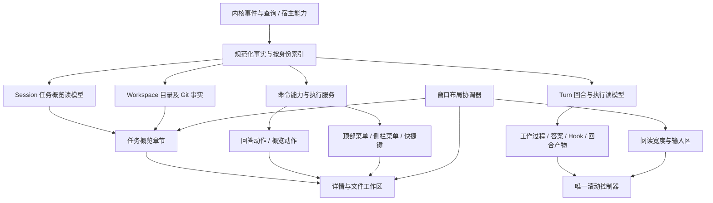

# Codex 中栏整体复核：任务概览、会话命令与回合呈现

日期：2026-10-13。本次由用户指出的两张截图触发，重新审查整体边界。本文修正此前《Codex 中栏体系》§15 的实施顺序；此前有效的流式、折叠、滚动取证继续保留。本文是研究与实施契约，不代表这些能力已经在 Nofy 落地。

## 1. 直接结论

此前挖到了部分呈现机制，但没有完成整个任务界面的能力、数据和交互闭环。旧报告 §14 只概括标题、菜单、概览；§15 把任务概览放进 P2 阅读导航，造成实施围绕正文、动画和局部按钮展开。这个顺序有问题：概览和菜单本来就需要参与会话身份、资源、布局及命令设计。

Codex 中栏至少包含五种协作职责：任务级控制、回合级呈现、任务资源摘要、阅读视口、输入与待处理交互。右侧工作区是它们打开详情的宿主。不能把它理解成“消息列表 + 输入框”，再往 Header 和消息底部补按钮。

## 2. 证据边界

基准仍为本机 `com.openai.codex`，版本 `26.1007.30912`，build `20156`。本次重新计算 `/Applications/ChatGPT.app/Contents/Resources/app.asar` SHA-256，得到 `75e397e2280dde93b70a85aa926f4282c728eacc84dfeb15ba7fb6ddd84628af`，与上轮快照一致。

本次补提取文件保存在 [supplement](/Users/mac/Workbuddy/2026-10-13-codex-center-research/supplement/manifest.json)。只读解包、TypeScript printer 格式化，不执行提取的应用代码；无官方 TypeScript 源码及 source map。以下压缩函数名仅用于定位该构建。

证据分为：用户截图确认入口可见；安装包静态分支确认实现；当前 Nofy 源码确认接入程度。未对 Codex 每个功能做运行时操作，也未验证其全部 feature flag、远端服务或 Nofy 的真实模型恢复链路。不用静态分析代替运行验收。

## 3. 图一：任务概览，不是文件面板开关

调用链：`local-conversation-page` 的 `local-thread-summary-panel-toggle` → `toggle-thread-summary-panel` → `use-thread-summary-panel` → `local-conversation-thread` 的 `$T / tE / sE` → 共享 `Q.Root / Content / Section / Item / Sources`。

- **项目 / 工作区与变更**：`git-summary-branch-changes-row` 接收 `branchName / diffStats / isDiffStatsLoading / onOpenReviewTab`。数字加载时显示加载态；有打开能力时进入 Review。此处是 checkout 变更，不应直接当作本轮修改。
- **子智能体 / 后台过程**：`dx / nx / $b` 读取背景智能体和终端数据；区分活跃、完成与汇总头像，接入子智能体面板、单个后台任务、终端和停止失败反馈。不是从正文里数几个工具卡片。
- **来源**：`KT → AT` 合并文件、外部资源、工具来源、Web 搜索和 Web MCP hostname。文件携带路径 / 行号；图片、文件和 MCP App 走不同打开入口；做 hostname 去重；共享 Sources 默认摘要上限为 3，支持查看全部。输入框附件搜索只是来源系统的一部分。
- **章节状态**：共享 Section 有 `sectionKey`、默认折叠、持久展开选择、条件自动折叠和 reduced-motion。组件中有 30 秒自动折叠等待常量，但不能据此宣称所有章节都 30 秒后折叠。
- **显示模式**：不是固定绝对定位弹窗。布局函数根据主内容可用宽度与摘要宽度计算 `overlay / shift / gutter`：空间不足浮层，中间宽度挪动阅读内容让位，更宽时利用留白。默认摘要宽度为 300 CSS px；默认参数下模式阈值由公式推导为 1096 / 1536 CSS px，输入是主内容目标宽度，不能照搬成整窗断点。
- **状态协调**：固定状态与 popover 临时打开分别存储；同一摘要内容用于 inline 和 popover。切换时协调隐藏、正文位移、动画、滚动位置及可用高度。popover 高度受视口和 Radix 可用高度限制。

这解释了为何仅调整右侧栏宽度不能得到参考项目的体验：概览、阅读留白和右侧文件工作区属于不同层，但必须共享布局预算。

## 4. 图二：能力驱动的会话命令菜单

调用链：`thread-overflow-menu.hn → app-initial.jJo`（导出别名 `SU`），传入 `scope / target / surface / actions / executeAction / paneItems`。

中央构建器按组织、继续工作、复制、窗口、通知、生命周期分组。菜单根据 host、会话类型、父子关系、归档状态、运行状态、Git/worktree 能力及开关生成；不是一份固定按钮数组。

| 截图入口 | 静态确认的含义 | 对 Nofy 的要求 |
| --- | --- | --- |
| 重命名 / 置顶 / 归档 | 共享会话操作，标题菜单与侧栏按 surface 复用 | 命令和能力判断只有一处，不能两套 pending/error |
| 新建侧边聊天 | 创建临时侧边会话，有独立失败反馈 | 有新的会话身份与继承语义，不是把当前聊天复制一份 DOM |
| 分叉 | 本地 / 当前 worktree / 新 worktree 等条件分支 | 与回答下方“从这里分支”的截止位置区分 |
| 计划任务 | 能力资格检查；查询加载、不可用、运行中限制及已有任务编辑 | 真正具备调度服务后接入，不能用按钮充数 |
| 分享 / 复制 | 复制目录、会话链接、Markdown 分开；分享受能力控制 | 导出已加载内容不能冒充完整分享或完整历史复制 |
| 移至右侧面板 | 注入 `tab-context-menu` 的 pane 命令，判断内容当前所在侧与是否能移动 | 会话内容身份与显示位置分离 |
| 新窗口 / 打开方式 | shell 路由与宿主动作，按 host/cwd 等约束 | 需要窗口 / 宿主契约，不能让 renderer 拼命令执行 |

`tab-context-menu.R/z` 处理 chat/content 标签与 left/right/bottom 宿主，并过滤不能执行的移动项。因此顶部菜单与右侧工作区属于同一套任务编排，不能各写各的。

## 5. 上一条反馈的四项，重新放回整体模型

### 5.1 连续计时

`app-primary.LW → D7e` 使用 `status / startedAtMs / completedAtMs`。仅在 `working && completedAtMs == null` 时每秒更新；耗时为 `max((completedAtMs ?? now) - startedAtMs, 0)`。工作未满 1 秒显示 Working，之后显示持续时长；worked、stopped、paused、loading、unknown 分支不同。

当前 Nofy `Spine.tsx:253/261` 在运行分支只显示“正在处理”，结束分支才渲染 `workDuration(turnSeconds(...))`。这是明确的呈现遗漏。还要区分回合开始、一次响应开始、恢复时刻，不能切换会话后重置运行时长，不能用一个工具失败判整个回合已经结束。

### 5.2 回答下方的分支

`sites-end-resource.xx → Ax` 中 `onFork` 受显示策略与完成状态约束；按钮文案为 Fork chat from here / Branch in new chat，有 disabled、isForking、aria-busy。

Nofy 已有 `forkAtTurnEffect(sessionId,cwd,promptIndex?)` 和会话菜单的分叉调用；助手回答行未接入。缺的不是图标，而是回答与内核截止点的可靠映射、操作中的状态、失败反馈、新会话导航，以及旧回答分支不会带入后续轮次的验证。不能拿当前会话完整 fork 伪装成“从这里”。

### 5.3 Hook 统计

这次已沿 import/export 确認锚形按钮：`sites-end-resource.Ax → user-message.ft → hook-stats-dialog`，名称确为 Hook stats。展示 count、blockedCount、errorCount 与 runs；历史含 eventName、source、status、statusMessage、输出条目。blocked/error 会令入口呈警示色；弹窗懒加载有 loading/error fallback。

它是**回合执行统计**，不是设置中的 Hook 配置列表，也不是对话里显示 hook 日志。Nofy `project.ts:753` 已保存 `hook_execution` 的 event_name/runs，并按 event ID 去重；`application/conversation/turns.ts:74` 隐藏其普通正文呈现。可以复用原始事实，但还缺带回合归属的统计读模型。session_start 等会话级 Hook 不应任意归到某个回答；重放不能重复计数；runs 数不能用事件块数量代替。

### 5.4 表格宽度

当前 `conversation.css:889` 给所有顶层表格、代码块统一宽轴并负 margin 居中，导致用户截图中表格超出普通正文边界。这里首先是阅读轴规则不符合用户要求，不宜直接说成窗口溢出。

参考的回答 Markdown 确实传 `allowWideBlocks:true`，因此不能谎称 Codex 所有表格都严格同宽。本项目应按用户要求确定明确策略：默认表格与正文对齐；内容太宽在表格内滚动，展开操作进入独立大视图；代码是否外扩单独定义，不再把两者捆成全局负 margin。概览打开、窄栏、长单元格、字号 / 缩放都进入同一个验收矩阵。

## 6. Nofy 当前能力盘点

以下仅是当前代码接入程度，不等于运行验收通过。

| 模块 | 当前有 | 缺失或未证明 |
| --- | --- | --- |
| 顶部任务操作 | `SessionActionsMenu` 接 rename/delete/fork；本地 pin/unread/archive/group | 没有统一跨 surface 命令能力模型；side chat、移动会话、计划、分享等未在该菜单接入 |
| 任务概览 | `useSessionResources` 提供 context/git；已有 agents、review 面板 | 没有任务摘要入口、统一章节及 responsive 摘要宿主 |
| 资源入口 | `panelRegistry` 注册 files/review/agents；有文件打开与附件搜索 | 缺会话 Sources 索引；聊天本身还不是可迁移的内容标签 |
| 回合呈现 | 分组、摘要、Disclosure、稳定 Markdown、虚拟列表及滚动控制已有基础 | 计时显示遗漏；答案分支和 Hook 统计未接；final 等部分语义仍需明确 |
| 变更 | Review 工作区查询、工具 edit preview | 工作区总体变更与回合变更必须分开；不能从全局 dirty 推断本轮成果 |
| 设置与共享 UI | 共享按钮、菜单、对话框、token、Markdown 已有 | 使用统一控件不等于统一动作协议；`SessionActionsMenu` 仍自行管理菜单开关/操作流程 |
| 错误与恢复 | 连接、运行与工具错误各有部分路径 | “发送后无反应”真实模型链路未验收，不能被本次研究结论覆盖 |

另发现 `CardHeader` 大段注释还称“没有内核写路径，菜单只读”，但 `App.tsx:424` 已注入真实 `SessionActionsMenu`。文档/注释与实际接入不同步，会导致后续沿旧假设继续补丁式开发。

## 7. 整体边界：四类身份、一个布局协调器、共享命令

这是 Nofy 的建议架构，不冒充 Codex 内部原始目录设计。

身份及归属：

- **Session**：会话标题、归档/置顶、本任务关联资源、父子会话；以 session/host 身份隔离。
- **Turn**：开始/结束/原因、活动、回答、Hook、分支截止点、本轮产物；以稳定 turn 身份关联。
- **Workspace**：cwd、Git/工作树、文件；可以被多个会话引用，不能算作某一轮专属事实。
- **Surface**：主栏、侧聊、文件标签、窗口、概览浮层；只拥有显示位置、展开选择、焦点等视图状态。移动不应重建会话事实或丢草稿。

能力必须包含 `supported / enabled / pending / unavailable reason / execute result`。同一命令由 Header、侧栏和回答操作复用；作用域显式带 sessionId、turnId/截止点、host/cwd，避免执行时偷读“当前活跃会话”。

布局协调器负责导航、中栏、工作区、任务概览的宽度预算和模式。滚动控制器负责跟随/让权、恢复、虚拟定位、折叠补偿、输入高度。摘要组件不直接写 scrollTop，表格不自造一套全窗宽度计算。

继续使用现有 UI primitives / menu / dialog / disclosure / tokens。先提取真实重复行为，不建立第二套组件库，也不为每项功能单独创建全局 store。

## 8. 重排实施顺序与验收出口

不再把任务概览放在 P2，也不再按“加动画、加两个图标”交付。每批是可使用的完整链路。

| 批次 | 一起交付 | 验收出口 |
| --- | --- | --- |
| A：任务控制与概览 | 会话身份/能力模型、共享命令、Header 菜单、概览宿主、现有 Git/agents/来源接入；保留真实不可用原因 | 换会话无串数据；两入口不同职责；点击摘要打开对应详情；概览在窄/中/宽栏切换不遮输入、不丢状态 |
| B：回合反馈闭环 | 运行计时、工作过程两层折叠、状态/失败呈现、回答操作、按回合分支/Hook、回合产物 | 持续计时；完成/停止固定；重放不重复；旧回答分支准确；Hook 脱离正文；错误/审批不会被折叠吞掉 |
| C：阅读与输入整体 | 表格边界、窄中栏、正文/概览宽度协同、滚动/导航/输入高度、队列与停止反馈 | 拖宽度、展开长输出、用户向上阅读、输入增高、流式末尾均无抢滚动、裁剪或状态跳变 |
| D：宿主扩展 | 侧聊、会话移动、新窗口及其他尚缺后台能力的命令 | 有真实协议和生命周期才开放；共享上述状态/命令/视图契约，绝不另起一个简化聊天实现 |

批次 A/B/C 都属于当前整体体验闭环；D 的云分享/调度等取决于真实后端，不以视觉仿制冒充功能。当前用户已报告的表格、持续计时、分支和 Hook 均保留在本次范围，未宣布修复。

验收场景至少覆盖：初始/历史恢复、运行无工具、连续工具、正文流式、完成、用户停止、工具失败但回合继续、回合失败、待审批、断线恢复、子任务仍活跃、切换会话、概览开合、右区开合、窄栏、缩放、reduced motion。用脱敏真实事件回放与人工可见操作核对状态和时序；既有单测通过数只证明对应切片，不证明整体与 Codex 对齐。

## 9. 本轮交付与仍需核实

交付：补齐两个顶部入口的真实调用链、按回合 Hook/分支/持续计时证据、现状能力矩阵、状态归属及重排实施契约。未修改产品代码、未新增假入口、未重启用户应用。

仍待运行/契约核实：参考包开关对应用户当前窗口的精确配置；新窗口/侧聊状态迁移细节；内核 fork 截止点与前端 turn 的一一对应；Hook 生命周期如何归属回合；回合级变更快照能力；真实模型停滞的端到端原因。后续对既有符号修改前按仓库要求运行 GitNexus upstream impact，并分别报告风险；本轮仅新增研究文档和证据，没有修改函数/类/方法。

## 10. 可复查源码索引

[机器可读证据索引](/Users/mac/nofy-build/nofy-desktop/docs/architecture/codex-center-integration-evidence-2026-10-13.json) 记录文件哈希和定位行号。

| 证据 | 本地格式化产物 |
| --- | --- |
| summary-layout | [t](/Users/mac/Workbuddy/2026-10-13-codex-center-research/supplement/thread-summary-panel-layout-488b931a4b80.js.pretty:2) |
| summary-host | [F](/Users/mac/Workbuddy/2026-10-13-codex-center-research/supplement/use-thread-summary-panel-f11ba8910e2a.js.pretty:10) |
| summary-sections | [Be](/Users/mac/Workbuddy/2026-10-13-codex-center-research/supplement/thread-summary-panel-components-f242525193ce.js.pretty:6) |
| summary-content | [sE](/Users/mac/Workbuddy/2026-10-13-codex-center-research/local-conversation-thread-c8c5e92ea89e.js.pretty:916) |
| sources | [KT](/Users/mac/Workbuddy/2026-10-13-codex-center-research/local-conversation-thread-c8c5e92ea89e.js.pretty:897) |
| command-builder | [jJo](/Users/mac/Workbuddy/2026-10-13-codex-center-research/app-initial-6350d04672d0.js.pretty:71587) |
| pane-commands | [z](/Users/mac/Workbuddy/2026-10-13-codex-center-research/supplement/tab-context-menu-fb5762dd5b1b.js.pretty:6) |
| hook-button | [ft](/Users/mac/Workbuddy/2026-10-13-codex-center-research/supplement/user-message-dd2539189e70.js.pretty:15) |
| answer-actions | [Ax](/Users/mac/Workbuddy/2026-10-13-codex-center-research/sites-end-resource-78b98c374310.js.pretty:768) |
| work-clock | [D7e](/Users/mac/Workbuddy/2026-10-13-codex-center-research/app-primary-6f60e9ac4103.js.pretty:4068) |
| work-status | [LW](/Users/mac/Workbuddy/2026-10-13-codex-center-research/app-primary-6f60e9ac4103.js.pretty:4034) |
| git-summary | [h](/Users/mac/Workbuddy/2026-10-13-codex-center-research/supplement/git-summary-branch-changes-row-e9eeebdd047c.js.pretty:5) |
