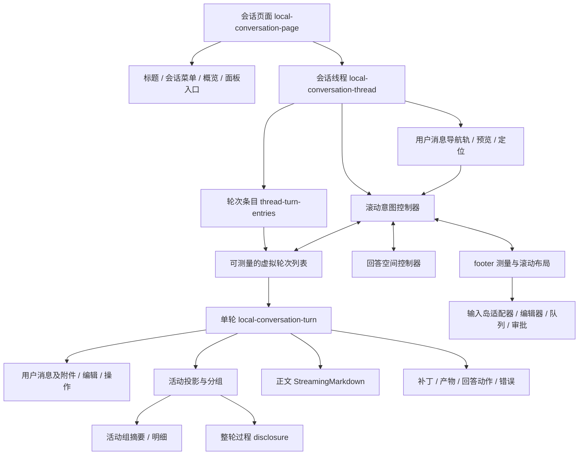

# Codex 中栏体系：生产包取证与 Nofy 架构对照

> 后续整体复核：[任务概览、会话命令与回合呈现](/Users/mac/nofy-build/nofy-desktop/docs/architecture/codex-center-integration-audit-2026-10-13.md)。本文 §14 对顶部入口的分析不足，§15 将任务概览放在 P2 的顺序已由该复核替代；其余内容是当时快照，不能当作当前落地状态。

调研日期：2026-10-13。对象是 Codex 桌面中栏，不是 ZCode。本文覆盖中栏的页面装配、阅读布局、轮次投影、工作过程、折叠、动效、流式正文、滚动、输入、队列、操作与错误反馈。结论来自本机安装包的静态实现；没有把截图观感当成运行时行为证明。

## 1. 结论与取证边界

**Codex 的精细感来自多套状态规则之间的协调。我们已有不少控件和布局基础，缺口主要是这些规则没有形成一致的呈现协议。**

最关键的链条是：语义事件 → 稳定身份的轮次和活动组 → 当前活动摘要 → 最终正文开始 → 有条件地收起过程 → 高度变化补偿 → 保持用户阅读意图。扫描光只是当前活动的一种低强度反馈。单独添加等待文字、换一条扫描光、在结束时隐藏历史，都不能复制这套行为。

本次基准：

| 项目 | 证据 |
| --- | --- |
| 应用身份 | `com.openai.codex`，版本 `26.1007.30912`，build `20156` |
| 安装包 | `/Applications/ChatGPT.app/Contents/Resources/app.asar`；磁盘目录名不是产品身份 |
| SHA-256 | `75e397e2280dde93b70a85aa926f4282c728eacc84dfeb15ba7fb6ddd84628af` |
| 原始及格式化快照 | [本地清单](/Users/mac/Workbuddy/2026-10-13-codex-center-research/manifest.json) |
| 可复查摘录 | [24 组证据、文件哈希与版本](/Users/mac/nofy-build/nofy-desktop/docs/architecture/codex-center-system-evidence-2026-10-13.json) |
| 旧材料 | 用户提供的 `codex-shell-research-full.json` 与 10 月 12 日报告对应较早版本，不能替代本次中栏链路 |

方法：只读解包，使用 TypeScript printer 格式化 JavaScript，沿 import/export 解析调用关系。下文的 `hk`、`mk` 等是该构建的压缩符号，不冒充官方组件名称。检查的核心 bundle 没有随包 source map；没有恢复官方 TypeScript 源码。格式化行号只对应保存的快照。

“静态确认”表示分支、参数和调用存在；“当前窗口一定启用”需要运行时开关和操作录屏验证。本文不声称已复现全部交互，也不以此前 Nofy 测试数量作为本次证据。未修改 Nofy 产品代码、没有打包或重启应用。

## 2. 中栏装配与职责图

以下是从产物整理的职责图，名称为解释性归纳；括号内文件是实际取证入口。



这里的扩展点不只是“注册一个卡片组件”。工具展示还声明是否隐藏、是否独立成行、收起后是否保留、是否只参加汇总、连续调用间是否维持活动状态。布局、事件语义、动作能力和持久状态都有自己的所有者。

## 3. 阅读布局：物理分区、正文宽度、宽块与输入岛

当前 Electron 对应的 CSS 默认正文阅读上限为 `48rem`，Markdown 宽块上限为 `56rem`。这是内容上限，不是中栏最小宽度。窗口分栏可以继续压缩，正文需要流动换行。不能拿 `48rem` 设置中栏的 `min-width`。

共享 CSS 还定义 `conversation-item-gap:16px`、`conversation-grouped-item-gap:4px`、面板内边距、输入岛外扩与相邻区域宽度。普通段落、密集工具行、代码表格的密度不同。输入岛有 `composer-inline-overhang`，因此“共用阅读轴”并不等于所有边框永远同宽。浏览器专用的 `40rem` 紧凑覆盖不能直接套到 Electron。

[`thread-scroll-layout`](/Users/mac/Workbuddy/2026-10-13-codex-center-research/thread-scroll-layout-6cc539710c73.js.pretty:50) 把 footer 与正文放入共同滚动坐标体系：底部区域有独立定位与交互命中层，测量 footer 后更新 `--thread-scroll-padding-bottom`，默认额外留 16px，compact 分支不同。输入变高、审批条出现时，正文的遮挡和滚动补偿一起更新。

**对照 Nofy：**当前已经有 `48rem/56rem` token、居中内容轴、中栏 280px 下限和 1px 分隔线。旧报告中“统一 1152px”已不是当前事实。当前 gutter 是 `clamp(24px,4cqw,40px)`；在 280px 中栏时仅剩约 232px 正文可用宽度，需要结合工具摘要和输入控制测量，而不是继续凭感觉改上限。当前 Dock 仍是占据流布局的独立区域（`max-height:55%`），与 Codex footer/回答空间协作方式有实质区别。

证据：[共享 CSS](/Users/mac/Workbuddy/2026-10-13-codex-center-research/app-shared-9a94b907ed47.css)、[Nofy 尺寸策略](/Users/mac/nofy-build/nofy-desktop/apps/desktop/renderer/ui/windowLayout.ts:4)、[Nofy 阅读 token](/Users/mac/nofy-build/nofy-desktop/apps/desktop/renderer/ui/foundations.css:39)。具体 Codex 主栏最小宽度及截图对应的运行时覆盖，本次未确证。

## 4. 数据先分层，再决定怎么显示

Codex 不是把每个协议事件都渲染成一张卡片。`local-conversation-thread-turn-entries`、`local-conversation-turn` 与活动投影协作，把轮内内容分成用户输入、工作过程、最终回复、持续可见内容及末尾资源。

[`ok`](/Users/mac/Workbuddy/2026-10-13-codex-center-research/sites-end-resource-78b98c374310.js.pretty:2368) 显式划分 `collapsibleUnits`、`expandedUnits`、`persistentUnits`、`preToggleUnits` 与 `workedForItem`。`worked-for` 会进入过程头部；某些交互式工具、用户输入请求、steering/反馈等走保留路径。它没有对所有历史节点统一 `display:none`。

工具注册能力包括 `hiddenInConversation`、`standaloneInConversation`、`persistentInCollapsedConversation`、`summaryOnlyInConversationGroup`、`continuesLiveActivityBetweenCalls`。新工具接入时要交付这些展示策略，否则组件数量越多，规则越散。

活动身份优先采用真实 item/call/request/handoff ID，分组使用首个成员的稳定身份。相同内容追加与新活动切换是不同事件；这决定动画是否重新播放、展开状态是否丢失。

**对照 Nofy：**[`presentWorkSegment`](/Users/mac/nofy-build/nofy-desktop/apps/desktop/renderer/features/conversation/workflowModel.ts:6) 的注释明确承认缺少协议 final-answer 标记。目前只能在 `!running && tail.kind==='agent-message' && tail.closed` 时把尾消息当答案。这个保守回退本身有理由，但无法支持 Codex 那样在最终正文开始时协调过程收起。先补充或查明语义来源，不能靠文本位置猜 final，也不能为做动效伪造内核运行状态。

## 5. 两层折叠，各自有规则

### 5.1 整轮工作过程

截图中的“用时 31 分钟 55 秒 ›”对应 [`collapsed-turn-disclosure`](/Users/mac/Workbuddy/2026-10-13-codex-center-research/collapsed-turn-disclosure-5e77ff7d3908.js.pretty:6)。它是过程容器的入口，使用共享 ghost 按钮、展开语义、旋转箭头与细分隔线；时长优先由 worked item 提供，其次为 duration，再回退到历史消息数量。不是另造的等待提示。

[`mk`](/Users/mac/Workbuddy/2026-10-13-codex-center-research/sites-end-resource-78b98c374310.js.pretty:2387) 的规则可归纳为：

```text
允许收起 = 有可收起的活动
          AND (允许 final 前收起 OR (final 已开始 AND 非取消轮次))

实际收起 = 允许收起
          AND 非强制展开
          AND (已保存的用户选择 ?? 默认允许自动收起)
```

调用方还传入 `disableCollapse`、`preventAutoCollapse`、视图类型、活跃子智能体等条件。某些 activity 模式可在 final 前提供收起能力，同时运行中又阻止自动收起。因此“Codex 一律结束才收起”与“final 一出现一律收起”都不准确。

用户手动选择优先于自动默认值；不可折叠、强制展开和取消等状态分别处理。最终答案、持续可见内容和过程历史不应被同一开关吞掉。

### 5.2 工具活动组

[`b_`](/Users/mac/Workbuddy/2026-10-13-codex-center-research/sites-end-resource-78b98c374310.js.pretty:53) 有 `collapsed → opening → expanded → closing` 四态，默认收起，支持显式 defaultExpanded。打开跨一帧进入展开；关闭等动画完成再撤载；关闭中再次点击可以回到展开。

这层控制的是一个工具组的明细。整轮过程展开，并不意味着每组工具明细全部展开。运行摘要可以保持可见，完成后显示汇总，用户随时展开细节。

Nofy 已有分组、Disclosure 和有 key 的历史列表；真正需要调整的是规则归属与两层折叠协作，不能再用“所有运行项默认展开”概括。

## 6. 活动反馈：语义摘要、稳定更新、有限节奏

[`inline-followup-markdown`](/Users/mac/Workbuddy/2026-10-13-codex-center-research/inline-followup-markdown-4916e7fc54e4.js.pretty:290) 虽然文件名看似 Markdown，实际承载了大量活动归并逻辑。组内可形成查阅、命令、编辑和 MCP 来源汇总；文件/搜索等按语义归并，不只是 `blocks.length`。

当前显示采用 `active / thinking / summary` 等状态：当前未结束的操作产生具体摘要；没有可展示的具体操作时可进入思考摘要；完成时进入结果汇总。不是让每条原始流事件轮流播放一遍。独立错误或特殊交互可以退出普通分组路径。

[`w_`](/Users/mac/Workbuddy/2026-10-13-codex-center-research/sites-end-resource-78b98c374310.js.pretty:68) 对摘要切换做约 1000ms 最小驻留：同一 key 的文字立即更新；换 key 等剩余驻留时间；后续更新会清理旧计时；完成汇总使用 immediate，清理待切换状态。此处没有证据支持给每条摘要都增加上下滚动动画。

展开后的组明细有独立高度上限与边缘淡出，并通过上下文关闭内部 shimmer，避免打开历史后所有旧项仍一起闪。

**对照 Nofy：**当前 [`RollingSummary`](/Users/mac/nofy-build/nofy-desktop/apps/desktop/renderer/ui/rollingSummary.tsx:12) 使用 800ms 的轮播推进和有界待播队列；[`WorkStage`](/Users/mac/nofy-build/nofy-desktop/apps/desktop/renderer/features/conversation/WorkStage.tsx:12) 主要以组内块数量汇总。这与 Codex 的“当前语义摘要 + 驻留 + 完成立即切换”不同。不是把 800 改成 1000 就能对齐。

## 7. 动效不是一条无限 CSS 动画

| 部位 | 产物确认的规则 | 目的 |
| --- | --- | --- |
| 活跃文字扫光 | 启动延迟 600ms；亮段约 1000ms；周期 4000ms | 留出静止时间，避免连续扫动 |
| 组摘要 | 同 key 原位更新，换 key 最小驻留 1000ms，完成立即更新 | 防止高速活动导致文字闪烁 |
| 整轮过程进入 | 高度 0→auto、opacity 0→1、translateY −8→0，默认 300ms | 展开过程中保持结构连续 |
| 整轮过程退出 | 默认 150ms；退出内容保留到动画结束 | 避免先删 DOM 再跳高度 |
| 折叠视口补偿 | 对触发点持续测量，约 350ms 补偿 | 保持用户点击位置稳定 |
| 用户主动滚动 | wheel/touch/pointer/键盘可取消相关程序控制 | 让出阅读控制权 |
| 减少动态效果 | 扫光不启动，部分几何过渡取消；存在保留短淡入的分支 | 不能简单声称所有动画都为 0 |

扫光证据：[`Q4s/$4s`](/Users/mac/Workbuddy/2026-10-13-codex-center-research/app-initial-6350d04672d0.js.pretty:82029)。使用独立的 aria-hidden 高光层，基础文字保留；active 属性和作用域上下文共同决定是否启用，清理时取消 interval/timer。

折叠补偿证据：[`NJe`](/Users/mac/Workbuddy/2026-10-13-codex-center-research/app-primary-6f60e9ac4103.js.pretty:1901)。记录触发点位置，观察所属 `[data-turn-key]` 高度变化，在 rAF 中抵消位移；用户输入会中断补偿。这正是“有动画但仍跳动”的重要区别。

Nofy 当前 `.activity-live` 是 CSS `4s infinite`，有静止段，不能说完全没有节奏处理；但其启动、作用域、摘要切换和折叠补偿没有形成上述同一套约束。此前只加扫光不足以解决问题。

## 8. 自动滚动是一套意图状态机

[`uk`](/Users/mac/Workbuddy/2026-10-13-codex-center-research/local-conversation-thread-c8c5e92ea89e.js.pretty:1552) 将轮次阶段 `idle / prework / final_answer` 与跟随模式分开。跟随模式包括：

| 模式 | 含义与转移 |
| --- | --- |
| `static` | 保持视口；开始前置工作可进入观察 |
| `prework_watch` | 观察最新工作内容是否超出视口；溢出才开始跟随 |
| `prework_follow` | 跟随当前工作内容；进入 final 时可转成 user_follow |
| `user_follow` | 用户明确要求到底部后的跟随 |

离底距离超过 24px 会使跟随状态退出或降级；`scroll_to_bottom` 表示明确用户意图；`hold_viewport`、最新轮移除/重新放置可切回静止。prework→final 的转移取决于原先模式，不能每次收到 token 都 `scrollIntoView()`。

`fk` 还根据消息 phase（包括 commentary）、首个工作项时间和 final 开始时间识别轮次阶段。滚动控制不依赖单个 `busy` 布尔值。

[`thread-scroll-layout`](/Users/mac/Workbuddy/2026-10-13-codex-center-research/thread-scroll-layout-6cc539710c73.js.pretty:50) 隔离用户输入、程序补偿、内容高度变化与 footer 高度变化。包内有常规方向与 reverse 兼容分支，具体分支取决于开关；不应照抄一种 DOM 方向而漏掉抽象。

**对照 Nofy：**[`useTranscriptScroll`](/Users/mac/nofy-build/nofy-desktop/apps/desktop/renderer/ui/useTranscriptScroll.ts:1) 已有用户滚动识别、锚点保存、隐藏恢复和 ResizeObserver，不应推倒这些成果。差距是核心仍以 following/reading 两态与 80px 阈值工作，没有 prework/final 阶段协作，也没有独立回答空间预算。直接把阈值改成 24px不能补上这部分。

## 9. 底部留白是受控空间，不是固定 padding

[`thread-response-space-controller`](/Users/mac/Workbuddy/2026-10-13-codex-center-research/thread-response-space-controller-d9944902d856.js.pretty:1) 单独管理回答预留空间：

```text
available = viewportHeight − footerPadding
maxSpacer = max(0, min(available × 2/3, available − 240))
```

新一轮定位时设置空间并协调视口；正文增长逐渐消耗空间；用户上滚也可减少空间；视口/footer 改变重新约束；空间离屏可以回收。滚轮、触摸、指针和键盘输入可中断放置动画，减少动态效果分支跳过该动画。

这解释了为什么参考项目既可以在新回答下方留白，又不会永久留一大块空洞。它与虚拟列表高度、输入岛遮挡、用户阅读位置共享测量信息。我们应该建设一个 owner，而不是在消息尾、输入框上方、列表 padding 三处各加空白。

## 10. 流式正文：解析、片段身份、呈现节奏分开

已沿 `sites-end-resource.xx → app-initial.Rsl → Bsl/Usl` 追到实际消息 Markdown，不能把同名的导出序列化模块误认为 UI renderer。

[`Rsl`](/Users/mac/Workbuddy/2026-10-13-codex-center-research/app-initial-6350d04672d0.js.pretty:94378) 提供独立错误边界与 buffering 路径。`Bsl` 使用以 streamId 区分的外部 store，支持 adaptive streaming；动画与 reduced motion、开关协同。它验证当前文本是否仍是对应 source 的前缀，避免把旧流缓存套到已替换文本。

`Usl` 对流式与完整内容采用不同路径，处理未闭合代码围栏、directive 和数学解析的中间态；使用 `Intl.Segmenter` 按词分段并有回退。`bsl` 尝试延续已有片段 key，追加文字不会把整段都当作新内容。`Osl/ksl` 对安全前缀 token 做缓存，尾部继续解析，并按 extensions 分开缓存。

普通段落、列表装饰、代码、表格、媒体、文件链接、可视化与自定义 directive 有各自 renderer。调用方传 `allowWideBlocks`、`isStreaming`、`renderCodeBlocksImmediately`、文件打开目标等能力。局部调用存在 16/96ms fade 配置，但条件不同，不能当成全应用统一默认。

**对照 Nofy：**[`Markdown`](/Users/mac/nofy-build/nofy-desktop/apps/desktop/renderer/ui/markdown.tsx:11) 已统一 ReactMarkdown、GFM、代码块与表格组件，但 text 变化仍传完整字符串，没有这里的流片段时间线或前缀缓存。当前链接 handler 无条件 `preventDefault()`，图片只输出 alt 文本；这还是内容交互缺口，不能靠调行高解决。应保留安全解析基础，增加独立流式适配与能力化链接/媒体 renderer。

同日后续落地：以上为调研时基线；稳定前缀、可变尾部和控件身份保留已在 [第二批实现记录](codex-center-streaming-2026-10-13.md) 中落地并验证。adaptive buffering、链接/媒体等缺口仍在，不能视为本节全部完成。

## 11. 用户气泡、回答动作与最终产物

[`user-message.Ft`](/Users/mac/Workbuddy/2026-10-13-codex-center-research/user-message-dd2539189e70.js.pretty:38) 将用户气泡、附件、状态、复制、编辑、额外动作放在同一 `group/user-message` 内。外层 `gap-1`，动作有自身紧凑间距；默认 opacity 0，hover 或 focus-within 显示，无 hover 设备有显式例外，`alwaysShowActions` 也可覆盖。编辑态替换为编辑器，具备取消、提交和草稿状态；不是把两个按钮绝对定位到远处。

assistant [`Ax`](/Users/mac/Workbuddy/2026-10-13-codex-center-research/sites-end-resource-78b98c374310.js.pretty:768) 同样采用动作能力与显示策略：复制、反馈、分叉、附加动作等不是每条中间正文都照搬。是否完成影响可用动作；alwaysShow 与 hover/focus 是明确策略。截图中存在的图标，不等于 Nofy 应当添加一个无后端能力的按钮。

[`dD`](/Users/mac/Workbuddy/2026-10-13-codex-center-research/sites-end-resource-78b98c374310.js.pretty:1669) 是轮次补丁资源：输入含 patchBatches/unifiedDiff、cwd、hostId，合并文件变更，默认展示数量常量为 3。查看变更、打开文件、撤销/重新应用有独立入口、pending 与部分失败反馈。整个工作区的 dirty 文件数量不能冒充本轮修改数量。

Codex 也有 hook 统计的独立动作入口和某些 hookFeedback 的交互语义；不能据此把原始 hook 日志渲染为普通对话。Nofy 用户已明确要求不显示原始 hook，投影层应继续执行这个产品规则。

## 12. 输入岛、菜单与队列是一组协作模块

页面默认 composer 入口已追到 `local-conversation-page.uc → app-primary.$X/rpt`。[`rpt`](/Users/mac/Workbuddy/2026-10-13-codex-center-research/app-primary-6f60e9ac4103.js.pretty:7358) 是会话适配层，分别接收 response in progress、history loading、resuming、handoff、submitDisabled，以及 submit start/error/accepted 等回调。它接入恢复提示和 queued-message-list；停止失败有错误反馈路径。

共享呈现层 [`Fdl`](/Users/mac/Workbuddy/2026-10-13-codex-center-research/app-initial-6350d04672d0.js.pretty:94983) 接收 layoutState、editor、attachments、header、replyContext、leadingActions、modelControl、secondaryActions、primaryAction 等槽位，通过共享 `$S.Body/Input/AdaptiveFooter/FooterControls` 组织。布局观察输入单行溢出、实际宽度、IME composition；有高度过渡与 reduced motion。编辑器 `uHc` 接入 composerController，保留独立输入生命周期。

浮层 [`xfl`](/Users/mac/Workbuddy/2026-10-13-codex-center-research/app-initial-6350d04672d0.js.pretty:95064) 的一个分支明确使用 body portal、跟踪 anchor、按视口约束高度、top placement；另有 expanded tray 分支。菜单裁剪不是把 z-index 加大就能解决，要共同处理宿主、锚点、视口与模式。

[`queued-message-list`](/Users/mac/Workbuddy/2026-10-13-codex-center-research/queued-message-list-77acfdcb3f8a.js.pretty:10) 区分 queued、pending、sending、outcome-unknown、paused 等状态，按条件支持编辑、删除、重排、立即 steer、侧聊和恢复中断队列。中断后明确显示队列暂停原因。不能把“仍可输入”与“已经发送成功”混为一谈。

本次确认 UI 状态和适配入口，没有逐条验证所有服务端发送、重连、幂等与排队协议。Nofy 的“发出后没反应”仍须另用真实请求/turn ID、内核事件和投影记录定位，不能宣布被呈现研究修复。

## 13. 错误、审批与恢复有不同层级

[`YYe`](/Users/mac/Workbuddy/2026-10-13-codex-center-research/app-primary-6f60e9ac4103.js.pretty:2055) 区分用量限制、服务过载、一般系统错误；根据模式提供 inline 或 banner，某些错误附带诊断入口。错误不会一概变成巨大代码输出卡。

过载重试 `QYe/$Ye` 要求线程 ready、仍是对应最后一轮、状态 failed；自动倒计时还受开关与所有者条件约束。手动与自动重试区分触发来源，pending 时阻止重复操作。不能给全部错误套无限重试。

工具错误、系统错误、发送失败、队列结果未知和用户审批是不同问题。截图里的 missing `command` 是工具参数契约失败：应提供简洁摘要与可展开技术详情，同时追查模型请求/工具 schema；扫光不能被当作它还在健康运行的证明。

共享审批呈现有 loading、approveDisabled、键盘入口和窄屏规则（`app-initial.Aml`），持续交互内容在整轮折叠策略里有专门保留位置。该取证不等于已审计所有审批种类。

## 14. 顶部工具、左侧刻度与虚拟化

`local-conversation-page` 将线程标题放进 shell header/titlebar 槽。`thread-overflow-menu` 接收会话身份、cwd、host、导出函数、pending 工作树等；按钮动作来自当前会话能力。`thread-panel-header-actions` 负责面板入口；任务概览与文件工作区开关不是同一概念。不能只照截图把所有图标放进一排。

左侧刻度来自 [`AppThreadUserMessageNavigationRail`](/Users/mac/Workbuddy/2026-10-13-codex-center-research/thread-user-message-navigation-rail-app-4212c5f4f01f.js.pretty:6)，少于 4 项不显示。它连接 scroll controller、预览与 reveal 接口，结合 DOM 观察器更新位置，并支持书签与目标高亮。它代表用户消息定位，不能按 token/chunk 数量画刻度。

[`virtualized-turn-list`](/Users/mac/Workbuddy/2026-10-13-codex-center-research/virtualized-turn-list-6a3bab50898c.js.pretty:14) 以 turnKey 管理动态高度、可见区、overscan、保留轮次、恢复数据和导航请求。目标未挂载时先加入渲染范围再完成定位；ResizeObserver 区分整轮和 latest-follow-content。测量会处理像素缩放与视口补偿。它还提供键盘/屏幕阅读器前往最新回复的入口。

Nofy 已有轮次虚拟化和阅读恢复。下一步应该让阶段变化、折叠、正文高度和导航都通过该能力边界协作，而不是分别写 scrollTop。

## 15. 当前差距与模块化改造顺序

以下为基于静态对照的设计建议，不冒充已经实现或运行验证的修复。

| 顺序 / 模块 | 当前事实 | 应交付的完整能力 |
| --- | --- | --- |
| P0 呈现读模型 | final 依赖停止后的尾消息；运行、内容、折叠分散关联 | TurnPresentation 明确 phase、稳定 item ID、活动单元、最终正文、持续交互和结束原因；缺失字段显式 unknown |
| P0 活动与折叠 | 已有分组和 Disclosure，摘要仍采用轮播 | ActivityProjection + SummaryPresenter + 两层 disclosure；用户选择、完成立即切换、可逆退出、错误/审批保留 |
| P0 滚动与空间 | 已有锚点/恢复，主要为 following 两态 | FollowController + ResponseSpaceController；阶段转移、用户让权、输入高度和折叠补偿一次交付 |
| P1 流式正文 | 统一 GFM/代码/表格；整段字符串重传 | StableStreamingMarkdown；稳定片段、尾部解析、增量呈现、宽块、链接/媒体与错误边界 |
| P1 输入交互 | Composer 已有业务功能，需核对状态组合 | ComposerController + Layout + Queue + Overlay；保留草稿/IME、明确发送结果、停止失败、浮层视口约束 |
| P1 轮次结果 | 已有动作和部分工具预览 | TurnResources 与 ActionCapabilities；本轮变更、结果入口、真实可用动作和失败反馈 |
| P2 阅读导航 | 已有虚拟定位，无完整参考导航体系 | 用户消息索引、书签/预览、虚拟 reveal、任务概览；统一命令入口 |

每个模块导出自己的 public interface；组件只读呈现模型，禁止自己推断内核运行真相。现有 shared UI、token、虚拟化和隔离 IPC 边界继续复用。上述模块名是建议，不要求机械创建同名文件，更不要求复制压缩产物。

关键契约建议：

```ts
type TurnPhase = 'unknown' | 'prework' | 'final' | 'settled';
type EndReason = 'completed' | 'failed' | 'cancelled';
type FollowMode = 'static' | 'prework-watch' | 'prework-follow' | 'user-follow';
// 数据层提供 phase 及来源；呈现层管理选择、折叠和动效；视口层独占滚动补偿。
// unknown 保留可靠降级，不能通过“最后一段文字”推断 final 开始。
```

界面错误反馈不能反向把内核 turn 改成已完成；动画结束也不等于工具结束。自动折叠默认值不覆盖用户刚展开的过程。活跃光效只归当前语义活动所有，历史展开区默认静止。

## 16. 验收必须录制完整时序

| 场景 | 验收观察点 |
| --- | --- |
| reasoning → 多工具 → commentary → 工具 → final | 阶段、摘要、动作和折叠各自正确，不因每个 chunk 重建 |
| 快速连续工具完成 | 当前摘要可读，完成后不播放过期队列 |
| final 流式输出中 | 前文稳定，仅新增部分呈现；过程策略与正文同步 |
| 手动展开后继续生成 | 用户选择保留；旧过程不重新扫光 |
| 打开/关闭中途反向点击 | 无突然卸载，无空白跳帧，触发点位置稳定 |
| 在底部/上滚读历史/点击回底 | 三种意图可区分，流式追加不抢历史阅读 |
| 输入变高、审批出现、右栏拖到窄中栏 | 不遮挡尾文、不出现横向溢出、不重置草稿与 IME |
| 工具失败、发送失败、停止失败、结果未知 | 不同错误与可用动作清晰，无假成功和永远运行 |
| 新轮次留白到正文变长 | 空间逐渐消耗，用户滚动可中断，结束不留永久空洞 |
| 长历史切换会话、导航未挂载轮次 | 返回原阅读锚点；导航等待测量后准确落点 |
| reduced motion / 隐藏窗口后恢复 | 不补播积压动画，不把隐藏时测量写成有效位置 |

需要同时保存事件时间线、phase/summary/follow/disclosure 状态和 GUI 帧序列。单测验证决策，GUI 验证可见行为；测试全绿不能替代用户报告的具体流程复现。

## 17. 尚未确证的边界

本次已贯通主要静态呈现链路。仍未确认当前账户开关组合、全部模型通道与审批类型、服务端队列/重连协议、各种窗口缩放下的最终 CSS 像素，以及安装包升级后的行为。源码里存在某分支不等于截图正在走该分支。

后续实施应先把第 15 节的 P0 三个模块作为一次贯通切片：**语义阶段 → 活动摘要/折叠 → 视口/回答空间**。在同一真实会话录屏中验收后，再推进流式正文与输入结果能力；不再把一条扫描光或一行等待提示当作体系改造。
