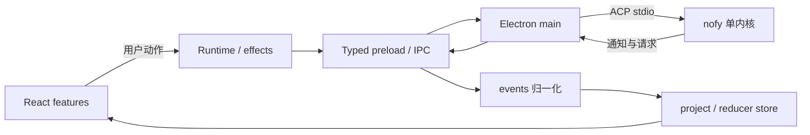
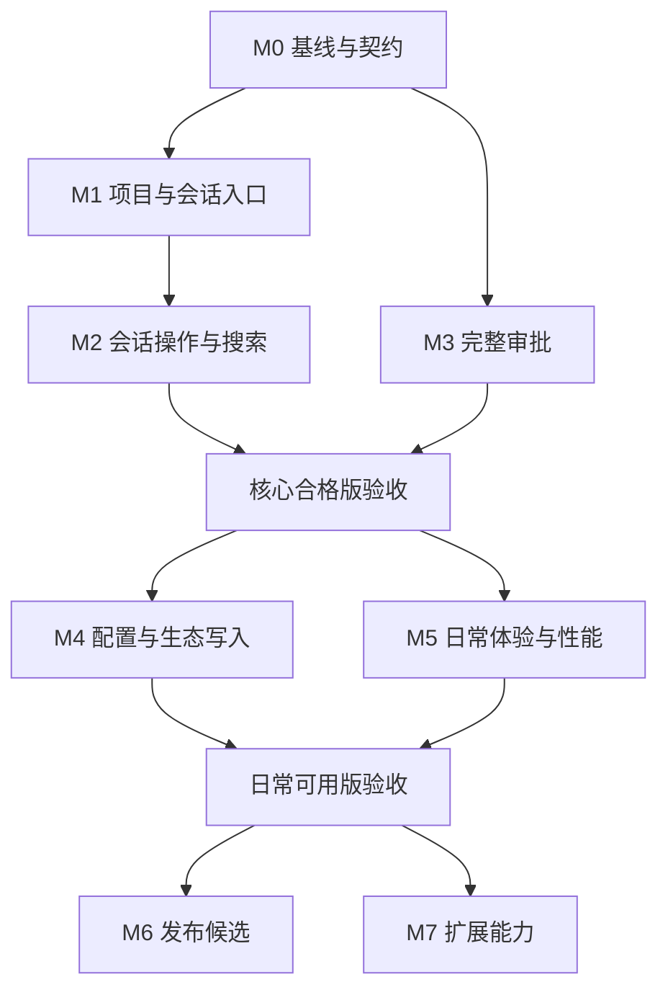

# Nofy 前端完善 Implementation Plan

> **For agentic workers:** Use `superpowers-executing-plans` to implement this plan task-by-task. Checkboxes track delivery; do not start later milestones before their dependencies pass.

**Goal:** 在现有 `nofy-desktop` 上交付可日常使用的 nofy 桌面前端：打开项目、持续对话、管理会话、完成审批、查看变更、配置模型与 MCP，且失败、重连、重启后行为可解释、可恢复。

**Architecture:** 保留 Electron main 所有的单个 `nofy agent stdio` 子进程。内核状态通过 ACP → 归一化 → reducer 投影进入 store，组件动作通过 runtime.effect 出站；原生目录选择和导出文件由 typed preload bridge 提供。ZCode 3.14.3 用作界面与交互参照，协议和权限语义由 nofy 决定。

**Tech Stack:** Electron、React 19、TypeScript strict、Vite、现有 reducer store、ACP 契约包、xterm、Node test runner。

日期：2026-10-08（Asia/Shanghai）。更新：2026-10-09，主流程已实现并完成分层验收；
当前交付、证据与剩余边界见 [验收状态](../../contract/frontend-acceptance.md)。下文是原始施工要求，未将扩展范围或未验证平台自动勾成完成。

## 1. 路线选择与范围

采用**继续完善 `nofy-desktop/`** 的路线。已有传输、投影、夹具、终端和真实界面可复用；新增能力按完整用户动作纵向交付。

其他路线的取舍：

| 路线 | 收益 | 代价 | 结论 |
|---|---|---|---|
| 继续完善新前端 | 保留 nofy 接线与现有测试，开发面可控 | 需逐项补全产品操作 | 主线 |
| 改造 ZCode 官方前端接 nofy | 可获得大量完整 UI | 服务、状态、协议、宿主依赖均需迁移，现有 ACP 投影难以直接替换 | 不作为本轮迁移项目 |
| 继续修旧构建产物 | 短期外观接近旧版 | 缺少可靠重建与类型边界，难随上游升级 | 仅作历史参照 |

范围分三级：

- **核心合格版：M0–M3。** 项目、会话、真实对话、审批完整，失败与恢复有验收证据。
- **日常可用版：M4–M5。** 配置和生态可操作，长会话、搜索、快捷键、可访问性达到日常使用要求。
- **发布候选版：M6。** 目标平台安装、退出、升级与日志诊断完成验证。

M7 为能力扩展积压，不阻塞日常可用版。云账户、订阅、支付、bots、移动远控、CUA、Office/PDF 全家桶不纳入本轮范围。自动化与复杂工作流单独排期，不因 ZCode 提供同名功能就提前加入。

## 2. 代码树与证据优先级

| 位置（相对仓库根） | 职责 |
|---|---|
| `nofy-desktop/` | 唯一前端开发主线 |
| `ref-desktop/` | 官方 ZCode 3.14.3 源码参照，不在此实现 nofy 产品功能 |
| `desktop/` | 旧壳、逆向资料、协议研究，仅阅读 |
| `crates/codegen/` | nofy 内核契约与 TUI 行为的权威源码，本计划不修改 |
| `nofy-desktop/docs/contract/` | 已录得的线路形状、客户端义务、UI 度量 |
| `nofy-desktop/PLAN.md` | 历史架构裁定与施工记录；未来开发排序采用本计划 |

遇到冲突时，依次核对当前代码、真实运行行为、已脱敏夹具，再解释历史文档。静态生成表里的方法名只证明有源码证据，不证明当前二进制支持某种参数。

ZCode 对照入口：`packages/ui/src/WorkspaceSidebar.tsx`、`v4/composer/V4ComposerToolbar.tsx`、`PermissionDialog.tsx`、`ElicitationDialog.tsx`、`app-shell/PlanDetailSidePane.tsx`、`settings/ModelProviderSection.tsx`、`settings/McpSettingsSection.tsx`，均位于 `ref-desktop/`。

## 3. 当前基线（2026-10-08 实测）

| 能力 | 当前状态 | 对应代码或证据 |
|---|---|---|
| Electron 启动与首屏 | 实际启动并截图成功 | `apps/desktop/main/index.ts`、`renderer/main.tsx` |
| ACP、IPC、reducer 投影 | 已实现并有测试 | `main/acp/connection.ts`、`renderer/core/`、`main/seam/` |
| 新建、历史载入、流式、停止 | 已有代码与夹具；本轮未重验完整真实模型对话 | `renderer/core/effects.ts`、`features/conversation/` |
| 模型、权限、附件、@、/、$ | 已有实现；组合操作纳入新 E2E 验收 | `Composer.tsx`、`App.tsx`、相关纯模型 |
| 权限、问答、工作区信任 | 已有专用卡 | `features/approvals/ApprovalCard.tsx` |
| 计划审批、MCP elicitation | 目前进入 UnknownCard | 同上 |
| 打开项目 | 添加项目按钮禁用；新建固定 `boot.cwd` | `Sidebar.tsx`、`App.tsx` |
| 会话动作 | 顶部更多菜单仅展示信息 | `CardHeader.tsx` |
| 队列 | 已有部分 effect；QueueStrip 主要展示 | `effects.ts`、`QueueStrip.tsx` |
| 文件、diff、子智能体摘要 | 已有实现 | `features/aux/`、`AuxPane.tsx` |
| 终端 | 实际 PTY 验证通过，收起不销毁 | `TerminalDock.tsx`、`pty-smoke.ts` |
| 设置 | 主题与统计可用，生态以只读列表为主 | `features/settings/` |
| 恢复 | 内核进程恢复通过；流式会话恢复仍需专项验收 | `recovery-smoke.ts` |

已执行：`pnpm typecheck`、`pnpm test`、`pnpm build` 均通过；桌面测试 224/224；`pnpm smoke` 7/7、`pnpm smoke:pty` 8/8、`pnpm smoke:recovery` 11/11。PTY 在无会话模式下通过，不等于已验证会话绑定全部行为。

当前实际使用 `~/.local/bin/nofy`，握手版本为 0.2.121；版本字符串不能证明它包含当前未提交的 Rust 改动。完整 `pnpm verify`、真实模型整轮、全部 GUI 操作、Windows/Linux 尚未在本轮验收。构建有 renderer 单 chunk 超过 500 kB 的提示，列入 M5，当前不作为功能阻塞。

## 4. 必须保持的状态与边界



| 状态 | 唯一所有者 | 规则 |
|---|---|---|
| 会话、轮次、队列、权限结果、模型生效状态 | nofy 内核；store 是其投影 | 不用 UI 的成功动画冒充内核已接受 |
| 目录对话框、保存对话框、子进程、宿主路径验证 | Electron main | 通过 typed bridge，不把 Electron/Node 暴露给组件 |
| 当前选中的项目、会话导航、输入草稿、布局 | renderer 窗口 | 草稿按会话隔离；切换不会将 A 的文本提交给 B |
| 主题、布局、最近项目 | 现有 UI 偏好层 | 仅保存非机密 UI 信息，兼容已有持久化格式 |
| 模型凭据、权限配置、MCP 配置 | 内核配置体系 | `config.json` 优先、`config.toml` 遗留回退；优先经内核写入 |
| PTY 输出 | 现有 ptybus 与终端视图 | 保持“收起不销毁”，不把高频输出塞进全局 store |

所有异步结果按目标会话/项目落位；用户切换后旧请求不得覆盖新页面。已完成的轮次不得残留可点击的孤儿审批；连接重建后不得用旧 RPC id 应答。

## 5. 依赖顺序与交付里程碑



图表示依赖，不要求启动多个代理。实际开发默认按下表顺序逐任务推进，每完成一个动作就可构建、可运行、可回归。

以下路径相对 `nofy-desktop/`；标注“新增”的文件是计划产物，尚不存在。

### M0：开发基线与契约账

**T00 基线和产品验收账（先完成）**

- [ ] 新增 `docs/contract/frontend-baseline-2026-10-08.md`，记录源码 commit、dirty 范围、实际二进制路径及版本、生成证据摘要；不记录密钥。
- [ ] 新增 `docs/contract/frontend-acceptance.md`，按本计划的 E01–E12 记录“未执行/通过/失败/阻塞”，关联截图、夹具和实际命令。
- [ ] 在隔离配置及临时 Git 仓库下重跑整轮对话、停止、历史载入；补齐本次分析未覆盖的运行事实。

验收：每项结论有执行日期与证据；既有失败单列；`README.md` 的入口、配置说明和进度与代码一致。

**T01 写路径取证（每类功能各自完成后才允许接按钮）**

- [ ] 扩展现有 `scripts/probe-session-shapes.ts` 的隔离探针，实测重命名、fork、删除、搜索的参数、返回值、事件回显与失败行为。
- [ ] 分别新增 `scripts/probe-approval-shapes.ts`、`scripts/probe-settings-writes.ts`，验证计划/elicitation 应答和模型/MCP/插件写路径。
- [ ] 新增 `docs/contract/frontend-write-paths.md`，逐方法标明 request/notification/server-request、作用域、成功依据、是否支持当前 binary。

验收：探针可复跑、不修改真实配置/会话；有名字但调不通的方法登记为不可用，不通过猜字段绕过。某类功能缺口不阻塞其他已取证的功能。

### M1：打开项目、可靠对话与会话切换

**T02 原生目录选择（依赖 T00）**

- [ ] 在 `preload/contract.ts` 定义 `pickDirectory(): Promise<string | null>`；在 `preload/index.ts` 与 `main/seam/register.ts` 接通宿主选择能力。
- [ ] main 使用 `dialog.showOpenDialog` 的 `openDirectory`，父窗取发送者所属窗口；取消返回 null；验证返回路径确为可访问目录。
- [ ] 补 `test/ipc-bridge.test.ts` 的取消、正常目录、宿主错误用例；更新 `docs/contract/ipc-boundary.md`。

验收：调用不启动第二个内核；取消不改变项目/会话；宿主失败能返回可呈现错误。

**T03 项目选择与最近项目（依赖 T02）**

- [ ] 在 `renderer/core/runtime.ts`、`renderer/seam/runtime.ts` 暴露目录选择；新增 `features/shell/workspaceModel.ts` 与 `ui/workspacePrefs.ts` 管理窗口选中项目和最近项目。
- [ ] 将 `App.tsx` 的项目选择逻辑提取到新增 `features/shell/useWorkspace.ts`；`Sidebar.tsx` 的添加项目与项目入口转真。
- [ ] 新建任务用选中项目 cwd；打开已有会话以该会话 cwd 为准；项目空目录、非 Git 目录均可使用。路径带空格、中文也能正确创建。

验收：A/B 两仓切换正确；重复选择同目录不重复最近项目；失效路径给重新选择入口；凭据缺失时保留所选项目并显示失败原因。

**T04 草稿隔离与会话恢复（依赖 T03）**

- [ ] 新增 `features/conversation/draftModel.ts`，草稿按 sessionId 隔离，尚无会话的草稿按项目隔离；发送确认后只清目标草稿。
- [ ] 提取新增 `features/shell/useSessionNavigation.ts`，将切换/历史加载/新建的状态机从 `App.tsx` 收敛到单一入口。
- [ ] 记录最后访问会话；启动先验证能否载入，再按需新建；失败不无限循环创建。切换请求返回时仍写入其原会话。

验收：A 有草稿→B 输入→回 A，文本和附件分别保留；请求失败保留文本；重启不额外产生空会话；消失的历史会话能回到项目空态。

**M1 出口：** E01–E03 通过，并完成一轮真实对话；新项目入口不再依赖启动环境变量。

### M2：会话生命周期、轮级操作和搜索

**T05 重命名（依赖 T01 会话取证、T04）**

- [ ] `core/effects.ts` 接已证实的 rename 请求，`core/project.ts` 对回显统一投影；不维护第二份标题。
- [ ] 新增 `features/shell/SessionActionsMenu.tsx`；`CardHeader.tsx` 和侧栏共用动作定义，输入标题校验、提交中状态、失败保留输入。
- [ ] 补投影/动作测试；重载后确认新标题从内核读回。

验收：侧栏、头部、命令中心标题一致；自动标题通知不会错误覆盖新的人为标题；后台会话可按其身份重命名。

**T06 导出（依赖 T04）**

- [ ] 新增 `features/conversation/exportModel.ts`，按轮次导出 Markdown，保留用户、最终答案、工具结果的可识别结构。
- [ ] typed bridge 增加限定的文本保存能力，由 main 打开保存对话框并异步写文件；不得增加任意文件写入口子。
- [ ] 当前已加载内容与完整历史导出明确区分；只有证实拿到完整转录后才提供“完整导出”。

验收：取消不写文件；编码、中文、代码块可读；原始协议/配置密钥不混入导出；写入失败可重试。

**T07 fork 与轮级编辑/重试/回退（依赖 T01、T05）**

- [ ] fork 单独交付：接内核已证实线路，形成新会话，记录父子关联并载入结果。
- [ ] 编辑重跑、重试、文件回退各作为单独子任务；新增 `features/conversation/TurnActions.tsx`，入口放轮级菜单，能力由内核信息或已验证边界控制。
- [ ] 文件回退先展示会影响的文件与轮次；分清回退转录和回退文件。内核不支持某动作时保留有依据的不可用状态。

验收：原会话不因 fork 被改写；进行中的轮次不执行冲突操作；每个子任务都有真实文件/转录前后对照；禁止把普通重新发送伪装成内核 retry。

**T08 搜索、定位和生命周期收尾（依赖 T01、T05）**

- [ ] 新增 `features/conversation/findModel.ts` 做已加载会话内查找、结果计数与跳轮；拓展 `CommandPalette.tsx` 的会话搜索，区分标题匹配和内容检索。
- [ ] 对历史搜索接已实测的内核路径；分页不得重复条目，切查询丢弃旧请求的视图结果。
- [ ] 删除使用内核已证实的生命周期动作并确认范围；“归档/置顶/未读/分组”先确定内核元数据能力，若采用本地 UI 元数据，在本任务 spec 明确存储、跨窗口语义和卸载行为，不混同删除。

验收：查找可定位到目标轮次；删除失败列表不消失；关闭活动会话后能选择另一会话或显示空态；不承诺当前没有数据支撑的全局搜索。

**M2 出口：** E04–E06 通过。fork、编辑、重试、回退分别记状态，某项不可用有契约证据；核心合格版不得将已证实可用却未接线的动作标成完成。

### M3：完整审批与运行中控制

**T09 计划审批（依赖 T01 审批取证）**

- [ ] 新增 `features/approvals/planModel.ts`、`PlanApprovalCard.tsx`；`ApprovalCard.tsx` 给 exit-plan 独立分支。
- [ ] 支持内联计划与内核实际提供的文件计划；展示计划正文、批准、反馈、取消，明确 feedback 与 abandoned/cancelled 的语义。
- [ ] 计划评论按内核能力决定结构；未支持行级评论时先交付整体反馈，不捏造行号协议。

验收：批准后继续执行；反馈能到达内核；计划读失败不误批；同请求只能提交一次；用户切会话不将计划发给另一会话。

**T10 MCP 表单 elicitation（依赖 T01 审批取证）**

- [ ] 新增 `features/approvals/elicitationModel.ts`、`ElicitationCard.tsx`，按实际 schema 生成支持的字段、必填与枚举校验。
- [ ] `core/interactions.ts` 保持协议分类，组件不硬编码线路名；取消、拒绝、接受按各方法真实形状应答。
- [ ] 不支持的字段类型逐项说明，不能提交一个丢字段的“成功”表单。

验收：合法字段提交后请求结束；不合法字段留在表单定位错误；取消与接受可区分；敏感字段不进入诊断日志。

**T11 权限变体与停止（依赖 T09、T10）**

- [ ] 扩展 `permModel.ts`、`ApprovalCard.tsx`：bash 授权范围、MCP Tool/Server scope、拒绝附言等按实测语义交付。
- [ ] 实测子代理仍运行时的停止政策；若内核支持选择，新增 `CancelTurnCard.tsx`，避免 Stop 默默留下未知状态的后台任务。
- [ ] 补权限/问答/计划/表单夹具及 `turn_completed`、断连、取消时的清账测试。

验收：安全选项优先且键位与屏幕顺序一致；双击不重复应答；轮次结束无孤儿卡；重连不提交旧 RPC id；选项文案不扩大授权含义。

**T12 队列可操作（依赖 T01 对通知方向核对、T04）**

- [ ] `QueueStrip.tsx` 增加取消、编辑、清空；复用已有 effect，重排与 interject 在实测后各自交付。
- [ ] 区分 UI 草稿、内核已接受的排队输入、正在执行输入；编辑时处理条目已执行/已删除的冲突。
- [ ] 暂时的乐观展示必须能由内核 queue_changed 校正，不能用本地删除冒充取消。

验收：运行中排两条→编辑第二条→取消第一条，内核实际执行内容与界面一致；切会话不串队列。

**T12R 会话级恢复与诊断（依赖 T04、T11；核心版出口前完成）**

- [ ] 在已通过的进程恢复基础上专项验证流式中断、审批中断、renderer reload、历史回放和 pending 请求重投。
- [ ] 需要恢复的状态从内核重新读取；保留可恢复草稿，明确某次提交是否被接受，不自动重发有副作用的 prompt。
- [ ] 对丢帧计数、unknown 事件、malformed 帧和不可用能力给可检查的诊断入口，输出脱敏日志。

验收：E11 通过；恢复后无重复用户块、重复工具执行、重复审批；退出无孤儿内核；未知事件不悄悄丢失。

**M3 出口（核心合格版）：** E07–E09、E11 通过；权限/问答/计划/表单可在 GUI 完成。未支持的内核能力有证据与明确边界，常用操作不存在假按钮。

### M4：设置与生态从只读走向可操作

**T13 模型配置与凭据（依赖核心合格版、T01 设置取证）**

- [ ] 新增 `features/settings/ModelSettings.tsx` 与 `modelSettingsModel.ts`，从实际模型/认证能力形成供应商、模型、凭据和连接反馈。
- [ ] 凭据通过已证实的内核路径写入；成功后读回非机密状态，触发模型刷新，不将密钥存在 localStorage 或用量账本。
- [ ] 将默认模型、思考强度等能力可用性与真实模型目录关联，区分应用默认值和会话当前值。

验收：配置可用供应商后能进行真实对话；坏凭据得到可操作错误；重启可用且界面不回显密钥；不支持思考档的模型不产生假写入。

**T14 MCP 管理（依赖 T10、T13）**

- [ ] 新增 `features/settings/McpSettings.tsx`，按实际接口分别交付新增/编辑、启停、删除、工具清单、认证或 setup。
- [ ] 表单区分 user/project 作用域与运输类型；写入经内核完成，观察生命周期通知并读回配置状态。
- [ ] 内核进程内 SDK MCP 尚无客户端支持时逐服务器说明，不能显示全部 ready。

验收：新建测试 MCP→加载工具→停用→启用→删除全链路可复跑；失败保持可编辑内容；其他 MCP 不被覆写。

**T15 插件、技能、hooks（依赖 T01 设置取证、T14）**

- [ ] `SettingsSurface.tsx` 中插件列表、市场列表与技能列表分成各自组件，分别交付插件安装/启停/卸载和技能来源/作用域/详情。
- [ ] 新增 hooks 查看分区及 personas/agents 目录，只显示当前真实能力；写管理功能各自取证后交付。
- [ ] 插件失败保留来源和可重试入口；安装后的列表、命令及 MCP 状态由内核刷新，不手工编造数量。

验收：在隔离配置下安装测试插件→出现真实能力→停用→卸载；技能来源可核对；重复点击不并发执行同一安装。

**T16 通用设置与偏好（依赖 T13）**

- [ ] 在现有 `theme.ts`、`prefs.ts` 基础上补系统主题跟随、字号/缩放；新增语言资源层，按现有中英产品目标整理用户文案。
- [ ] 内核设置与窗口 UI 偏好分开存储；模型/MCP/权限配置优先走内核写，不新增 setting.json 或 v2 配置树。
- [ ] 只有确认当前内核无法提供写路径且任务确需本地写时，另立配置写入 spec 解决原子更新、格式保留和并发冲突。

验收：主题、字号、语言重启保留；切换语言无混合旧文案；热重载不改写别的配置；统计页只展示其声明的数据范围。

**M4 出口：** E10 通过。首次使用可通过设置完成可用配置，不要求用户手工编辑配置文件；配置写入失败不误报成功。

### M5：体验与性能

**T17 长会话与渲染性能（依赖核心合格版）**

- [ ] 先用录制夹具建立至少 100 轮、1000 块的可重复基线，测首屏、滚动和流式提交耗时，不凭文件行数断言慢。
- [ ] 按测得瓶颈增加 store selector 订阅、消息虚拟化与稳定块标识；保留复制文本、跳轮、手动滚动后不抢位置的行为。
- [ ] 对终端、设置等按需加载；消除或解释现有大 chunk 警告。新增依赖前核对现有能力，避免为拆文件重写 store。

验收：同机同夹具前后比较无回退；目标为常规交互响应 p95 ≤100 ms（开发目标，未达标列原因）；向上阅读时新输出不强制跳底；虚拟化不改变内容与操作语义。

**T18 键盘、布局、可访问性与媒体（依赖 T17）**

- [ ] 暗/亮主题检查 1280×860 与 1024×768，多卡审批、长标题、长 diff 下输入框与主要动作仍可达。
- [ ] 焦点进入/退出弹层、Esc、Tab、组合键、中文输入法 composition 都有真实 GUI 场景；快捷键帮助与注册表保持一致。
- [ ] 对照实际需求补代码复制/下载、图片与 Mermaid；链接打开由宿主控制；没有后端数据的预览不显示可点击入口。

验收：只用键盘可走项目→会话→输入→审批→关闭弹层；发送不截断中文输入；主要文本/控制对比度符合 WCAG AA；错误能被定位且无需重新输入全部内容。

**M5 出口（日常可用版）：** E01–E11 全部有有效证据，M4 和 M5 的体验/配置场景通过；运行证据来自真实界面，不能只用 reducer 单测替代。

### M6：发布候选

**T19 包装与平台验证（依赖日常可用版）**

- [ ] 明确应用与内核的分发关系、二进制发现、版本显示和能力兼容；没有内核时提供实际可行的安装/选择路径。
- [ ] 以当前 macOS 为首个交付平台，验证安装、首次启动、二次启动、退出、卸载保留数据策略；Windows/Linux 各设独立验收账，不虚报已支持。
- [ ] CI 运行无凭据门；真实模型 E2E 单独受控运行；发行说明包含已知边界、数据迁移与回滚方法。

验收：E12 通过，目标平台零阻塞缺陷；同一发布包能执行核心场景；正式签名、公开发布等外部动作在有明确发布请求后执行。

### M7：扩展能力积压（每项单独出 spec 与计划）

| 原 P1–P8 范围 | 本计划落点 | 剩余扩展 |
|---|---|---|
| P1 会话内环 | M1、M2、T17 | 完整 timeline、特殊会话来源迁移 |
| P2 审批 | M3 | 未支持的细粒度计划评论与特殊权限族 |
| P3 活任务 | T11、T12、子代理现实现 | 多源任务面、todo、btw、转后台、复杂 follow-up |
| P4 上下文/记忆/诊断 | 已有用量、T12R | memory 浏览、recap、doctor、goal 详情 |
| P5 生态 | M4 | 完整 personas/agents 管理、复杂 workflows |
| P6 全局运维 | T08 | 多会话 dashboard、trash/forensics/worktree/PR 管理 |
| P7 查看器 | T18 | 全屏 BlockViewer/LineViewer、视频等独立查看器 |
| P8 桌面增强 | T16、M6 | tray、原生通知、zen、多 agent tabs |

自动化：先确认调度、持久化与通知的内核所有者，再定义创建/编辑/暂停/删除/执行历史；界面不会另建一套隐藏定时器充当内核调度。

## 6. 产品验收场景

| ID | 场景 | 必须观察到的结果 |
|---|---|---|
| E01 | 从系统目录框打开新仓库 | cwd 正确，项目可见，无第二内核；取消无副作用 |
| E02 | 对话→工具→权限→最终答案 | 真执行与展示一致；停止后不留卡；失败保留可恢复文本 |
| E03 | A/B 会话切换与重启 | 草稿、附件、标题、历史各归其主；不自动创建多余会话 |
| E04 | 重命名与导出 | 所有入口一致、重启读回；取消导出无文件，导出范围准确 |
| E05 | fork/编辑/重试/文件回退 | 原会话与文件的变化可核对；并发运行下不可做冲突操作 |
| E06 | 标题/内容搜索和跳轮 | 结果类型、总数/分页与定位可信；旧查询不覆盖新查询 |
| E07 | 计划→反馈→批准执行 | 计划可读、反馈到达、批准继续、取消结束相应请求 |
| E08 | 多题问答与 MCP 表单 | 必填/多选/自由文本正确；接受、拒绝、取消可区分 |
| E09 | 子代理停止与队列编辑取消 | 实际存活任务与队列结果符合选择，无跨会话串扰 |
| E10 | 模型/MCP/插件配置 | 写入、热重载、读回、重启一致；失败不丢输入或覆写其他配置 |
| E11 | 流式/审批断内核，reload，再恢复 | 无重复执行/重复块/旧 id；草稿可恢复；单内核保持 |
| E12 | 安装→使用→退出→再次启动 | 正确发现内核，无孤儿进程，配置/会话按策略保留 |

额外边界必须覆盖：目录含中文/空格、非 Git 工作区、失效目录、无凭据、坏凭据、长文本、中文输入法、连续切换、重复点击、请求中切页面、多卡审批、权限模式变化、能力缺失。

## 7. 每个任务的执行方法与质量门

1. 先读目标 spec、当前源码与相关契约。将本任务的输入、输出、状态所有者、成功依据写入对应 `docs/contract/` 文档。
2. 用 GitNexus query/context 定位，修改函数/类/方法前必须 impact upstream，并向用户报告直接调用者、受影响流程与风险；HIGH/CRITICAL 先明确提醒。索引过期按仓库规则刷新，不把旧图当当前验证结果。
3. 对有风险的状态/协议行为先写可失败的测试并确认其失败原因，再接最小实现；低风险文案、布局修改采用视觉检查，避免镜像实现的测试。
4. 一次只交付一个动作。涉及 bridge、投影、UI 时按契约→实现→真实回显顺序，保持现有可运行状态。单任务超过约 5 个实现文件时，按契约、接线、视图拆成连续小批；T07、T08、T15 中的独立动作各自验收，不能一次大改后统一宣布完成。
5. 跑相关测试与 `pnpm typecheck`；阶段出口跑 `pnpm verify` 与 E2E。记录实际结果与限制，不把已知失败计为通过。
6. 检查 diff，保留无关工作。提交前必须 `gitnexus_detect_changes()`，确认范围和执行流符合预期；计划本身不要求本轮提交现有未提交工作。
7. 更新任务状态和验收账；源码已写、测试通过、GUI 已验收是三个不同状态。

从 `nofy-desktop/` 执行的现有命令：

```sh
pnpm typecheck
pnpm test
pnpm build
pnpm audit:fixtures
pnpm smoke
pnpm smoke:pty
pnpm smoke:recovery
pnpm verify
pnpm dev
```

`pnpm verify` 当前包含 gen、typecheck、test、夹具审计、build 与三类 smoke；它不包含完整 GUI E2E，也没有独立 lint 命令。执行时核对 `package.json`，不要把 `ref-desktop` 的 lint/typecheck 命令误用到新前端。

新增自动 GUI 场景建议放 `apps/desktop/e2e/`，与现有 Node 单测分开；先验证 Electron 启动、桥与隔离 home 的可控性，再决定现有工具可复用程度。选择测试依赖后写入专门 spec 和包脚本，不在本计划中假定已有 E2E runner。

## 8. 风险处理与完成定义

| 风险 | 处理方式 | 是否阻塞 |
|---|---|---|
| 源码/安装二进制/夹具有版本差异 | T00 记基线，T01 用实际 binary 探针，变化后只重验受影响契约 | 阻塞对应未证实功能 |
| 历史文档与代码冲突 | 当前源码与实测优先；维护新验收账，不沿用旧完成勾选 | 不阻塞其他功能 |
| 配置并发写丢更新 | 内核写路径优先；本地写另立所有者与并发 spec | 阻塞该本地写方案 |
| App.tsx 继续增长 | 仅随 T03/T04 等改动提取职责 hooks，不先重写整个应用 | 不单独占主线阶段 |
| 切会话、重连造成串状态或重复执行 | sessionId/request 身份贯穿，真实断连与回放验收 | 阻塞核心合格版 |
| nofy 不具备 ZCode 的某项能力 | 记录已验证的缺口与用户可用替代；另立内核任务，不在前端伪造成功 | 视该能力是否核心决定 |
| 为像素一致挤掉产品功能 | 先完成操作闭环，每阶段验暗/亮与重要尺寸，不追逐不相关界面 | 不阻塞行为正确的交付 |

核心合格版完成：M0–M3 出口全部通过，真实用户可完成项目→会话→工具→审批→结果→恢复；常用且有内核能力的操作已接通。

日常可用版完成：M4–M5 出口通过，首次配置、长会话、检索、键盘与故障恢复均有证据。发布候选完成：目标平台 M6 通过，阻塞缺陷清零。

原施工顺序 T00 → T02 → T03 → T04 已完成主要实现与项目 GUI 验收。
后续开发从验收状态表的明确剩余范围选择独立切片；保留真实线路、GUI 模拟和目标平台三层证据，不重做已通过功能。
